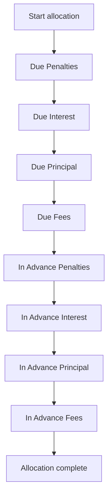
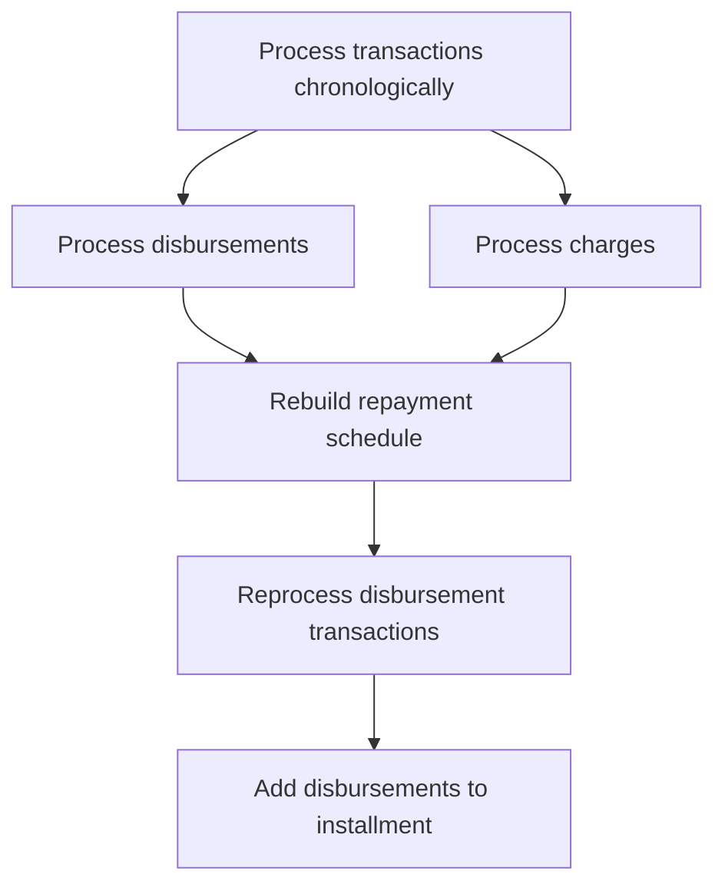

# Repayment and Allocation

## Payment Allocation Strategies

### Repayment strategy order

The repayment strategy order determines how payments are applied to amounts due on a loan. The order is: Due charges, In advanced principal, Penalty, Fee, Interest, Principal.

### New repayment strategy behavior

The new repayment strategy tracks unpaid but due charges and penalties and applies reverse-replay logic that respects transaction order. Reverse-replay recalculates installments of the repayment schedule when a payment transaction is executed or a charge is added, starting from the first Disbursement and resetting installment balances. It rebuilds installment balances based on the transaction and redistributes repayments according to the repayment strategy; if before and after balances do not match, the transaction is reverse-replayed by reversing the original transaction and creating a new transaction with the same properties but different balances.

The following rules govern reverse-replay and transaction assignment:

- If a repayment is added and later a charge occurs on the very same day, no reverse-replay occurs.
- If another repayment is added on the very same day, the charge is paid by this repayment.
- Transactions and charges can be ordered, and reverse-replay logic respects that order.
- Every executed transaction or added charge is always assigned to an installment to monitor debt and repayments and decide on distribution.
- For transactions, the transaction date is used for assignment; for charges, the due date is used.

Specific charge types use these dates for assignment:

- specific due date charge uses due date
- disbursement fee uses disbursal date
- installment fee uses installment due date
- overdue penalty is due from the moment it was added

With the New DueInAdvance payment strategy, when there are in advance portions:

- the In Advance column on the Repayment schedule tab shows an incorrect amount

Paying more than the actual due payment keeps the loan status ACTIVE.

### Repayment distribution mechanics

A repayment strategy controls how a repayment transaction amount is distributed based on the target repayment installment. The strategy orders transactions of the instalment and pays those off within the instalment's timeframe. Payment Allocation Strategy applies to region DE (Germany) and product PayIn30.

The distribution follows these rules:

- If the installment has unpaid balances, the strategy distributes the transaction amount according to its order, such as Penalty, Fee, Interest, Principal.
- Charges are assigned to repayment installments before transactions are reprocessed.
- When a new charge is added to an installment, even if its submitted or due date is later than the repayment transaction, the repayment transaction is reverse-replayed and distributes a portion of the transaction amount to pay that charge.
- Fees added to the instalment have to be paid by a payment created after the fee is due; this applies to any other income source too.
- A new repayment strategy introduces two buckets: Due charges and In advance principal, allowing payment of a charge on or after the charge due date, with the strategy aware of any unpaid but due charge.

> **Note:** The strategy pays the charge on or after the charge due date and needs to be aware if there is any unpaid but due charge or penalty.

### Payment allocation examples

The payment allocation order decides which charge types and due dates a payment settles first. The order depends on the transaction type, repayment date, and loan product strategy.

| Transaction | Date | Payment allocation order |
| --- | --- | --- |
| 31-Jan Autopayment | 31-Jan | DuePrincipal on 31-Jan |
| 31-Jan Autopayment | 31-Jan | Due Penalties on 28-Jan then DuePrincipal on 31-Jan |
| 1-Mar Autopayment | 1-Mar | DuePrincipal on 1-Mar then DueFees on 1-Mar |
| 1-Mar Autopayment | 1-Mar | Due Penalties on 15-Feb then DuePrincipal on 1-Mar then DueFees on 1-Mar |
| 1-Mar Autopayment | 1-Mar | Due Penalties due 15-Feb (Oldest First), then Due Penalties due 26-Feb (Oldest First), then DuePrincipal due 1-Mar, then DueFees due 1-Mar |
| 1-Mar Autopayment | 1-Mar | Due Penalties due 15-Feb, then DuePrincipal due 1-Mar, then DueFees due 1-Mar |
| 1-Mar Autopayment | 1-Mar | DueFees due 1-Mar |
| 1-Mar Autopayment | 1-Mar | Due Penalties due 15-Feb then DuePrincipal due 1-Mar then DueFees due 1-Mar |
| 1-Mar Autopayment | 1-Mar | DuePrincipal due 1-Mar then DueFees due 1-Mar |
| 25-Jan Rt Repayment | 25-Jan | InAdvancePrincipal on 31-Jan |
| 10-Feb Rt Repayment | 10-Feb | InAdvancePrincipal on 1-Mar then InAdvanceFees on 1-Mar |
| 8-Mar Rt Repayment | 8-Mar | Due Penalties on 15-Feb (Oldest First) then DuePrincipal due 1-Mar then DueFees due 1-Mar then Due Penalties due 7-Mar (Oldest First) |
| 16-Jan RT Repayment | 16-Jan | InAdvancePrincipal on 31-Jan |
| 1-Feb Real Time Repayment | 1-Feb | InAdavncePrincipal on 1-Mar |
| 25-Jan Real Time Repayment | 25-Jan | InAdvancePrincipal on 31-Jan |
| 30-Jan Real Time Repayment | 30-Jan | InAdvance Penalties on 28-Jan then InAdvancePrincipal on 31-Jan |
| 10-Feb Real Time Repayment | 10-Feb | InAdvancePrincipal due 1-Mar then InAdvanceFees due 1-Mar |
| 24-Feb Real Time Repayment | 24-Feb | Due Penalties due 15-Feb, then InAdvancePrincipal due 1-Mar, then InAdvanceFees due 1-Mar |
| 8-Mar Real Time Repayment | 8-Mar | Due Penalties on 15-Feb (Oldest First) then Due Penalties on 7-Mar (Oldest First) then DuePrincipal on 1-Mar then DueFees on 1-Mar |
| 8-Mar Real Time Repayment | 8-Mar | Due Penalties due 15-Feb (Oldest First), then DuePrincipal due 1-Mar |
| 15-Mar Real Time Repayment | 15-Mar | DuePrincipal due 1-Mar |
| 22-Mar Real Time Repayment | 22-Mar | DuePrincipal due 1-Mar, then DueFees due 1-Mar, then Due Penalties due 7-Mar (Oldest First) |
| 21-Feb Real Time Repayment | 21-Feb | Due Penalties due 15-Feb then InAdvancePrincipal due 1-Mar |
| 21-Feb Real Time Repayment | 21-Feb | Due Penalties due 15-Feb then InAdvancePrincipal due 1-Mar then InAdvanceFees due 1-Mar |
| 28-Feb Real Time Repayment | 28-Feb | InAdvancePrincipal due 15-Feb then InAdvanceFees due 1-Mar |
| 28-Feb Real Time Repayment | 28-Feb | InAdvanceFees due 1-Mar |

For Pin30 in DE (Germany), the payment allocation order is DuePenalties, DueInterest, DuePrincipal, DueFees, InAdvancePenalties, InAdvanceInterest, InAdvancePrincipal, InAdvanceFees, and this order remains the same for all transaction types.

### Accrual configuration

Accrual configuration controls when charge accruals post and how they behave across jobs, COB jobs and API calls. You set two global settings: charge_accrual_date and Accrual_timing. Transaction allocation must be set properly. The transaction processor should be implemented.

| Setting | Options | Default |
| --- | --- | --- |
| charge_accrual_date | submitted on, due date | due date |
| Accrual_timing | immediate, job | job |

Accrual behaviour follows these rules:

- With immediate accrual, multiple accruals can happen on the same day.
- Accrual posting for charges is based on either the charge created date or the due date, and the system posts accrual journal entries accordingly.
- Job, COB job and accrual via API behave consistently.
- When an accrual transaction is reverse-replayed and was created on the submitted-on date instead of the due date, the recreated accrual uses the same value date.
- Fees added to loans are a source of income, and backdated transactions or reverse-replay can change money distribution and pay off fees retrospectively, changing the amount of income.

A disbursement on 14 May, a Snooze fee based on the disbursement amount due 31 May, and an extra disbursement on 16 May require reverse-replay of the accrual so the fee amount reflects the higher disbursement.

### Worked examples

A loan with no penalties or fees is disbursed for a principal of 1,000.00 and a single installment due on 31 January. On 31 January an autopayment of 1,000.00 is received and allocated entirely to principal. The figures in this example are illustrative.

| Date | Event | Amount | To principal | Principal balance | Total balance |
| --- | --- | --- | --- | --- | --- |
| 1-Jan | Disbursement | 1,000.00 | 1,000.00 | 1,000.00 | 1,000.00 |
| 31-Jan | Autopayment | 1,000.00 | 1,000.00 | 0.00 | 0.00 |

A loan is disbursed for 1,000.00 on 1 January with an installment due on 31 January. A fee of 20.00 is added on 25 January and due on 1 March. A repayment of 1,020.00 on 10 February pays principal and the fee, clearing the balance. That repayment is reversed on 15 February, restoring principal and fee. An NSF penalty of 15.00 is added on 15 February and due on 15 February, bringing the total to 1,035.00. On 1 March an autopayment of 1,035.00 pays principal, the due penalty, and the due fee, clearing all balances.

| Date | Event | Amount | To principal | To penalty | To fee | Total balance |
| --- | --- | --- | --- | --- | --- | --- |
| 1-Jan | Disbursement | 1,000.00 | 1,000.00 | – | – | 1,000.00 |
| 25-Jan | Snooze fee | 20.00 | – | – | 20.00 | 1,020.00 |
| 10-Feb | Repayment | 1,020.00 | 1,000.00 | – | 20.00 | 0.00 |
| 15-Feb | Reversal | 1,020.00 | (1,000.00) | – | (20.00) | 1,020.00 |
| 15-Feb | NSF penalty | 15.00 | – | 15.00 | – | 1,035.00 |
| 1-Mar | Autopayment | 1,035.00 | 1,000.00 | 15.00 | 20.00 | 0.00 |

A loan is disbursed for 1,000.00 on 1 January. A repayment of 500.00 on 10 January pays principal only. A charge of 50.00 is added on 15 January and due on 20 January. A repayment of 100.00 on 17 January, before the charge due date, pays principal only and leaves the charge unpaid. A second charge of 10.00 is added on 19 January and due on 23 January. A repayment of 100.00 on 20 January pays the now-due first charge of 50.00 and 50.00 of in-advance principal, but not the second charge because it is not yet due. Merging the single-charge and two-charge cases: the only difference is the extra later-due charge, which remains unpaid until its own due date.

| Date | Event | Amount | To principal | To charge | Outstanding | Charge due |
| --- | --- | --- | --- | --- | --- | --- |
| 1-Jan | Disbursement | 1,000.00 | 1,000.00 | – | 1,000.00 | – |
| 10-Jan | Repayment | 500.00 | 500.00 | – | 500.00 | – |
| 15-Jan | Charge added | 50.00 | – | – | 550.00 | 20-Jan |
| 17-Jan | Repayment before due | 100.00 | 100.00 | – | 450.00 | 20-Jan |
| 19-Jan | Second charge added | 10.00 | – | – | 460.00 | 23-Jan |
| 20-Jan | Repayment on due date | 100.00 | 50.00 | 50.00 | 360.00 | 20-Jan |

A loan is disbursed for 1,000.00 on 1 January with an installment due on 31 January. A repayment of 500.00 on 10 January pays principal only. On 15 January a charge of 50.00 is added with a due date of 20 January. Because the charge is assigned to the same installment and its due date is later than the repayment, the repayment is reverse-replayed: 50.00 moves from principal to the charge, leaving principal at 450.00 and the charge paid. On 20 January the charge is due and already settled. If the charge were added on the same day as the repayment, no reverse-replay would occur and the repayment would remain allocated to principal only.

| Date | Event | Amount | To principal | To charge | Outstanding |
| --- | --- | --- | --- | --- | --- |
| 1-Jan | Disbursement | 1,000.00 | 1,000.00 | – | 1,000.00 |
| 10-Jan | Repayment | 500.00 | 500.00 | – | 500.00 |
| 15-Jan | Charge added (due 20-Jan) | 50.00 | – | – | 550.00 |
| 15-Jan | Reverse-replay repayment | – | (50.00) | 50.00 | 500.00 |
| 20-Jan | Charge due (already paid) | – | – | – | 500.00 |

## Configurable Payment Allocations

### Advanced payment allocation strategy

The advanced payment allocation strategy supports configurable repayment allocation for a loan product. Selecting it displays the Payment allocation tab and requires default payment allocation rules. The strategy is named Advanced payment allocation, uses code advanced-payment-allocation-strategy, and has order 8.

> **Note:** The implementation is NOOP yet.

### Configuration scope and inheritance

Advanced payment allocation is configured at the transaction type level and applies to Repayment, Goodwill credit, payout refund, Merchant refund, Charge Adjustments, and Downpayment. The same allocation applies to all sub-payment types of each transaction type. Each loan product can define its own advanced payment allocation configuration, and customizable allocations by payment type can be set across specific BNPL products and markets. When a loan is created, it inherits the loan product's payment allocation rules, and later changes to the loan product do not affect loans that already exist.

> **Note:** Future allocations already applied to an installment have no impact during reverse replay or future repayments.

### Payment allocation rules management

Payment allocation rules define how a repayment is distributed across installments for each transaction type. You can store these rules on a loan product, update them, and fetch them from the database.

The following rules govern how payment allocation rules are configured and applied:

- A DEFAULT transaction type configuration is always required and acts as fallback rules when no configured rules exist for a specific transaction type.
- The default allocation order cannot be deleted.
- Configured order for a transaction type can be removed except for DEFAULT.
- When no payment allocation rules are set for a payment transaction type, the system falls back to the DEFAULT rules.
- A default allocation can be overruled by configuring a payment allocation order for a specific transaction type.
- When a repayment allocation rule is set, a repayment is allocated accordingly across the installments.
- When no repayment allocation rule is set for a given transaction, the default allocation rule is used.
- If an element is not sent, it is considered deleted; if a transaction type is missing, it needs to be deleted.
- Always send all of the elements for all of the configured transaction types even if there was no change in the order.
- The UI always sends all of the allocation rules for all of the transaction types.
- For future installments, the system follows the default behaviour at first: the next installment to be processed first for in advance rules.

### Default allocation order

Default transaction payment allocation needs to be implemented. Default allocation order decides how the system processes a transaction amount and distributes it across repayment schedules and outstanding balances. It applies when Advanced payment allocation is selected as the repayment strategy and a default payment allocation order is set.

The following settings govern default payment allocation:

- paymentAllocation must be set for the default transaction type when Advanced repayment allocation is the repayment strategy.
- paymentAllocation contains valid values and includes all 12 values.
- futureInstallmentAllocationRule must be set and must have a valid value.
- When a default allocation rule is set, payment transactions are allocated in that order across the installments.

### Transaction processing order

Advanced payment allocation processes transactions, charges, and disbursements in chronological order to minimize reverse replaying. Loan transactions are ordered by transaction date, then submitted on date, then created date time. Loan charges are ordered by due date, then submitted on date, then creation date time.

### Reverse replay and reprocessing

Reverse replay and reprocessing recalculate how repayments apply to charges when a transaction is added or changed. Reprocessing happens only when a backdated transaction or backdated charge alters something that must change as a side effect.

The following conditions govern reverse replay and reprocessing:

- Only newly added payment transactions consider repaying newly added charges based on repayment strategy.
- Prior payment transactions are not affected by later added charges.
- Only transactions with dates later than a newly added transaction can be reallocated; transactions paid in advance do not change anymore.
- After disbursement, an installment paid in advance should not be reverse-replayed.
- Adding a charge later than a repayment does not require reprocessing the repayment because it has no effect on the earlier repayment.
- When a repayment is on or after the prior last processed transaction, reprocessing is unnecessary under the new strategy.
- When a charge is added with a due date after the last processed transaction, reprocessing is unnecessary.
- When a charge is added, prior repayments shall not be reverse-replayed.
- Adding a charge with a due date after a backdated repayment does not lead to reverse replay for the advanced payment strategy.
- If a loan charge due date is earlier than the last transaction date, then reprocess.

Loan charges participate in reverse replay under these conditions:

- Loan charges can be configured whether they participate in reverse replaying or not.
- By default, loan charges were not reverse-replayed.
- A loan charge can be reverse-replayed when advanced repayment allocation strategy is set.

Disbursement transactions are reprocessed and the repayment schedule is rebuilt from ground up to avoid reverse-replaying already allocated amounts.

Transactions might need to be reprocessed only because interest handling could produce different interest amounts.

### Disbursement handling

Advanced payment allocation supports Progressive loan disbursement handling only; CUMULATIVE (legacy) disbursement handling does not fit the chronological ordering idea. Selecting Advanced payment allocation for a CUMULATIVE loan throws a validation exception. When another payment allocation is chosen, cumulative disbursement remains the only option. Validation for Advanced payment allocation and disbursement handling happens at loan product creation/edit and loan account creation.

### Installment processing types

Installment processing uses either HORIZONTAL or VERTICAL strategy, controlled by the loanScheduleProcessingType field. HORIZONTAL is the default and unchanged. The field is visible only when the Advanced payment allocation repayment strategy is selected, and its options come from the backend. Horizontal processing applies allocation rules in installment scope, processing installments from oldest to latest one by one. Vertical processing applies allocation rules in repayment schedule scope, processing balances one by one based on whether they are past due, due or in advance.

Horizontal processing pays each installment in this order:

- unpaid penalty of the installment first
- then any unpaid fee
- then any unpaid interest
- then any unpaid principal of that installment

Vertical processing pays balances in this order:

- oldest unpaid penalty first
- then remaining unpaid past due penalties
- then oldest unpaid past due fee
- then remaining unpaid past due fees
- then past due interest

Future installment allocation affects in-advance payments as follows:

- When an N+1 installment is present and future installment allocation is LAST_INSTALLMENT, an in-advanced payment does not take the N+1 installment into account.
- The same error occurs with an in-advanced Merchant issued refund transaction when future installment allocation is REAMORTIZATION.

### Future installment allocation rules

The future installment allocation rule code is futureInstallmentAllocationRule. Its options are Next installment (NEXT_INSTALLMENT), Last installment (LAST_INSTALLMENT), and Reamortization (REAMORTIZATION), with Next installment as the default. Secondary allocation follows the IN_ADVANCE_XXX rules order.

Each option allocates an in-advance amount to future installments as follows:

- If NEXT_INSTALLMENT is selected, IN_ADVANCE_XXXX allocation rules are applied to the next due installment first, then to subsequent due installments if the remaining transaction amount is not fully processed.
- If LAST_INSTALLMENT is selected, IN_ADVANCE_XXXX allocation rules are applied to the last installment based on due date first, then to the last but one installment based on due date if the remaining transaction amount is not fully processed.
- If REAMORTIZATION is selected, the transaction amount is divided into equal amounts between the future installments.

Allocation rules are followed when an in-advance amount is allocated for future installments.

### Main allocation rules

Main allocation rules apply to past due, due, and in advance installments.

The main allocation rules are:

- Past due installments are always allocated from the oldest installment.
- Due installments are allocated only to the current due installment when the transaction date matches the due date.
- Future installments can be allocated from the next installment, from the last installment, or re-amortized to future installments, and re-amortization applies only to the principal portion of installments.

### Secondary allocation rules

Secondary allocation rules apply to Penalty, Fee, Principal, and Interest.

| Rule | Allocation target |
| --- | --- |
| T3.R1 | Penalties |
| T3.R2 | Fees |
| T3.R3 | Principal |
| T3.R4 | Interest |

For future installments, you can define one of three rules: Next installment, Last installment, or Reamortization.

In advance allocation under each rule:

- Under Next installment, allocation goes to the next installment first based on due date.
- Under Last installment, allocation goes to the last installment first based on due date.
- Under Reamortization, allocation is divided evenly across all future installments.

### Re-amortization

Re-amortization applies only to the principal balance and does not consider charges or penalties in its calculation.

Re-amortization follows these rules:

- If an N+1 installment exists, the system considers it as well for re-amortization.
- When the re-amortization amount overpays the principal portion of all installments, the system allocates the excess to other portions according to the secondary allocation set, such as unpaid penalty or fees amounts.

Backdated transactions added before the second disbursement are handled by reverse and replay logic with chronological order processing, which manages second disbursement and downpayment behaviour without affecting existing allocations.

### Transaction type support

Advanced payment allocation supports specific transaction types for payment allocation: Repayment, Down payment, Merchant issued refund, Payout refund, Goodwill credit, Charge refund, Charge adjustment, Interest waiver, Refund for active loan, Chargeback, Charge-off, Charge payment, and Write-off. The list of supported transaction types is fixed.

The following transaction types have specific allocation behaviour:

- Refund for active loan can have its own allocation order and acts as the opposite of repayment.
- Credit Balance Refund calculates the balance it may cover.
- Chargeback increases the due amount, is due immediately, triggers immediate delinquency calculation, creates an N+1 instalment when added after maturity, and allocates proportionally according to what the original payment paid off.
- Charge-off matches all outstanding balances and reverse replay runs only when a change modifies the outstanding balance.
- Charge payment can use a configured payment allocation order to override its default allocation, and when set, allocates across the installments accordingly.
- Pre-write-off payment reversal is not allowed.

The following transaction types are handled the same way as before under Advanced payment allocation:

- Credit Balance Refund
- Chargeback
- Charge-off

### Credit balance refund

A loan with Advanced payment allocation strategy supports Credit Balance Refund transactions, and loan transaction reprocessing can reverse-replay a Credit Balance Refund transaction. Reverse replay requires correct balances on the Credit Balance Refund transactions and correct balances on the loan schedule.

### Waive loan charges

The Waive loan charges transaction is supported with Advanced payment allocation repayment strategy, and correct balances are calculated for it. Reprocessing of waive charge transaction is supported.

> **Note:** Creating a new loan with PIN4 product where ADVANCED_PAYMENT_ALLOCATION is the repayment strategy and adding a Charge Installment Percentage Fee results in an internal server error.

If Installment Percentage Fee is not supported for Advanced payment allocation repayment strategy, it should be handled correctly instead of an internal server error.

### Charge management restrictions

You cannot remove or update a charge after the loan is approved. The system does not process any affected transactions for either operation, and no change occurs.

### Other operations with no reverse replay

Certain loan operations do not trigger reverse replay or reprocessing. Loan reschedule, adding or deleting loan disbursal details, undoing a write-off, closing a loan, and updating the future schedule leave transaction processing unchanged. For an active loan, making a refund updates transaction amounts without reverse replay, and if the refund is the last transaction, no reprocessing occurs.

### Use case examples

Use cases show how refunds and goodwill credits are allocated across installments depending on whether amounts are past due, due, or future.

Refunds apply as follows across the documented use cases:

- In UC05, UC07, UC08, UC10, UC11, UC12, UC13, UC14, and UC15, the refund applies to past due amounts first.
- In UC08, UC13, and UC14, the refund then applies to due amounts.
- In UC13, UC15, and UC16, any remaining credit applies to the last or next installment.
- In UC09, the refund applies to the next installment (installments 2 and 3).
- In UC10, the refund applies to the past due amount for installment 2 and next installment 3.
- In UC11, the refund applies to past due installment 1 and next installments 2, 3, then 4.
- In UC12, nothing is past due or due, and the refund applies to the final installments.
- In UC13, the remainder of any refund applies to the final installment.
- In UC15, the goodwill credit is allocated to past due principle and then last installment.
- In UC16, the goodwill credit is allocated to the next installment.
- In UC20, partial merchant refunds are first allocated to the next due installment.

Remaining credit balances are reamortized as follows:

- In UC05, UC07, and UC08, the remaining credit balance is reamortized across future due installments.
- In UC08, reamortization covers installments 3 and 4.

### Allocation order examples

Refunds and goodwill credits follow configurable allocation orders that determine which loan amounts receive the payment first.

Refund allocation orders apply as follows:

- A refund is applied to due, past due, and delinquent amounts oldest first, and any remainder applies to the final installment.
- A refund is applied to any past due amount and then the due amount.
- Partial merchant refunds are first allocated to the next due installment.

Goodwill credit allocation orders apply as follows:

- Goodwill credit is allocated to past due principal and then the last installment.
- Goodwill credit is allocated to the next installment.

### Provisional credit examples

Provisional credit applies to the oldest due installments first and triggers a re-amortization across all remaining installments.

Reversing a $400.00 provisional credit restores the installment schedule to four equal amounts of $125.00 each.

- Reversal of $400.00 returns the schedule to $125.00, $125.00, $125.00, $125.00.

When re-amortization leaves a remainder after fully paying an installment, that remainder goes to the last installment.

- If the outstanding balance of an installment is lower than the evenly divided credit, that installment is paid in full and the remainder goes to the very last installment.

### Payment replay examples

| Scenario | Installment 1 | Installment 2 | Installment 3 | Installment 4 |
| --- | --- | --- | --- | --- |
| 4 Jan payment replayed after reversal | $75.00 | $125.00 | $125.00 | $125.00 |
| 16 Jan payment replayed after reversal | $0.00 | $75.00 | $125.00 | $125.00 |
| 4 Jan payment replayed | $75.00 | $125.00 | $125.00 | $125.00 |
| 16 Jan payment replayed | $0.00 | $75.00 | $125.00 | $125.00 |
| Credit balance refund reversed | $25.00 | $125.00 | $125.00 | $125.00 |

### Overpayment examples

Overpayment is allocated to the next installment due.

Partial merchant refunds follow the allocation rules for this use case.

- Partial merchant refunds are first allocated to the next due installment.

### Database tables

The system stores configurable payment allocation rules in the database table m_loan_payment_allocation_rule. Product-level rules are stored in m_loan_product_payment_allocation_rule.

| Table | Columns |
| --- | --- |
| m_loan_payment_allocation_rule | loan_id, transaction_type_code (DEFAULT), allocation_order, future_installment_allocation_rule |
| m_loan_product_payment_allocation_rule | loan_product_id, transaction_type_code (DEFAULT), allocation_order, future_installment_allocation_rule |

### Allocation rule codes

Allocation rule codes identify how a payment is distributed across past due, due, and future or in advance amounts, and across penalty, fee, principal, and interest categories. The default payment allocation code is DEFAULT, and the default transaction type code is DEFAULT.

| Category | Code |
| --- | --- |
| Past due penalty | PAST_DUE_PENALTY |
| Past due fee | PAST_DUE_FEE |
| Past due principal | PAST_DUE_PRINCIPAL |
| Past due interest | PAST_DUE_INTEREST |
| Due penalty | DUE_PENALTY |
| Due fee | DUE_FEE |
| Due principal | DUE_PRINCIPAL |
| Due interest | DUE_INTEREST |
| In advance penalty | IN_ADVANCE_PENALTY |
| In advance fee | IN_ADVANCE_FEE |
| In advance principal | IN_ADVANCE_PRINCIPAL |
| In advance interest | IN_ADVANCE_INTEREST |

| Main allocation category | Code |
| --- | --- |
| Past due | PAST_DUE |
| Due | DUE |
| Future / in advance | IN_ADVANCE |

| Secondary allocation category | Code |
| --- | --- |
| Penalty | PENALTY |
| Fee | FEE |
| Principal | PRINCIPAL |
| Interest | INTEREST |

Future installment allocation rule codes are NEXT_INSTALLMENT, LAST_INSTALLMENT, and REAMORTIZATION. The future installment allocation rule code is futureInstallmentAlocationRule.

| Table | Columns |
| --- | --- |
| m_loan_product_payment_allocation_rule | loan_product_id, transaction_type_code, allocation_order, future_installment_allocation_rule |
| m_loan_payment_allocation_rule | loan_id, transaction_type_code, allocation_order, future_installment_allocation_rule |

### UI configuration

Configurable payment allocations let you customize how payments are allocated by payment type across specific BNPL products and markets. You configure advanced repayment allocation rules on the loan product screen by transaction type. The UI request includes a paymentAllocation array with transactionType, paymentAllocationOrder (paymentAllocationRule and order), and futureInstallmentAllocationRule fields.

On the Payment allocation tab you can set up allocation behaviour as follows:

- Select a transaction type from the dropdown: Repayment, Down payment, Merchant issues refund, Payout refund, Goodwill credit, Charge refund, Charge adjustment, Refund for active loans, or Interest waiver.
- Set payment allocation rules in order for the selected transaction type, similarly to the business steps of a COB job.
- Select a future installment allocation rule from the dropdown.
- The Default transaction type (code: DEFAULT) is selected by default.

The UI also provides these configuration entry points:

- You can define the default payment allocation order similarly to the business steps of a COB job.
- You can define the payment allocation order for a specific transaction type similarly to the business steps of a COB job.
- A new advanced repayment allocation strategy configuration page is available on the loan product page.

A writeoff transaction payment allocation sets the loan balance to 0, closes the loan, and writes off all outstanding amounts.

### Reprocessing mechanics

When transactions are reprocessed, the new repayment strategy processes and reprocesses transactions, disbursements and charges in chronological order and rebuilds the repayment schedule from the ground up. Disbursement transactions are reprocessed and added again to the installment. The loan inherits the configured payment allocation rules of the loan product by copying them into the m_loan_payment_allocation_rule table.

### Worked examples

A loan product uses the Advanced payment allocation repayment strategy. The product defines a DEFAULT payment allocation with four rules: past-due penalty first, then past-due fee, then past-due interest, then in-advance interest, and sets the future installment rule to next installment. The figures are illustrative. This example shows how default allocation rules are configured for a transaction type.

| Transaction type | Allocation rule | Order |
| --- | --- | --- |
| DEFAULT | DUE_PAST_PENALTY | 1 |
| DEFAULT | DUE_PAST_FEE | 2 |
| DEFAULT | DUE_PAST_INTEREST | 3 |
| DEFAULT | IN_ADVANCE_INTEREST | 14 |
| DEFAULT | Future installment rule | NEXT_INSTALLMENT |

A loan has three installments of 100.00 each due. A repayment of 150.00 arrives. With NEXT_INSTALLMENT, the first installment is fully paid and the remainder goes to the second. With LAST_INSTALLMENT, the last installment is fully paid and the remainder goes to the second. With REAMORTIZATION, the repayment is divided equally across all three installments. This example shows how the future installment rule decides which installment receives an in-advance repayment first.

| Repayment | Future rule | Installment 1 | Installment 2 | Installment 3 |
| --- | --- | --- | --- | --- |
| 150.00 | NEXT_INSTALLMENT | 100.00 | 50.00 | 0.00 |
| 150.00 | LAST_INSTALLMENT | 0.00 | 50.00 | 100.00 |
| 150.00 | REAMORTIZATION | 50.00 | 50.00 | 50.00 |

A loan of 1,000.00 has four installments of 250.00 each. A fee of 20.00 and a penalty of 10.00 are added to the first installment, and a penalty of 10.00 is added to each of the second and third installments. A repayment of 275.00 arrives. Under horizontal processing, the installment's own balances are cleared in rule order before moving on. Under vertical processing, the same balance type is cleared across installments before moving to the next type. This example shows that horizontal processing exhausts one installment before moving to the next, while vertical processing exhausts one balance type across installments before moving to the next type.

| Processing type | Allocation order | Installment 1 applied | Installment 2 applied | Installment 3 applied | Remaining on installment 1 |
| --- | --- | --- | --- | --- | --- |
| Horizontal | Penalty → Fee → Principal | 275.00 | 0.00 | 0.00 | 5.00 |
| Vertical | Penalty → Fee → Principal | 255.00 | 10.00 | 10.00 | 25.00 |

A loan of 500.00 has four installments of 125.00 each due on 1-Jan, 16-Jan, 31-Jan, and 15-Feb. No down payment is posted, so all installments remain due. A partial merchant refund of 300.00 on 8-Jan reduces the principal balance to 200.00. The refund clears the past-due first installment and reamortizes the remaining credit across the future installments, leaving installments 2, 3, and 4 at 66.67, 66.67, and 66.66 respectively. This example shows that a refund first clears past-due installments and then reamortizes the remaining credit across future installments.

| Date | Transaction | Principal balance | Installment 1 | Installment 2 | Installment 3 | Installment 4 |
| --- | --- | --- | --- | --- | --- | --- |
| 1-Jan | Disbursement | 500.00 | 125.00 | 125.00 | 125.00 | 125.00 |
| 8-Jan | Merchant refund 300.00 | 200.00 | 0.00 | 66.67 | 66.67 | 66.66 |
| 16-Jan | Payment 66.67 | 133.33 | 0.00 | 0.00 | 66.67 | 66.66 |
| 31-Jan | Payment 66.67 | 66.66 | 0.00 | 0.00 | 0.00 | 66.66 |
| 15-Feb | Payment 66.66 | 0.00 | 0.00 | 0.00 | 0.00 | 0.00 |

## In-Advance Allocation Rules

The in advance allocation rule allocates an unprocessed amount to the upcoming installment first, then to the last installment if any amount remains unallocated. The Future installment rule allocates to the upcoming installment first, then to the last installment, and then allocates backward through earlier installments.

If an early repayment amount exceeds both the first upcoming installment outstanding and the last installment outstanding, the remaining unprocessed amount is allocated as follows:

- The remaining amount is allocated to the last but one installment.

A future allocation rule named "Next installment - Last installment" is added.

Figures are illustrative. A loan with a principal of 1,000 and an annual interest rate of 12% has three monthly installments due on 1 March, 1 April and 1 May, each carrying an outstanding amount of 100. A repayment of 180 arrives on 10 January. Under the in-advance allocation rule, the unprocessed amount is posted to the upcoming installment first, and any remainder is posted to the last installment.

| Installment due | Outstanding before | Allocation | Paid order | Outstanding after |
| --- | --- | --- | --- | --- |
| 1 March | 100.00 | 100.00 | 1 | 0.00 |
| 1 April | 100.00 | 0.00 | — | 100.00 |
| 1 May | 100.00 | 80.00 | 2 | 20.00 |
| Total | 300.00 | 180.00 | — | 120.00 |

The April installment remains unpaid because the repayment is exhausted after the last installment receives its share.

A loan with a principal of 1,000 and an annual interest rate of 12% has four monthly installments due on 1 March, 1 April, 1 May and 1 June, each carrying an outstanding amount of 100. A repayment of 320 arrives on 10 January. Under the future installment rule, the unprocessed amount is posted to the upcoming installment first, then to the last installment, and then backward through the remaining installments.

| Installment due | Outstanding before | Allocation | Paid order | Outstanding after |
| --- | --- | --- | --- | --- |
| 1 March | 100.00 | 100.00 | 1 | 0.00 |
| 1 April | 100.00 | 20.00 | 4 | 80.00 |
| 1 May | 100.00 | 100.00 | 3 | 0.00 |
| 1 June | 100.00 | 100.00 | 2 | 0.00 |
| Total | 400.00 | 320.00 | — | 80.00 |

Because the repayment exceeds both the first upcoming and the last installment, the remainder flows to the last-but-one installment and then backward to April.

## Next and Last Instalment Allocation

The Next/Last installment option lets you allocate an advance amount first to the next installment and then to the last installment. Configuration is available to select this option as part of the Advanced payment allocation strategy. The FutureInstallmentAllocationRule enum contains the supported future installment allocation rules, and AdvancedPaymentScheduleTransactionProcessor supports the new allocation rule.

The Next-Last allocation rule always defines a next installment, and the last installment behaviour is unchanged.

- If the repayment date is before the current installment due date, the current period is the next installment and any advance payment allocates to it first as the Next installment strategy.
- If the repayment date is on the current installment due date, the upcoming next installment is the next installment and any advance amount allocates to that current installment first, then to the last installment.
- If the current installment is fully paid, any in-advance portions allocate to the last installment as the Last installment strategy.
- Once allocation reaches the next installment, it jumps to the last installment and allocates from behind: last, then last but one, then last but two, and so on.

Payment allocation follows this fixed order:

- overdue interest
- overdue principal
- overdue fees
- due interest
- due principal
- due fees
- advance principal
- advance interest
- advance fees

A borrower takes a 1,000.00 loan at 12% per year with three monthly installments and 30-day months. Installment 1 is due on day 30 for 410.00 (interest 10.00, principal 300.00), installment 2 on day 60 for 307.00 (interest 7.00, principal 300.00), and installment 3 on day 90 for 404.00 (interest 4.00, principal 400.00). A payment of 500.00 arrives on day 15, before the first due date. Because the payment is before the due date, the current installment is treated as the next installment under the Next rule. The figures are illustrative. The example shows that an early payment clears the next installment first and sends the excess to the last installment, reducing its principal while the middle installment stays unchanged.

| Step | Installment | Interest | Principal | Total | Balance after principal |
| --- | --- | --- | --- | --- | --- |
| 1 | Next installment (No. 1) | 10.00 | 300.00 | 410.00 | 1,000.00 |
| 2 | Payment received | - | - | 500.00 | 1,000.00 |
| 3 | Allocated to next installment | 10.00 | 300.00 | 410.00 | 700.00 |
| 4 | Remainder to last installment (No. 3) | - | 90.00 | 90.00 | 610.00 |
| 5 | Last installment (No. 3) remaining | 4.00 | 310.00 | 314.00 | 610.00 |
| 6 | Installment No. 2 unchanged | 7.00 | 300.00 | 307.00 | 610.00 |

The same 1,000.00 loan at 12% per year has three monthly installments due on days 30, 60, and 90. A payment of 500.00 arrives on day 30, the due date of installment 1. Because the payment is on the due date, the Next rule is skipped and the Last rule applies: the amount allocates to the last installment first and then backward to earlier installments. Had the payment arrived one day earlier, the Next rule would apply and installment 1 would receive the payment first. The example shows that a payment on the due date does not prepay the current installment; it is applied from the last installment backward.

| Step | Installment | Interest | Principal | Total | Balance after principal |
| --- | --- | --- | --- | --- | --- |
| 1 | Installment No. 1 (due) | 10.00 | 300.00 | 410.00 | 1,000.00 |
| 2 | Payment received on due date | - | - | 500.00 | 1,000.00 |
| 3 | Last installment (No. 3) | 4.00 | 400.00 | 404.00 | 600.00 |
| 4 | Remainder to last but one (No. 2) | - | 96.00 | 96.00 | 504.00 |
| 5 | Installment No. 2 remaining | 7.00 | 204.00 | 211.00 | 504.00 |
| 6 | Installment No. 1 unchanged | 10.00 | 300.00 | 410.00 | 504.00 |

The same 1,000.00 loan at 12% per year has three monthly installments. A payment of 200.00 arrives on day 15, before installment 1 is due. The current installment is the next installment, but the payment is smaller than the installment amount, so it is fully consumed by the next installment and nothing flows to the last installment. If the payment were larger than the next installment, the excess would move to the last installment. The example shows that when the advance payment does not exceed the next installment, the last installment receives nothing.

| Step | Installment | Interest | Principal | Total | Balance after principal |
| --- | --- | --- | --- | --- | --- |
| 1 | Next installment (No. 1) | 10.00 | 300.00 | 410.00 | 1,000.00 |
| 2 | Payment received before due date | - | - | 200.00 | 1,000.00 |
| 3 | Allocated to next installment | 10.00 | 190.00 | 200.00 | 810.00 |
| 4 | Remainder to last installment | - | - | - | 810.00 |
| 5 | Installment No. 1 remaining | - | 110.00 | 110.00 | 810.00 |
| 6 | Installments No. 2 and No. 3 unchanged | 11.00 | 700.00 | 711.00 | 810.00 |

## Credit Adjustments

Credit adjustments govern how payments are allocated across loan balances and how interest is calculated during repayment and pre-closure. Allocation rules determine whether monies apply to interest or principal, how many future payments are satisfied before re-amortization, and whether they target the next or last installment due.

Payment allocation rules define the following behaviour:

- Monies apply to the interest balance of a single amount due first, ordered from the oldest due amount to the most current due amount.
- For future balances, payment allocation applies monies to principal balances only.
- Where applicable, future interest accrued but not yet due can be satisfied, such as in early payoff.
- Rules define how many future payments are satisfied prior to triggering a re-amortization of the repayment schedule.
- Rules define if monies apply to the next installment due or the last installment due.

Interest calculation rules apply to decreasing balance loans with equal installments and daily interest calculation. For each normal repayment installment, interest is calculated based on the outstanding balance. Advance payment allocation disbursement supports decreasing balance interest calculation.

Interest allocation and pre-closure rules include:

- Interest is not allocated for the down-payment installment when down-payment installment is enabled.
- The pre-closure interest calculation rule defines till when interest should calculate on the event of pre-closure.

Pre-closure interest calculation supports two methods:

| Method | Behaviour |
| --- | --- |
| Calculate till pre closure date | Calculates interest till as on the closing date; for example, if the loan closing date is 20th February, interest is calculated till 20th February. |
| Calculate till rest frequency date | Calculates interest till the rest period; for example, if the loan closing date is 20th February, interest is calculated till the repayment period due date. |

A declining-balance loan with equal monthly installments calculates interest each period on the outstanding principal. The figures are illustrative: a principal of 1,500, an annual interest rate of 12%, three monthly installments, and 30-day months, with disbursement on 1 January and the first installment due on 1 February. If an additional disbursement is posted after the first installment, the outstanding principal rises and the interest on the remaining installments is recalculated upward. This example shows how interest declines as the principal is repaid.

| Due date | Opening balance | Interest | Installment | Principal | Closing balance |
| --- | --- | --- | --- | --- | --- |
| 1 February | 1,500.00 | 15.00 | 510.03 | 495.03 | 1,004.97 |
| 1 March | 1,004.97 | 10.05 | 510.03 | 499.98 | 504.99 |
| 1 April | 504.99 | 5.05 | 510.04 | 504.99 | 0.00 |
| Total |  | 30.10 | 1,530.10 | 1,500.00 |  |

A loan with a monthly interest rate and equal installments recalculates the schedule when a partial repayment is posted between installments. The figures are illustrative: a principal of 1,200, a monthly interest rate of 1%, three installments due on 1 March, 1 April, and 1 May. If a partial repayment of 250 is posted after the first installment, the outstanding principal drops and the interest on the remaining installments is recalculated downward. This example shows how a mid-term repayment reduces the balance and the interest charged on later installments.

| Due date | Opening balance | Interest | Installment | Principal | Closing balance |
| --- | --- | --- | --- | --- | --- |
| 1 March | 1,200.00 | 12.00 | 408.03 | 396.03 | 803.97 |
| 1 April | 803.97 | 8.04 | 408.03 | 399.99 | 403.98 |
| 1 May | 403.98 | 4.04 | 408.02 | 403.98 | 0.00 |
| Total |  | 24.08 | 1,224.08 | 1,200.00 |  |

## Loan Payoff

A pay-off is a repayment done as of the transaction date with interest calculated as of that date. You can perform a pay-off transaction at API level for an active loan account, and once the loan is paid off its status is marked as closed. The pay-off amount required to close the loan on that day includes all principal, interest, fee, and penalty balances along with any accrued interest not yet billed. Accounting entries for a pay-off transaction are the same as for a repayment transaction.

The following rules govern when a pay-off can occur and how interest is treated:

- Pay-off can be done as of any date from the last repayment date till the current date.
- Pay-off can be done as of any date from the last repayment date till the current date when interest recalculation is enabled.
- The system calculates and collects interest as of the pay-off date entered.
- When interest recalculation is disabled, payable interest is the same whether the loan is paid off in the middle of the loan lifecycle or on the maturity date.
- When interest recalculation is enabled, payable interest is only the recognized interest till the pay-off date and it matters whether the loan is paid off in the middle of the lifecycle or on the maturity date.
- When interest recalculation is disabled, the full principal, calculated interest, fee, and other amounts must be paid to fully pay off the loan.
- When interest recalculation is enabled, the full principal and the calculated interest till the pay-off date must be paid to fully pay off the loan.

The pay-off calculation covers outstanding balances as follows:

- Pay-off calculation should contain all outstanding balances calculated till the pay-off date or the end of the pay-off period due date based on configuration.
- Pay-off calculation logic must add all past due installments outstanding balances, not only the payable details of the current period.
- If the transaction date is before or equal to the first disbursement date, all principal must be paid but no interest for an interest bearing loan product.
- If the transaction date is on or after the maturity date, all outstanding balances must be paid.

Additional pay-off behaviour includes:

- For progressive loans in case of pay-off, the pay-off amount is allocated across each installment rather than modifying the current period to reflect the full amount paid.
- In case of interest recalculation for progressive loans, payable interest is calculated till the pay-off date, the current installment is modified, and any interest from upcoming installments is lifted if the transaction amount is enough to fully pay the outstanding principal on that installment.
- Disbursement chargeback is not allowed yet on the pay-off loan account.
- Backdated transactions or reversal of older transactions will trigger reverse replay of the loan account and the loan status will be updated accordingly.
- When backdated pay-off happens, the accrual transactions that happened after that date shall be reverted.

The advanced payment allocation processor decides whether repayment starts from the next installment or the last installment.

A customer takes a 900.00 loan at 12 percent annual interest with a 360-day year and 30-day months, repayable in three monthly installments of 300.00 principal each. The first installment falls on day 30. On day 45, fifteen days after the first installment, the customer requests a pay-off while interest recalculation is enabled. The system accrues interest on the outstanding principal from the last repayment date to the pay-off date, adds it to the principal balance, and closes the loan once the pay-off is collected. The figures in this example are illustrative.

| Date | Event | Principal | Interest | Balance |
| --- | --- | --- | --- | --- |
| Day 0 | Disbursement | 900.00 | — | 900.00 |
| Day 30 | Installment 1 paid | 300.00 | 9.00 | 600.00 |
| Day 45 | Pay-off | 600.00 | 3.00 | 0.00 |

The pay-off total of 603.00 equals outstanding principal plus accrued interest, and the loan status moves to closed.

The same 900.00 loan at 12 percent annual interest with three monthly installments of 300.00 principal each is paid off on day 45 while interest recalculation is disabled. The system does not remeasure interest for the shortened period; instead it collects the interest that remained on the original schedule for the unpaid installments. The loan is closed once the pay-off is collected.

| Date | Event | Principal | Interest | Balance |
| --- | --- | --- | --- | --- |
| Day 0 | Disbursement | 900.00 | — | 900.00 |
| Day 30 | Installment 1 paid | 300.00 | 9.00 | 600.00 |
| Day 45 | Pay-off, recalculation disabled | 600.00 | 9.00 | 0.00 |

If interest recalculation were enabled, the payable interest would be only 3.00 accrued till day 45, making the pay-off total 603.00 instead of 609.00.

A 900.00 loan at 12 percent annual interest with three monthly installments of 300.00 principal each falls into arrears when the second installment due on day 60 is not paid. On day 75, fifteen days after the missed installment, the customer requests a pay-off. The pay-off calculation adds all past due installment balances, including the unpaid principal and interest of installment 2, together with interest accrued on the outstanding balance from day 60 to day 75.

| Date | Event | Principal | Interest | Balance |
| --- | --- | --- | --- | --- |
| Day 0 | Disbursement | 900.00 | — | 900.00 |
| Day 30 | Installment 1 paid | 300.00 | 9.00 | 600.00 |
| Day 60 | Installment 2 due, unpaid | 300.00 | 6.00 | 600.00 |
| Day 75 | Pay-off | 600.00 | 9.00 | 0.00 |

The pay-off total of 609.00 covers the overdue installment 2 principal and interest plus accrued interest, rather than only the current period's payable amount.

A progressive 1,000.00 loan at 12 percent annual interest with monthly installments of 200.00, 300.00, and 400.00 principal is paid off on day 45, after the first installment of 200.00 has been collected on day 30. The outstanding principal of 800.00 is allocated across the remaining installments instead of being applied only to the current period.

| Date | Event | Principal | Interest | Balance |
| --- | --- | --- | --- | --- |
| Day 0 | Disbursement | 1,000.00 | — | 1,000.00 |
| Day 30 | Installment 1 paid | 200.00 | 10.00 | 800.00 |
| Day 45 | Pay-off | 800.00 | 4.00 | 0.00 |

The 800.00 pay-off principal is distributed across the remaining installments, and the loan is closed once the full amount is collected.
