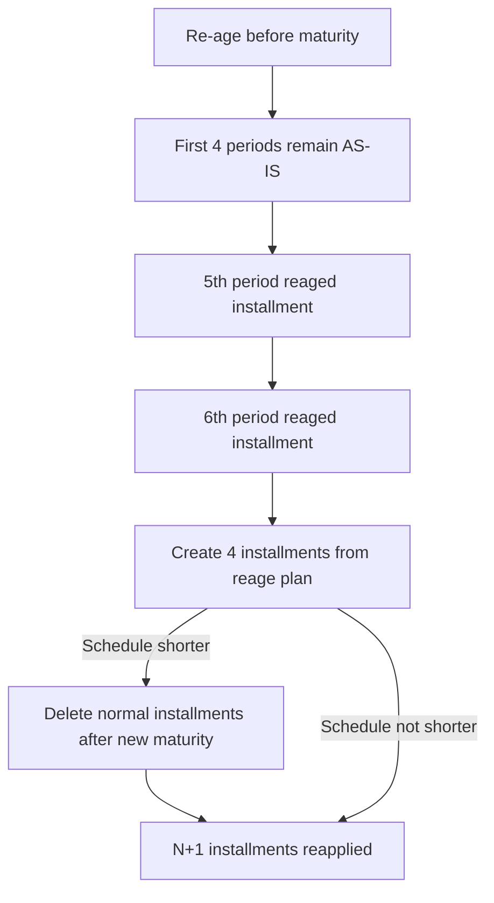
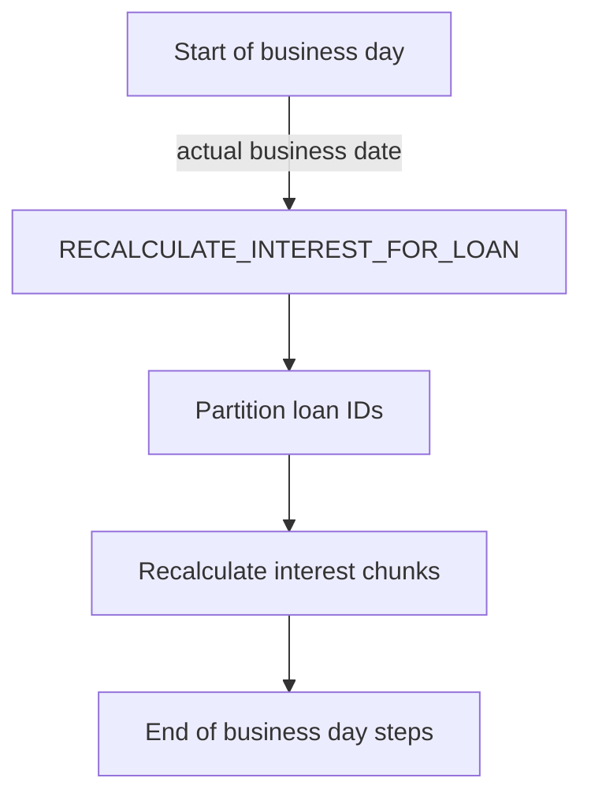

# Restructuring

## Re-aging

### Re-aging overview

Re-aging, also known as Settlement Plan, assists customers in duress around repaying their loans by creating a new set of Installments for the same loan account from the principal outstanding pending on the loan account.

### Eligibility and timing

Re-aging applies to interest-bearing, progressive loan accounts with interest handling set to default behavior. You can configure re-aging from any date of the loan cycle after the first disbursement date, including before the maturity date. The re-aging date must not be before the last repayment date.

### Charge-off loans

Re-aging can be applied to a charge-off loan account. Charge-back amount has no impact on re-aging.

The following rules apply to charges, fees, iteration, and fixed amounts during re-aging:

- Charges or fees with a due date after the re-age date are waived off.
- Charges or fees with a due date before the re-age date are split equally among new installments.
- Iteration is disabled with should iterate set to FALSE and iterate value 0.00.
- EMI is fixed at 17.01.
- Interest rate is 7% per annum with daily rate 0.000194444.

The following behaviours apply to backdated repayments, reversals, and reverse replay:

- Backdated repayment or reversal is allowed and re-aging will be reversed and replayed accordingly.
- The N+1 instalment amount will be adjusted as part of reverse replay.

Interest handling configuration is available on the Re-age screen and is not required on the loan product. Charge-off accelerate maturity date logic works the same as contract termination.

### Reversing re-aging

You can reverse a re-aging transaction until it is the latest transaction on the loan. Reversing it replays and re-applies the scheduled transactions accordingly.

The following rules apply when reversing re-aging:

- A reversed re-age transaction is not found during validations when initiating a new re-age.
- Backdated repayment or reversal is allowed and re-aging is reversed and replayed accordingly.
- When re-aged installments are added and an N+1 installment already exists, the N+1 installment is updated to become one of the re-aged installments.

Interest handling options can be configured for interest-bearing loans during re-age from both the UI and API:

- Default Behavior
- Waive Interest
- Equal Amortization
- Outstanding payable Interest
- Outstanding FULL Interest

| Charge or fee due date | Effect |
| --- | --- |
| After the re-age date | Waived off |
| Before the re-age date | Split equally among new installments |

### Default behavior interest handling

Under Default Behavior interest handling, overdue interest and charge-back interest move to the first new re-age installment, while charge-back principal is re-aged. Overdue fees and charge-back fees remain as is on the existing installment. Fees and penalties with a due date after re-age remain as is and are adjusted to the relevant installment.

For interest-bearing loans under Default Behavior interest handling, overdue interest moves to the first new re-age installment, charge-back principal is re-aged, charge-back interest moves to the first new re-age installment, overdue fees remain as is on the existing installment, charge-back fees remain as is on the existing installment, and fees and penalties with a due date after re-age remain as is and are adjusted to the relevant installment.

### Waive interest handling

Waive interest handling applies when interest handling is configured as Waive Interest. It waives overdue interest and outstanding payable interest, while charge-back principal is re-aged and charge-back interest is waived.

Charge-back fees and other fees or penalties behave as follows:

- Charge-back fees remain as is on the existing installment.
- Fees or penalties added before re-age remain as is and are adjusted to the relevant installment.
- Fees or penalties with a due date after re-age remain as is and are adjusted to the relevant installment.

Overdue charges and charge-back principal behave as follows:

- Overdue charge remains as is on the existing installments.
- Charge-back principal is re-aged.

### Equal amortization interest handling

Equal amortization interest handling splits outstanding interest among new installments without recalculating interest after re-aging.

The following rules apply under Equal Amortization of Outstanding amount interest handling:

- Outstanding interest is equally split among new installments based on either the outstanding payable interest or outstanding full interest option selected by the user.
- Outstanding charges and penalties are equally split among new installments.
- Charge-back interest and principal amounts are equally split among new installments.
- Charge-back amount portions are equally split among new installments.
- Declining balance interest calculation is turned off.

Charges and penalties with a due date after the re-age date are handled as follows:

- Charges and penalties with a due date after the re-age date are equally split among new installments.
- Penalties or fees with a due date after the re-age date remain as is on the respective installment.

### Interest recalculation and rate

Re-aging applies only to loans using the Progressive loan strategy. Interest recalculation is turned off during re-aging, and declining balance interest calculation is also turned off. For interest-bearing loans, the interest rate and interest recalculation setting remain the same during re-aging.

When interest recalculation is true, the model is updated and used; when it is false, only repayment installments are used.

- When interest recalculation is true, the model is updated and used.
- When interest recalculation is false, only repayment installments are used.

Re-aging affects installments and existing amounts as follows:

- N+1 installments are reapplied to the new installments during re-aging for interest-bearing loans.
- Existing charge-back interest and principal amount also go through equal split during re-aging.

### Installment and schedule changes

Re-aging overrides existing installments and rebuilds the repayment schedule around reaged installments.

When re-aging occurs before the maturity date, existing installments are overridden as follows:

- The first 4 installment periods remain as-is.
- The 5th period is converted into a reaged installment with the reage flag applied and its due date recalculated.
- The 6th period is converted into a reaged installment with the reage flag applied and its due date recalculated.
- 4 more installments are created based on the reage payment plan.

The system applies these additional rules to the rebuilt schedule:

- N+1 installment amount is adjusted as part of reverse replay.
- N+1 installments remain unless they overlap with reaged installments.
- N+1 installments are reapplied accordingly to the new installments.
- All outstanding balances are evenly amortized into a fixed repayment plan with equal installments.
- If re-aging makes the repayment schedule shorter, all normal installments after the new maturity date (the last due date of reaged installments) are deleted.

### Charges and fees handling

Re-aging updates the charge-to-repayment-installment mapping and redistributes charges and fees across the new installments. Down-payment amounts are not affected by re-aging.

Charges and fees are handled during re-aging as follows:

- Charges or fees with a due-date after the re-age date remain unchanged on that installment.
- Charges or fees with a due-date before the re-age date are split equally among the new installments.
- The same handling applies to interest-bearing and non-interest bearing products, with no special treatment for either.

### Principal and charge-back handling

Re-aging applies only to the unpaid portion of installments before the re-age date; any partial amount already paid remains unchanged. Excess payments allocated to installments after the re-age date go to a special installment created as of the re-age start date, and this behaviour applies to both non-interest bearing and interest bearing loan accounts. Users with Re-age permission can generate and preview a re-age schedule based on selected parameters at both UI and API level.

Charge-back handling follows these rules:

- Charge-back interest and principal amounts from the previous period are split accordingly.
- Charge-back amount does not affect the re-age process.

### Transaction template and validation

The re-age transaction template returns metadata about the loan schedule relative to the current business date, including counts of future and past installments, the next current installment due date, and the calculated start date. A re-age transaction with an amount of 0 is not allowed when there are no outstanding balances to re-age.

The template call returns the following values:

- The current business date.
- The number of future installments where the installment due date is later than the current business date.
- The number of past installments where the installment due date is on or before the current business date.
- The next current installment due date, which is the earliest period with a due date later than the current business date.
- The calculated start date, which is the current date plus one unit of the original frequency type.

Validation rules for a zero-amount re-age transaction are:

- A re-age transaction with an amount of 0 is not allowed when there are no outstanding balances to re-age.
- If a zero-amount re-age situation occurs during reverse-replay, the re-age transaction is reverted.
- When a zero-amount re-age is triggered in real time, a HTTP 403 domain rule violation exception is raised explaining that there are no outstanding balances to re-age.

### Edge cases and examples

Re-aging handles three edge cases on interest bearing loan accounts with Default Behavior and interest recalculation enabled: a charge-off during re-aging, a chargeback before re-age, and a backdated re-age. The system applies logic for each case.

### Frequency and iteration settings

Re-aging can change due dates and repayment frequency types when interest recalculation is enabled. Principal only is re-amortized, while unpaid interest is waived off.

### Worked examples

A customer holds an interest-bearing progressive loan with a principal of 1,000, an annual interest rate of 12%, monthly installments, and 30-day months. After one installment is paid, the outstanding principal is 900 and accrued interest is 30, so the total outstanding balance is 930. The loan is re-aged from the next due date into three new equal installments. The figures in this example are illustrative.

| Stage | Opening balance | Installment | Interest | Principal | Closing balance |
| --- | --- | --- | --- | --- | --- |
| Re-age start | 930.00 | – | – | – | 930.00 |
| Installment 1 | 930.00 | 310.00 | 10.00 | 300.00 | 620.00 |
| Installment 2 | 620.00 | 310.00 | 10.00 | 300.00 | 310.00 |
| Installment 3 | 310.00 | 310.00 | 10.00 | 300.00 | 0.00 |
| Total | – | 930.00 | 30.00 | 900.00 | – |

The example shows that under default interest handling the full outstanding principal and interest are re-amortized into equal installments; with Waive Interest, the 30.00 interest would be waived and only the 900.00 principal would be re-aged, giving three installments of 300.00 each.

A customer holds the same loan, but the installment due before re-aging is only partially paid. The installment calls for principal of 200 and interest of 20. The customer pays 120, of which 100 is principal and 20 is interest. The paid amount remains on the original installment; only the unpaid principal of 100 is re-aged together with the remaining principal of 500, giving a re-aged principal of 600 and no outstanding interest. The loan is re-aged into three equal installments.

| Stage | Opening principal | Installment | Interest | Principal | Closing principal |
| --- | --- | --- | --- | --- | --- |
| Before re-age | 600.00 | – | – | – | 600.00 |
| Installment 1 | 600.00 | 200.00 | 0.00 | 200.00 | 400.00 |
| Installment 2 | 400.00 | 200.00 | 0.00 | 200.00 | 200.00 |
| Installment 3 | 200.00 | 200.00 | 0.00 | 200.00 | 0.00 |
| Total | – | 600.00 | 0.00 | 600.00 | – |

This shows that partial payments before re-aging stay as paid and only the unpaid principal enters the new schedule.

A re-aging transaction creates a new installment schedule and remains reversible until it is the latest transaction on the loan. After the loan above is re-aged into three installments of 310, the re-aging transaction is reversed. The system replays the original schedule, restores the pre-re-age outstanding balance of 930 (principal 900, interest 30), and removes the re-aged installments.

| Event | Schedule state | Outstanding principal | Outstanding interest | Total outstanding |
| --- | --- | --- | --- | --- |
| Before re-aging | Original schedule | 900.00 | 30.00 | 930.00 |
| Re-aging applied | New schedule: 3 x 310.00 | 900.00 | 30.00 | 930.00 |
| Re-aging reversed | Original schedule replayed | 900.00 | 30.00 | 930.00 |

This shows that reversing the latest re-aging transaction restores the original schedule and balances without loss of data.

A loan re-aged into three installments carries two fees: a 60 fee due before the re-age date and a 40 fee due after the re-age date. The fee due before re-aging is split equally across the three new installments, adding 20 to each. The fee due after re-aging is waived off and does not appear in the new schedule. The principal of 900 is re-aged as 300 per installment.

| Item | Amount | Treatment | Per installment | Total in new schedule |
| --- | --- | --- | --- | --- |
| Principal | 900.00 | Re-aged equally | 300.00 | 900.00 |
| Fee due before re-age | 60.00 | Split equally | 20.00 | 60.00 |
| Fee due after re-age | 40.00 | Waived off | 0.00 | 0.00 |
| New installment total | – | – | 320.00 | 960.00 |

This shows that pre-re-age fees are shared across new installments while post-re-age fees are removed.

## Re-amortization

### Eligibility and applicability

Re-amortization applies to interest bearing loan accounts that use the Progressive repayment strategy. You cannot apply it after the maturity date or to charge-off and written-off loan accounts.

Schedule handling after re-amortization depends on the selected behaviour:

- Default behaviour applies to interest bearing loan accounts with interest recalculation enabled.
- Interest Waiver behaviour applies to both non-interest bearing and interest bearing loan accounts.
- Equal Overdue Interest split behaviour applies to both non-interest bearing and interest bearing loan accounts.

### Re-amortization behaviors

Re-amortization recalculates interest and equated monthly installments based on the new principal balance, while the treatment of overdue amounts, charges, and fees depends on the selected behavior option.

The default behavior applies the following rules:

- Overdue interest including chargeback interest moves to the first installment after the re-amortization date.
- Overdue charge including chargeback charge remains as is on the existing installment.
- Fees or penalties with a due date after re-amortization remain as is.

The waive option applies the following rules:

- Overdue interest including chargeback interest is waived off.
- Overdue charge including chargeback charge remains as is on existing installments.
- Fees or penalties with a due date after re-amortization remain as is.

The equal overdue interest split option applies the following rules:

- Outstanding payable interest including chargeback interest is equally split among future installments.
- Outstanding charges or penalties are equally split among new installments.
- Charge or penalty with a due date after re-amortization remains as is on the existing installment.

### Default behavior details

Default re-amortization recalculates interest and EMI from the new principal balance and moves overdue interest, including chargeback interest, to the first installment after the re-amortization date.

Other amounts keep their existing placement:

- Overdue charge, including chargeback charge, remains on its existing installment.
- Fees and penalties with a due date after re-amortization remain as is.
- Partial or excess paid amounts on installments before re-amortization stay on their allocated installments; only the unpaid amount is re-amortized, whether allocation targets the last installment or the next installment.

### Waive interest behavior details

When re-amortization is applied with waive interest behaviour, the system recalculates actual interest and EMI based on the new principal balance.

Waive interest behaviour affects overdue amounts, charges, fees, down payments, and partial payments as follows:

- Overdue interest including chargeback interest is waived off.
- Overdue charge including chargeback charge remains as is on existing installments.
- Fees or penalties with a due date after re-amortization remain as is.
- Down-payment amounts have no impact from re-amortization.
- Partial or excess paid amount on installments before re-amortization remains as is on allocated installments; only the unpaid amount is re-amortized, whether allocation is to the last installment or the next installment.

### Equal overdue interest split behavior details

Equal Overdue Interest Split applies to future installments when re-amortization is applied. It splits outstanding payable interest, including chargeback interest, equally among those installments.

The following amounts are treated as follows under Equal Overdue Interest Split:

- Outstanding charges or penalties are equally split among new installments.
- A charge or penalty with a due date after the re-amortization date remains unchanged on its existing installment.
- The N+1 installment remains unchanged.
- Down-payment amounts are not affected by re-amortization.
- Partial or excess paid amounts on installments before re-amortization remain allocated to those installments; only the unpaid amount is re-amortized, whether allocation is to the last installment or the next installment.

### Schedule structure and recalculation

Re-amortization keeps the existing repayment schedule structure intact: no installments are added or removed, no due dates change, and no repayment periods are recreated. It recalculates current and all future installment EMIs based on current outstanding principal, while past due installments keep their total paid balances plus charges and are not re-amortized.

The following amounts are not changed by re-amortization:

- N+1 installment remains as is.
- Down-payment amounts have no impact.
- Partial paid amounts on installments before re-amortization remain as is; only the unpaid amount is re-amortized.
- Partial paid amount will remain as it is on the installment, unpaid overdue amount will be re-amortized accordingly.
- Fees and penalties remain where they were.
- Payable interest does not change.
- Chargeback amount remains as it is.

Principal and unpaid interest and fees are handled as follows:

- Principal only is re-amortized.
- Unpaid interest and fees are split equally across all further installments.
- Split interest and fees act like standalone amounts and do not take part in recalculation or interest calculation.

Paid amounts are not moved or recreated:

- Paid amounts are not moved anywhere.
- No special installments or any treatment are applied.

### Reversal and repetition

You can reverse a re-amortization transaction until it is the latest transaction on the loan, and reversal is allowed at any point in the loan life cycle even when monetary transactions occur after the re-amortization. You can perform multiple re-amortizations on a loan account, but not more than one on the same date, and every re-amortization must use the same interest options as the first one.

### Accrual handling

Accruals are recalculated and adjusted as of the re-amortization business date at end of day. Accrual activity for overdue installments being re-amortized is reversed or reverse-replayed on that date in real time.

Periodic accrual follows the new installment interest:

- Periodic accrual is calculated and posted periodically based on the new installment interest.
- Accrual activity posts regularly as per the new future installment dates on installment dates at end of day.

Backdated repayments and reversals trigger real-time accrual handling:

- Any backdated repayment or reversal before the re-amortization date recalculates and posts the difference accrual or accrual adjustment as of current business date end of day.
- Any backdated repayment results in installment re-calculation before re-amortization creating a new accrual activity as of the installment date in real time.
- Any backdated repayment reversal results in installment re-calculation and re-amortization reversing the respective accrual activity transaction in real time.

### Backdated transactions

Backdated repayment or reversal of backdated repayments are allowed; re-amortization is reversed and replayed accordingly.

### Interest and fee options

Re-amortization applies to principal and interest, and fees can also be re-amortized.

The following interest and fee options are available:

- Zero interest carry forward is an option.
- Interest recalculation based on new dates and charges stays as it is.
- Interest equal splits and charges stays as it is.
- Interest and charges equal splits is an option.

### Iteration and maturity constraints

Iteration is disabled, so re-amortization does not iterate. You cannot re-amortize after the new maturity date.

### Transaction support and preview

The system allows any type of transaction and feature to work normally on the re-amortization schedule, including credit transactions such as disbursements and capitalised income. Interest calculation follows the re-amortization interest handling setting. A preview schedule feature is available at both UI and API level.

The system applies the following validation and workflow rules:

- Validation prevents re-amortization on a Charge-off loan account.
- The system recalculates and reapplies the repayment schedule.
- Reversal of a re-amortization transaction recalculates and reapplies the repayment schedule.

If payable interest on the current date was $1.23, it remains $1.23 after re-amortization.

### Worked examples

An interest-bearing loan uses a principal of 1,000.00, an annual interest rate of 12 percent (1 percent per 30-day month), and four monthly installments due on 2/1/24, 3/1/24, 4/1/24, and 5/1/24. The first installment of 260.00, made up of 10.00 interest and 250.00 principal, is paid on 2/1/24 and leaves a balance of 750.00. The second installment due on 3/1/24 is not paid, so its interest of 7.50 and principal of 252.50 are overdue. Re-amortization runs on 3/15/24 under default behavior. The figures are illustrative.

| Date | Balance before | Interest | Principal | Installment | Balance after | Status |
| --- | --- | --- | --- | --- | --- | --- |
| 2/1/24 | 1,000.00 | 10.00 | 250.00 | 260.00 | 750.00 | Paid |
| 3/1/24 | 750.00 | 7.50 | 252.50 | 260.00 | 750.00 | Overdue |
| 3/15/24 | 750.00 | 3.75 accrued | — | — | 750.00 | Re-amortization date |
| 4/1/24 | 750.00 | 7.50 | 373.13 | 388.13 | 376.87 | Recalculated |
| 5/1/24 | 376.87 | 3.77 | 376.87 | 380.64 | 0.00 | Recalculated |

Default behavior recalculates the EMI on the outstanding principal and moves the overdue interest to the first installment after the re-amortization date.

The same loan and payment history apply: principal 1,000.00, 12 percent annual interest, first installment paid on 2/1/24 leaving 750.00, and the second installment of 260.00 (interest 7.50, principal 252.50) overdue on 3/1/24. Re-amortization runs on 3/15/24 with the waive-interest option, so the overdue interest of 7.50 is waived off and is not added to any future installment.

| Date | Balance before | Interest | Principal | Installment | Balance after | Status |
| --- | --- | --- | --- | --- | --- | --- |
| 2/1/24 | 1,000.00 | 10.00 | 250.00 | 260.00 | 750.00 | Paid |
| 3/1/24 | 750.00 | 7.50 | 252.50 | 260.00 | 750.00 | Overdue |
| 3/15/24 | 750.00 | 0.00 waived | — | — | 750.00 | Re-amortization date |
| 4/1/24 | 750.00 | 7.50 | 373.13 | 380.63 | 376.87 | Recalculated |
| 5/1/24 | 376.87 | 3.77 | 376.87 | 380.64 | 0.00 | Recalculated |

Compared with default behavior, waiving interest removes the 7.50 overdue interest, so the first recalculated installment is 380.63 instead of 388.13.

The same loan and payment history apply: principal 1,000.00, 12 percent annual interest, first installment paid on 2/1/24 leaving 750.00, and the second installment overdue on 3/1/24 with interest 7.50 and principal 252.50. Re-amortization runs on 3/15/24 with equal overdue interest split, so the 7.50 overdue interest is divided equally across the two remaining installments as 3.75 each and added as a standalone amount.

| Date | Balance before | Interest | Principal | Installment | Balance after | Status |
| --- | --- | --- | --- | --- | --- | --- |
| 2/1/24 | 1,000.00 | 10.00 | 250.00 | 260.00 | 750.00 | Paid |
| 3/1/24 | 750.00 | 7.50 | 252.50 | 260.00 | 750.00 | Overdue |
| 3/15/24 | 750.00 | 3.75 split | — | — | 750.00 | Re-amortization date |
| 4/1/24 | 750.00 | 7.50 | 373.13 | 384.38 | 376.87 | Recalculated |
| 5/1/24 | 376.87 | 3.77 | 376.87 | 384.39 | 0.00 | Recalculated |

Compared with default behavior, equal split spreads the 7.50 overdue interest as 3.75 on each of the two remaining installments instead of moving it entirely to the first installment.

A loan with principal 1,000.00 and 12 percent annual interest has its first installment paid on 2/1/24, leaving 750.00. The installment due on 3/1/24 is not paid and the account is charged off on 3/1/24, which sets all future installment interest to zero. Re-amortization runs on 3/15/24 and is permitted on the charged-off account; the remaining principal is re-amortized over the two remaining installments with zero interest.

| Date | Balance before | Interest | Principal | Installment | Balance after | Status |
| --- | --- | --- | --- | --- | --- | --- |
| 2/1/24 | 1,000.00 | 10.00 | 250.00 | 260.00 | 750.00 | Paid |
| 3/1/24 | 750.00 | 7.50 | 252.50 | 260.00 | 750.00 | Charged off |
| 3/15/24 | 750.00 | 0.00 | — | — | 750.00 | Re-amortization date |
| 4/1/24 | 750.00 | 0.00 | 375.00 | 375.00 | 375.00 | Principal only |
| 5/1/24 | 375.00 | 0.00 | 375.00 | 375.00 | 0.00 | Principal only |

Compared with a normal account, charge-off sets future interest to zero, so re-amortization yields principal-only installments of 375.00.

## Schedule Recalculation for Overdue Loans

### Interest recalculation scope and behavior

When interest recalculation is enabled for a loan account, the system recalculates and regenerates the repayment schedule if an instalment is not paid on its instalment date for overdue loans. Interest is recalculated for all instalments according to their overdue days. If the loan is not interest-bearing, there is nothing to do during interest recalculation.

The recalculation behaves as follows:

- The new business step recalculates interest of a loan similarly as the existing RECALCULATE_INTEREST_FOR_LOAN job does.
- Progressive interest-bearing loans handle overdue installments similar to cumulative loans when interest recalculation is enabled.
- Late repayment on the loan triggers recalculation of the loan repayment schedule.

### Overdue installment handling

Overdue installments hold and display additional interest on overdue principal on the repayment schedule so that repayment amounts remain correct for late repayments. Interest recalculation applies to interest-bearing progressive loans when an installment becomes overdue.

The model calculates overdue interest and creates a new installment only when a repayment happens.

- When a late repayment comes after the maturity date, a new installment is created as of the repayment date.
- Interest for that installment is calculated for the extra days from the last maturity date on the current reducing principal balance.
- A repayment after maturity collects only the interest in the repayment schedule for the installment it fulfills.

### COB job configuration and execution

The Loan COB job includes a configurable business step that recalculates interest for overdue loans. Interest recalculation must be enabled on the loan, and the recalculate interest step must be set as the last step in the COB job. The job runs at start of business day using the actual business date and executes after all end of business day business steps.

The RECALCULATE_INTEREST_FOR_LOAN job partitions loan IDs into chunks and processes each chunk in parallel using a custom ThreadPoolTaskExecutor.

The batch job "Recalculate Interest For Loans" handles interest recalculation and requires review for progressive loan configurations with interest recalculation enabled.

### Repayment schedule coverage and limitations

Repayment schedule recalculation applies when the COB job's interest recalculation business step is enabled and covers daily and same-as-repayment-period strategies only. Weekly, monthly and mixed strategies are not covered, and last installment overdues are not covered. No new installment is created during the COB job process, and no new interest is added, calculated or collected post maturity date.

The repayment schedule updates correctly after running COB for daily and same-as-repayment-period strategies in these situations:

- One overdue installment.
- Two or more installments overdue in a row.
- Late repayment on the next installment due date.
- Late repayment on a day between the start and due dates.
- Partial late repayment on the same day where the sum of partial repayments fully repays the overdue installment.
- Partial late repayment on different business days during the same installment period.

When repayment happens, interest recalculation is applied and the repayment schedule remains valid for the business day.

### Rate factor formulas

The rate factor depends on the repayment frequency: monthly, weekly, or daily. Each formula uses the rate of interest, repaid every, days in year, actual days in period, and calculated days in period.

| Frequency | Rate factor formula |
| --- | --- |
| Monthly | 1 + rate of interest × repaid every × days in month ÷ days in year × actual days in period ÷ calculated days in period |
| Weekly | 1 + rate of interest × 7 × repaid every ÷ days in year × actual days in period ÷ calculated days in period |
| Daily | 1 + rate of interest × repaid every ÷ days in year × actual days in period ÷ calculated days in period |

### Worked examples

A customer takes a loan of 1,000 at 12% annual interest, repayable in 3 monthly installments over 30-day months. The figures are illustrative. With no overdue installments, the system generates a fixed amortization schedule: each period interest is calculated on the opening balance, the installment covers interest and principal, and the closing balance becomes the next opening balance. No interest recalculation is triggered because every installment is paid on its due date.

| Period | Due date | Opening balance | Interest | Principal | Installment | Closing balance |
| --- | --- | --- | --- | --- | --- | --- |
| 1 | 2024/02/01 | 1,000.00 | 10.00 | 330.00 | 340.00 | 670.00 |
| 2 | 2024/03/01 | 670.00 | 6.70 | 333.30 | 340.00 | 336.70 |
| 3 | 2024/04/01 | 336.70 | 3.37 | 336.70 | 340.07 | 0.00 |

The same loan of 1,000 at 12% annual interest with 3 monthly installments and 30-day months is used. The first installment is paid on time, but the second installment due on 2024/03/01 is not paid. Under the same-as-repayment-period strategy, the system keeps the overdue installment on the schedule, recalculates its interest for the overdue days, and creates no new installment. When the borrower pays the overdue amount on 2024/03/10, the overdue interest is added to that installment and the remaining schedule continues unchanged.

| Period | Date | Event | Opening balance | Interest | Overdue interest | Principal repaid | Total paid | Closing balance |
| --- | --- | --- | --- | --- | --- | --- | --- | --- |
| 1 | 2024/02/01 | Paid on time | 1,000.00 | 10.00 | 0.00 | 330.00 | 340.00 | 670.00 |
| 2 | 2024/03/01 | Overdue | 670.00 | 6.70 | 0.00 | 0.00 | 0.00 | 670.00 |
| 3 | 2024/03/10 | Paid late | 670.00 | 6.70 | 1.00 | 333.30 | 341.00 | 336.70 |
| 4 | 2024/04/01 | Paid on time | 336.70 | 3.37 | 0.00 | 336.70 | 340.07 | 0.00 |

The same loan of 1,000 at 12% annual interest with 3 monthly installments and 30-day months is used. The second installment is overdue. Under the daily interest strategy, the system splits the overdue period at each repayment date and calculates interest on the overdue principal for the actual number of days. If the borrower repays the full overdue installment on 2024/03/10, overdue interest stops on that date. If the repayment is partial, the overdue period is split again at each repayment date and interest continues to accrue on the remaining overdue principal until it is cleared. No new installment is created during recalculation.

| Period | Date | Event | Days overdue | Opening balance | Interest | Overdue interest | Principal repaid | Total paid | Closing balance |
| --- | --- | --- | --- | --- | --- | --- | --- | --- | --- |
| 1 | 2024/02/01 | Paid on time | 0 | 1,000.00 | 10.00 | 0.00 | 330.00 | 340.00 | 670.00 |
| 2 | 2024/03/01 | Overdue | 0 | 670.00 | 6.70 | 0.00 | 0.00 | 0.00 | 670.00 |
| 3 | 2024/03/10 | Paid late in full | 9 | 670.00 | 6.70 | 1.00 | 333.30 | 341.00 | 336.70 |
| 4 | 2024/04/01 | Paid on time | 0 | 336.70 | 3.37 | 0.00 | 336.70 | 340.07 | 0.00 |

See also: [Interest and Accruals: Early and Late Repayment Interest](confluence-link:Interest%20and%20Accruals#early-and-late-repayment-interest), [Interest and Accruals: EMI Calculation](confluence-link:Interest%20and%20Accruals#emi-calculation), [Repayment and Allocation: Loan Payoff](confluence-link:Repayment%20and%20Allocation#loan-payoff).
