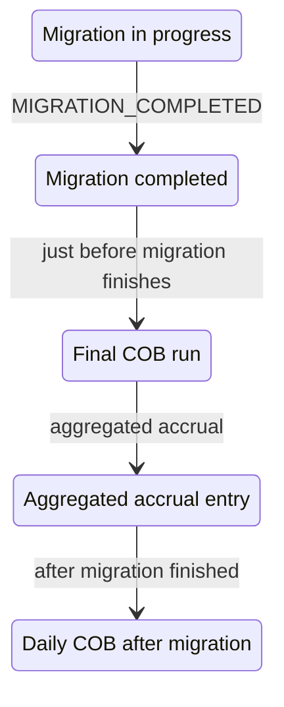

# Migration Tracking

## Migration Tracking

### Migration overview

Tenants are migrated on dev/test environments using a migration plan available from Fineract Jira. The fineract-migration module provides Migration APIs that start and finish a loan migration through POST v1/loans/{loanId}/migration and POST v1/loans/external-id/{loanExternalId}/migration.

### Migration APIs and loan lifecycle

Migration APIs support starting and finishing a loan, and loan creation accepts a migration flag so that a LoanCreatedBusinessEvent includes migration information. The Start event, Finished event, and migration flag control particular business needs during migration. You mark a loan as migrated through the API Start, Finish, and loan creation endpoints using the query parameter migration=true.

The migration flag behaves as follows:

- If the migration started, the flag value is true.
- If the migration finished, the flag does not need to be set anymore.

1. Call GET v1/loans/{loanId}/migration to retrieve migration details for a loan by ID.
2. Call GET v1/loans/external-id/{loanExternalId}/migration to retrieve migration details for a loan by external ID.
3. Call POST v1/loans with the query parameter migration=true to create a loan application during migration.

Migration information is carried in two places:

- The MessageV1 schema includes a migration boolean flag so downstream systems know whether an external business event concerns an entity where migration is ongoing.
- The ExternalEvent entity (m_external_event) includes an optional migration boolean field that can only be set to true while migration is ongoing.

### Migration flag and event differentiation

The system tracks every Fineract activity during migration, including entities, transactions, journal entries, and charges. It marks every external event as a migration event and includes a migration flag on events and real-time API calls so downstream systems can build business logic or filtering logic.

### Migration datatable and status

Migration details and status are stored in the database. A new datatable named dt_loan_migration holds one field, status varchar(100), and includes audit information by default. Its relation is registered in x_registered_table through liquibase inside the custom migration module.

The datatable supports these status values:

- MIGRATION_IN_PROGRESS
- MIGRATION_COMPLETED

When migration is marked as FINISHED, a LoanMigrationCompletedBusinessEvent is triggered. It contains loan details and works similarly to LoanAccountSnapshotBusinessEvent, which is needed when migration of a loan is marked as completed as a body account details snapshot.

### External event configuration during migration

External business events can be filtered during migration so that only selected events are sent, such as loan transaction events without account details.

Migration uses the existing m_external_event_configuration table extended with an enabled_for_migration field.

- Only external business events explicitly enabled for migration are sent while migration is ongoing.
- If a loan is under migration and an external business event is not enabled for migration, the system does not create or send that event.

### Custom data serializers

Custom serializers put migration information into the customData field on loan and loan transaction external business events. The field uses Map<String, byte[]> so migration details or the migration flag can be stored in a highly customizable way.

The following serializers include a customData field:

- CustomLoanMigrationDataSerializer puts the last entry of the dt_migration datatable into customData for every loan and loan transaction external business event.
- InvestorBusinessEventSerializer for LoanOwnershipTransferDataV1.
- LoanProductBusinessEventSerializer for LoanProductDataV1.
- LoanChargeBusinessEventSerializer for LoanChargeDataV1.
- LoanAdjustTransactionBusinessEventSerializer for LoanTransactionAdjustmentDataV1.
- LoanRepaymentBusinessEventSerializer for LoanRepaymentDueDataV1.
- LoanDelinquencyRangeChangeBusinessEventSerializer for LoanAccountDelinquencyRangeDataV1.

Custom serializers can be implemented as part of custom modules with optional injection, and the serializer bean can be conditionally created based on application properties.

### Business event triggering and override

The system triggers business events when datatable entries are created, updated, or removed, and decides whether posting a business event is enabled by default fetching that setting from the database. A custom module can override this decision and add its own listener logic. The implementation lives in org.apache.fineract.infrastructure.dataqueries.service.ReadWriteNonCoreDataServiceImpl, and a test listener can be introduced only when the test profile is active.

The system triggers the following business events for datatable changes:

- DatatableEntryCreatedBusinessEvent when a new datatable entry is created.
- DatatableEntryUpdatedBusinessEvent when an existing datatable entry is updated.
- DatatableEntryDeletedBusinessEvent when an existing datatable entry is removed.
- LoanAccountSnapshotBusinessEvent when a MIGRATION_COMPLETED migration datatable entry was created.

### Custom external business event configuration service

CustomExternalBusinessEventConfigurationServiceImpl overrides ExternalBusinessEventConfigurationService to send external business events based on the state of the dt_migration datatable and the configured migration event list. It sends events when the datatable has no entry, when it has a MIGRATION_COMPLETED entry, or when it has a MIGRATION_IN_PROGRESS entry without MIGRATION_COMPLETED and the business event type is listed in custom.migration.loan.migration.events.

The service supports the following DatatableBusinessEvent configuration:

- Create a new DatatableBusinessEvent type with entityType set to EntityTables, entityId set to the Long primary key of the entity, datatableName set to the datatable table name, appTableId set to the primary key of the datatable entry, and data as a Map<String, Object> where the key is the column name and the value is the column value.
- Add entries to custom.migration.loan.migration.events in application.properties; the default entries are LoanCreatedBusinessEvent, LoanDisbursalBusinessEvent, and LoanTransactionMakeRepaymentPostBusinessEvent.

### COB and income recognition

COB and income recognition during migration recognize all accruals for open or fully paid loans, covering interest and charges, and set delinquency for overdue loans while recalculating interest on those loans. The COB for the final day of migrations can be configured and run, with the result affecting every income till the final run date in one run.

Migration income recognition follows these rules:

- Migrated loans are created in a backdated manner without changing the current business date, and submitted on date and disbursement date might be backdated.
- No COB or inline COB runs during migration; only one inline COB execution occurs just before migration finishes, resulting in an aggregated accrual entry for income recognition.
- One Accrual Activity is created for each period on the due date when the period is backdated relative to the current date, if applicable, unless the period was early repaid.
- The loan repayment schedule updates with each backdated transaction, and when backdated transactions are applied, the schedule updates and recalculates based on each step.
- After migration finishes, COB executes daily for proper income recognition.

A listener in a custom module such as loan-migration listens for DatatableEntryCreatedBusinessEvent and, when a new entry is created for the dt_migration table with value MIGRATION_COMPLETED, triggers a LoanAccountSnapshotBusinessEvent.

### Worked examples

A loan with principal 1,000 and loan identifier 1,000 enters migration. The integrator calls POST /v1/loans/1000/migration with action MIGRATION_IN_PROGRESS to start, and later with action MIGRATION_COMPLETED to finish. The figures are illustrative.

| Step | Request action | Persisted status | migrationStartDateTime | migrationEndDateTime | Response resourceId | Response subResourceId |
| --- | --- | --- | --- | --- | --- | --- |
| 1 | MIGRATION_IN_PROGRESS | MIGRATION_IN_PROGRESS | 2024-01-01T00:00:00Z | null | 42 | 1000 |
| 2 | MIGRATION_COMPLETED | MIGRATION_COMPLETED | 2024-01-01T00:00:00Z | 2024-01-31T23:59:59Z | 42 | 1000 |

The action value controls whether a new in-progress record is created or an existing record is marked completed with an end date time.

An integrator calls GET /v1/loans/1000/migration to read the recorded migration state of loan 1,000.

| Step | Returned status | migrationStartDateTime | migrationEndDateTime | locale | dateformat |
| --- | --- | --- | --- | --- | --- |
| 1 | MIGRATION_COMPLETED | 2024-01-01T00:00:00Z | 2024-01-31T23:59:59Z | en | yyyy-MM-dd |

The GET response mirrors the final row of m_loan_migration_details, including locale and date format.
