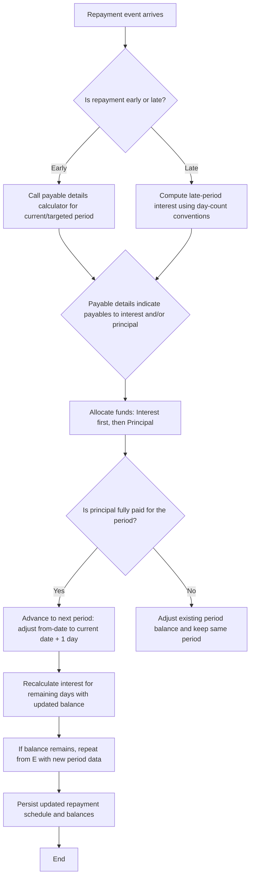

<!-- Labels: developer, early-and-late-repayment -->
# Early Repayment/Late repayment Interest Calculation

This document describes the verified behavior and implementation guidance for adjusting interest when loans experience early repayment or late repayment. It documents the computational model, interaction between calculation components, and the resulting effects on repayment schedules, balances, and accounting semantics. The content reflects the enhancement scope and the concrete references provided in the calculation artifacts. Public API surface, database schema, and internal identifiers are not modified or described beyond what is evidenced by the reference material.

### Conceptual overview

In the Pepper-Soup loan module, interest accrues according to a day-count convention and a rate factor that converts a nominal annual rate into period-specific multipliers. When a borrower makes an early repayment, the system recalculates the applicable interest for the remaining portion of the period and adjusts the outstanding balance and schedule . If the repayment amount exceeds what is required to progress through the current period, the implementation may push remaining interest into subsequent periods, rebalancing the repayment schedule around the new outstanding balance. Conversely, late repayments incur additional interest for the days elapsed after the scheduled due date, using the same rate and day-count framework, with adjustments to the period boundaries as necessary.

The implementation separates concerns into specialized calculation components, scheduling logic, and a repayment allocation policy. A fundamental rule observed in the reference data is that payments are allocated with interest honored first, then principal, and the schedule is updated to reflect any recalculated balances and associated interest for the remaining days in the loan horizon.

### Core conventions and formulas

- Day-count conventions and rate factors
 - The calculations rely on a defined year length and month length used to derive rate factors for period-based interest. In the common monthly scenario, Days In year is 360 and Days In month is

30. The rate factor for a period is computed as: Rate factor = 1 + (rate of interest × (actual days in period / Days In year)). This rate factor is used to determine period-specific interest accrual and EMI composition.
 - The reference calculations show multiple formulations for rate factors depending on the period granularity (monthly, weekly, daily) and repayment cadence. The primary monthly convention uses a fixed 30-day month within a 360-day year for the rate factor computation.

- EMI computation (baseline per-period payment)
 - EMI is derived from a weighted aggregation of period-weighted factors. The reference notation expresses EMI as: EMI = (Rate factor_i × R_i × Principal) for i from 1 to n, divided by fn. In the baseline monthly scenario with a single principal, the EMI per period is observed as a constant value across early/late adjustment experiments, subject to adjustments when early/late repayments occur.
 - Example baseline (no early/late adjustments): with Principal = 100 and a 7% annual rate under a 360/30 convention, the rate factor for a 30-day period is Rate factor = 1 + (0.07 × 30/360) = 1.005833333. The first period EMI shown in the reference sequence is 17.01, with an interest portion of 0.58 and a principal portion of 16.43, yielding a balance after the first EMI of 83.57. This demonstrates the fundamental relationship between EMI, interest, and principal in the absence of advanced early/late adjustments.

- Payable details for repayment events
 - The system exposes a payable-details calculation (for example via an EMI calculator component) that determines how a given repayment amount should be allocated to interest and principal for the current or upcoming period. The payable details influence whether the repayment reduces the current period’s principal, whether interest is paid in full, and how remaining balance and future interest are re-evaluated.
 - The payable details logic is invoked during early repayment processing to decide how much of the transaction should be credited to interest versus principal for the affected period.

- Payment allocation policy
 - Payments are allocated with the priority: Interest first, then Principal. This policy is explicitly reflected in the reference material and governs how a repayment amount is split when recalculations occur due to early or late payments.

- Schedule recalculation and balance propagation
 - After a repayment portion is allocated, the loan’s repayment schedule is recalculated to reflect the updated balance and the revised interest for the remaining days in the loan horizon. If the repayment fully pays the period’s required amount (or results in a payoff of the remaining principal), the following period boundaries adjust : the “from” date used to calculate interest for the next period becomes the current date plus one day, and interest accrual may be suppressed for fully paid-off periods.
 - If a repayment reduces the outstanding principal such that not all the previously projected interest can be recognized in the current period, the system may postpone the unrecognized portion of interest to subsequent periods and recalculate interest from the new outstanding balance. This logic can cascade if multiple advance payments occur.

- Late repayment adjustments
 - Late repayments introduce additional interest for the days elapsed after the due date, computed using the same rate-factor framework with the day-count conventions. The reference materials describe scenarios where the late payment adjusts the schedule (e.g., “Late RPMT-adjst nxt”) and may shift balance calculations to reflect the extended payment horizon. The resulting effect is that the next period’s interest calculation uses the updated balance and updated date boundary, consistent with the recalculation rules described above.

- Integrity constraints
 - The calculated opening balance for each period must equal the previous period’s closing balance. Payments and allocations must reconcile with the transaction amount, and the remaining cash and outstanding dues must reconcile against the computed balances. When available, journal entries must balance (debits equal credits) and rounding must follow evidenced conventions (HALF_UP or HALF_EVEN ). The flow preserves clear relationships between event (repayment), account movements, and post-transaction state.

### How the calculation flows in practice

1) A repayment event occurs (early or late) and is routed to the repayment processing flow.
2) The system determines the repayment type (current, past due, advance) and retrieves payable details for the targeted period via the EMI calculation mechanism.
3) Based on payable details and the repayment amount, the system allocates funds to interest and principal according to the policy (Interest first).
4) If any portion of the payment is allocated to principal, the outstanding balance is reduced . If the principal paid exceeds the EMI and any payable interest, the system may advance to the next period, updating the period boundaries and recalculating interest for the remaining days.
5) The remaining balance and the next period’s calculations are recomputed using the defined rate factor rules. If the loan is fully paid, interest accrual ceases in subsequent periods.
6) The updated repayment schedule and balances persist, maintaining the invariant that each period’s opening balance equals the prior period’s closing balance.

These steps are designed to preserve financial integrity across schedule recalculations, verify consistency of day-count conventions, and produce traceable outcomes that follows the reference scenarios for early and late repayment adjustments.

### Baseline calculation walkthrough (illustrative, using the 30/360 convention)

- Baseline EMI and first-period accrual (no early/late adjustments):
 - Principal = 100, Interest Rate = 7% annually, Days In year = 360, Days In month = 30.
 - Rate factor for the 30-day period = 1 + (0.07 × 30/360) = 1.005833333.
 - EMI for the period (per reference pattern) is observed as 17.01.
 - Interest for the first period = Principal × (Rate factor − 1) = 100 × 0.005833333 = 0.58 (rounded as in the reference to 0.58).
 - Principal repaid in the first EMI = EMI − Interest = 17.01 − 0.58 = 16.43.
 - Resulting balance after the first EMI = 100 − 16.43 = 83.57.

- Subsequent period progression (illustrative, baseline):
 - On the second period (1st of the month following), Balance = 83.57, EMI = 17.01, Principal = 16.43, Interest = 0.58, leaving Balance = 67.14 after the EMI.
 - This baseline progression is consistent with the initial segment of the reference calculation sequence, illustrating the core relationship among EMI, interest, principal, and balance under the 360/30 convention.

Note: The reference material contains more elaborate scenarios (early repayments of small amounts, mid-period early repayments, late repayments, and combinations thereof) that demonstrate the mechanics described above. The general principles—rate-factor-driven interest, EMI-derived principal flow, and post-payment schedule recalculation with potential movement of unrecognized interest to subsequent periods—remain constant across those scenarios.

### Diagram: repayment processing flow (Mermaid)

### Data model, persistence, and integration touchpoints

The reference data primarily documents behavioral rules and calculation artefacts, without asserting changes to the public API surface, database schema, or service contracts beyond the internal calculation workflow. Based on the provided material:

- API surface changes: No explicit public API parameter additions, removals, or behavioral differences are evidenced in the reference data. A future release note would only reflect API changes if the reference data includes concrete surface changes.
- Database schema: There is no explicit of DDL changes or new persistent structures in the reference material. The descriptions focus on calculation logic and its impact on repayment schedules and balances, not on new persisted entities.
- Integration contracts: No new inter-service surface details are described in the provided references. The focus is on internal calculation and scheduling behavior.

If future engineering work introduces API or schema changes, those would need to be documented separately with the exact surface differences, data formats, and compatibility notes.

### Worked example snippets (calculation anchors)

- Baseline EMI calculation anchor under 360/30 convention with Principal = 100 and Interest Rate = 7%:
 - Rate factor = 1.005833333
 - EMI observed in the reference for the first period: 17.01
 - Interest for the first period: 0.58
 - Principal repaid in the first period: 16.43
 - Ending balance after first EMI: 83.57

- Early repayment anchor (illustrative, as described in the reference flow):
 - Payable details are retrieved for the period, and the repayment amount is allocated with interest-first priority. If the repayment amount exceeds the current period’s required principal portion, unrecognized interest may be shifted to subsequent periods, and the balance is recomputed from the current date + 1 for the next period.

### Calculations integrity and verification notes

- Each period’s opening balance must equal the previous period’s closing balance. This invariant supports traceability of the balance evolution through the schedule.
- Allocation completeness: The sum of allocations to interest and principal must equal the transaction amount for each repayment event, verifying a balanced and traceable cash flow.
- Rounding: All intermediate and final figures should follow the documented rounding conventions (HALF_UP or HALF_EVEN) as evidenced by the reference data’s numerical values.
- Settlement: When a period is fully paid, no further interest accrues for subsequent periods, and the from-date for the next period’s interest calculation is updated to current date + 1.

### Summary for developers and integrators

- The Early Repayment/Late Repayment Interest Calculation enhancement centers on adjusting interest and principal allocations through a payable-details mechanism, applying an Interest-first payment rule, and recalculating the repayment schedule from the point of payment with standard date-boundary updates.
- The system maintains a consistent, adjustable balance trajectory, preserving period-to-period continuity while enabling payoff or reallocation when early or late repayments occur.
- The documented behavior adheres to a 360-day year with 30-day months for the standard monthly scenarios, and the same rate-factor framework under late-repayment adjustments, with standard recalculation of future periods.

This page captures the verified, end-user-facing behavior and its internal algorithmic foundations as described by the reference artifacts. It provides a reference for architecture, algorithms, processing behavior, persistence expectations, and accounting implications relevant to backend Java engineers, system integrators, and Fineract contributors.