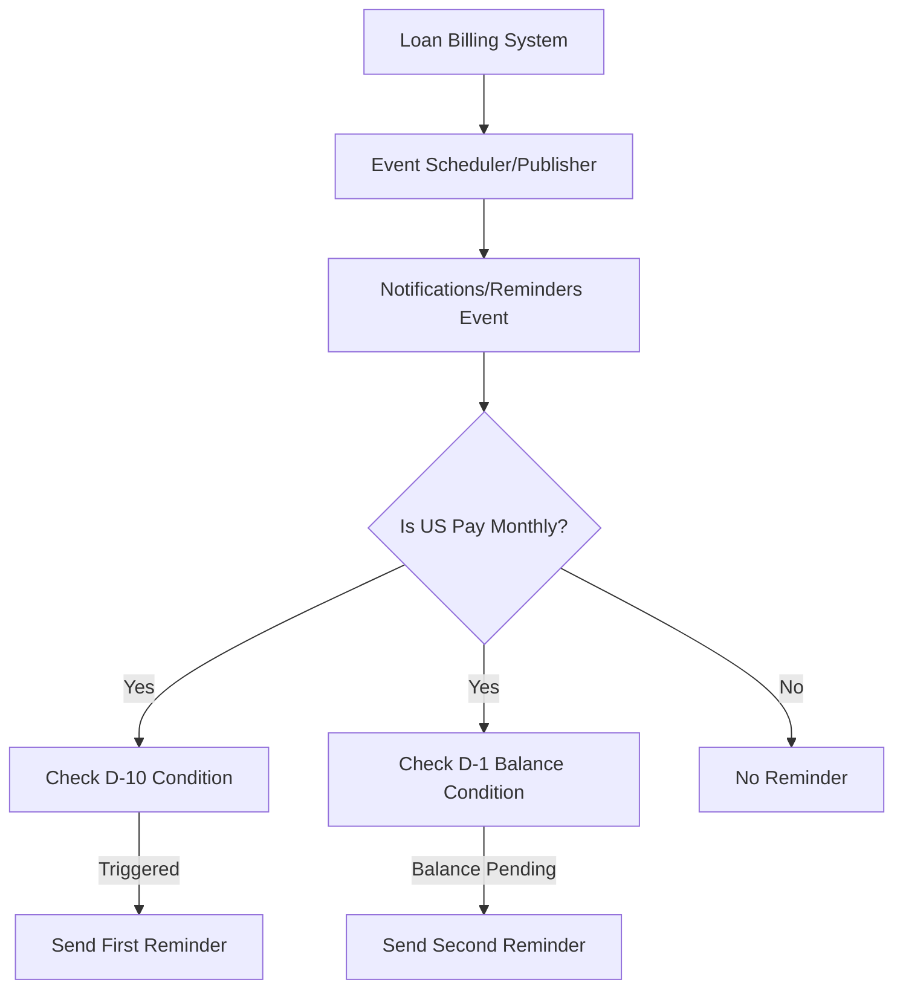

<!-- Labels: developer, events -->
# Events related changes

The enhancement area focuses on revisiting the events surface, its parameters, and triggers to verify that the data sent with events accurately reflects current needs. A new event type, Notifications/Reminders, is introduced to support additional reminder notifications conditioned on loan balances. In particular, for US Pay Monthly customers, reminders are generated in relation to the loan’s installment due date as described below. The reference notes that the event payload for the new events changes includes five child fields, and that payload structure will be extended as part of this work.

### Overview of the change
- New event: Notifications/Reminders. This event type is designed to convey reminder-related information to downstream consumers (for example, notification delivery mechanisms).
- Conditional reminders based on balance. The reminders can be sent depending on the current balance of the upcoming installment prior to the due date.
- Customer-specific trigger: US Pay Monthly. The primary scenario described targets US Pay Monthly customers, with reminders issued in relation to the installment due date.
- Payload evolution: The event payload for the new changes contains five child elements. The precise semantics or names of these children are not specified in the reference, but their existence indicates a structured, multi-field payload for the new event type.

### Technical scope and limitations (as documented)
- The reference specifies the introduction of a new event type (Notifications/Reminders) and notes that the event payload will have five child fields. It does not enumerate or rename other event types, surfaces, or parameters beyond this change.
- No details are provided about adjusted or new APIs, database schema changes, or specific class or service implementations. The description focuses on the presence of the new event type and its payload composition, plus the conditional triggering logic described below.

### Payload semantics (verified constraint)
- The new event’s payload comprises five child elements. The names and exact semantics of these fields are not specified in the reference, but their collective presence constitutes the payload structure for this event type.
- No additional payload field changes are described beyond the five-child structure for the Notifications/Reminders event.

### Triggering rules and behavioral intent (verified as described)
- Reminder cadence for US Pay Monthly customers: a reminder should be sent 10 days before the payment due date for the upcoming installment.
- Secondary reminder condition: if, on the day 1 before the due date, the upcoming installment still has a non-zero balance, another reminder should be sent.
- Conditional delivery: both reminders are conditioned on the customer being in the US Pay Monthly category and on the balance condition described for the second reminder.
- If the balance is not pending on the D-1 checkpoint, the second reminder is not generated.

### Data flow and processing sketch
The reference implies a flow where events are produced and consumed by downstream mechanisms responsible for delivering reminders. A simplified processing sketch follows, showing the high-level logic without asserting specific internal component names:

Notes:
- The diagram reflects the verified conditions: the first reminder is tied to the D-10 window; the second reminder depends on the balance being pending as of D-1. It does not imply a specific implementation path or component naming beyond the described conditions.
- The diagram does not depict other event types or unrelated scheduling logic.

### Implications for persistence and integration
- Payload evolution to five children implies consumers must be ready to parse and validate a payload with five fields for the new event. Consumers should be prepared to handle the payload without assuming any previously present fields beyond those required by their integration.
- Given that the new event relates to reminders, downstream integrations (such as notification delivery systems) will need to be able to interpret the Notifications/Reminders payload and act on the D-10 and D-1 timing rules.

### Edge cases and verification considerations
- The first reminder is emitted solely based on the D-10 window for US Pay Monthly customers, regardless of the balance state described for the second reminder.
- The second reminder is emitted only if the D-1 balance condition is met (i.e., the upcoming installment balance remains pending as of one day before the due date).
- If the customer is not US Pay Monthly, or if the due date is not defined, the reference does not specify reminders for those scenarios. No reminder is described for those cases in the provided specification.
- Because the payload is described as five children, validation logic should enforce the presence of five child fields for the new event, consistent with the stated payload evolution.

### Migration and compatibility notes (documented scope)
- The specification notes payload changes for the event, specifically the five-child payload for the new Notifications/Reminders event. It does not document additional API changes, database schema changes, or other structural modifications beyond this payload evolution.
- Integrations relying on the previous event set should anticipate the addition of a new event type and adapt by consuming the new payload fields as they are defined by downstream implementations.

### Summary of verified behavior
- A new event type Notifications/Reminders is introduced to support reminder notifications.
- The event payload for the new change consists of five child fields.
- For US Pay Monthly customers, a reminder is sent 10 days before the installment due date.
- If the upcoming installment balance is still pending 1 day before the due date, a second reminder is sent.
- Reminders are conditional on the customer’s category and the described balance state; all other conditions and potential additional events are outside the scope of the provided specification.

This page captures the verified aspects of the Events related changes as described in the reference data. No internal implementation details, source names, or confidential materials are included, and the behavior described here reflects the documented scope and constraints.