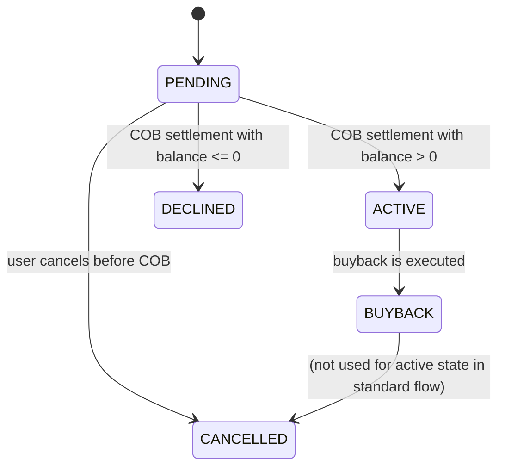

<!-- Labels: developer, financial-year -->
# Financial Year Ending

The Financial Year Ending (FY Ending) capability in PepperSoup addresses the need to close a financial year with validated reporting and journal entries. At present, Fineract does not provide an automated year-end closing process for profit and loss calculation. Users are expected to manually compute the year-end result and post a journal entry. The FY Ending feature introduces two verified capabilities to support this workflow in the context of asset externalization and PayPal-related ownership scenarios: (1) extending manual journal entries to pass at the asset owner level, and (2) updating the Trial Balance (TB) reporting to reflect asset owners in manual entries. These changes are designed to preserve existing accounting semantics while enabling asset-owner-scoped visibility in year-end reporting.

### Concept and scope

The FY Ending process centers on manual year-end accounting activity. It does not introduce an automated profit-and-loss calculation engine. Instead, it allows an accountant to bring the year-end result into the system via a manual journal entry, with an explicit association to the relevant asset owner . This asset-owner linkage is particularly important in the context of asset externalization, where loans may be owned by external asset owners (investors) rather than the cash-payee PayPal entity. By tying manual journal entries to asset owners, the TB and related reporting can deliver owner-scoped insights and reconciliations.

As part of the PP (PayPal) asset externalization workflow, the following verified changes are required and supported:

- Extend manual journal entries to pass at the asset owner level, so year-end postings can be attributed to the correct owner.
- Update the Trial Balance reporting to support manual journal entries that are associated with asset owners, enabling accurate owner-level reconciliation and reporting.

These changes are described in the context of the Asset Externalization design and the Financial Year Ending changes recently specified for Fineract. The combined effect is to make year-end financials auditable by asset owner and consistent with asset externalization accounting.

### Asset ownership lifecycle and state considerations (-based)

Asset ownership transfers under the externalization framework follow a defined lifecycle with distinct states. The documented states are: PENDING, ACTIVE, BUYBACK, DECLINED, and CANCELLED. The lifecycle describes how ownership transfers proceed from initiation through COB (close of business) processing, and how journal entries relate to the active owner at COB.

- PENDING: An asset ownership transfer request has been initiated but has not yet completed for the COB period.
- ACTIVE: The asset ownership transfer is active; journal entries for the owner role are processed against the active owner.
- BUYBACK: The loan ownership has been bought back from an external owner.
- DECLINED: The transfer request is declined based on business rules (e.g., settlement timing and balance conditions).
- CANCELLED: A transfer request that was initiated but not executed can be cancelled prior to COB.

A Mermeid diagram below summarizes the verified transitions and their triggers.

This diagram reflects -driven understanding that ownership changes and related journal postings are anchored to the COB process and to the active ownership state. It also shows why year-end postings that involve asset owners must be able to reference the asset-owner context explicitly.

### Functional requirements and behavior

Based on the documented scope, FY Ending requires two concrete capabilities:

- Extend Manual Journal Entries to asset owner level: The year-end posting must be recorded with an association to the relevant asset owner (). This allows owner-specific reporting and aligns year-end accounting with asset externalization semantics.
- TB reporting updated for asset owner context: The Trial Balance must be capable of presenting or segmenting balances and postings by asset owner to support reconciliations at the owner level after year-end postings.

These requirements are stated in the Financial Year Ending Changes in Fineract documentation, which describes the intended extension to manual journal entries and to the TB report to accommodate asset owners.

### Financial operation: planning and interpretation guidance

The FY Ending operation is a manual closing activity. The process begins with the preparation of the year-end profit and loss (P&L) figure using the organization’s customary accounting judgment. The calculated P&L result is then posted to the ledger as a manual journal entry. In the context of asset externalization, the entry may need to reference asset owner context if the underlying revenue or expense relates to a particular owner.

Key behavioral expectations:
- There is no automatic calculation of P&L within FY Ending; the calculation remains external to Fineract’s automated posting logic.
- The manual journal entry created for FY Ending can be attributed to an asset owner so that owner-level reporting and reconciliation reflect the correct ownership link.
- The TB report will support the asset-owner dimension for manual JEs, enabling per-owner reconciliation after year-end postings.

### Data persistence and reporting implications (high level)

The year-end extension relies on the existing accounting and reporting pipeline, augmented to carry an asset-owner dimension through manual journal entries. Specifically, the system must store the association between a manual journal entry and the asset owner () so that TB and other owner-scoped reports can reflect the year-end posting in the owner’s context. The precise persistence model for the asset-owner linkage is part of the Asset Externalization design; in the FY Ending context, the same ownership context is leveraged to verify auditable, owner-specific year-end reporting.

### Validation, guards, and edge cases

- The year-end posting must be a manual entry, and the system must accept a properly attributed asset owner reference when the entry is intended to affect asset-owner reporting.
- If no asset owner is applicable for a given manual entry, the entry can still post under the standard ledger, but owner-scoped TB visibility would not apply.
- The TB enhancement aims to provide visibility by asset owner for manual JEs; it does not alter the core double-entry accounting semantics for standard ledger postings.

### Practical workflow for users (sequential steps)

1) Calculate the year-end profit and loss externally and confirm the figure to be posted.
2) Create a manual journal entry in the system, selecting the standard accounts and entering the P&L components as standard JE lines.
3) If the year-end posting relates to asset ownership (e.g., allocations tied to externalized assets), associate the journal entry with the relevant asset owner to allows owner-specific reporting.
4) Post the journal entry and verify that the entry is reflected in the general ledger.
5) Run or refresh the Trial Balance report and validate that the asset-owner dimension now reflects the year-end posting for the relevant owner(s).

The described workflow follows the documented aim to support year-end closing in scenarios involving asset externalization, so that reporting and auditability are maintained when an asset owner is involved in the year-end entry.

### Endpoints and integration notes (conceptual)

The FY Ending capability relies on the existing journal entry pathways for manual postings and the asset-owner linking mechanism described in asset externalization documentation. There are no new public API contracts introduced solely for FY Ending in the provided material. However, for asset externalization scenarios, the system supports a spectrum of asset-owner related workflows that culminate in COB journal entries and owner-specific reporting visibility. In practice, year-end JEs that need asset-owner context would follow the same posting workflow as other manual JEs, augmented with the asset-owner attribution.

### Related references (-based)

- Financial Year Ending Changes in Fineract: This source documents the goal to support year-end closing with manual P&L postings and the required extensions to manual journal entries and TB reporting to support asset owners.
- Asset Externalization and ownership lifecycle: The externalization design describes asset ownership transfer, COB posting, and related journal entry behavior, which informs how asset-owner context should flow into year-end reporting.
- Asset ownership states and COB interactions (PENDING, ACTIVE, BUYBACK, DECLINED, CANCELLED): These states provide the stable, evidenced model for ownership context that year-end postings can reference when asset-owner attribution is relevant.

These references establish the validated behavioral expectations for FY Ending in the presence of asset externalization and asset-owner accounting considerations.

### Example representations (conceptual)

- This page describes the concept and verified behavior rather than prescriptive numerical examples. When a year-end posting is asset-owner scoped, the TB view will reflect the posting under the associated owner’s ledger. The exact debit/credit pairings and account codes are determined by the existing journal entry mechanisms and are not altered by the FY Ending extension beyond enabling owner attribution.

If you need further detail on how asset ownership interacts with journal entries in other workflows (e.g., asset transfers, buybacks, or COB journal postings), refer to the Asset Externalization design and its state machine, which codify the verified transitions and the timing of COB postings.