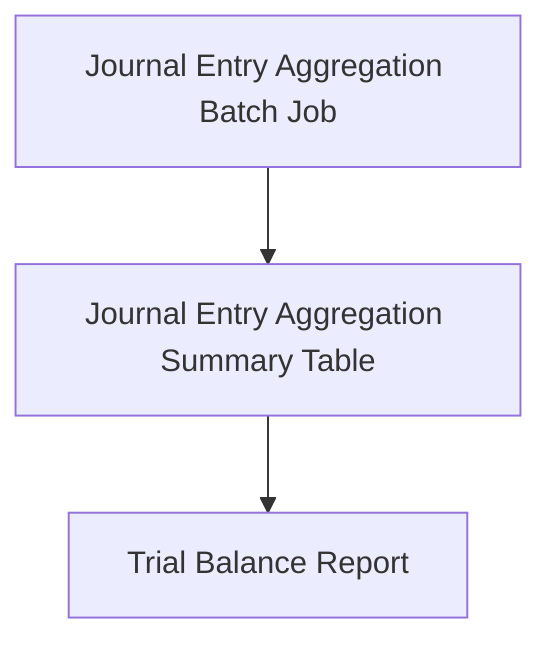

<!-- Labels: developer, journal-entries -->
# Journal entry aggregation

The Journal Entry Aggregation enhancement introduces a batch-centric workflow that precomputes summarized journal data for use by reporting. The core idea is to produce a Journal Entry Aggregation Summary, store it in a dedicated table, and have the Trial Balance Report consume this pre-baked data instead of performing on-demand aggregation during each run. This approach follows the Step1/Step2 plan described in the reference: first, a batch job creates the aggregation results; second, the Trial Balance Report hooks into the aggregation data to avoid daily on-the-fly computation.

### Overview and rationale
The goal of this enhancement is to provide a ready-to-use aggregation snapshot that can back reporting workflows, notably the Trial Balance report. By generating a Journal Entry Aggregation Summary once per cycle and exposing it to downstream reports, the system reduces repetitive computation and accelerates report generation. The Trial Balance Report will not execute Journal Entry Aggregation logic on each run; instead, it will rely on the precomputed aggregation data stored in the Journal Entry Aggregation Summary table.

### Scope and behavior
- Step 1: Create a Journal Entry Aggregation batch job that computes the necessary summary data and persists it into a dedicated aggregation table (Journal Entry Aggregation Summary table).
- Step 2: Hook up the Journal Entry Aggregation Summary data into the Trial Balance Report so that the report reuses pre-baked results rather than performing live aggregation every day.

This description reflects the documented enhancement plan and the intended data flow between components. It does not describe additional steps beyond what is stated in the reference material.

### Architectural components involved
- Journal Entry Aggregation Batch Job
 - A batch-oriented process responsible for scanning relevant journal entries, applying the defined aggregation rules, and producing a summarized representation suitable for reporting.
 - Writes the resulting summary into the Journal Entry Aggregation Summary table.
- Journal Entry Aggregation Summary Table
 - A dedicated persistence structure that stores the precomputed aggregation results used by downstream reports.
 - Acts as the primary data source for the Trial Balance Report when aggregation is enabled via pre-baked data.
- Trial Balance Report
 - Updated to consume data from the Journal Entry Aggregation Summary table rather than invoking live aggregation logic.
 - This change reduces daily compute on the report path by reusing precomputed results.
- Scheduling/Triggering (implicit)
 - The existence of a batch job implies a periodic refresh cadence for the aggregation data. The reference specifies the batch-based approach but does not define a fixed cadence in this document.

### Data model and persistence (high level)
- Journal Entry Aggregation Summary Table
 - Stores the aggregated representation of journal entries as prepared by the batch job.
 - Serves as the data source for the Trial Balance Report when the aggregation pathway is enabled.
- No other database structures are specified in the reference material provided for this enhancement.

### Processing flow (visual overview)
A high-level flow from batch creation to report consumption is described as follows: the Journal Entry Aggregation Batch Job computes the summary, writes it to the Journal Entry Aggregation Summary table, and the Trial Balance Report reads from that table to present the final numbers.

### Notes on specification and data scope
- Specification notes in the reference mention: “Trial balance with asset owner; 2 children.” This indicates a particular data scope or structure relevant to the trial balance, but the exact interpretation is not expanded within this document. The aggregation pathway is designed to support such reporting scenarios by providing precomputed data through the summary table.

### Implications for integration and operation
- External integrations and downstream consumers relying on the Trial Balance Report will receive results derived from pre-baked aggregation data, which can impact data freshness semantics and scheduling expectations.
- The approach requires the Journal Entry Aggregation Batch Job to stay in sync with underlying journal entries to verify the aggregation summary remains representative of the source data between batch runs.
- No explicit changes to public API surfaces are described in the reference material for this enhancement; the primary surface affected is the Trial Balance Report’s data source path.

### How this fits into the reporting and accounting workflow
- The aggregation path decouples daily trial balance computation from live journal entry processing by introducing a precomputed summary. This reduces runtime cost for the Trial Balance Report and provides a stable, reusable data source for reporting purposes.
- The reporting model remains capable of presenting asset-owner related balances and related hierarchies, now powered by the aggregation summary rather than on-demand aggregation.

### Glossary (key terms)
- Journal Entry Aggregation: A batch-driven process that computes a summarized representation of journal entries for reporting use.
- Journal Entry Aggregation Summary Table: The persistent store for precomputed aggregation results used by downstream reports.
- Trial Balance Report: A reporting function that can consume pre-baked aggregation data to produce balances, subject to the availability of the aggregation summary.

> Note: The documented behavior reflects the enhancement’s intended data flow and component responsibilities as described in the reference material. No additional implementation details, API signatures, or DDL definitions are provided beyond what is stated here.