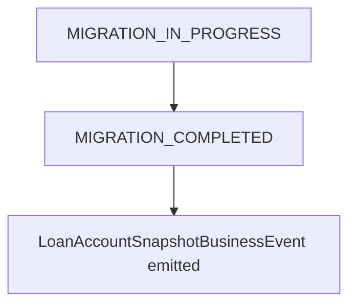

<!-- Labels: developer, migration-tracking -->
# Allow us to track migration activities

This page documents the architecture, data modeling, and behavioral rules for tracking migration activities within the Pepper-Soup deployment of the Fineract-based lending platform. The feature focuses on differentiating migration-era events and real-time API calls from post-migration activity, verifying migration context is carried through loan creation, events, and post-migration processing. It uses the existing datatable infrastructure for loan-related migration state and introduces optional extension points for custom behavior in a modular fashion.

### Conceptual role and module boundaries
The migration-tracking capability lives at the intersection of loan lifecycle processing, event emission, and data enrichment. Its core responsibilities include:
- Representing migration state for loans using a dedicated data record, and exposing that state to downstream processing.
- Propagating a migration flag through loan creation and related events, so downstream consumers can distinguish migration-time activity from post-migration activity.
- Providing a pluggable mechanism to determine whether external events are posted during migration, allowing customization in a modular extension.
- Emitting a specialized completion event when a loan migration is marked as complete, enabling downstream systems to snapshot loan account state.
- Offering an optional, COB-driven consolidation path for finalizing migration-day results in a controlled, test-friendly manner.

The design avoids introducing standalone API contracts or new public endpoints for migration tracking. Instead, it enhances existing loan and event surfaces through data enrichment and configurable behavior, using the datatable and customData mechanisms already available in the platform.

### State and lifecycle overview
 supports a lightweight migration-state model represented in a dedicated datatable with at least two status values:
- MIGRATION_IN_PROGRESS
- MIGRATION_COMPLETED

A migration state transition occurs when a datatable entry is created or updated to MIGRATION_COMPLETED for a given loan. When a MIGRATION_COMPLETED entry is created, the system emits a LoanAccountSnapshot-like event to record a snapshot of the loan’s account state at migration completion. This sequence formalizes the migration lifecycle as follows:
- Migration starts: an entry for the loan indicates MIGRATION_IN_PROGRESS.
- Migration progresses: ongoing activity is recorded, with the flag indicating current migration status.
- Migration completes: a datatable entry with MIGRATION_COMPLETED is created, which triggers a LoanAccountSnapshot-like event.

The above transitions are driven by business logic that reacts to datatable state changes and by design can be augmented in a custom module to tailor behavior for specific deployment needs.

### Data model and persistence
Key data structures introduced or repurposed for migration tracking include:
- dt_loan_migration: a new datatable to store migration state information for loans. Values stored represent migration status, with MIGRATION_IN_PROGRESS and MIGRATION_COMPLETED cited as example statuses.
 - By default, the datatable records carry audit information, so no additional fields are required beyond the status value for standard usage.
- Custom data at loan and loan transaction level: a new customData field is introduced to carry migration-related metadata in a flexible, serialized form. The data type for this field is Map<String, byte[]> to maximize expressiveness and portability.
 - This allows embedding the migration flag or related details into the core loan and transaction events without altering their primary schemas.
 - Optional serializer beans can be injected to populate the customData field, controlled by application properties. If the serializer bean is not enabled, the field remains unused.

These data-model choices preserve existing persistence patterns (datatables and customData) while providing a controlled extension point for migration-related information.

### Eventing, posting, and extensibility
Migration-aware eventing introduces several extensibility points that are intentionally pluggable to accommodate PP-specific requirements:
- External event posting configurator: a notifier mechanism determines whether a business event should be posted to external listeners. The default behavior consults the existing persistence-backed configuration to decide posting. In a custom module, this decision logic can be overridden to alter external posting behavior during migration.
- Migration-datatable listener: by default, adding a new entry to the dt_loan_migration table can trigger internal signals (listeners) that may drive further migration-related processing. A custom module may register listeners to implement domain-specific reactions to migration state changes.
- MIGRATION_COMPLETED trigger: when a MIGRATION_COMPLETED entry is created, a LoanAccountSnapshot-like business event is emitted. This allows downstream components to capture a consistent loan state at the end of migration for reporting or reconciliation purposes.
- External-event-filtering capability: a configuration mechanism allows filtering of external events during migration (for example, restricting external postings to loan transactions only, while omitting account-details events). This capability supports targeted data exposure during the migration window.

Collectively, these extensibility points allow a custom module to tailor the migration-tracking behavior while preserving a safe, upgrade-friendly default implementation.

### COB (Close Of Business) handling for migrations
A capability exists to configure and run a COB process for the final day of migrations. The COB result is intended to affect all income up to the final run date in a single consolidated operation. This behavior is described as primarily intended for testing and preparation, with the implication that per-day accrual events may be consolidated rather than emitted for every day in the migration window. The COB path provides a deterministic, end-of-migration financial alignment when migration activity must reflect a single closing point.

### Workflow illustrations
Mermaid diagrams help illustrate the migration state transitions and key event triggers without exposing internal implementation details.

This diagram captures the core transition: a loan migrates from in-progress to completed, and that completion triggers a snapshot event that external systems may rely on for reconciliation and reporting.

### Practical guidance for implementation and configuration
- Loan creation flow: when a loan is created in the migration context, the system should record the migration information in the dt_loan_migration table with an initial MIGRATION_IN_PROGRESS status. The default audit information on the datatable verifies traceability without requiring additional fields.
- CustomData enrichment: allows the optional serializer to populate customData on the loan and related loan-transaction events with migration details. This data is stored as Map<String, byte[]> and can be consumed by downstream processes that understand the serialized migration payload.
- Event-notification extension: if your deployment requires alternative behavior for posting events during migration, implement a custom module that overrides the decision logic for external posting. The default behavior reads the configuration from the database to decide whether to post.
- Completion handling: verify that creating a MIGRATION_COMPLETED entry in dt_loan_migration triggers the LoanAccountSnapshot-like event, enabling downstream systems to capture and persist a coherent snapshot of the loan state at the moment migration completes.
- Migration event filtering: configure an external-event filter to restrict or tailor the set of external events emitted during migration. For example, you may choose to emit loan-transaction events only and suppress other external event types.
- COB strategy: if you allows the COB final-day processing, verify that the resulting consolidated financial effects are applied consistently up to the final run date and that per-day accruals do not appear as separate, daily events in the migration window.

### Answering the stakeholder needs
- Differentiation of events during migration: migration-aware events and API calls are marked with the migration context, enabling downstream consumers to distinguish migration-time activity from post-migration activity.
- Minimal schema impact: migration state is tracked via the existing dt_loan_migration datatable and a new customData field on loan-related events, avoiding the need for standalone tables or new public APIs.
- Extensibility: the system provides clear extension points for custom behavior in a module, including event posting decisions and handling of migration completions.
- Observability and snapshot readiness: the migration-completed pathway emits a LoanAccountSnapshot-like event to support reconciliation and reporting after a loan has finished migrating.

### Important considerations and constraints
- All migration-tracking changes are designed to operate alongside the existing loan and event surfaces, using the datatable and customData extensions already present in the platform.
- The approach is intended to be patch-level, PP-specific, and implemented as a custom module on a feature branch; no standalone migration-tracking API surface is introduced by default.
- Internal implementation details, such as specific class names or internal method hooks, should be treated as implementation details. Public-facing behavior is described in terms of the data structures (dt_loan_migration, customData) and the observable eventing outcomes (internal signals, LoanAccountSnapshotEvent).

If you are integrating with external systems, consider how migration context is surfaced in your consumer logic and verify that any event filtering follows your reconciliation and auditing requirements. This design provides a structured, auditable migration window with clear points for extension, snapshotting, and controlled data exposure.