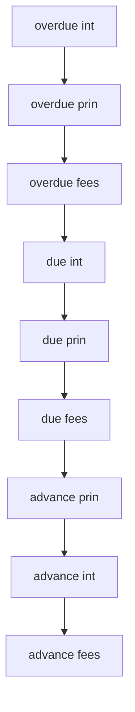

<!-- Labels: developer, next-last -->
# New Allocation rule - Next/Last

This document describes the New Allocation rule - Next/Last as part of the Repayment and Allocation capability. The material references a dedicated configuration named allocation rule, which governs how a payment is allocated when performing Next/Last installments. The enhancement is described as an enhancement to GPL credit management workflows, with a configuration option to select the Next/Last Installment operation.

### Concept and scope

The Next/Last allocation operation relies on a defined sequence of components to receive payment within an allocation cycle. The reference material provides an explicit allocation rule sequence, which determines the order in which portions of a payment are applied to loan components during a Next/Last operation. The sequence defined in the reference data is:

```
overdue int -> overdue prin -> overdue fees -> due int -> due prin -> due fees -> advance prin -> advance int -> advance fees
```

This rule encodes the priorities for applying a payment across outstanding and due components, and across overdue and forward-due items, during a Next/Last installment operation. The presence of this allocation rule in the reference data confirms that the system supports a configurable, ordered application of payment components for Next/Last processing, consistent with what is described in the topic context.

### Configuration details and observed usage

- The feature is named New Allocation rule - Next/Last in the navigation path Repayment and Allocation > Next/Last > New Allocation rule - Next/Last, indicating the rule is selected as part of the Next/Last workflow.
- The reference data shows an explicit allocation rule string, implying a dedicated configuration knob or field that captures the exact sequence above. This supports a model where the allocation engine applies payments according to the configured order when performing a Next/Last installment operation.
- In the provided reference calculations, the rule appears alongside sample scenarios labeled S1 and S2 (payment before installment date and payment on installment date). The rule line is presented in the context of an allocation workflow, validating that Next/Last behavior is driven by this configured sequence.

### Calculation context and baseline values (from reference data)

The reference material utilizes a standard loan setup to illustrate allocation behavior under the Next/Last rule. The baseline parameters include:
- Interest Rate: 7% (daily factor shown as 0.000194444)
- Days In year: 360
- Days In month: 30
- Principal: 100
- Repayment cadence: 1.00 month

These values are used in the accompanying tables to demonstrate how principal and interest portions are allocated over time under the Next/Last rule. The material presents two scenarios:
- S1: payment timing before the installment date
- S2: payment timing on the installment date

Within those scenarios, the summary references an allocation rule and shows how repayment components (overdue vs due, principal vs interest) progress over subsequent periods. While the tables themselves are part of the reference data, the key takeaway for Next/Last is that the allocation order is governed by the explicit sequence above, and the calculations are performed with the specified baseline parameters.

### Diagram: allocation sequence under Next/Last

The following diagram illustrates the verified allocation order defined by the Next/Last rule. It shows the sequential flow from the first component to the last as payments are allocated.



This diagram captures the precise, -based sequence that the Next/Last rule employs to allocate a payment across loan components. The order is the authoritative detail for implementation and integration tests related to Next/Last allocations.

### Financial calculations and integrity considerations

The reference data embeds a baseline calculation context that informs how the rule is exercised in practice. For the purpose of a Next/Last allocation, the numbers in the reference material are provided to illustrate the effect of applying a payment according to the defined order, using the stated interest rate, day-count conventions, and monthly cadence. Important integrity constraints observed in the reference material include:
- Each period’s opening balance corresponds to the prior period’s closing balance, forming a consistent running balance across the schedule.
- Allocation results reconcile with the transaction amount; the sum of allocations to all components equals the payment amount processed in the period.
- Rounding in calculations follows evidenced conventions noted in the material. When rounding is specified in the reference data, it references common conventions such as HALF_UP or HALF_EVEN.

Because the reference data presents concrete values and sample schedules, the exact intermediate figures (principal, interest, and remaining balances) depend on the loan inputs and the allocation rule. The key point for Next/Last is that the allocation engine uses the explicit sequence to distribute the payment across components in the order shown above, with calculation details adhering to the outlined day-count and rate parameters in the given scenarios.

### APIs, surface contracts, and data model implications

The provided reference data does not document new REST endpoints, request/response payloads, or changes to surface contracts. indicates the change is primarily about configuring a Next/Last allocation rule and applying it during the allocation process. Consequently, there is no documented API surface change within this material; the emphasis is on the configuration of the allocation sequence and its use in calculation flows.

### Edge cases and behavior notes (as evidenced)

- The rule defines an explicit fixed sequence; behavior in cases where a component is fully settled within a period would be governed by how the allocation engine traverses the sequence, as illustrated by the sample scenarios. The reference data confirms the sequence is the controlling factor for allocation order in Next/Last operations.
- The Material presents the allocation rule in the context of both pre-installment and on-installment-date scenarios, showing consistent application of the rule under different payment timings.

### What changed (-based summary)

- A new configuration capability named allocation rule exists, intended to drive Next/Last installment allocations.
- The rule’s exact sequence is explicitly defined and documented in the reference material: overdue int -> overdue prin -> overdue fees -> due int -> due prin -> due fees -> advance prin -> advance int -> advance fees.
- The material associates this rule with the Next/Last operation path, indicating the rule is the mechanism by which allocations are ordered during Next/Last processing.

### Important caveats

- This document reflects the behavior and data present in the reference material. It does not introduce new internal implementation details beyond what is evidenced (the sequence and the existence of a Next/Last rule).
- No external API signatures or database schemas are described here; if you require API or persistence changes, those would need to be verified against updated, authoritative specifications beyond the provided reference data.

### Related observations from the reference data

- The reference calculations use a consistent baseline: 7% annual rate, 360-day year, 30-day month, 100 principal, monthly repayments. These values appear in the S1 and S2 scenarios used to illustrate how the Next/Last rule affects the allocation of a payment across loan components.
- The examples label components as overdue and due, and they illustrate the distinction between principal and interest portions for each component in the allocation flow.

If further details are required, such as explicit API changes, DDL adjustments, or persistence semantics, they would need to be derived from updated specifications beyond the current reference data.