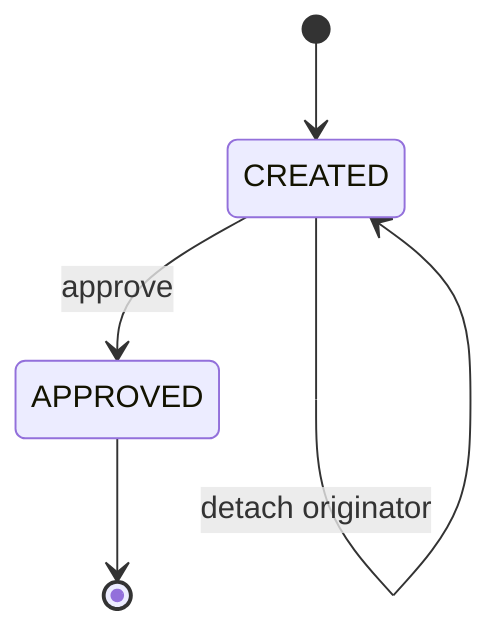
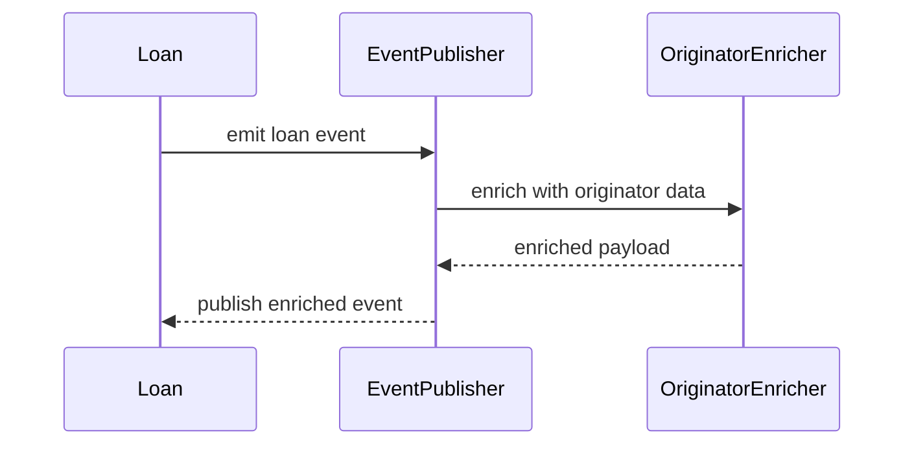

<!-- Labels: developer, originator -->
# Loan origination details (Merchant BNPL Checkout Capabilities)

This page documents the loan origination capabilities that attribute loan revenue to a loan originator (merchant, broker, affiliate, platform, or channel) to support revenue sharing and reporting. The feature is designed as an optional module with its own data model, API surface, event enrichment, and reporting extensions. The originator information is stored at the loan level as metadata and is designed to be retrievable and consumable by downstream reporting and event consumers. The key design guarantees are that the module remains optional, supports 1:N (or N:M) originator associations per loan, and preserves backward compatibility through optional fields in events and reports.

### Conceptual boundaries and guarantees
- Optional module: the originator capability is disabled by default and activated via configuration. When disabled, standard loan behavior remains unchanged.
- Loan-level metadata: the Originator ID (also referred to as Revenue Share ID) is stored at the loan level as part of the originator association and is exposed in loan retrieval when requested.
- Non-transformative: no automatic transformations or validations are applied to the Originator ID beyond existence checks and registration validations.
- 1:N/N:M association: the design supports multiple originators per loan, even though typical usage attaches a single originator.
- Backward compatibility: the originator field is modeled as optional in events and associations to avoid breaking existing consumers.
- Reporting and events: originator information is propagated to all relevant events and included in the Transaction Summary and Trial Balance reports for revenue sharing calculations by PayPal and merchant partners.

### Scope and optionality
- The module is optional and encapsulated under a distinct component that can be registered conditionally.
- The module’s schema, events, and reporting extensions are enabled only when configured to do so.
- The originator feature is designed to be non-disruptive for tenants not using it, with optional registry and association wiring.

## Data model (conceptual)
Two core concepts underpin the data model: a registry of canonical originator partner records and an association between loans and originators. The registry stores canonical partner data; the association represents which originators are linked to a given loan.

### A) Originator registry (canonical partner records)
- id: PK
- originator_name: nullable
- originator_external_id: required, unique
- originator_type_cv_id: nullable; code value
- origination_channel_type_cv_id: nullable; code value
- status: ACTIVE/PENDING/INACTIVE (LLD mentions status)
- audit columns

### B) Association (loan ↔ originator)
Because the loan API returns a list originators, the association is designed for 1:N (or N:M) usage.
- id: PK or composite (loan_id, originator_id)
- loan_id: FK to m_loan
- originator_id: FK to m_loan_originator
- audit columns

### C) Metadata placement
- The Originator ID (Revenue share id) is stored as metadata at the loan level and is linked via the originator association list on loan retrievals and events.

## API design
The following API surfaces support registry management, loan association, and enriched loan retrieval. All endpoints are designed to be optional and backward-compatible where indicated.

### Originator registry APIs
- POST /loan-originators — create a new originator
- GET /loan-originators — fetch originators
- PUT /loan-originators/{originatorId} and /loan-originators/external-id/{originatorExternalId} — update status/fields
- DELETE /loan-originators/{originatorId} and /loan-originators/external-id/{originatorExternalId} — delete originator

Validations
- originator_external_id must be unique
- Provided originator type and channel type code values must exist when supplied

Response
- Returns both resourceId and resourceExternalId

### Attach/detach originator to loan
- POST /loans/{loanId}/originators/{originatorId}
- DELETE /loans/{loanId}/originators/{originatorId}
- GET /loans/{loanId}/originators (and external-id variants)

Validations
- Attach/detach allowed only while the loan is in the CREATED state (i.e., before approval)
- Cannot attach the same originator twice; cannot detach an originator that is not attached

### Retrieve Loan API extension
- Extension: associations=originators or associations=all
- Response includes originators: [{ id, name, status, typeId, externalId, channelTypeId }]

### Create and attach during loan creation flow
- During loan creation, originators can be supplied as a field originators (LIST) with the following possible fields:
 - externalId, id, name, typeId, channelTypeId
- If id is provided, the existing originator is attached to the loan; if externalId is provided, an originator with that externalId is attached or created (depending on global configuration) and attached to the loan; other fields are optional and may create a new originator if externalId is not existing yet.

Global configuration
- enable_originator_creation_during_loan_application: default false

### Global data exposure in loan details
- When the association originators is requested, the loan details response can include originators with fields such as id, name, status, originatorTypeId, externalId, channelTypeId, and any partner-type synonyms as defined in the model.

## Event propagation and enrichment
The system enriches loan and loan transaction events with originator data to allows downstream consumers to compute revenue sharing. The event model uses an optional field originators (array of records) in external business events (Avro). This extension preserves backward compatibility by defaulting the new field to null if not populated.

Enrichment timing
- On loan-related events (e.g., disbursement, repayment), the event publisher constructs the base loan event payload and the originator module enriches this payload by mapping the loan to originator(s) via the registry and association. The enriched event is then emitted to consumers.

Payload considerations
- The originators field in the event payload is optional and defaulted to null when not used by the tenant.

## Reporting extensions
Two reporting outputs are extended to reveal originator information:
- Transaction Summary Report
- Trial Balance Report

In both reports, the MerchantOriginator external id is exposed to support revenue sharing calculations by PayPal and partner merchants.

## End-to-end flows
### Flow A: Create originator + attach to loan
1) Partner is created via POST /loan-originators with an externalId.
2) The loan is created as part of the normal loan flow.
3) The originator is attached to the loan via POST /loans/{loanId}/originators/{originatorId} (or external-id variant).
4) Retrieve the loan with associations=originators to confirm attachment and view originator details.

### Flow B: Loan event publication with originator enrichment
1) A loan lifecycle action occurs (e.g., disbursement, repayment).
2) The event publisher constructs the base loan event payload.
3) The originator module enriches the payload with originator(s) by mapping the loan to originator records.
4) The enriched event is emitted to consumers who can compute revenue sharing externally.

### Flow C: Reporting integration
1) Reports are generated with originator data joined from the originator registry and mapping.
2) The outputs include merchantOriginatorId in the Trial Balance and Transaction Summary exports.

## State and lifecycle considerations
Attach and detach operations are governed by loan state: they are allowed only while the loan is in the CREATED state and before approval. Once the loan is approved, attachments cannot be added or removed using the attach/detach endpoints. Idempotency checks prevent double-attach or double-detach attempts.

## Security, auditing, and governance
Access to originator management and loan-originator associations is guarded by permissions:
- CREATE_LOAN_ORIGINATOR, UPDATE_LOAN_ORIGINATOR, DELETE_LOAN_ORIGINATOR
- ATTACH_LOAN_ORIGINATOR, DETACH_LOAN originator
Audit fields on originator records and mappings are auto-filled to maintain traceability of changes.

## Low-level design
A dedicated module is introduced to house the originator capability:
- New module: fineract-loan-origination
- New entity m_loan_originator
 - id: PK, auto-generated
 - originator_name: string, optional
 - originator_type_cv_id: code value (MERCHANT / BROKER / AFFILIATE / PLATFORM), optional
 - originator_external_id: string, unique, required
 - origination_channel_type_cv_id: code value (ONLINE / IN_STORE / API / AGGREGATOR), optional
 - created_on, created_by, last_modified_on, last_modified_by: audit fields, auto-filled
- New entity m_loan_originator_mapping
 - id: PK
 - loan_id: FK to m_loan, required
 - originator_id: FK to m_loan_originator, required
 - created_on, created_by, last_modified_on, last_modified_by: audit fields, auto-filled

### API surface (summary)
- POST /loan-originators — create originator (returns resourceId and resourceExternalId)
- PUT /loan-originators/{originatorId} and /loan-originators/external-id/{originatorExternalId} — update originator
- DELETE /loan-originators/{originatorId} and /loan-originators/external-id/{originatorExternalId} — delete originator
- GET /loan-originators — fetch registry entries
- Attach originator to loan: POST /loans/{loanId}/originators/{originatorId} (or external-id variant)
- Detach originator from loan: DELETE /loans/{loanId}/originators/{originatorId} (or external-id variant)
- GET /loans/{loanId}/originators — fetch originators attached to a loan (or external-id variants)
- Retrieve Loan API extension: add associations=originators or associations=all to include originator lists in loan payloads
- Create loan with originators: during loan creation, provide originators array with fields such as id, externalId, name, typeId, channelTypeId

### Configuration and deployment
- Module packaging: fineract-loan-origination
- Conditional bean wiring: @ConditionalOnProperty(name="fineract.module.loan-origination.enabled", havingValue="true")
- Property: fineract.module.loan-origination.enabled=false (default)
- Global flag to allows on-the-fly originator creation during loan application: enable_originator_creation_during_loan_application (default false)

## Example payload shapes (high level)
- Originator registry create (excerpt)
 - externalId: unique string, required for creation
 - name, status, originatorTypeId, channelTypeId: optional
- Loan creation with originators (excerpt)
 - originators: [ { id, externalId, name, typeId, channelTypeId } ]
 - If id is provided, the originator is attached to the loan; if externalId is provided, an originator with that externalId is attached or created and attached according to global configuration

## Reporting and external consumers
- The originator external id (merchantOriginatorId) is surfaced in the Transaction Summary Report and Trial Balance Report to supports revenue sharing calculations for merchant partners.
- External business events carry an optional originators field to allows downstream revenue attribution without breaking existing consumers.

## Diagrammatic views
Flow and state transitions related to originator attachment are governed by the loan’s lifecycle. The following Mermaid diagrams illustrate the high-level relationships and gating rules.



### Flow A (sequence): Create originator + attach to loan
sequenceDiagram
 participant Partner as Partner
 participant Originator as LoanOriginatorService
 participant Loan as LoanService
 Partner->>Originator: POST /loan-originators (externalId)
 Originator-->>Partner: 200 OK (resourceId, resourceExternalId)
 Partner->>Loan: create loan
 Loan-->>Partner: loanId
 Partner->>Loan: POST /loans/{loanId}/originators/{originatorId}
 Loan-->>Partner: 200 OK with mapping
 Partner->>Loan: GET /loans/{loanId}?associations=originators
 Loan-->>Partner: originator details included
```



## Important validations and invariants
- Originator external id must be unique within the registry.
- Location-based validations verify code values exist for originator type and channel type when provided.
- Attach/detach operations are permitted only while the loan is in the CREATED state; once the loan progresses to APPROVED, changes to originator associations are not allowed via these endpoints.
- Duplicate attachments are rejected; removing a non-attached originator is rejected.
- The Originator ID field is optional in loan records and events; when absent, no originator association is reported.

## Impact and governance
- Access to all originator management and loan-originator association operations is controlled by dedicated permissions.
- Audit fields track creation and modification of originator records and their mappings to loans.

This publication conveys the verified design and behavior for the Merchant BNPL Checkout Capability to track loan originators within Pepper-Soup’s loan origination framework. It follows the referenced feature description, its optional deployment model, and the enrichment and reporting extensions required for revenue sharing with merchants.