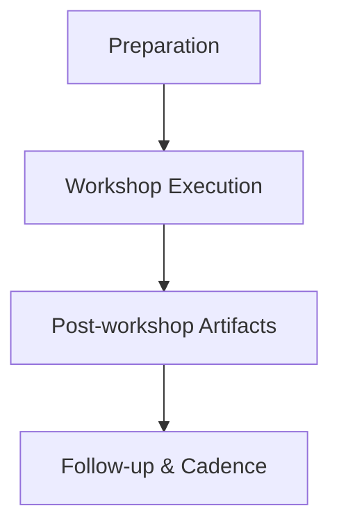

<!-- Labels: developer, partner-collaboration -->
# Workshop between Mifos and PP team for long-term relationship-building and collaboration

The Pepper-Soup program emphasizes sustained collaboration with partner teams. This workshop between Mifos and the PP team is structured to establish a durable, trust-based relationship, align on shared objectives, and define a governance and collaboration model that can scale over time. The session does not enact production changes or platform deployments; rather, it creates the foundation for coordinated joint work and sets the stage for future initiatives. The output is a collaborative charter, a high-level roadmap, and agreed working practices that participants can adopt in subsequent engagements.

### Objectives

- Build mutual understanding of strategic goals and capabilities across Mifos and PP teams. 
- Establish a governance framework for decision rights, escalation paths, and information sharing. 
- Map capabilities and identify joint initiatives with high impact and feasible scope. 
- Define success criteria, metrics, and a cadence for reviews to verify continuous alignment. 
- Address data handling, security, and confidentiality considerations relevant to future collaborations. 
- Agree on the process for integrating future external-system work, including how interaction contracts would be defined and maintained.

### Scope and boundaries

- In-scope: planning and alignment activities that establish how the two teams will collaborate, including discovery of joint initiatives, capability mapping, risk assessment, and governance definitions. 
- Out-of-scope: production deployments, detailed technical designs, or implementation workstreams. Detailed design and development will follow in separate engagements once collaboration is formally chartered.

### Participants and roles

- Mifos representatives: technical and product stakeholders responsible for articulating strategic objectives, capabilities, and risk considerations.
- PP team representatives: technical lead, product owner, and integration specialists responsible for partnering on feasibility, dependencies, and execution planning.
- Facilitator: neutral moderator responsible for guiding discussions, documenting decisions, and verifying productive collaboration.
- Observers: any additional stakeholders may participate in a limited capacity to provide context, as agreed in advance.

### Interaction contracts and external-system considerations

If future work involves integration with external systems or ledger postings, the participants will define an interaction contract during subsequent engagements. The contract will address data payload semantics, sequencing, error handling, and reconciliation with the ledger . Any shared data handling will respect applicable privacy and security requirements, and access controls will be agreed as part of the collaboration charter.

### Process and sequencing

1) Preparation
- Align on the workshop’s objectives, success criteria, and scope. 
- Gather and circulate pre-reads, including high-level business goals, potential collaboration areas, and any constraints or compliance considerations. 
- Establish a lightweight success framework and a draft agenda for the workshop.

2) Workshop execution
- Conduct joint sessions to clarify strategic objectives, map capabilities, and explore candidate joint initiatives. 
- Identify dependencies, risks, and cross-team responsibilities. 
- Agree on governance structures, decision rights, escalation paths, and information-sharing principles. 
- Produce a working draft of the collaboration charter and a high-level roadmap for follow-up activities.

3) Post-workshop artifacts
- Formalize decisions in a collaboration charter and capture actions, owners, and due dates. 
- Create a joint roadmap outlining prioritized initiatives, milestones, and review cadences. 
- Establish a shared artifact repository or workspace for ongoing updates and decisions, with access controls defined.

4) Follow-up and cadence
- Schedule regular collaboration reviews to assess progress against the roadmap and adapt as necessary. 
- Maintain open channels for ad-hoc questions, issue escalation, and knowledge transfer between teams.

### Artifacts and governance

Deliverables from the workshop are intended to include:
- A collaboration charter that codifies goals, governance, and working practices.
- A joint roadmap outlining prioritized initiatives, ownership, and timeframes.
- A risk register capturing key concerns and mitigation strategies.
- Data-sharing guidelines and security considerations relevant to future joint work.
- An agreed repository or workspace for ongoing artifact storage and versioning.

Governance focuses on clear decision rights, escalation procedures, and a sustainable operating rhythm that avoids duplication of effort and minimizes friction in future engagements.

### Data, security, and confidentiality

Participants will treat all workshop materials and any subsequently shared data as confidential. Any sharing of sensitive information will comply with applicable privacy and security requirements and be governed by the collaboration charter. Access to shared artifacts will be restricted to approved participants and maintained in a controlled workspace.

### Risks and mitigations

- Misalignment of strategic objectives: address via explicit objective articulation and a shared success framework during the workshop.
- Scope creep or drift in priorities: mitigate by locking a draft collaboration charter and a prioritized roadmap with owners and due dates.
- Insufficient stakeholder engagement: verify representation from both teams in key decision points and follow-up reviews.
- Information-security concerns: apply data-handling guidelines and access controls to any shared artifacts.

### Success criteria and measurement

- Clarity of joint objectives and alignment on collaboration model as evidenced by the collaboration charter. 
- Agreement on a prioritized, actionable joint roadmap with owners and milestones. 
- Defined governance, including decision rights and escalation paths, with documented processes. 
- Establishment of a reusable collaboration workspace and agreed data-sharing guidelines. 
- Positive feedback from participants on clarity of roles, expectations, and working relationships.

### Visual overview (workflow)

### Glossary

- Collaboration charter: A formal document that codifies the purpose, governance, principles, and working practices for a long-term partnership.
- Joint roadmap: A prioritized plan detailing shared initiatives, owners, milestones, and review points.
- Interaction contract: A future agreement describing data formats, sequencing, error handling, and reconciliation for any external-system integrations.

This publication presents the intended process for establishing a durable, cooperative relationship between Mifos and the PP team. It describes what the workshop aims to achieve, how the collaboration will be governed, and how artifacts and follow-ups will be managed to sustain productive, long-term engagement. It emphasizes clarity, disciplined governance, and secure, structured data handling as foundations for future joint work.