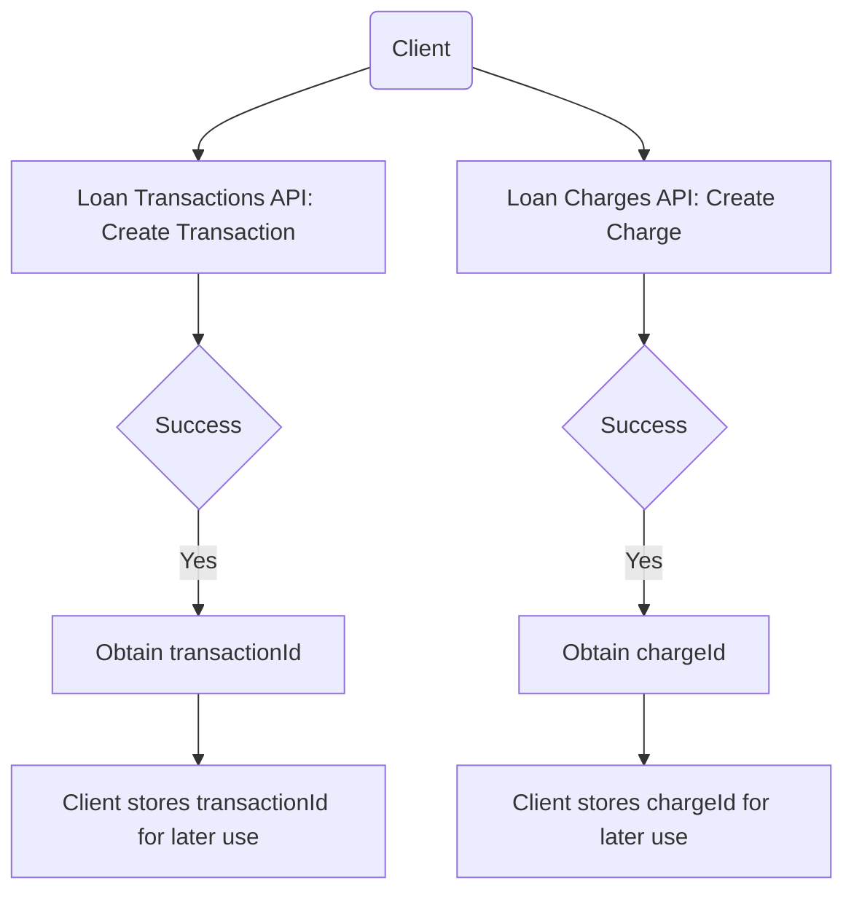

<!-- Labels: developer, pay-in-30-days -->
# Pay in 30 days - Phase 2 [Nice to have]

The Pay in 30 days - feature augments the BNPL workflow by enabling creation and management of loan-related transactions and loan charges through the core loan subsystem APIs. It centers on the Loan Transactions API for executing and adjusting transactional events (payments, refunds, waivers, credits, and reversals) and on the Loan Charges API for creating, paying, updating, waiving, adjusting, and deleting charges. The design guarantees that results from transactional operations are surfaced as resource identifiers that reference the created entities, enabling subsequent operations to reference those identifiers in a uniform way. The component’s primary boundaries are the loan subsystem surfaces exposed via REST, specifically the Loan Transactions API and the Loan Charges API.

### Scope and boundaries

- Primary surface: interactions with the loan subsystem through the Loan Transactions API (for executing and reverting transactions) and the Loan Charges API (for lifecycle management of loan charges).
- Outcomes are expressed as resource identifiers (transactionId or chargeId) that can be used in subsequent operations.
- The references provided describe the available HTTP methods, paths, and the fact that creating certain resources returns a resourceId associated to the created entity.

### REST API contracts and behavior

 specifies a set of HTTP endpoints for executing loan transactions and managing loan charges. The following endpoints are the documented surface for , including the HTTP method, path, and the reported outcome when applicable.

#### Loan Transactions API
- Execute loan transaction
 - HTTP method and path: POST /loans/{loanId}/transactions
 - Operations included (as command values): repayment, merchantIssuedRefund, payoutrefund, goodwillcredit, waiveinterest, writeoff, undowriteoff, recoverypayment, refundByCash, foreclosure, creditbalanceRefund
 - Result: resourceId is the transactionId
 - Notes: A successful execution yields a new loan transaction resource identifiable by its transactionId.
- Adjust loan transaction
 - HTTP method and path: POST /loans/{loanId}/transactions/{transactionId}
 - Operations included: chargeback, adjust (revert)
 - Result: resourceId is the transactionId

- Undo waive charge
 - HTTP method and path: PUT /loans/{loanId}/transactions/{transactionId}
 - Result: resourceId is the chargeId
 - Notes: Use subEntity for Loan Transaction? (as per the reference)

#### Loan Charges API
- Create loan charge
 - HTTP method and path: POST /loans/{loanId}/charges
 - Result: resourceId is the chargeId
 - Notes: The operation is described as not returning a transaction; it creates a charge resource.
- Pay loan charge
 - HTTP method and path: POST /loans/{loanId}/charges?command=pay
 - Result: resourceId is the chargeId
 - Notes: Use subEntity for Loan Transaction? (as per the reference)
- Update loan charge
 - HTTP method and path: PUT /loans/{loanId}/charges/{chargeId}
 - Result: resourceId is the chargeId
- Waive loan charge
 - HTTP method and path: POST /loans/{loanId}/charges/{chargeId}?command=waive
 - Result: resourceId is the chargeId
 - Notes: Use subEntity for Loan Transaction? (as per the reference)
- Pay loan charge (alternative path)
 - HTTP method and path: POST /loans/{loanId}/charges/{chargeId}?command=pay
 - Result: resourceId is the chargeId
 - Notes: Use subEntity for Loan Transaction? (as per the reference)
- Adjustment for loan charge
 - HTTP method and path: POST /loans/{loanId}/charges/{chargeId}?command=adjustment
 - Result: resourceId is the transactionId
 - Note: The reference questions whether it should be chargeId and subEntity to fit the pattern of other APIs.
- Delete loan charge
 - HTTP method and path: DELETE /loans/{loanId}/charges/{chargeId}
 - Result: resourceId is the chargeId

> The above mappings are derived from the documented API result mapping. They describe which operations create resources and what type of identifier is returned, without prescribing payload structures.

### Calculation references and surfaces

#### API result mapping (Calculation Reference)
The reference provides a mapping table that describes, for each operation, whether a new resource is created and what the result indicates:

| LoanTransactionAPI | Create transaction? | Result | Solution? |
| :--- | :--- | :--- | :--- |
| Execute loan transaction (multiple commands: repayment, merchantIssuedRefund, payoutrefund, goodwillcredit, waiveinterest, writeoff, undowriteoff, recoverypayment, refundByCash, foreclosure, creditbalanceRefund) | yes | resourceId is the transactionId | |
| Adjust loan transaction | yes | resourceId is the transactionId | |
| Undo waive charge | yes | resourceId is the chargeId | use subEntity for Loan Transaction? |
| LoanChargeAPI: Create loan charge | no | resourceId is the chargeId | |
| Pay loan charge | yes | resourceId is the chargeId | use subEntity for Loan Transaction? |
| Update loan charge | no | resourceId is the chargeId | |
| Waive loan charge | yes | resourceId is the chargeId | use subEntity for Loan Transaction? |
| Pay loan charge (again) | yes | resourceId is the chargeId | use subEntity for Loan Transaction? |
| Adjustment for loan charge | yes | resourceId is the transactionId | Should it be chargeId and subEntity to fit for the rest of the APIs? |
| Delete loan charge | no | resourceId is the chargeId | |

This table communicates the expected outcomes and identifiers for operations involved in executing transactions and managing charges, as evidenced by the named endpoints.

### Data flow and usage concepts (illustrative)

Mermaid flow illustrates the high-level interaction sequence between a client and the loan subsystem for creating transactions and charges, and then referencing the created identifiers in subsequent operations.

### Observed behavior and notable considerations

- Resource orientation: The design expresses results as resource identifiers (transactionId, chargeId), which are intended to be used in subsequent operations (e.g., adjustments, payments, and reversals).
- Endpoint coverage: The documented surface includes both transaction-oriented operations and charge-oriented operations, enabling a broad set of Pay in 30 days workflows.
- Ambiguities in wording: Some items in the reference raise questions about parameterization (for example, whether certain adjustments should reference chargeId and subEntity). The documented behavior reflects the wording present in the source data and highlights areas for future clarification.

### Execution context and lifecycle considerations

The provided references do not include a formal state machine, detailed event emissions, or specific COB batch job interactions for this scope. As a result, this document does not describe a state transition diagram, domain events, or background processing semantics beyond the REST API behavior and its resource-oriented results.

### Example payloads and responses

The references do not include concrete JSON payload examples. They specify the HTTP methods, endpoints, and the semantics of the results (resource identifiers) without prescribing exact payload structures. The published behavior supports the creation of resources whose identifiers are then used in subsequent calls.

### Educational summary for engineers

- When you create a loan transaction via the Loan Transactions API, expect a resourceId in the response that represents the new transaction's identifier. Use this identifier for future adjustments or reversals of that transaction.
- When you create or manage loan charges via the Loan Charges API, expect a chargeId as the primary identifier for the created or modified charge. Certain operations may require command parameters (for example, pay, waive, or adjust) in the request path or query string, as indicated by the documented endpoints.
- The system maintains a clear separation between transactions and charges, with each domain having its own lifecycle endpoints and identifiers.

If you need to implement or test scenarios, rely on the documented endpoints and the resource-id conventions described above to coordinate subsequent operations across transactions and charges.