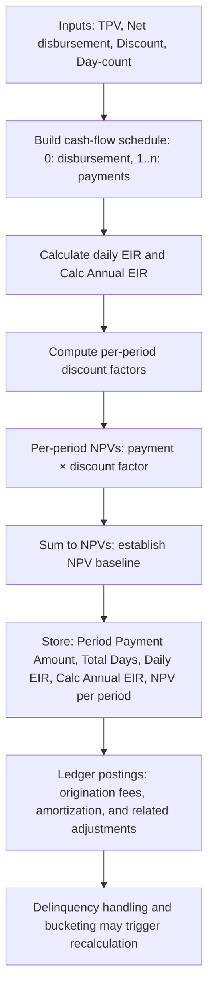

<!-- Labels: developer, projected-balances -->
# Planned / Projected balances and calculation to support new EIR calculation method

This page documents the technical behavior and data produced to support the new Effective Interest Rate (EIR) calculation method for the Pepper-Soup Working Capital product. The reference material describes a discount/fees-based financing model in which an up-front fixed fee is charged and subsequently amortized through the loan lifecycle. The calculation workflow yields per-period cash-flow values, discount factors, and net present value (NPV) figures that feed into projected balances and the overall EIR calculation. The material also shows how these values are stored, how they relate to general ledger postings, and how discount adjustments or delinquencies influence the projections.

Key concepts used in the reference data include:
- Up-front origination discounts/fees collected at disbursement and their amortization over the loan lifetime.
- Per-period cash flows (periodic repayments) and a per-period discounting mechanism based on a daily EIR that maps to a 360-day NPV convention.
- Storage of computed values at the loan-account level, including period-specific payment amounts, total days, daily EIR, and calc-annual EIR.
- Ledger postings that reflect origination fees as a liability (deferred income) and their amortization into income over time.
- The ability to adjust projections when discount-related assumptions change (partial, full, backdated adjustments).

The following sections explain the scope, data model implications, processing behavior, and representative calculations evidenced by the reference material.

---

### Scope and component changes evidenced by the reference data

From the reference content, the following aspects are involved in supporting the new EIR calculation method:
- Calculation core: The model stores and computes
 - Period Payment Amount
 - Total Days
 - Daily EIR
 - Calc Annual EIR
 - NPV value per period
 These values are visible in the provided calculation references and are used to project balances and compute the EIR.
- Cash-flow construction: The initial disbursement creates a negative cash flow (net disbursement), followed by a sequence of periodic payments. Discount factors are applied to cash flows to produce period-level NPV values.
- Discount factor mechanics: Each period shows a per-period discount factor (derived from the daily EIR) and an NPV value equivalent to the period's cash flow times that factor.
- Discount/fee accounting mappings: The reference exhibits accounting postings that connect origination discount fees to principal and deferred income, then amortize the deferred balance into income over time.
- Adjustments and scenarios: The reference includes discount adjustments (partial, full, and backdated) that propagate through amortization, NPV, and the forecast balance, indicating support for recalculation and revaluation of projected cash flows when discount assumptions change.
- Delinquency and bucketing: The reference includes a delinquency example with buckets (D00, D30, D60, etc.), grace days, and related timing rules that influence the expected payments and period calculations.

There is no in the reference data of a publicly exposed REST API contract change for the EIR calculation surface. The material focuses on internal financial calculations, ledger mappings, and the projection logic used to derive EIR-related values.

---

### Data model and persisted values (what changes or additions are evidenced)

The reference data indicates that projected balances and EIR calculations depend on a set of per-loan-account values, stored and updated as part of the calculation process:
- Period Payment Amount: The scheduled payment amount for each period.
- Total Days: The total number of days in the calculation horizon or period definition.
- Daily EIR: The daily effective interest rate used to discount future cash flows.
- Calc Annual EIR: The computed annual EIR derived from the daily EIR and day-count conventions.
- NPV value per period: The present value of the period's cash flow using the daily discount factor.

The data organization evidenced by the reference material implies that these values are produced and used at the loan account level to drive projected balances and inform EIR calculations.

For example, the calculation references show a per-period sequence where the initial disbursement is represented as a negative cash flow, followed by a series of period payments with associated discount factors and NPVs. The discount factors are shown as per-period multipliers (e.g., 0.998933325, 0.997867787, etc.), and the associated NPVs are the product of the period's actual payment and its discount factor (e.g., 49.94666623 for a 50 payment with a 0.998933325 factor).

---

### Accounting and ledger implications (up-front fees and amortization)

The reference demonstrates a ledger approach that captures up-front origination fees as a discount against principal and defers income until amortization occurs. A representative mapping from the Accounting-regular sheet shows:
- Up-front discount Fees posting:
 - Debit: Loans Receivable Principal (112601) — Asset, mapped to the Loan Portfolio
 - Credit: Deferred Interest (240005) — Liability, mapped to Deferred Income, under the Prin, Fees, and Penalty allocation
- Discount fees Adjustment (to amortize or reverse the upfront effect):
 - Debit: Deferred Interest (240005) — Liability
 - Credit: Loans Receivable Principal (112601) — Asset

These postings reflect the intended economic effect: the up-front discount increases the loan's reported principal, while a liability (deferred income) is recognized to be amortized into income as the loan progresses. The reference material also shows amortization steps that credit Interest income and debit the Deferred Interest account, expressing the recognition of income over time as the discount is amortized.

In addition, the reference contains detailed postings for repayments, repayments reversals, and charge-offs that interact with the same accounts (Loans Receivable Principal, Fee Receivable, Penalty Receivable, Deferred Income) and with the suspense/clearing accounts used during transaction processing. Those postings illustrate how the EIR-driven cash flows translate into ledger entries as the loan advances, is repaid, or incurs adjustments.

---

### Calculation method: inputs, factors, and outputs

The reference data defines the calculation flow in terms of the inputs and the resulting per-period values used to project balances and derive the EIR:
- Input parameters visible in the references include:
 - Period payment rate (for example, 18%)
 - Total Payment Volume (TPV)
 - Net disbursement (the amount disbursed to the borrower less any origination fees or discounts captured upfront)
 - Discount (origination fees)
 - NPV Day count (commonly 360 days)
 - Disbursement date and subsequent amortization dates
- Outputs per the references include:
 - Daily EIR and Calc Annual EIR (the per-day rate and its annualized equivalent)
 - NPV values per period (the present value of each period’s cash flow using the per-period discount factor)
 - The amortization schedule for the discount/fee over time, including the effect on the expected balance and the actual amortization each period, as shown in the example tables.
- The per-period discount factor is presented alongside each period’s NPV value. For example, a period with a 50 unit payment and a discount factor of 0.998933325 yields an NPV value of 49.94666623 for that period.
- The initial period typically reflects the net disbursement as a negative cash flow, establishing the opening balance against which future payments are discounted.

The reference material also shows how adjustments to the discount (partial, full, or backdated) propagate through the amortization schedule and NPV values, demonstrating the system’s capacity to recompute projected balances when assumptions about origination fees change.

---

### Calculation workflow (procedural outline)

1. Gather inputs for the EIR projection:
 - Period payment rate (e.g., 18%)
 - TPV (Total Payment Volume)
 - Net disbursement (net cash funded to borrower)
 - Origination discount/fees amount
 - Day-count convention (NPV Day count, e.g., 360)
 - Disbursement date and the planned amortization dates
2. Build the cash-flow sequence:
 - Time 0: a negative cash flow equal to the net disbursement (opening balance).
 - For each subsequent period: record the actual payment amount (e.g., 50) and the associated date.
3. Compute per-period discount factors:
 - Use the daily EIR to derive a discount factor for each period. The reference shows per-period discount factors such as 0.998933325 for the first period, 0.997867787 for the second, and 0.996803386 for the third, etc.
4. Compute per-period NPVs:
 - NPV per period = Actual Payment Amount × Discount Factor for that period.
5. Validate the opening and closing balances across periods:
 - Integrity rule: Each period's opening balance must equal the previous period’s closing balance.
6. Store calculated values:
 - Persist Period Payment Amount, Total Days, Daily EIR, Calc Annual EIR, and NPV value per period for the loan account.
7. Handle discount adjustments as needed:
 - Partial Discount Adjustment (S1), Full Discount Adjustment (S2), Backdated Discount Adjustment (S3) demonstrate how the amortization and NPV values are updated and re-posted.
8. Postings to GL and related accounts reflect the origination fee treatment and subsequent amortization, consistent with the accounting mappings described earlier.

This sequence follows the references’ presentation of an EIR-driven projection that combines a cash-flow schedule, per-period discount factors, and NPV values, while maintaining ledger consistency through the up-front discount accounting framework.

---

### Example: partial snapshot of the EIR calculation (illustrative)

The reference material provides a concrete, period-by-period illustration for a schedule with a disbursement date of 1/1/2019 and subsequent payments. The initial cash flow is the net disbursement, followed by a sequence of payments with associated discount factors and NPVs. A compact excerpt from the reference demonstrates the first few periods:

- Period 0 (Disbursement date 1/1/2019):
 - Cash flow: -9000
 - Discount factor: 1.0000000000
 - NPV value: -9000
- Period 1 (1/2/2019):
 - Actual payment: 50
 - Discount factor: 0.998933325
 - NPV value: 49.94666623
- Period 2 (1/3/2019):
 - Actual payment: 50
 - Discount factor: 0.997867787
 - NPV value: 49.89338934

These values illustrate how the model discounts future payments using a per-day EIR-derived factor and records the present value of each payment. The pattern continues for subsequent periods in the schedule and feeds into the overall EIR calculation.

Note: The numbers shown here are taken from the reference calculation excerpt and are intended to illustrate the calculation mechanics. They reflect the exact per-period discount factors and NPVs as presented in the reference data.

---

### Delinquency, buckets, and schedule recalculation

The reference contains a Delinquency Example with buckets (D00, D30, D60, D90, D120, D150, etc.) and grace days. It documents that delinquency status affects when payments are due and how periods are defined for EIR projection and minimum-payment calculations. The data demonstrates a mechanism to reevaluate schedules in light of delinquency progression and to reallocate payments and revenues .

---

### Edge cases and validation considerations

- Opening versus closing balances: The projection must verify that each period’s opening balance equals the previous period’s closing balance, preserving continuity across the schedule.
- Discount adjustments: The system models partial, full, and backdated discount adjustments, and these adjustments propagate through amortization, NPV values, and the forecast balance.
- Delinquency handling: Buckets and grace day rules influence payment timing and the calculation horizon, potentially altering period counts and discounting behavior.
- Ledger consistency: The accounting mappings for origination fees and subsequent amortization must balance when journal entries are available. The floating values in the reference indicate precise postings that must be preserved for correctness.

---

### Mermaid diagram: EIR calculation flow (verified behavior and relationships)

---

### Summary of -backed behavior

- The EIR calculation method for the new PPWC product relies on an up-front fixed fee (origination fees) that is amortized over time, with a 360-day NPV convention and a per-day discount factor derived from a daily EIR.
- Projected balances are driven by a cash-flow schedule that starts with net disbursement and is discounted using per-period factors to produce period NPVs.
- The per-loan-account values persisted or computed include Period Payment Amount, Total Days, Daily EIR, Calc Annual EIR, and NPV value per period.
- Discount accounting shows origination fees posting to Loans Receivable Principal and Deferred Income, with subsequent amortization into income and associated adjustments when needed.
- The reference includes scenarios for discount adjustments (partial, full, backdated) and delinquency progression, illustrating how projections and accounting are recalibrated when assumptions change or when delinquency states evolve.

This page captures the verified calculations, data relationships, and ledger implications evidenced by the reference data, and presents them as the authoritative description of the planned / projected balances and calculation for the new EIR method.