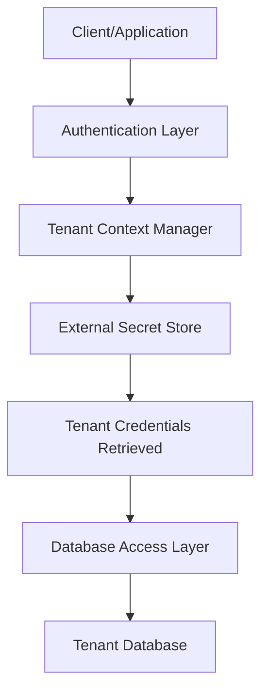

<!-- Labels: developer, security -->
# Improve tenant separation and security

This page documents the verified product behavior for enhancing tenant separation and security in Pepper-Soup. The initiative aims to prevent tenants from accessing other tenants’ data and to remove plain text password storage. The proposed solution introduces per-tenant authentication with credentials retrieved from an external secret store. It is a breaking change; credentials are encoded and not available to non-authorised access. Old plain text passwords are removed from the database. Tenants have been migrated in development and test environments, and a migration plan is available.

### Overview of the verified changes
The reference scope confirms four core pillars of the enhancement:
- Per-tenant authentication: authentication is scoped to individual tenants.
- External secret store: tenant database credentials are retrieved from an external secret store rather than being stored in plain text locally.
- Credential encoding and access control: credentials are encoded and not accessible to unauthorized components or users.
- Password deprecation and migration: old plain text passwords are removed from the database, and tenants have been migrated in development and test environments with a formal migration plan.

This is identified as a breaking change. The verified acceptance criteria include that credentials are encoded and not available to non-authorised access, old passwords are removed from the database, and tenants have been migrated in dev/test environments with a migration plan in place.

### Technical scope and changes (verified)
The reference describes the following areas as modified or introduced to achieve improved tenant separation and security. Exact implementation details (such as concrete class names, module boundaries, or API surfaces) are not specified in the reference data; the statements below capture the confirmed behavioral changes and architectural intent.

- Per-tenant authentication model
 - Authentication behavior is scoped to individual tenants. Each tenant operates within its own authentication context, preventing cross-tenant data access during authentication and authorization checks.
 - Access to backend resources is performed using tenant-specific credentials fetched from a secret store, rather than relying on globally shared credentials.

- External secret store integration
 - Tenant database credentials are retrieved from an external secret store per tenant. The secret store acts as the source of truth for the credentials used to connect to each tenant’s database.
 - Retrieval occurs in the authentication flow prior to establishing a connection to the tenant’s data store.

- Credential encoding and access controls
 - Credentials are encoded and not available for non-authorised access. Components that do not possess the proper authorization context or permissions should not be able to view or retrieve raw credentials.
 - This reduces exposure risk and limits the potential for credential leakage within the system.

- Password handling and migration
 - Old plain text passwords present in the database are removed as part of the effort to eliminate plain text storage.
 - New per-tenant authentication relies on credentials stored in the external secret store, rather than plain text entries in the local database.
 - Tenants have been migrated on development and test environments to validate the end-to-end flow before any production rollout.

- Migration planning and verification
 - A migration plan exists and is available for coordination and execution. The reference confirms that a migration plan is available and that migrations have occurred in dev/test environments.

### What changed in the security model
Before this change, tenant data could be associated with credentials stored in a less restricted manner, potentially exposing less isolation between tenants. The verified changes establish a per-tenant authentication boundary and rely on an external secret store for credentials, which is not exposed to unauthorized components. Credentials are encoded to reduce risk of exposure, and access to raw credentials is restricted to authorized operations only.

### Data persistence and schema considerations (high level)
- The system no longer relies on plain text passwords stored within the local database for tenant authentication. Instead, credentials are retrieved from an external secret store as part of the authentication flow.
- The reference does not include specific DDL or database schema details. It notes the removal of old passwords from the database and the shift to secret-store-based credentials.

### Migration plan and environment status
- Tenants have been migrated in development and test environments as part of the rollout.
- A migration plan is available to guide production rollout, sequencing, and rollback considerations when moving beyond development and testing.

### Public API surface
The reference data does not specify changes to public REST or internal service APIs. No API surface details are documented in the provided material. Any public-facing API changes would be captured in the migration plan and accompanying implementation guidance.

### Acceptance criteria (verified)
- Credentials are encoded and not available for non-authorised access.
- Old passwords are removed from the database.
- Tenants have been migrated on dev/test environments.
- A migration plan is available to support broader rollout.

### Architecture flow (per-tenant authentication using external secret store)

### Why this matters
Isolating authentication per tenant and moving credential storage to an external secret store reduces the blast radius of credential leakage and strengthens privacy boundaries between tenants. Encoding of credentials further mitigates exposure risk in case of data access anomalies. The migration to per-tenant authentication also lays groundwork for more granular access controls and auditability at the tenant level.

- Credentials encoded and not available for non-authorised access.
- Old passwords removed from database.
- Tenants migrated on dev/test environments.
- Migration plan is available.
- This is a breaking change.