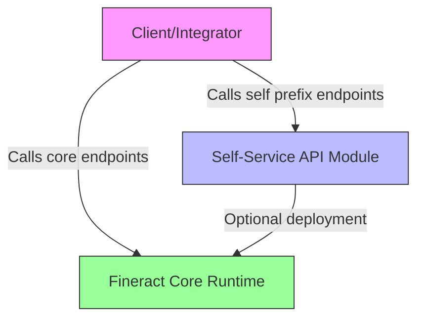

<!-- Labels: developer, security -->
# Self-Service API

This publication describes the Self-Service API as an enhancement to the platform, focusing on architectural separation and an isolated surface for self-service functionality. The central idea is to move all REST endpoints that begin with the self prefix into a dedicated module, packaged and deployed independently from the core Fineract runtime. By design, the core Fineract service can start and operate without the self-service module present. This separation is intended to reduce security risks associated with weak authentication by isolating the self-service surface, while leaving room for future integration with third-party authentication mechanisms. Note that third-party authentication is out of scope for this enhancement.

### Purpose and scope

- Goal: Eliminate security concerns arising from weak authentication by introducing an external mechanism through a self-service surface. The reference scenario envisions the possibility of third-party authentication as a longer-term benefit, but integration with such mechanisms is outside the current scope.
- Scope: The Self-Service API surfaces are implemented as a custom module separate from the core Fineract platform. All REST endpoints prefixed with self are provided by this module.
- Acceptance criteria: The self-service surface is packaged independently and physically separated from Fineract. Fineract should start without the self-service module present.

### Architectural model

- Standalone module: The Self-Service API is a standalone module that can be deployed alongside the core Fineract runtime. When present, it hosts all endpoints that share the self prefix.
- Core startup behavior: The core Fineract service initializes without requiring the self-service module. The absence of the self-service module does not prevent Fineract from starting or serving non-self-service functionality.
- Architectural boundary: The self-prefix endpoints constitute a distinct surface that is isolated from the core API surface. This boundary supports independent lifecycle management, deployment, and security considerations for the self-service functionality.

### Surface and behavior

- API surface: All REST endpoints that are prefixed with self are served by the Self-Service API module. These endpoints form the self-service surface and are not exposed by the core runtime when the module is not present.
- Availability: If the self-service module is not deployed or started, self-prefixed endpoints are unavailable. When the module is deployed and running, clients may invoke the self-prefix endpoints to access self-service functionality.
- Interaction with core: The core Fineract runtime continues to handle its own endpoints independently of the self-service module. Requests to the self-prefix surface do not route through the core runtime when the self-service module is active; instead, they are handled by the dedicated module.

### Deployment and lifecycle guidance

1. Package the Self-Service API as a separate module artifact. This artifact is built and deployed independently from the core Fineract distribution.
2. Deploy the self-service module alongside the core Fineract runtime. The core should be able to start and operate without this module present.
3. Start the core Fineract runtime first, without requiring the self-service module. This establishes a baseline operation for the platform.
4. Optionally deploy and start the Self-Service API module to expose the self-prefixed endpoints. When started, the module serves the self surface and operates in isolation from the core surface.
5. Clients and integrators interact with the self-prefix endpoints when the self-service module is active. If the module is inactive, calls to self-prefixed paths will not be routable.

### Diagram: deployment and interaction boundaries

### Considerations for integration and evolution

- Authentication posture: The Self-Service API surface is designed to be isolated from the core. The stated long-term goal envisions stronger authentication through third-party mechanisms, but such integration is not part of this enhancement.
- Operational independence: The independence of the self-service module allows separate deployment cycles, scaling, and security controls for the self-service surface without impacting core functionality.
- Data and persistence: The documentation surrounding this enhancement does not prescribe changes to data models or persistence layers within the core or the self-service module. Any future changes to data contracts would be governed by separate specifications.

### Related notes

- This page documents the product behavior for the Self-Service API as an architectural enhancement. It describes the verified behavior and design decisions that pertain to packaging, startup order, and the separation of concerns between the core runtime and the self-service surface.
- 3rd party authentication is acknowledged in the goal, but its implementation is outside the scope of this enhancement and will require a distinct set of contracts and migration steps if pursued.