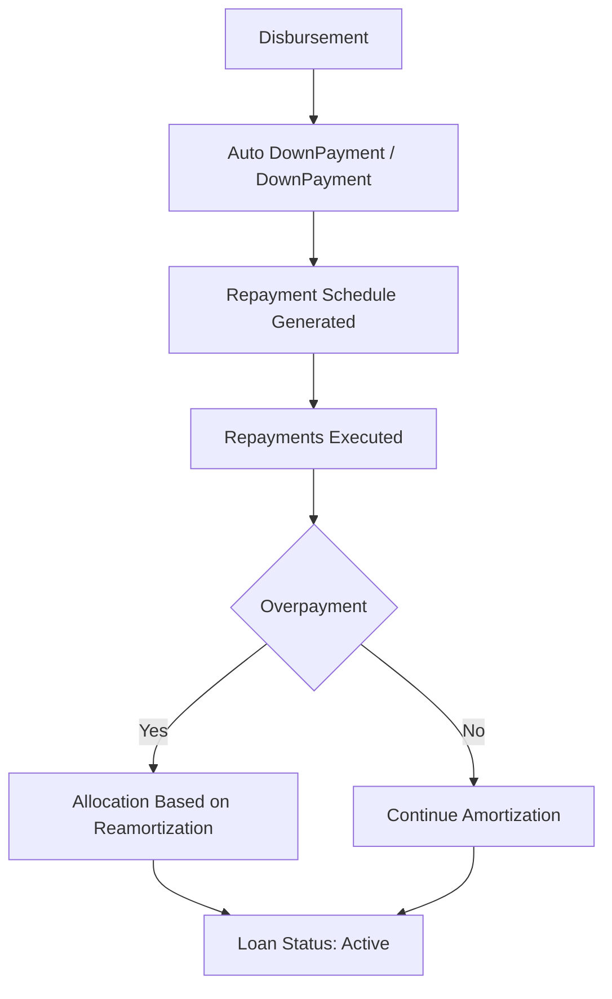

<!-- Labels: developer, stability -->
# Dev - Pi 3 & 4 Post-Production Stability

This page documents the verified behavior and observed patterns for Pi 3 and Pi 4 post-production stability within the Pepper-Soup project, using the provided downpayment enhancements reference as the primary exemplar. The material focuses on the calculation logic, transaction sequences, and integrity considerations evidenced by the reference data. It does not introduce new capabilities beyond what is represented in the references. Where the reference data does not specify an implementation contract, the page notes these gaps clearly.

### Context and objective

The reference data section titled “Calculation Reference: downpayment enhancements v2” provides four scenarios (S1–S4) that exercise how overlapping flows of disbursement, downpayments (automatic and manual), and repayments interact when the loan is in an overpaid state. Each scenario presents a sequence of transaction rows with columns such as Transaction Type, Business Date, Transaction Date, amount, Installment Date, Principal, DP Principal, Interest, Fees, EMI, Due, Paid, and Overpaid. A recurring element across the scenarios is the presence of an Allocation Rule described as “Based on Reamortization,” indicating that the amortization schedule may be recalculated in response to downpayments or overpayments.

The material demonstrates how the system records and visualizes the evolving loan state through successive events, culminating in a Loan Status of Active. It also highlights cases where auto-downpayment activity is suppressed (NO AUTODOWNPAYMENT) when the overpayment amount is adjusted against the downpayment amount.

### Execution context (what is evidenced)

- Core calculation references: The material centers on a calculation engine named downpayment enhancements v2 and its handling of overpayments relative to the downpayment amount.
- Transaction sequences: Each scenario shows a fixed sequence of transaction types and dates, including Disbursement, Auto DownPayment, DownPayment, and Repayment events, followed by additional repayments or allocations on subsequent dates.
- Allocation and reamortization: All scenarios reference an Allocation Rule described as “Based on Reamortization,” implying that the outstanding balance and schedule may be recomputed when the downpayment or overpayment is applied.
- Loan state: Across the scenarios, the loan status resolves to Active after the sequence of events, indicating the process maintains and transitions the instrument state consistently through the flow.
- Overpayment accounting: Each scenario tracks an Overpaid value at various points, illustrating how excess payments are recognized and carried in the ledger until reallocation (or until the next relevant event).

### Data model and persistence (observed structures)

The reference data encodes transaction details in tabular form with the following columns:

- Transaction Type: The kind of financial event (for example: Disbursement, Auto DownPayment, DownPayment, repayment).
- Business Date: The date used for business processing of the entry.
- Transaction Date: The date attributed to the underlying activity in the ledger.
- Amount: The monetary value associated with the transaction.
- Installment Date: The date on which the associated installment is due or scheduled.
- Principal: The principal portion associated with the row, when applicable.
- DP Principal: The portion of the principal allocated as downpayment (or subsequent adjustment thereto).
- Interest: Interest portion, when applicable.
- Fees: Any fees associated with the item.
- EMI: Equated monthly installment or payment amount, when applicable.
- Due: The amount due for the transaction as tracked by the schedule.
- Paid: The amount actually paid against the due.
- Overpaid: The excess amount beyond the due or the allocated downpayment, as tracked per entry.

These columns appear across the four scenario tables, demonstrating the granularity used to verify alignment between input actions, allocation decisions, and resulting balances.

### Scenario summaries and observed behaviors

The reference data defines four distinct scenarios that exercise different overpayment relationships with the downpayment.

1) S1 — Overpaid amount is lesser than the downpayment amount
- Context: Loan status shown as Overpaid during the flow.
- Key observations: The sequence includes an initial Disbursement of 500, an Auto DownPayment of 125 (DP Principal 125), followed by a repayment of 400 (DP Principal 125 allocated to the first repayment). A subsequent repayment date (1/31/22) continues to reflect 125 toward the DP principal, and by 2/15/22 the cumulative recapture shows an Overpaid value of 25.00. The flow culminates with the loan remaining in Active status.
- Notable mechanism: NO AUTODOWNPAYMENT appears when the overpayment amount is adjusted against the downpayment, indicating the system suppresses automatic downpayment in favor of applying the overpayment to other portions of the schedule.

2) S2 — Overpaid amount is greater than the downpayment amount
- Context: The loan status remains Overpaid in this scenario as well.
- Key observations: The disbursement and DP events are followed by repayments that cover the DP amount and push the overall remaining balance. The 2/15/22 Installment Date shows an Overpaid value of 125.00, illustrating that the overpayment exceeds the initial downpayment and alters subsequent allocations.
- Notable mechanism: Allocation continues under the assumption of reamortization, with a portion of the overpayment reallocated into the schedule to maintain a consistent amortization path.

3) S3 — Overpaid amount is equal to the downpayment amount
- Context: Loan status remains Overpaid through the progression; the downpayment equals the overpaid portion in aggregate terms.
- Key observations: The sequence mirrors S1 with an equalization between the downpayment and the overpaid amount reflected in the 2/15/22 row as an Overpaid value of 50.00. The distribution of the DP Principal across successive repayments continues to drive a recalibrated amortization profile, with the loan remaining Active.
- Notable mechanism: The interplay between downpayment and overpayment leads to a fixed reallocation in the later installments rather than creating a larger immediate overpayment balance.

4) S4 — Overpaid amount is greater than the disbursement amount
- Context: The annotated sequence begins with a simple Disbursement, and the scenario is labeled as Overpaid with the overpayment exceeding the initial disbursement amount.
- Key observations: The table set demonstrates the same transaction types (Disbursement, DownPayment, repayment, and related Disbursement entries) with the emphasis on how the overpayment interacts with the disbursed principal. The explicit Overpaid value is not fully enumerated in all rows within the provided references, but the pattern indicates continued reallocation of the overpayment according to a reamortization rule, sustaining an Active loan state.
- Notable mechanism: The scenario reinforces that the system supports overpayment-driven reallocation even when the overpayment outstrips the initial disbursement amount.

For all scenarios, the reference consistently includes an entry labeled “Allocation Rule - Based on Reamortization,” signaling that the calculated amortization schedule can be recomputed in response to downpayment and overpayment events.

### Diagram: downpayment enhancements flow (evidenced behavior)

This diagram captures the high-level sequence observed across the scenarios: a funding event, a downstream downpayment action (either automatic or manual), generation of a repayment schedule, execution of repayments, and a decision point where overpayment triggers a reamortization-based allocation, with the loan eventually reported as Active.

### Implementation notes and observed constraints

- Control flow and scheduling: The reference presents discrete events with explicit business dates and transaction dates. The progression from Disbursement through DownPayment/Auto DownPayment to repayments implies an event-driven progression that must be preserved in any post-production validation harness.
- Data integrity: The sequences are designed so that, for each period, the opening balance implied by the previous period matches the closing balance of the preceding period, aligning with the integrity expectations for period-based financial calculations.
- Rounding and precision: The reference uses fixed numeric values for DP Principal, Overpaid, and related entries. When implementing or testing, verify that amounts maintain consistent precision and rounding behavior across all calculations and allocations. The reference does not specify rounding modes; verify alignment with the project’s standard rounding policy when reproducing or validating these scenarios.
- State and transitions: Each scenario’s narrative culminates with Loan Status: Active, indicating a stable continuation of the loan lifecycle even in overpayment conditions.

### Gap analysis and observability needs (GAP items)

The provided reference data focuses on the numerical and transactional flow for downpayment enhancements v2. It does not document:

- Specific Spring beans, services, or component boundaries involved in the Pi 3 & 4 post-production stability workflow.
- Public service contracts, method signatures, or REST interfaces that callers would rely on to trigger the described behaviors.
- Audit logs, domain events, or notification mechanisms emitted as part of the downpayment and reamortization flows.
- Retriable operations, failure modes, or compensating transactions beyond what is implied by the standard sequence of Disbursement, DownPayment, and Repayment events.
- UI controls, database table definitions, or exact persistence schemas beyond the transaction-rows representation shown in the reference.

Where these items are required for a complete mechanical implementation or integration, they remain as gaps available from the reference data. Annotate and investigate these gaps during deployment planning and test design.

### Practical validation guidance (based on )

To validate Pi 3 & 4 post-production stability against the documented reference, engineers should:

- Reproduce the four scenarios (S1–S4) using the exact transaction types and sequence observed in the reference data, verifying the resulting loan state ends as Active.
- Verify that the Allocation Rule - Based on Reamortization is invoked in the presence of a downpayment or overpayment and that the resulting amortization schedule remains consistent with the observed outcomes.
- Confirm that Disbursement, DP-related entries, and repayments form a coherent opening/closing balance chain across periods, satisfying the invariant that each period’s opening balance equals the previous period’s closing balance.
- Check for the correct handling of NO AUTODOWNPAYMENT, verifying overpayment is allocated according to the rules described in the scenarios where the amount is adjusted from the overpayment instead of auto-downpaying.
- Where available, examine any audit or event records produced during these flows to verify traceability and to assist troubleshooting in production.

This page uses the reference data as the basis for the observed behaviors and the associated stability considerations. Any extension to cover real service contracts, persistence details, or event-driven architectures must be validated against the actual implementation in the target environment.