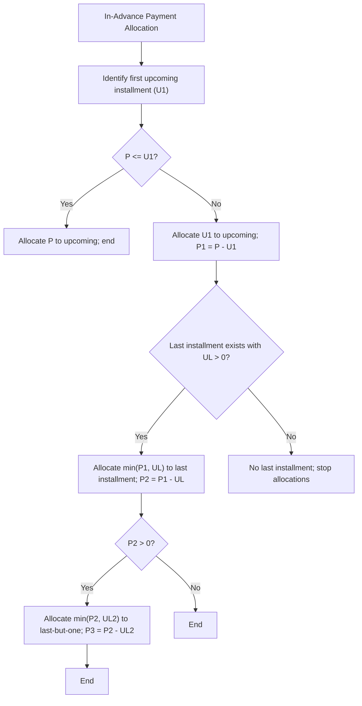

<!-- Labels: user, advanced-allocation -->
# Advanced payment allocation - Add further in advance allocation rules

This enhancement defines the behavior for allocating funds when a payment is made in advance against a loan where multiple installments are outstanding. The new strategy specifies the allocation order for unprocessed funds: first to the upcoming installment, and then to the last installment if any funds remain unallocated. It also covers an explicit exceptional path for cases where the early repayment amount exceeds both the first upcoming installment and the last installment outstanding. This change affects daily operations by clarifying the sequence of allocations that credit agents must apply and by making the resulting installment balances more predictable from the customer’s perspective.

### What changed and why it matters

Previously, in advance allocations followed a simpler implicit ordering that could leave unallocated funds ambiguous when multiple installments were involved. The enhanced rule verifies a deterministic allocation sequence, improving transparency for customers and reducing follow-up inquiries about how extra repayments are applied.

Key aspects of the change:

- Allocation priority now follows a defined order: upcoming installment first, then the last installment if any funds remain unallocated.
- An explicit exception handles scenarios where the early repayment amount is larger than both the first upcoming installment and the last installment outstanding; in that case, any remaining unallocated funds are applied to the last-but-one installment.
- The behavior applies to in-advance allocations; standard allocations to installments remain governed by existing rules for non-advanced payments.

### Allocation rules (verified behavior)

- Rule 1: Allocate unprocessed funds to the first (upcoming) installment’s outstanding amount first.
- Rule 2: If, after applying the upcoming installment, there is remaining unallocated amount, allocate it to the last installment’s outstanding amount.
- Rule 3 (exception): If the repayment amount is larger than both the upcoming installment outstanding and the last installment outstanding, allocate the remaining unprocessed amount to the last-but-one installment.

Note: The guidance indicates a two-step “Next installment then Last installment” approach, with an explicit exceptional path to the last-but-one when the repayment is large enough to cover both the first upcoming and the last installments.

### Updated interaction workflow for operations staff

1. When processing an in-advance payment, determine the outstanding amount of the first upcoming installment (U1).
2. If the payment amount P is less than or equal to U1, allocate P to the upcoming installment and finish.
3. If P is greater than U1, allocate U1 to the upcoming installment and set the remaining amount P1 = P − U1.
4. If there is a last installment with outstanding amount UL and P1 > 0, allocate min(P1, UL) to the last installment and set the remaining amount P2 = P1 − UL.
5. If P2 > 0 and a last-but-one installment exists with outstanding amount UL2, allocate min(P2, UL2) to the last-but-one installment (and continue only if the policy specifies further back allocations; otherwise stop).
6. After allocations complete, confirm that the sum of allocations equals the original payment amount, and that each installment balance reflects the allocations made.

These steps verify transparent, auditable application of in-advance payments with a clear allocation sequence.

### Calculations and financial integrity considerations

- Opening balances for affected installments are reduced by the allocated amounts in the sequence described above. The sum of allocations to the upcoming, last, and (if applicable) last-but-one installments must equal the original payment amount.
- Balances must reconcile at the end of the allocation process: opening balances minus allocated amounts for each installment, with the total of reductions equal to the payment amount.
- Rounding and precision follow the standard financial rules used elsewhere in the system; if any intermediate calculations involve fractions of a unit, apply the established rounding convention (e.g., HALF_UP or HALF_EVEN) consistently across all allocations in the same payment event.

### Example narrative (no dummy figures)

- Scenario A: An early repayment amount exactly matches the upcoming installment’s outstanding amount. The system applies the full amount to the upcoming installment and leaves the later installments unchanged.
- Scenario B: The repayment amount exceeds the upcoming installment’s outstanding amount but is not large enough to cover the last installment’s outstanding amount. The system applies the full U1 to the upcoming installment and allocates the remaining to the last installment until its balance is fully covered or the payment amount is exhausted.
- Scenario C (exception): The repayment amount is larger than both the upcoming and the last installment outstanding. After applying amounts to the upcoming and the last installments, any remaining unallocated funds are applied to the last-but-one installment.

In all scenarios, the allocations are recorded as distinct line items against the respective installments for traceability and reconciliation.

### Migration and operational considerations

- Activation scope: This behavior applies to in-advance allocations as part of the repayment and allocation workflow. Regular allocations retain their existing behavior unless otherwise specified in future updates.
- Reconciliation: After enabling or adopting the new rules, Operations should perform reconciliation reconciliations on representative loans to verify that allocations sum to the original payment and that outstanding balances reflect the allocations in the intended sequence.
- Training and user guidance: Provide updated guidance to loan officers, branch managers, and credit agents describing the new allocation order and the exceptional path to the last-but-one when applicable.
- Reporting: verify that repayment allocation reports reflect the allocation sequence in the loan’s installment ledger so that customers and staff can trace how an early payment was applied.

### Diagram: allocation flow (verified behavior)

### Verification and controls

- The implemented behavior must preserve the integrity of each period's opening balance as the prior period's closing balance.
- Payment allocations must reconcile with the transaction amount, so that the total allocated equals the original payment.
- Remaining cash and outstanding dues must reconcile after the allocation process.
- Where available, journal entries (if the system surfaces them) must balance across debit and credit accounts associated to the allocation events.
- All intermediate calculations, running balances, and rounding must adhere to the system’s established precision rules.

### Related considerations

- Compatibility: This change modifies the in-advance allocation pathway. Other allocation strategies remain unaffected unless explicitly updated in a future release.
- Documentation alignment: End-user guidance, training materials, and control dashboards should reflect the updated allocation order and the exceptional path to the last-but-one when applicable.

If you require a flow diagram in another format or need additional scenarios captured for training materials, please request an expanded diagram set for stakeholder reviews.