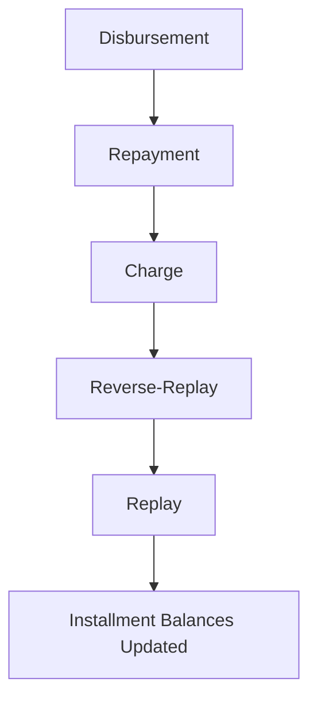

<!-- Labels: user, allocation-strategies -->
# Payment strategy by timely order

The Payment strategy by timely order is a repayment allocation design that governs how a loan’s incoming money is distributed across the components of an installment when multiple charges, penalties, and fees exist. Its business purpose is to provide predictable, auditable income recognition and to verify that charges and fees allocated to a loan are paid in a defined priority sequence. This feature benefits operations staff, loan officers, branch managers, and credit agents by clarifying how repayments are applied and by enabling consistent handling of charges and in-advance payments across loan servicing activities.

Key concepts andpractices

- Buckets and priorities: The strategy introduces distinct buckets for allocation, including:
 - Due charges
 - In advance principal
 - Penalty
 - Fee
 - Interest
 - Principal
- Allocation order: When a repayment transaction is executed, the system distributes the available amount according to the following order: due charges first, then in-advance principal, followed by penalty, fee, interest, and finally principal. This order applies to all eligible repayments and is designed to reflect the income and cost structure for the loan while respecting charge due dates.
- Charge handling: Charges are associated with a due date and are paid by repayments created after the charge due date. The allocation rules apply to any charge that attaches to the installment, including penalties and fees charged to the loan.
- Time sensitivity and correctness: Charges use the due date for allocation, while repayments use the transaction date. This distinction affects how funds are applied when charges become due or when repayments occur before or after due dates.
- Reverse-replay behavior: When a repayment transaction occurs or a charge is added, the system may reverse and replay the repayment allocations to recalculate the installment balances. The process starts from the first disbursement and rebuilds balances by re-applying repayments according to the active strategy. If there are differences in balances before and after a transaction, the original transaction may be reversed and replaced by a replay that preserves the transaction properties while updating balances.
- New buckets in practice: The design explicitly supports two helpers for timing and allocation: due charges and in-advance principal. These buckets allows paying a charge on or after its due date and allow some repayments to target the charge portion even if the charge is not yet due.

Faculty notes on implementation details

- The described behavior is anchored in the established order: due charges, in-advance principal, penalties, fees, interest, then principal. This ordering is intended to reflect the income- and debt-tracking needs of loan servicing while preserving precise balances and schedules for auditing.
- The system reprocesses repayment allocations when a new charge is added or when repayments occur, which may alter previously recorded allocations to verify the current state respects the strategy. The reprocessing starts from the earliest disbursement and progresses forward, adjusting installment balances .

High-level workflow (conceptual diagram)

Conceptual rules by scenario

- Fee and charge behavior: A fee added to an installment is paid by a payment created after the fee is due. This rule applies to any income source associated with the loan.
- Transaction date vs due date: Repayment transactions use the transaction date; charges use the due date (disbursement fee uses the disbursal date; installment fees use the installment due date; overdue penalties use the date the penalty was added).
- Reverse-replay mechanics: When a new charge is added or a repayment is posted, the system may reverse and replay earlier repayments to reallocate funds according to the current strategy. If a transaction before and after the replay no longer align, the system reverses the original transaction and replays it with updated balances.

Worked examples: New behaviour scenarios

New behaviour #1

- Context: New Repayment strategy orders are: Due charges, in advance Principal, Penalty, Fee, Interest, Principal. In this scenario, after a charge is added, the first repayment is not reverse-replayed.
- Sequence and results:

| Transaction ID | Transaction Type | Business date | Transaction date / Due date | Amount | Principal | Charges | Outstanding | Notes |
| :--- | :--- | :--- | :--- | :--- | :--- | :--- | :--- | :--- |
| 1 | Disbursement | 01/01/2022 | 01/01/2022 | 1000 | | | 1000 | |
| 2 | Repayment | 10/01/2022 | 10/01/2022 | 500 | 500 | 0 | 500 | ← NO REVERSE-REPLAY |
| 3 | Charge | 15/01/2022 | 20/01/2022 | 50 | 0 | 50 | 550 | |
| 4 | Repayment | 17/01/2022 | 17/01/2022 | 450 | 450 | 0 | 100 | Not paying the charge, it is not due yet |
| 5 | Repayment | 21/01/2022 | 21/01/2022 | 50 | 0 | 50 | 50 | Paying the charge, it is already due |

Installment due date: 31/01/2022

New behaviour #2

- Context: In the same policy, after initial charge(s), repayments may be allocated across the new buckets, including paying the first charge before it is due and then applying the remainder to in-advance principal.
- Sequence and results:

| Transaction ID | Transaction Type | Business date | Transaction date / Due date | Amount | Principal | Charges | Outstanding | Notes |
| :--- | :--- | :--- | :--- | :--- | :--- | :--- | :--- | :--- |
| 1 | Disbursement | 01/01/2022 | 01/01/2022 | 1000 | | | 1000 | |
| 2 | Repayment | 10/01/2022 | 10/01/2022 | 500 | 500 | 0 | 500 | ← NO REVERSE-REPLAY |
| 3 | Charge | 15/01/2022 | 20/01/2022 | 50 | 0 | 50 | 550 | |
| 4 | Repayment | 17/01/2022 | 17/01/2022 | 100 | 100 | 0 | 450 | Not paying the charge, it is not due yet |
| 5 | Charge | 19/01/2022 | 23/01/2022 | 10 | 0 | 10 | 460 | |
| 6 | Repayment | 20/01/2022 | 20/01/2022 | 100 | 50 | 50 | 360 | Paying the 1st charge, it is due on the day and the remaining amount goes to the in advance principal Not paying the 2nd charge, it is not due yet |

Installment due date: 31/01/2022

New behaviour #3

- Context: A full repayment before the charge due date can be allocated first to in-advance principal, followed by the remaining amount to the charge portion if applicable.
- Sequence and results:

| Transaction ID | Transaction Type | Business date | Transaction date / Due date | Amount | Principal | Fees | Outstanding | Notes |
| :--- | :--- | :--- | :--- | :--- | :--- | :--- | :--- | :--- |
| 1 | Disbursement | 01/01/2022 | 01/01/2022 | 1000 | | | 1000 | |
| 2 | Repayment | 10/01/2022 | 10/01/2022 | 500 | 500 | 0 | 500 | ← NO REVERSE-REPLAY |
| 3 | Charge | 15/01/2022 | 20/01/2022 | 50 | 0 | 50 | 550 | Not paying the charge, it is not due yet |
| 4 | Repayment | 17/01/2022 | 17/01/2022 | 550 | 500 | 50 | 0 | Paying the charge, it is not due yet, but paying in advance |

Installment due date: 31/01/2022

Application and impact on accounting and balance integrity

- Allocation integrity: For every period, the opening balance must equal the previous period’s closing balance. The allocation rules described preserve this invariant by applying repayments to the defined buckets in order and by reprocessing as needed when charges or repayments are posted.
- Balance reconciliation: The system maintains accurate running balances for principal, charges, penalties, and fees in accordance with the chosen strategy. In New Behaviour scenarios, the balances reflect the moved allocations according to the new priority order and the timing of charges.
- Reporting and auditing: Because fees added to a loan are treated as income, the allocation order and reverse/replay logic support auditable tracking of how income was recognized across installments and dates. When charges are paid after their due date, the system applies repayments to the due-charge bucket first, followed by in-advance principal, and then subsequent buckets, verifying consistency with the time-respective strategy.

Operational procedures: how to use the feature in servicing workflows

1. allows and select the strategy
- In the loan servicing solution, open the loan product or the specific loan’s servicing configuration.
- Navigate to the allocation settings and select the option named Payment strategy by timely order. This option applies the priority sequence described above.
- Confirm the bucket order: Due charges, In advance principal, Penalty, Fee, Interest, Principal. Save the configuration.

2. Create or adjust charges with explicit due dates
- When a new charge is added to a loan, the system uses the charge’s due date for allocation (e.g., Disbursement fee uses disbursal date; installment fee uses installment due date; overdue penalties use the date the penalty was added).
- If a new charge is created on a date after the loan’s initial repayment, the allocation remains governed by the new priority, and charge amounts may be paid from later repayments according to the strategy.

3. Post repayments and observe allocation behavior
- When you post a repayment, the system allocates the available amount to the buckets in the configured order.
- If there are due charges, the repayment amount first reduces the charges, then applies to in-advance principal, then penalties, fees, interest, and finally principal, in that sequence.
- If a charge becomes due and a repayment is made, allocations reflect the charge as a due item in the current cycle and are paid in the order defined by the strategy.

4. Review and reconcile repayment schedules
- Inspect the installment schedule to verify that the sum of opening balance for a period equals the sum of the previous period’s closing balance (Integrity requirement).
- Confirm that payments allocated to charges follows the due dates and that the remaining allocation funds reduce principal .
- Validate that running totals, rounding, and balance states are consistent with the documented rules and the strategy’s order.

Appendix: reference calculation patterns (illustrative only)

The following worked examples illustrate the allocation behavior under New Behaviour scenarios. All figures come from the verified scenarios described in the reference design for this feature; they are not placeholders.

New Behaviour #1 (illustrative sequence with a single charge and pre-due repayment)

| Transaction ID | Transaction Type | Business date | Transaction date / Due date | Amount | Principal | Charges | Outstanding | Notes |
| :--- | :--- | :--- | :--- | :--- | :--- | :--- | :--- | :--- |
| 1 | Disbursement | 01/01/2022 | 01/01/2022 | 1000 | | | 1000 | |
| 2 | Repayment | 10/01/2022 | 10/01/2022 | 500 | 500 | 0 | 500 | ← NO REVERSE-REPLAY |
| 3 | Charge | 15/01/2022 | 20/01/2022 | 50 | 0 | 50 | 550 | |
| 4 | Repayment | 17/01/2022 | 17/01/2022 | 450 | 450 | 0 | 100 | Not paying the charge, it is not due yet |
| 5 | Repayment | 21/01/2022 | 21/01/2022 | 50 | 0 | 50 | 50 | Paying the charge, it is already due |

Installment due date: 31/01/2022

New Behaviour #2 (illustrative sequence with multiple charges and partial repayments)

| Transaction ID | Transaction Type | Business date | Transaction date / Due date | Amount | Principal | Charges | Outstanding | Notes |
| :--- | :--- | :--- | :--- | :--- | :--- | :--- | :--- | :--- |
| 1 | Disbursement | 01/01/2022 | 01/01/2022 | 1000 | | | 1000 | |
| 2 | Repayment | 10/01/2022 | 10/01/2022 | 500 | 500 | 0 | 500 | ← NO REVERSE-REPLAY |
| 3 | Charge | 15/01/2022 | 20/01/2022 | 50 | 0 | 50 | 550 | |
| 4 | Repayment | 17/01/2022 | 17/01/2022 | 100 | 100 | 0 | 450 | Not paying the charge, it is not due yet |
| 5 | Charge | 19/01/2022 | 23/01/2022 | 10 | 0 | 10 | 460 | |
| 6 | Repayment | 20/01/2022 | 20/01/2022 | 100 | 50 | 50 | 360 | Paying the 1st charge, it is due on the day and the remaining amount goes to the in advance principal Not paying the 2nd charge, it is not due yet |

Installment due date: 31/01/2022

New Behaviour #3 (illustrative sequence showing full repayment before due date)

| Transaction ID | Transaction Type | Business date | Transaction date / Due date | Amount | Principal | Fees | Outstanding | Notes |
| :--- | :--- | :--- | :--- | :--- | :--- | :--- | :--- | :--- |
| 1 | Disbursement | 01/01/2022 | 01/01/2022 | 1000 | | | 1000 | |
| 2 | Repayment | 10/01/2022 | 10/01/2022 | 500 | 500 | 0 | 500 | ← NO REVERSE-REPLAY |
| 3 | Charge | 15/01/2022 | 20/01/2022 | 50 | 0 | 50 | 550 | Not paying the charge, it is not due yet |
| 4 | Repayment | 17/01/2022 | 17/01/2022 | 550 | 500 | 50 | 0 | Paying the charge, it is not due yet, but paying in advance |

Installment due date: 31/01/2022

This page reflects the verified behavior of the Payment strategy by timely order, including the new allocation buckets and reverse-replay mechanics, and provides concrete worked examples derived from the reference scenarios. It is intended to be used by operations staff, loan officers, branch managers, and credit agents to understand how repayments and charges are allocated under this design and how the system behaves when charges are added or repayments are posted.