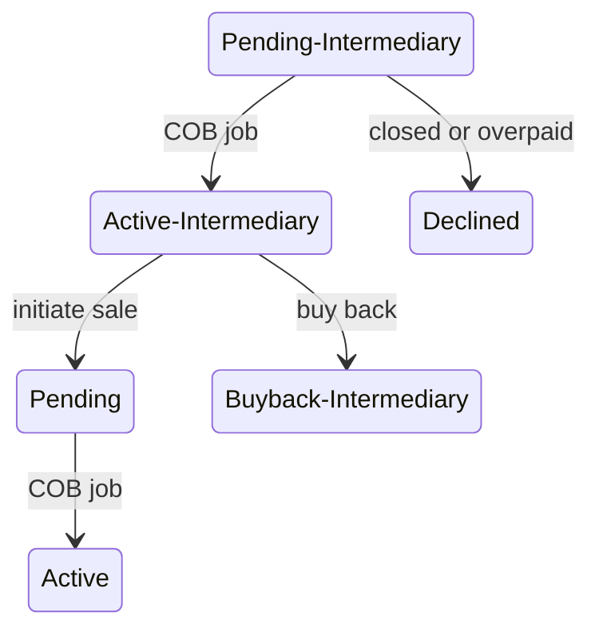
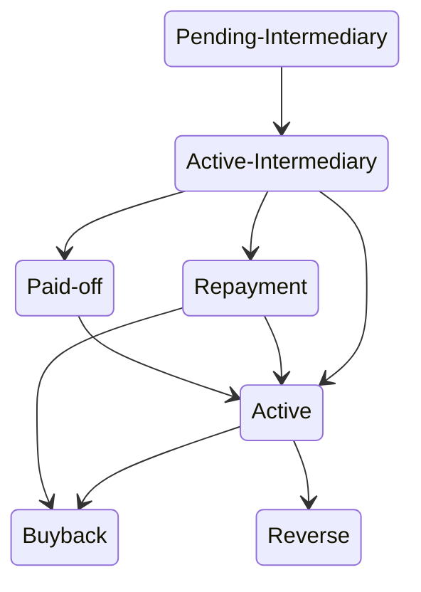

# Investor Module Enhancements

## Investor Module Enhancements

### Module overview and goals

The Investor Module Enhancement is also known as Danube 2.0. Its goal is to allow intermediate sale of a loan account before the sale is complete. Features discussed as out of scope might be revisited in a later release.

### Owner ID and accounting rules

The Owner ID for an intermediary transfer is passed by the user. Status changes invoked through API create no accounting entries, and no accounting entries are created for zero amounts.

The following rules apply to status changes and accounting:

- Pending-Intermediary status is invoked through API and creates no accounting entries.
- Pending status is invoked through API and creates no accounting entries.
- Decline status occurs when Active-Intermediary status is canceled by the user through API and creates no accounting entries.
- Buyback status is invoked through API once the status is in Active state.
- Buyback-Intermediary status is invoked through API once the status is in Active-Intermediary state.

When the status changes from Pending to Active and the loan has zero balance:

- No accounting entries are passed for zero amount.
- The status is transferred to the new asset owner.
- Any new monetary transaction after that is tagged to the new asset owner.

### Status transitions and lifecycle

An intermediary sale adds an intermediate step before the actual sale, moving a loan from Pending-Intermediary to Active-Intermediary to Pending to Active.

The following status transitions apply:

- A user initiates an intermediary sale on an active loan account, resulting in Pending-Intermediary status.
- The COB job picks up the Pending-Intermediary sale to make it Active-Intermediary.
- A user initiates the sale on an Active-Intermediary loan account, resulting in Pending status.
- The COB job picks up the Pending sale to make it Active.
- A user can buy back an Active-Intermediary loan account, resulting in BuyBack-Intermediary status.
- Only loans with status Active can be moved to Buyback state, and loans with status Active-Intermediary can be moved to Buyback-Intermediary status.
- A user can buy back an Active-Intermediary loan account or move it to the next status.

The following status change orders are not allowed:

- Pending-Intermediary to Pending.
- Pending-Intermediary to Active.
- Pending-Intermediary to Active-Intermediary to Decline.
- Pending-Intermediary to Active-Intermediary to Pending to Active to Decline.

COB processing rules for loan statuses are:

- COB does not decline a Pending loan even if the loan account is closed or overpaid.
- COB processes Active-Intermediary status.
- COB processes Active status.
- When a loan account is in a Pending state, it moves to Active even if the loan balance is zero or overpaid.
- When a loan account is in a Pending-Intermediary state and the loan is closed or overpaid, COB moves the status to Declined.
- When a loan account is in an Active-Intermediary state, it stays in the same state even if the loan is closed or overpaid.
- The COB job declines the Pending-Intermediary sale when the loan account status is closed or overpaid.

A sale can be on status right after initiation, transitioning from PENDING to ACTIVE.

### Asset transfer lifecycles

An asset transfer moves through a lifecycle that starts at Pending-Intermediary and continues to Active-Intermediary, then follows one of several paths depending on the transfer outcome.

Possible lifecycles are:

- Pending-Intermediary → Active-Intermediary → Active → Buyback.
- Pending-Intermediary → Active-Intermediary → Repayment → Active → Buyback.
- Pending-Intermediary → Active-Intermediary → Repayment → Active → Reverse.
- Pending-Intermediary → Active-Intermediary → Repayment → Buyback.
- Pending-Intermediary → Active-Intermediary → Paid-off → Active → Reverse.

Each transfer record tracks status, owner, effective from date, and effective to date.

### Worked examples

A loan officer starts an intermediary sale for a loan with a balance of 1,000, made up of 800 principal, 100 fees and 100 interest. The figures are illustrative. On day 1 the sale is requested and the account enters Pending-Intermediary under owner 999 with no accounting entries. At close of business the same day it becomes Active-Intermediary under owner 999, and the ledger moves the principal, fees and interest to that owner. On day 5 a second user initiates a purchase, moving the account to Pending under owner 10001; at close of business it becomes Active under owner 10001 and the ledger transfers the balances from owner 999 to owner 10001. On day 10 the current owner buys the loan back, moving it to Buyback under owner 10001 with no accounting entries. This example shows the full intermediary sale lifecycle from first offer to buyback.

| Day | Action | Status after | Owner | Balance after | Ledger entry |
| --- | --- | --- | --- | --- | --- |
| 1 | Start sale | Pending-Intermediary | 999 | 1,000.00 | None |
| 1 (close) | Close of business | Active-Intermediary | 999 | 1,000.00 | Principal 800.00, Fees 100.00, Interest 100.00 to owner 999 |
| 5 | Start purchase | Pending | 10001 | 1,000.00 | None |
| 5 (close) | Close of business | Active | 10001 | 1,000.00 | Principal 800.00, Fees 100.00, Interest 100.00 to owner 10001 |
| 10 | Buyback | Buyback | 10001 | 1,000.00 | None |

A loan with a zero balance is sold intermediarily. On day 1 the sale is requested and the account enters Pending-Intermediary under owner 999 with no accounting entries. At close of business it becomes Active-Intermediary under owner 999 even though the balance is zero, and no ledger entries are posted because the amount is zero. On day 5 a second user initiates a purchase; the account moves to Pending under owner 10001 and at close of business to Active under owner 10001, again with no zero-amount entries. Any later transaction is tagged to the new owner. If the loan were overpaid instead of exactly zero, the status would still move to Active at close of business, but no accounting entries would be passed for the zero amount.

| Day | Action | Status after | Owner | Balance after | Ledger entry |
| --- | --- | --- | --- | --- | --- |
| 1 | Start sale, zero balance | Pending-Intermediary | 999 | 0.00 | None |
| 1 (close) | Close of business | Active-Intermediary | 999 | 0.00 | Zero-amount entry skipped |
| 5 | Start purchase | Pending | 10001 | 0.00 | None |
| 5 (close) | Close of business | Active | 10001 | 0.00 | Zero-amount entry skipped |
| 10 | New payment | Active | 10001 | 0.00 | Payment tagged to owner 10001 |

A repayment of 50, made up of 10 fees and 40 principal, is posted while the loan is Active-Intermediary under owner 999; the ledger credits fees and principal to owner 999 and debits cash to owner 999. Before the repayment is reversed, the sale completes and the loan becomes Active under owner 10001. When the reversal is processed, the ledger debits fees and principal to owner 10001 and credits cash to owner 10001, so the reversal follows the current owner rather than the original one. This example shows that repayments and reversals are tagged to the owner recorded at the time of processing.

| Day | Action | Status after | Owner | Balance after | Ledger entry |
| --- | --- | --- | --- | --- | --- |
| 1 | Start sale | Pending-Intermediary | 999 | 1,000.00 | None |
| 1 (close) | Close of business | Active-Intermediary | 999 | 1,000.00 | None |
| 2 | Repayment of 50.00 | Active-Intermediary | 999 | 960.00 | Fees 10.00 credit, Principal 40.00 credit, Cash 50.00 debit to owner 999 |
| 5 (close) | Sale completes | Active | 10001 | 960.00 | Principal 800.00, Fees 100.00, Interest 100.00 to owner 10001 |
| 10 | Repayment reversal | Active | 10001 | 1,000.00 | Fees 10.00 debit, Principal 40.00 debit, Cash 50.00 credit to owner 10001 |

A repayment of 1,200 is made on a loan with a balance of 1,000, made up of 800 principal, 100 fees and 100 interest, creating an overpaid amount of 200 credited to owner 999. At close of business the sale completes and the loan becomes Active under owner 10001; the ledger transfers the overpaid amount of 200 from owner 999 to owner 10001. A later buyback of 200 clears the overpaid amount under owner 10001. This example shows how overpaid amounts move with the account to the new owner.

| Day | Action | Status after | Owner | Balance after | Ledger entry |
| --- | --- | --- | --- | --- | --- |
| 1 | Start sale | Pending-Intermediary | 999 | 1,000.00 | None |
| 1 (close) | Close of business | Active-Intermediary | 999 | 1,000.00 | None |
| 2 | Repayment of 1,200.00 | Active-Intermediary | 999 | -200.00 | Fees 100.00 credit, Principal 800.00 credit, Overpaid 200.00 credit, Cash 1,200.00 debit to owner 999 |
| 5 (close) | Sale completes | Active | 10001 | -200.00 | Overpaid 200.00 transferred to owner 10001 |
| 10 | Buyback of 200.00 | Buyback | 10001 | 0.00 | Overpaid 200.00 cleared, Cash 200.00 credit to owner 10001 |
