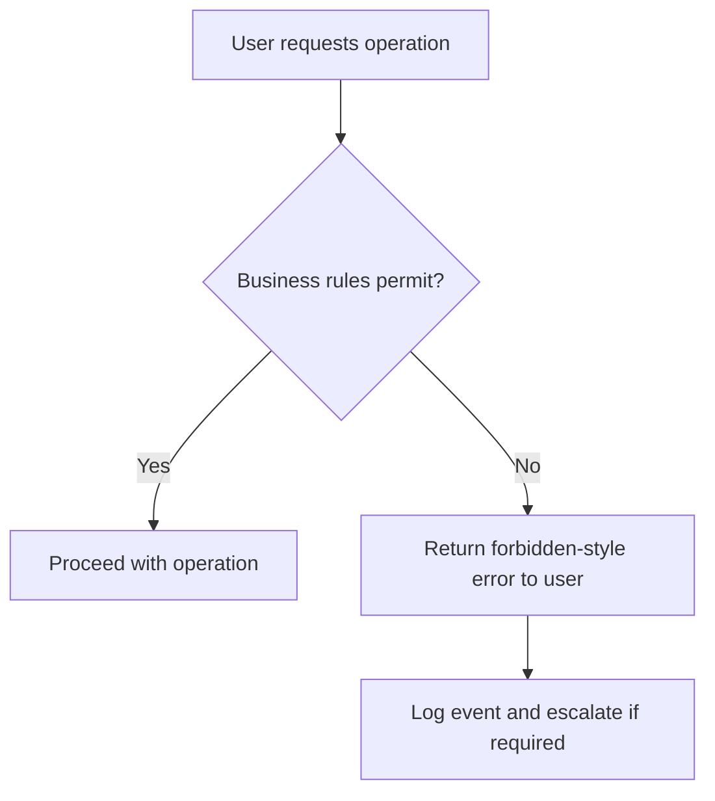

<!-- Labels: user, bugs-and-security -->
# Business Logic related error ➡️ http403

In Pepper-Soup, when an operation is blocked by business logic, the system surfaces a forbidden-style response to the client. This communicates that the requested action is not permitted under current policies or data state. This behavior differs from surface symptoms of resource unavailability and is intended to reflect the actual cause of the failure rather than suggesting a temporary outage.

### Overview
A business-logic-related error occurs when the evaluation of business rules determines that the requested operation cannot proceed. The responsible processing component checks the applicable policy gates and, if any gate is not satisfied, halts the operation and returns a forbidden-style response to the user. This explicit delineation helps users, branch staff, and credit agents distinguish between policy-based denial and temporary system downtime.

### Trigger and operational circumstances
This condition is triggered during request processing whenever a rule or policy required to authorize an action is not satisfied. The trigger may originate from the client attempting the operation or from an automated process applying policy constraints. The key factors influencing the trigger include:
- The action requested by the user or automated agent is not permitted under current business rules.
- The account or data state does not satisfy the prerequisites for the operation.
- The user’s role, permissions, or associated policies do not authorize the requested operation.

### What users see and how to respond
When a business-logic violation is detected, the client receives a forbidden-style response indicating that the requested action is not allowed under current rules. The message should guide the user to verify their role and permissions or to contact standard support channels if they believe the request should be permissible. Staff should avoid retrying the operation automatically and should instead verify the underlying rule and data state before attempting again.

### Recovery paths and escalation
To restore normal operation or to proceed when standard, follow these paths:
- Validate the user’s role and permissions against the applicable policy for the requested action.
- Verify that the operation follows the current data state and business rules.
- If the operation should be permissible, adjust the user’s access or the data state as defined by governance, and then retry through the standard workflow.
- If the operation remains blocked, escalate to the policy owner or designated approver with context (user, role, operation attempted, time, and data state) to determine whether a rule adjustment or exception is warranted.

### Operational procedures (step-by-step)
1. Detect the forbidden-style response during an operation request.
2. Record key details: user identity/role, operation attempted, data state, time, and system context.
3. Cross-check the applicable business rules and prerequisites for the operation.
4. If the operation should be allowed, coordinate with the policy owner to adjust access rights or data state, then retry via the normal workflow.
5. If the operation must remain blocked, initiate the standard escalation path and provide the user with guidance to seek standard authorization or support.

### Data integrity and system behavior
- The forbidden result prevents the requested operation from proceeding and does not create ledger entries or modify balances.
- If the operation had begun or a partial state change was initiated, system controls must verify no unintended changes are committed as a result of the denial.
- Logging and traceability: every occurrence should be captured for auditing, including the operation attempted, user, timestamp, and the reason inferred from the business rules.

### Diagram: decision and outcome flow

### Terminology and glossary
- Forbidden-style error: A user-visible response indicating that the requested operation is not permitted under current business rules or data state. This contrasts with responses that indicate temporary system unavailability.

### Auditing and reporting guidance
- Capture occurrences of business-logic-denied requests with: user identity/role, operation attempted, time, data context, and the rule or policy indicated as violated.
- Use this information to inform governance reviews, rule clarifications, and access-control adjustments.

### Notes on scope
- This page documents verified product behavior: when business logic prohibits an action, the system responds with a forbidden-style error to the client. It does not describe general system outages, maintenance windows, or other non-business-rule-related failures.
- The guidance reflects current operational behavior and reporting expectations for operations staff, loan officers, branch managers, and credit agents.