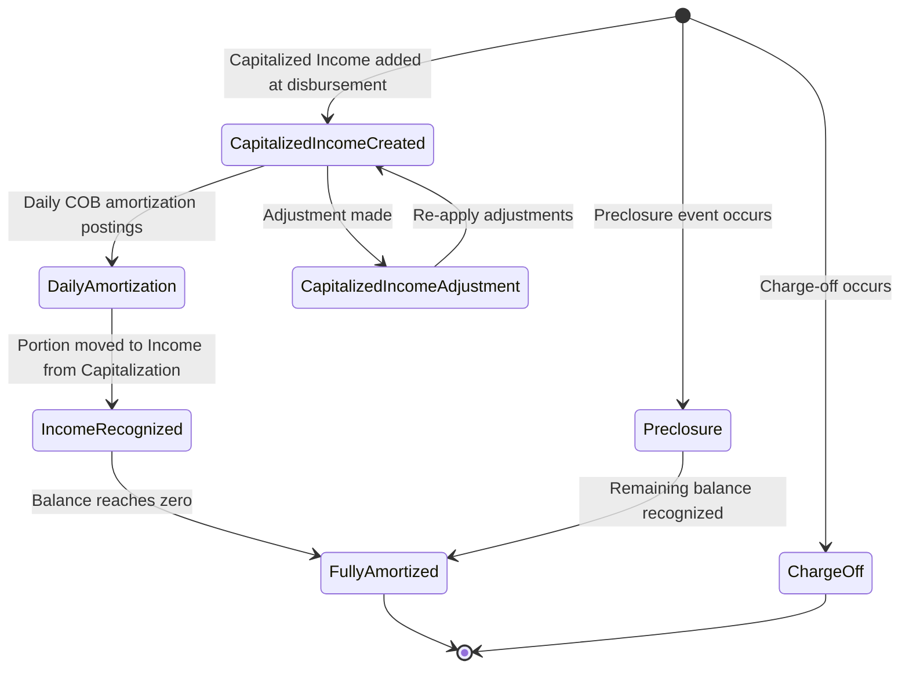

<!-- Labels: user, capitalized-income -->
# Origination fee -> Capitalized income

Capitalized income refers to origination fees that are introduced at loan product level, added to the loan balance at disbursement, and amortized over the life of the loan. This asset-like balance is treated as a liability up front (deferred income) and progressively recognized as income through a structured amortization process. The feature is designed to improve income recognition accuracy and align accounting with regulatory expectations. It is available to users who administer loan products and loans, including operations staff, loan officers, branch managers, and credit agents. The configuration and behavior described here reflect the verified product implementation and its documented rules.

### What this feature does and why it matters

- A capitalized income amount (often referred to as an origination fee) is configurable at the loan product level and can be introduced as FLAT (the default) or, in future, as a percentage of the disbursement amount. In the current verified implementation, the supported calculation mode is FLAT. The capitalized income is added to the loan principal at or after the first disbursement date, and it is treated as part of the principal for repayment and interest calculations. This allows the lender to defer a portion of the income rather than recognizing it upfront.
- The capitalized income amount becomes the basis for daily amortization. Daily recognition moves the amount from Deferred Income (liability) to Income from Capitalization (income) through a defined amortization schedule.
- The amortization pattern is based on a daily, equal allocation across the remaining days of the loan, using the configured amortization strategy. The current implementation supports the Equal Amortization strategy.
- The accounting treatment debits the loan portfolio (asset) when capitalized income is created and credits Deferred Income (liability). As amortization progresses, entries move from Deferred Income to Income from Capitalization. When the loan is closed early or charged off, amortization may stop and remaining balances are handled according to policy rules.

### Who benefits from capitalized income

- Loan officers and branch managers gain a mechanism to structure fees in a deferred manner, aligning with income recognition practices.
- Operations staff observe and validate amortization flows, balances, and reconciliations in loan portfolios.
- Credit agents and financial controllers benefit from clearer separation of capitalized income (as a liability) and recognized income, with auditable journal entries and a traceable balance history.

## How capitalized income is configured and managed (loan product level)

Capitalized income is configured at the loan product level and becomes available for loans created from that product. The verified configuration options include:
- allows Capitalized Income: Boolean toggle (default: disabled).
- Calculation Type: FLAT (the current supported mode).
- Amortization Strategy: EQUAL_AMORTIZATION (daily equal portions over the life of the loan).
- Income Type: FEE (default; defines which balance category is used for the amortization process; alternatives such as INTEREST are supported by other configurations).
- GL Mapping: Deferred Income (Liability) and Income from Capitalization (Income).

 
Capitalized IncomeEnabled/Disabled

 
Calculation TypeFLAT

 
Amortization StrategyEQUAL_AMORTIZATION

 
Income TypeFEE

 
GL Mapping (Deferred Income)Liability

 
GL Mapping (Income from Capitalization)Income

### Step-by-step: enabling capitalized income on a loan product
1. Open the loan product configuration screen for the target product.
2. Find the setting labeled **allows Capitalized Income** and set it to **On**. The system confirms the feature is active for this product.
3. Set the field labeled **Capitalized Income Calculation Type** to **FLAT**. This selects flat-amount capitalization for the initial amount added to the loan principal.
4. Set the field labeled **Capitalized Income Strategy** to **EQUAL_AMORTIZATION**. This configures daily, equal portions to be recognized until the balance is fully amortized.
5. Set the field labeled **Capitalized Income Type** to **FEE**. This defines the balance category used for capitalization and amortization logic.
6. Verify the GL mappings:
 - Deferred Income (Liability)
 - Income from Capitalization (Income)
7. Save the product configuration. The product is now eligible to apply capitalized income when a loan is created from this product.

### How capitalized income interacts with a loan lifecycle
- When a loan is disbursed using a product with capitalization enabled, the system adds the capitalized income amount to the loan principal. The amount is recorded as a capitalized transaction that increases the loan’s outstanding balance for repayment and interest purposes, while also creating a liability entry (Deferred Income).
- The amortization process begins from the date the capitalized income is added and runs daily, moving amounts from Deferred Income to Income from Capitalization according to the configured equal-amortization schedule.
- If a loan prepays or is closed early, the final amortization step accounts for any remaining unrecognized balance, per the preclosure rules. If the loan is charged off, amortization stops and the remaining balance is charged off according to policy.
- Adjustments to capitalized income are possible via a dedicated adjustment pathway; however, automatic reversal of the original capitalized income is not a default feature. Reversals require the standard adjustment transactions to restore balances and recognize any changes in amortization.

### Important rules, validations, and edge cases
- Validation at disbursement: (Disbursement Amount + Capitalized Income) must be less than or equal to the approved loan amount. This verifies capitalization does not exceed the loan’s approved capacity.
- Daily amortization is calculated and posted during the COB process, moving funds from Deferred Income to Income from Capitalization.
- Preclosure handling: Remaining capitalized income balance is recognized in full on the preclosure date.
- Charge-off handling: Amortization stops; any remaining unrecognized capitalized income is handled as part of the charge-off calculation.
- Reversal behavior: If the Capitalized Income transaction is reversed, amortization adjustment entries are generated to reverse already recognized portions. A dedicated automatic reversal path (Capitalized Income Amortization Adjustment) is system-generated to maintain accounting integrity.
- Backdating: Capitalized income transactions support backdating, but adjustments cannot predate the original capitalization transaction.

## Calculation mechanics: what changes in the loan schedule and accounting

Capitalized income is added to the loan principal at the time of capitalization, and it is treated as part of the principal for amortization and interest calculations. The result is an updated amortization and interest schedule that includes the capitalized amount in the outstanding balance. The deferment of income is reflected as a liability until amortization converts it into recognized income.

### How daily amortization is performed
- The system recognizes daily amortization of the capitalized income as a portion of the original amount, moving it from Deferred Income (liability) to Income from Capitalization (income).
- The only currently supported amortization method is Equal Amortization. This divides the total capitalized income evenly across the remaining days of the loan term.
- The daily amortization process runs as part of the Close of Business (COB) routine and persists as a daily amortization transaction. If the loan closes early or a reversal occurs, the final amortization step adjusts the remaining unrecognized balance or reverses previously recognized income, respectively.

### Journal entries commonly observed (verified behavior)
- Capitalized Income creation:
 - Debit Loan Portfolio (Asset)
 - Credit Deferred Income (Liability)
- Capitalized Income amortization (daily):
 - Debit Deferred Income (Liability)
 - Credit Income from Capitalization (Income)
- Capitalized Income Adjustment (to correct past capitalization):
 - Debit Deferred Income (Liability) / Income from Capitalization (Income) 
 - Credit Loan Portfolio (Asset)
- Capitalized Income Amortization Adjustment (reversal of amortization portions):
 - Debit Income from Capitalization (Income) / Credit Deferred Income (Liability)

Notes:
- The system does not perform automatic reversal of the Capitalized Income transaction itself; instead, dedicated adjustments reverse already recognized amortization as needed.
- All capitalized income adjustments must reference the original capitalized income transaction and cannot predate it.

## Worked example: conceptual walkthrough (using verified configuration concepts)

The reference model provides concrete numbers for a simple scenario, where a loan product allows capitalized income with flat calculation and equal amortization. The core numbers involved are:
- Capitalized Income amount: 50 (added to the loan principal at disbursement)
- Disbursement amount: 100
- Total loan balance after capitalization: 150
- Interest rate: 7% per annum (0.000194444 daily rate when using a 360-day year)
- Days in year: 360; Days in month: 30
- Amortization method: Equal Amortization (daily portions recognized over the life of the loan)

Key sequence and outcomes you will see in the system:
1) Disbursement event: The system records the disbursement of 100 as the loan principal and creates a Capitalized Income transaction of

50. The accounting entries are:
 - Debit Loan Portfolio (Asset) 50
 - Credit Deferred Income (Liability) 50
 This increases the reported loan balance to reflect the capitalized amount while recognizing that the income is not yet recognized.
2) Amortization entry(s): Each day (at COB) the system generates an amortization entry for the capitalized amount, moving from Deferred Income to Income from Capitalization. The exact daily amount is derived from the Equal Amortization schedule and the remaining days until loan maturity. In a representative daily pattern from the reference, a daily amortization amount is posted from Deferred Income to Income from Capitalization.
3) Full recognition: Amortization continues daily until the entire capitalized amount has been recognized as income, at which point the Capitalized Income balance becomes zero.
4) Reversal handling: If the original Capitalized Income transaction is reversed, a Capitalized Income Amortization Adjustment is generated to reverse all previously recognized amortization to restore the liability and income balances aligned with the reversal.

The example illustrates the end-to-end lifecycle from capitalization to amortization and eventual recognition of income, with all steps reflected in the ledger as described above. The exact timing and amounts of daily amortization depend on the loan’s term and the daily equal-amortization calculation, but the mechanism and accounting impact are consistent with the verified behavior described here.

### Visual overview: lifecycle diagram (Mermaid)

## Summary of key rules and outcomes
- Capitalized income is introduced at the loan product level and added to the loan balance at disbursement, creating a deferred income liability.
- The daily amortization process moves amounts from Deferred Income to Income from Capitalization, using the Equal Amortization strategy.
- Preclosure handling recognizes the remaining balance in full on the preclosure date; charge-offs halt amortization and reflect the remaining balance in the charge-off process.
- Adjustments can reduce the capitalized income balance and may adjust future amortization, but they must not predate the original capitalization transaction. Automatic reversal of the capitalization itself is not supported; specialized adjustments reverse related amortization when needed.
- All changes are reflected in both the loan balance and the related general ledger mappings (Deferred Income and Income from Capitalization).

### When and how to verify the outcomes
- Validate that (Disbursement + Capitalized Income) <= Approved Amount for the loan.
- Confirm that the initial capitalization entry debits the Loan Portfolio and credits Deferred Income.
- Review daily amortization postings to verify they move amounts correctly from Deferred Income to Income from Capitalization and that the cumulative amortization matches the capitalized income amount by the end of the amortization period.
- If a capitalization is reversed, verify that the amortization adjustment has reversed all recognized portions and that the loan balance reflects the reversal appropriately.

If you need drilled steps for a specific loan product or a concrete calculation run, provide the product settings and loan term, and the system-generated amortization schedule will reflect the configured flat capitalization and equal daily amortization as described above. The behavior documented here captures the verified rules, calculations, and outcomes of the Origination fee -> Capitalized income feature as implemented.