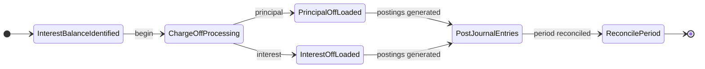

<!-- Labels: user, charge-off-interest -->
# Charge off process to charge off interest due

This enhancement integrates the automatic charge-off of interest balances into the automated charge-off routine. The change verifies that interest portions that are deemed uncollectible are written off in concert with principal charge-offs, so accounting entries reflect the true state of the loan portfolio and follows the defined chart of accounts (COA) mappings. In practice, the system now processes interest balances during the same automated run that handles principal charge-offs, applying the same governance, validation, and posting discipline as principal write-offs. This matters for day-to-day operations because it preserves the integrity of the borrower’s ledger, verifies consistent financial reporting, and reduces the risk of misaligned revenue and expense recognition when interest is not collectible.

### What changed and why it matters

- The enhancement brings interest balances into the automated charge-off workflow, so uncollectible interest is written off alongside the principal when a loan is charged off. This prevents residual interest from remaining on the books after the account is written off and preserves accurate income and expense recognition.
- The change relies on the defined charge-off mappings in the COA. Interest write-offs use the COA mappings for charge-off entries, including accounts such as Loans Receivable, Interest Receivable, Interest income charge off, and Credit Loss/Bad Debt, along with recoveries handling .
- The approach applies to both Fraud and Non-Fraud charge-off scenarios, with explicit mappings for each path to verify correct accounting treatment per category.

### Scope and terminology

- Charge-off: A formal write-off of an uncollectible loan balance, including principal and related interest components, as defined by policy.
- Interest due: The portion of interest that has accrued on a loan and remains unpaid at the time the charge-off is processed.
- Interest receivable: The recorded amount representing earned interest that remains unpaid and is subject to write-off.
- Recoveries: Any cash received after a charge-off that offsets the loss, recorded against a recoveries account.
- Fraud vs Non-Fraud: Distinct accounting paths with separate mappings in the charge-off framework.

### How the system handles charge-off of interest due (workflow)

1) The automated charge-off process identifies loans selected for write-off and detects outstanding interest balances that should be charged off as part of the same run.
2) For each identified loan, the system applies the charge-off mappings to post journal entries that correspond to the principal and interest portions of the write-off.
3) The principal portion affects Loans Receivable and related credit-loss or bad-debt accounting as defined in the COA, with standard offsetting entries to verify the loan portfolio balances reflect the write-off.
4) The interest portion affects Interest Receivable and the designated interest-off entry (e.g., Interest income charge off) per the COA mappings, and it posts to the associated expense or income account according to the fraud/non-fraud path.
5) If recoveries occur after a charge-off, they are posted to the recoveries accounts and reduce the net charge-off impact.
6) The process produces a reconciled set of postings that balance within the period, with the opening balances of each period matching the previous period’s closing balances, per standard accounting rules.

> Note: Some mappings and fields in the reference data are marked as in development. Operations should verify the exact journal entries and GL selections in the live environment when those items are released.

### Key accounting implications (high level)

- Principal portion: Decreases the Loans Receivable balance. The write-off is reflected as a charge-off or credit loss expense per the COA, and the offset may involve the main loan portfolio and related suspense accounts as defined by policy.
- Interest portion: Decreases the Interest Receivable balance and records the write-off against an income/expense designation in the charge-off category (for example, an interest income charge off), in accordance with the COA mapping. Fraud and Non-Fraud paths have separate mappings to verify correct classification.
- Fees and penalties: , related fees or penalties that were part of the loan’s charge-off process are posted to their associated receivables and revenue/expense accounts as defined by the mapping.
- Recoveries: Any subsequent recoveries post-charge-off are posted to recoveries accounts and offset the original charge-off impact.
- Suspense/clearing handling: The charge-off process employs suspense/clearing accounts as part of the lifecycle to verify traceability and clean balancing during posting.

### Reference mapping essentials (conceptual)
The authoritative mappings reference the following categories in the COA and charge-off workflow:
- Asset accounts: Loans Receivable (principal balance) and Interest Receivable (accrued interest)
- Income accounts: Interest income charge off (used to reflect charged-off interest) and Fee Income / Fee Charge off 
- Expense accounts: Credit Loss/Bad Debt and Credit Loss/Bad Debt Fraud (plus recovery-related expenses)
- Liability / clearing accounts: Other Credit liability and Suspense/Clearing account
- Recoveries: Recoveries (offsetting entries when cash is later recovered)

### User workflow: UI navigation and actions (operational view)
The enhanced process is accessible through the following navigation path: Charge-off, Write-off and Settlement > Charge-off interest > Charge off process to charge off interest due.

Operational steps to perform the charge-off of interest due (when the enhancement is enabled):
1) Open the Charge-off interest area and select the “Charge off process to charge off interest due.”
2) Confirm the scope of the automated charge-off run, verifying the accounts selected include those with eligible interest balances.
3) Review the generated postings for principal and interest portions against the COA mappings, confirming correct accounts are used for each component and that fraud vs non-fraud paths are applied as standard.
4) Validate that opening balances for the period equal the prior period’s closing balances, and that the postings balance within the period.
5) Post the journal entries to the ledger. Monitor for any exceptions or validation messages and address them per procedural guidance.
6) If post-charge-off recoveries occur, process and apply them to the standard recoveries accounts and verify the net liability reflects the update.

### Data integrity and validation notes
- The system must reconcile each period’s opening balance with the previous closing balance, per standard accounting practice.
- Payment allocation and journal entries must balance, with the sum of debits equal to the sum of credits across the charge-off postings.
- Remaining cash, unactioned dues, and the outstanding balance must reconcile after postings.
- If any GLs or mappings are not yet active in the live environment (for example, those marked as in development in the reference data), operations should treat those entries as pending and verify actual live mappings after deployment.

### Migration and compatibility considerations for operations staff
- Validation of COA mappings: Confirm which GL accounts are active for charge-off of interest due in the live environment and verify they follows the COA descriptions.
- New GLs: The reference data indicates that new GLs related to charge-off and new mapping fields are planned; verify the availability and applicability of these GLs in the production environment before processing live charge-offs.
- Reconciliation timing: Because interest write-offs are processed in the same run as principal write-offs, reconcile the period-wide totals after the run to confirm there are no residual mismatches in the interest and principal components.
- Reporting impact: Period-end reports may reflect changes in charge-off allocations between principal and interest components; verify reporting teams are aware of the enhanced treatment for interest write-offs.

### GAPs and test items (present-tense)
- Several mapping entries are labeled in development in the reference data and are not guaranteed to be live in all environments. These items constitute gaps to verify during UAT and production validation.
- The table-based “For Fineract charge-off mapping” includes mappings that indicate changes to mapping fields in the Lona product accounting mapping and new GLs. Confirm whether these GLs are implemented and available in the current release before relying on them in production postings.

### Appendix: Key terms and mappings (reference concepts)
- Loans Receivable (Asset): The principal balance of loans that may be charged off.
- Interest Receivable (Asset): Accrued interest that has not yet been received at the charge-off decision point.
- Interest income charge off (Income): An income-type account used in charge-off scenarios for interest balances.
- Credit Loss/Bad Debt (Expense): The expense category that captures losses on uncollectible loan balances.
- Credit Loss/Bad Debt Fraud (Expense): A separate expense category for fraud-related charge-offs.
- Recoveries (Expense/offset): Amounts recovered after a charge-off that offset the original loss.
- Suspense/Clearing account (Asset): A holding account used during posting to verify traceability and balancing.
- Fees Receivable (Asset) and Fee Income / Fee Charge off (Income): Accounts associated with fees that may be affected during charge-off procedures.

### Diagram: high-level charge-off flow for interest due

This page provides an operationally focused description of the enhanced charge-off process for interest due, its alignment with COA mappings, and the practical steps for the day-to-day use by operations staff, loan officers, branch managers, and credit agents. It preserves the critical conditions and relationships that govern the posting behavior and the financial effects of charging off interest alongside principal within the automated workflow.