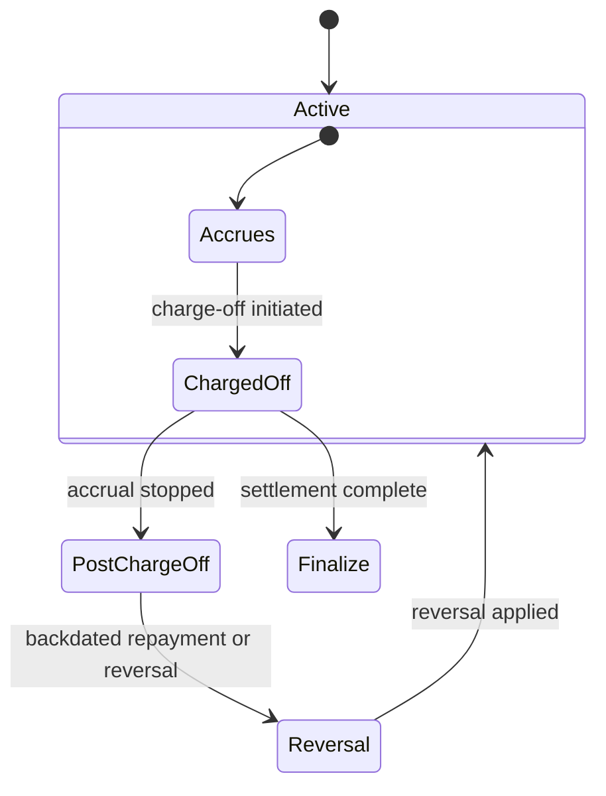

<!-- Labels: user, charge-off-interest -->
# Interest Accrual Handling for Charge-off loans

This publication describes the enhanced behavior for handling interest accrual on charge-off loans. The core change is to suspend interest accrual once a loan is charged off, so that only income which will actually be realized is recognized. Specifically, interest is accrued up to the charge-off date and a charge-off amount is composed of the outstanding principal portion plus the accrued interest up to that date. From the day after the charge-off date, no further interest accrues on that loan. The documented behavior applies to all charge-off events, with special handling when repayments, reversals, or accelerated maturity options occur. The examples illustrate how the new rules apply in practice and what operators will see in the system.

What changed and why it matters

- Before: Interest continued to accrue on a loan that had been written off, potentially recognizing income that would not be realized. This could distort reported income and the true financial impact of the charge-off.
- Now: Interest accrual stops on the day after the charge-off date. Interest accrues only up to the charge-off date and is recognized as the charge-off interest portion. From the next day onward, no additional accrual occurs, and the remaining balance is written off.
- Why it matters in operations: Staff can close and settle charged-off loans with a clearly defined timing of interest recognition, reducing noise from accruals that would not be realized. This affects daily reconciliations, profitability reporting on charged-off loans, and the timing of journal entries related to charge-offs.

Scope and applicability

- The change applies to interest-bearing products and progressive loans where charge-offs are supported. Accelerate maturity is available for interest-bearing, progressive loan products. For non-interest-bearing, progressive loan products, charge-off options are optional.
- The charge-off date can be any date as long as it is the latest transaction on the loan account. The charge-off date cannot be a future date.
- If a repayment or reversal is backdated to a date before the charge-off, the system performs the reverse replay of all transactions and the charge-off transaction. This verifies the accounting and balance history remain consistent.
- N+1 installments (i.e., installments beyond the charge-off date) do not impact charge-off activity. They are not accrued or incorporated into the charge-off calculation after the charge-off date.

Calculation model and example patterns

- Core principle: Interest accrual uses a daily rate derived from the loan’s annual rate and the defined calendar (for the reference scenario, Days In Year is 360; Days In Month is 30). The daily rate is applied to the outstanding balance for the number of days in each period prior to charge-off.
- Charge-off amount composition: when a charge-off occurs, the total charge-off amount equals the outstanding principal at the moment of charge-off plus the interest accrued up to the charge-off date. The remaining balance after charge-off is zero.
- Post-charge-off behavior: no further interest accrues after the charge-off date, and the loan balance remains zero unless a reversal or reconstruction occurs.

Example: charge-off on the date after a scheduled payment (S1 scenario)

- Assumptions used in the reference scenario: Interest rate 7% per year, Days In year 360, Days In month

30. Principal at start: 100. Repayment frequency: 1 month. A payment is made on the 1st of February.
- Pre-charge-off state (illustrative values from the reference data): On 1 February 2024, the loan balance is 83.57 after a payment, with an installment of 17.01 and an interest portion of 0.58 for that period. The balance reduces to 83.57 by that date.
- Charge-off event: on 29 February 2024, a charge-off is recorded. The charge-off contains a principal portion of 83.57 and an interest portion of 1.47, for a total charge-off amount of 84.04. The balance becomes 0.00 after the charge-off.
- Post-charge-off state: on 1 March 2024 the balance is 0.00, and no further interest accrual occurs because the charge-off has occurred.

| Parameter | Value |
|---|---|
| Original balance prior to charge-off | 83.57 (after 2/1 payment) |
| Charge-off date | 29 February 2024 |
| Charge-off principal portion | 83.57 |
| Charge-off interest portion | 1.47 |
| Total charge-off amount | 84.04 |
| Balance after charge-off | 0.00 |
| Post-charge-off interest accrual | Stopped from the day after charge-off |

In this example, the total charge-off amount equals the principal outstanding at the moment of charge-off plus the interest accrued up to the charge-off date. The system then stops accruing interest as of the day after the charge-off date, and the remaining balance is written off.

Workflow: how the system handles charge-off events (operational steps)

1) Verify charge-off eligibility and timing
- verify the charge-off date is not in the future and is the latest transaction date on the loan account.
- Confirm that the loan type supports charge-off options (including acceleration for eligible interest-bearing, progressive products).

2) Initiate the charge-off
- In the loan account, initiate a charge-off and select the standard charge-off reason code (for example, FRAUD). The system will map this event to the charge-off processing workflow.
- The system will determine the charge-off amount as the sum of the outstanding principal at the moment of charge-off and the interest accrued up to the charge-off date. This amount is posted as the charge-off value.

3) Apply the charge-off and stop accrual
- The system records the charge-off amount and immediately stops interest accrual starting the day after the charge-off date.
- The loan balance is written off, and no further interest accrues unless a reversal occurs.

4) Handle backdated repayments or reversals
- If a repayment posted on a date earlier than the charge-off date or a reversal is backdated, the system performs a reverse replay of all transactions and the charge-off transaction to restore consistency in the balance history and accounting.

5) Validate post-charge-off state
- Confirm that the installment schedule after the charge-off date does not reintroduce accrued interest or new charges, consistent with the N+1 rule.
- If accelerated maturity is used, verify the loan remains in a consistent state with the new maturity and interest accrual rules up to the charge-off date.

6) Accounting considerations (high level)
- The charge-off event affects the loan balance and recognizes the charge-off income via the charge-off interest portion. The exact journal entries are determined by product configuration and accounting mappings.
- The system maintains journal entries that balance when debit and credit data are available and preserves the integrity of the balance history, including any reversals.

Additional notes on policy and interactions

- Accelerate Maturity: This option should be available for interest-bearing, progressive loan products as part of the charge-off workflow.
- Non-Interest Bearing Progressive Loans: Charge-off options may be available but are optional (deferred) for these products.
- Charges after charge-off date: If amounts are due after the charge-off date, accrual is not recognized beyond the charge-off date, and any subsequent postings follow the established reverse-replay rules if backdated events occur.
- Compatibility and migration: The enhanced behavior relies on the charge-off workflow and date validations described above. Operational staff should be trained on the updated flow, including how charge-off dates are chosen, how the charge-off amount is calculated, and how backdated traffic (payments or reversals) affects the charge-off record.

Diagram: Charge-off lifecycle (high level)

Glossary (quick reference)

- Charge-off: The formal write-off of outstanding principal and accrued interest when a loan is deemed uncollectible.
- Interest accrual: The process of accumulating interest on the outstanding principal over time.
- Accrual stop: The point at which the system ceases to accumulate further interest for a loan after a charge-off date.
- Reversal: An operation that undoes a prior posting, which may trigger reverse-replays of related charge-off events to restore consistency.
- Accelerate Maturity: A feature that allows shortening the loan’s remaining tenor, potentially affecting how the remaining balance is settled.

This publication reflects verified product behavior for interest accrual handling on charge-off loans. It presents the rules, the operational workflow, representative calculation patterns, and the expected outcomes for daily operations, reconciliations, and reporting. It intentionally avoids internal development details and private materials while providing precise guidance on how the system behaves today under the published rules.