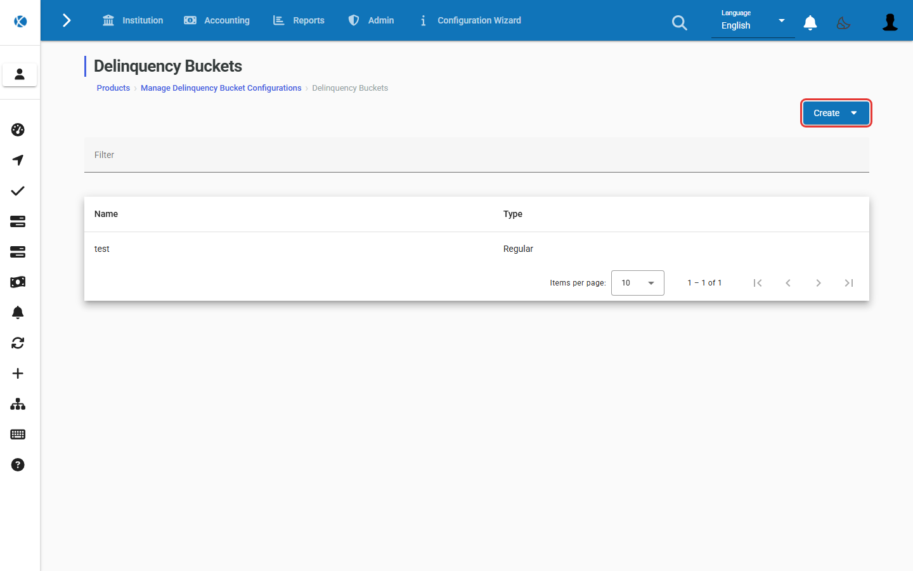
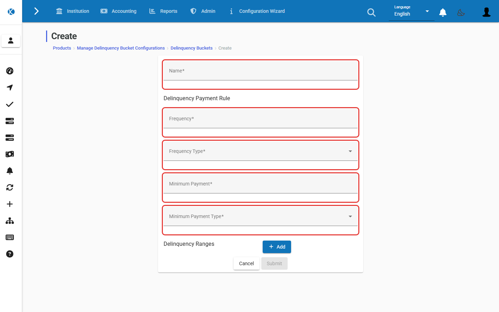

# Delinquency Buckets

## Delinquency buckets

Delinquency Management monitors overdue loan payments using customized buckets. A Basic Delinquency Bucket uses a name, a classification name, and a sequence of delinquency ranges, each with Days From and Days Till.

## Create a delinquency bucket

Use this screen to set up a delinquency bucket with overdue days defined per bucket for monitoring overdue payments on loans.

1. Select **Admin** > **Products**.
2. Select **Delinquency Buckets**.
3. Select **Manage Delinquency Buckets**.
4. Select **Create** > **Working Capital Delinquency Bucket**.

   

5. Enter the details described below, then select **Submit**.

| Field | Required | Description |
| --- | --- | --- |
| Name | Yes | Enter the name of the delinquency bucket. |
| Frequency | Yes | Enter how often the bucket applies. |
| Frequency Type | Yes | Select the type of frequency. |
| Minimum Payment | Yes | Enter the minimum payment required for the bucket. |
| Minimum Payment Type | Yes | Select the type of minimum payment. |

The delinquency bucket is created and can be used to classify overdue loans.

## Delinquency levels

You can set delinquency levels at the loan product level or at the installment level. A loan inherits the delinquency level configuration from its loan product. Selecting a delinquency bucket when creating or updating a loan product is optional. Delinquency works normally for charge-off tagged loan accounts.

## Grace period

The grace period lets you delay delinquency classification for an installment after its due date. You set the grace period for each product. If you do not set one, the past due bucket covers one to three days and acts as the grace period. Down-payment installments are also considered for delinquency classification.

## Installment delinquency

Installment delinquency evaluates each overdue installment and assigns its amount to the delinquency bucket for that loan account, marking the loan as delinquent. Each installment can be in its own delinquency bucket with its own dates.

The loan remains delinquent until every installment comes out of its delinquency bucket:

- The loan's delinquency bucket equals the longest overdue bucket.
- When an overdue loan account is paid and one old installment is paid fully, only that installment leaves its delinquency bucket.

When a reverse or backdated repayment happens, each installment delinquency is recalculated and assigned to its new bucket.

## Delinquency calculation

Delinquency calculation checks each loan's overdue status and moves overdue loans to their respective delinquency buckets. It is not real-time, so the system does not keep a history of bucket changes; when an installment moves to another bucket, only the new bucket is shown.

When delinquency calculation runs, it stores the following information:

- Loan Id
- Instalment
- Bucket
- Outstanding amount
- First overdue date

## Delinquency history

Delinquency history is not shown in the user interface. A feature toggle enables or disables the delinquency history feature.

Delinquency history records the following fields:

- Delinquent installment number and date overdue since
- Delinquent principal amount
- Delinquent interest amount
- Delinquent fees amount
- Delinquent penalty amount

Changes made by the LDC job are captured in delinquency history.

## Delinquency events

A delinquency event records when a loan enters, moves between, leaves, pauses in, or resumes from a delinquency bucket. Collections staff use the event to call customers and schedule repayment, and the system uses it for bureau reporting.

The event triggers when:

- The loan goes into a delinquency bucket.
- The loan moves from one delinquency bucket to another.
- The loan comes out of delinquency (cured).
- Pause delinquency starts.
- Pause delinquency ends.

The event lists only buckets with an outstanding amount, and each bucket shows the aggregated past due amount from multiple installments.

## Aging calculation examples

Aging calculations for an installment start on a specific date that depends on which installment it is and which use case applies.

| Installments | Aging calculations start as of | Use case |
| --- | --- | --- |
| 1 | 31 Jan (subsequent installment due date post chargeback) | UC5 Full Prior |
| 1 & 2 | 31 Jan | UC5 Full Prior |
| 1-4 | 21 Feb | UC6 Full After |
| 2 | 21 Feb | UC7 Partial After |

## Loan level delinquency display

At the loan level, under the delinquency tab, the system shows all configured delinquency buckets and the delinquency amount under each delinquent bucket. The display stays the same until all installments come out of delinquency.

## Worked examples

A loan officer opens a loan with a principal of 1,000.00, an annual interest rate of 12%, and three monthly installments using 30-day months. The figures are illustrative. The product has installment-level delinquency switched on, and the delinquency buckets are set to grace for 1-3 days past due, then 4-14 days, 15-29 days, and 30-59 days. On the calculation date, installment 1 is 45 days overdue and installment 2 is 15 days overdue, while installment 3 is not yet due. Each overdue installment is aged separately and placed in its own bucket.

| Installment | Days overdue | Principal past due | Interest past due | Total past due | Bucket |
| --- | --- | --- | --- | --- | --- |
| 1 | 45 | 340.00 | 10.00 | 350.00 | 30-59 days |
| 2 | 15 | 330.00 | 10.00 | 340.00 | 15-29 days |
| 3 | - | 0.00 | 0.00 | 0.00 | - |
| Total |  | 670.00 | 20.00 | 690.00 |  |

The delinquency tab lists only buckets that have an outstanding amount, with the installment totals added together per bucket.

The same loan receives a payment of 350.00 that is applied to installment 1. That installment is now fully paid and leaves its bucket. Installment 2 remains unpaid and stays in the 15-29 day bucket. Because at least one installment is still overdue, the loan remains delinquent, and its delinquency bucket moves to the longest remaining overdue bucket. Paying one installment removes only that installment from delinquency, while the loan stays delinquent until every installment is clear.

| Installment | Past due before payment | Payment applied | Past due after payment | Bucket after payment |
| --- | --- | --- | --- | --- |
| 1 | 350.00 | 350.00 | 0.00 | - |
| 2 | 340.00 | 0.00 | 340.00 | 15-29 days |
| 3 | 0.00 | 0.00 | 0.00 | - |
| Total | 690.00 | 350.00 | 340.00 |  |
