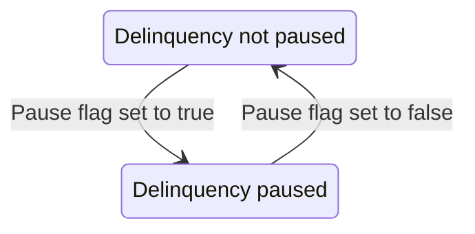
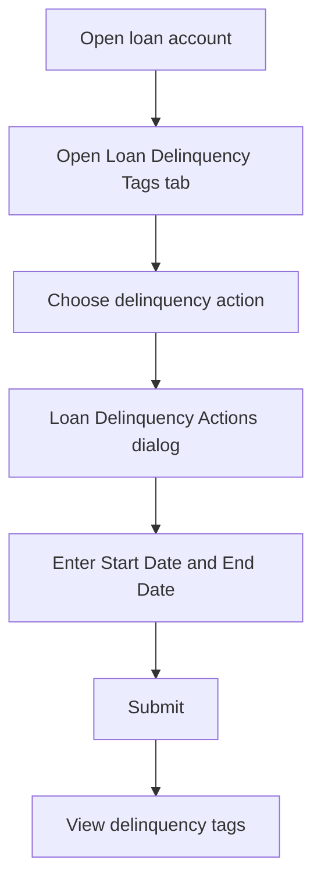

# Pausing Delinquency

## Pausing Delinquency

### Delinquency evaluation basics

Delinquency is evaluated at the installment level because both the outstanding amount and the due time change per installment. The system evaluates each overdue installment and assigns its amounts to the respective delinquency bucket for the loan account. Down-payment installments are also considered for delinquency classification.

Delinquency status and bucket behaviour:

- The loan account remains delinquent until every installment comes out of its delinquency bucket.
- When an installment moves from one bucket to another, it appears only in the new bucket and no history of the old bucket is stored.
- Delinquency calculation is real-time and no history of bucket changes is maintained.
- Changes to delinquency bucket configuration affect all existing loan account bucket classifications.
- When the overdue loan account is paid and one old installment is paid fully, only that installment comes out of the delinquency bucket; the loan remains delinquent until all installments come out of the delinquency bucket.

Status changes based on days past due:

- At 1 day past due, the loan is marked as PAST_DUE.
- At 4 days past due, the loan is marked as DELINQUENT and the PAST_DUE tag is removed.

Scope and configuration:

- The delinquency tab at the loan level shows all configured delinquency buckets.
- Delinquency bucket classification configuration remains the same for both levels.
- Delinquency works normally for charge-off tagged loan accounts.
- Charge off of the remaining balance on the loan is triggered for non-payment.

Other behaviour:

- When reverse or backdated repayment happens, each installment delinquency is recalculated and assigned to the respective new buckets.
- The delinquency level configuration cannot be changed from installment to loan when there are active loans with installment delinquency buckets.
- Grace options for installment delinquency are not required; the past due bucket is configured for 1-3 days and treated as a grace period.
- Past due to D20 to D40 behavior can vary by product and market, and grace period impacts effects.

### Pause and resume overview

Pausing delinquency stops delinquency evaluation for an active loan account while the pause is active, and the delinquency bucket remains unchanged. You can pause and resume delinquency only on active loan accounts, and overlapping pause periods are not allowed.

Pause periods follow these rules:

- A pause can start today or later and must last at least a day, with the start date before the end date.
- A pause cannot be backdated.
- The end date cannot be the same as the start date.
- A loan account can have multiple pause periods, but they must not overlap.
- If a pause was not manually resumed in the middle of the period, it resumes automatically after the pause period.

Resume follows these rules:

- Resume is possible only when there is an active pause period.
- The resume date is always the current business date, and no future resume is possible.
- The resume end date must not be specified.
- When a pause period is resumed, the resume date becomes the pause end date of that pause period.

Delinquency behaviour during and after a pause:

- While delinquency is paused, no evaluation of delinquency is required and the delinquency bucket remains as is.
- Payment in full of delinquent amounts removes any delinquent state or tag even while delinquency is paused.
- If the loan is repaid, delinquency pause stops because the loan is no longer in delinquency.
- When business date equals the last day of pause, delinquency recalculation happens.
- When delinquency is resumed, delinquency is recalculated at next CoB.
- COB takes past paused delinquency periods into account when calculating delinquency after a pause.

Pause days calculation:

- Pause days calculation happens only till the new end date, which is the resume date.
- The resume date becomes the pause end date for pause dates calculation.

Pause scope and query results:

- Pause controls whether delinquency re-calculation runs for both loan level delinquency and installment level delinquency calculation.
- If the pause query returns nothing, delinquency calculation is enabled.
- If the pause query returns a PAUSE entry, delinquency calculation is currently paused.
- If the pause query returns a Resume entry, delinquency calculation is enabled.

> **Note:** Only Pause and Resume actions are currently supported.

### Pause and resume rules and constraints

You can set a pause start date in the past. Delinquency recalculation happens when a backdated pause starts, as of the current date loan status, and the loan-level pause flag updates in real time.

The pause start date must meet these conditions:

- It cannot be before the last pause period end date if a pause period already exists.
- It cannot be before the first disbursement date of the loan account if no pause period exists already.
- It can start as of an old past end date because pause day calculation works on N+1 days.

The effect of a pause depends on the dates you enter:

- If both the start date and end date are backdated, the pause has no effect.
- If the start date is backdated and the end date is in the future, the pause takes effect.
- If both dates are in the future or are the current date, the pause works normally.

Overlapping pauses and resumes behave as follows:

- Multiple pauses are allowed for the same period with the same start date but different idempotency keys.
- Multiple resumes are allowed for the same date with different idempotency keys; the same idempotency key returns an idempotent response.
- A resume on an overlapping date resumes both pauses.
- Overlapping pauses are allowed in some scenarios, for example Pause1 from 12/10 to 12/25 and Pause2 from 12/13 to 12/18 can both be created successfully.
- In an overlapping pause scenario, a resume action removes the pause on both pause periods.

Delinquency ranges and grace periods follow these rules:

- The loan-level delinquency range is the same as the installment-level delinquency range.
- The grace period is not counted in installment-level delinquency.

The resume option is available only for the current active pause period.

### Events and flags

When delinquency is paused on a loan account, the system emits events that carry the pause flag status, pause start date, and pause end date. If the account never had a delinquency pause set, those fields remain empty.

The following events and flags apply to delinquency pauses:

- Setting the pause flag to true or false emits an account changed event and an Existing Delinquency Event.
- A flag indicates whether delinquency is paused or not.
- While a loan account is actively paused, no delinquency evaluation is required and the delinquency bucket remains as is.
- When a loan was not paused on the previous day but becomes paused today, the COB job triggers a LoanDelinquencyRangeChangeBusinessEvent.
- When a loan was in pause on the previous day but comes out of pause today, the COB job triggers a LoanDelinquencyRangeChangeBusinessEvent.
- At the COB job, the pause flag is set to false when a pause is resumed and the loan account is included in the delinquency calculation.
- Pause delinquency is the only feature in scope; re-aging/freezing and reset are out of scope.

Backdated payments reverse and replay the loan account, which recalculates pause and delinquency days, but delinquency recalculation due to backdated actions is out of scope.

### User interface

Delinquency pause is a loan-level feature shown in the Delinquency Settings of the loan. You can pause and resume delinquency at the loan account level using the pause and resume buttons under the more button on the loan account view. The settings menu options include pause delinquency of the loan; re-age delinquency and reset delinquency are out of scope.

There is an option to select the delinquency level (loan level or installment level) at the loan product level.

1. Open the loan account.
2. Choose "Loan Reschedules" from the tabs.
3. Open the loan delinquency tags tab.
4. Choose Enable Delinquency, Pause Delinquency Classification, Reschedule, Reset, Undo Reset, Disable Delinquency or Resume Delinquency Classification.
5. On the loan delinquency action dialog, enter the Start Date and End Date, then choose Submit.

The loan delinquency action dialog behaves as follows:

- Start Date and End Date are required fields.
- The dialog offers Cancel and Submit buttons and displays the text Loan Delinquency Actions.
- You can create a pause start date that backdates from the UI.
- Validation messages appear when the pause start date is added before the existing pause end date or before the disbursement date.

| Column | Description |
| --- | --- |
| Total Actions | Total number of delinquency actions |
| Active Pause | Whether a pause is active |
| Total Days Paused | Number of days paused |
| Last Action | Most recent delinquency action |
| Delinquency evaluation disabled | Whether delinquency evaluation is disabled |
| Pause Active | Whether a pause is active |
| Pause Timeline | Timeline of pauses |
| Active | Active status |
| Scheduled | Scheduled status |
| Expired | Expired status |
| Pauses | List of pauses |
| Today | Current date reference |
| Total Records | Total number of records |
| Id | Record identifier |
| Action | Action type |
| Status | Action status |
| Start Date | Action start date |
| End Date | Action end date |
| Duration | Action duration |
| Minimum Payment | Minimum payment amount |
| Frequency | Payment frequency |
| Created On | Creation date |
| Actions | Available actions |
| Ongoing | Ongoing status |
| No records match the selected filter | Message when no records match |
| No Delinquency Actions | Message when no actions exist |
| No delinquency actions have been recorded for this loan | Message when no actions are recorded |
| Loan Delinquency Range Schedule | Schedule header |
| Period | Schedule period |
| Expected Amount | Expected payment amount |
| Paid Amount | Amount paid |
| Outstanding Amount | Amount outstanding |
| Delinquent Days | Number of delinquent days |
| Delinquent Amount | Delinquent amount |
| Minimum Payment Criteria Met | Whether minimum payment criteria are met |
| Reset delinquency period (neutralized, no expected amount) | Reset period description |
| Reset | Reset action |
| Loan Delinquency Tags | Tab title |
| Delinquency Classification | Classification section |

1. You can reset the delinquency from the UI.
2. You can see the reset delinquency data.
3. You can undo or delete the latest delinquency reset from the UI.

### Reschedule and reset

You can reschedule an active loan account multiple times from the UI, including on the same date.

### COB processing

The delinquency job runs every day at close of business. It evaluates each loan to determine the correct delinquency bucket and assigns that bucket. A paused loan can be resumed; a pause cannot be undone by updating or deleting the pause itself, the resume action must be used. When calculation runs after a pause period, it takes the duration of the pause into account.

### Worked examples

A loan officer reviews an active loan with a principal of $1,000 and one installment of $250 due on January 1. The figures are illustrative. On January 5 the installment is four days past due, so the loan is delinquent and the D3 bucket shows $250. The officer pauses delinquency from January 6 through January 10. While the pause is active, the system stops evaluating delinquency and the D3 bucket stays at $250. On January 11 the pause ends automatically and the next end-of-day run recalculates delinquency, subtracting the five paused days from the days past due. This shows that while delinquency is paused, effective days past due stop increasing and the installment remains in the same bucket.

| Date | Pause flag | Calendar days past due | Days paused | Effective days | D3 bucket | Loan tag |
| --- | --- | --- | --- | --- | --- | --- |
| Jan 5 | No | 4 | 0 | 4 | $250.00 | Delinquent |
| Jan 7 | Yes | 6 | 2 | 4 | $250.00 | Delinquent |
| Jan 9 | Yes | 8 | 4 | 4 | $250.00 | Delinquent |
| Jan 10 | Yes | 9 | 5 | 4 | $250.00 | Delinquent |
| Jan 11 | No | 10 | 5 | 5 | $250.00 | Delinquent |

The same active loan has a principal of $1,000 and a $250 installment due on January 1. On January 5 the installment is four days past due and sits in the D3 bucket. The officer pauses delinquency from January 6 to January 20, but on January 10 decides to resume early. Because the resume date is always the current business date, January 10 becomes the pause end date. Pause days are counted only through January 10, and from January 11 the next end-of-day run resumes delinquency calculation. This shows that resuming early sets the pause end date to the resume date and counts pause days only up to that date.

| Date | Action | Pause flag | Days paused counted | Effective days | D3 bucket | Loan tag |
| --- | --- | --- | --- | --- | --- | --- |
| Jan 5 | None | No | 0 | 4 | $250.00 | Delinquent |
| Jan 8 | Pause active | Yes | 3 | 4 | $250.00 | Delinquent |
| Jan 10 | Resume | No | 5 | 4 | $250.00 | Delinquent |
| Jan 11 | None | No | 5 | 5 | $250.00 | Delinquent |

The same active loan has a principal of $1,000 and a $250 installment due on January 1. The installment is overdue and sits in the D3 bucket at $250 while delinquency is paused from January 6 to January 10. On January 8 the borrower pays the full $250. Even though delinquency is paused, payment in full of the delinquent amount removes the delinquent state and tag. The D3 bucket drops to zero and the loan is no longer delinquent, so the pause no longer applies. This shows that paying the full delinquent amount clears the delinquent state even while delinquency is paused.

| Date | Event | Payment | Pause flag | D3 bucket | Loan tag |
| --- | --- | --- | --- | --- | --- |
| Jan 6 | Pause starts | $0.00 | Yes | $250.00 | Delinquent |
| Jan 8 | Payment in full | $250.00 | Yes | $- | Not delinquent |
| Jan 9 | None | $0.00 | Yes | $- | Not delinquent |
| Jan 10 | Pause ends | $0.00 | No | $- | Not delinquent |

A loan officer manages an active loan with a principal of $1,000 and one installment of $250 due on January 1. No payment is made, so on January 5 the installment is four days past due and in the D3 bucket. The officer pauses delinquency from January 6 through January 12, seven paused days. On January 20 the calendar shows nineteen days past due, but after subtracting the seven paused days the effective days past due is twelve, which keeps the installment in the D3 bucket. Without the pause, nineteen days past due would have moved the installment into the D15 bucket. This shows that paused days are subtracted from calendar days past due, which can keep an installment in a lower bucket after the pause ends.

| Date | Pause flag | Calendar days past due | Days paused | Effective days | Bucket | Loan tag |
| --- | --- | --- | --- | --- | --- | --- |
| Jan 5 | No | 4 | 0 | 4 | D3 | Delinquent |
| Jan 12 | Yes | 11 | 7 | 4 | D3 | Delinquent |
| Jan 13 | No | 12 | 7 | 5 | D3 | Delinquent |
| Jan 20 | No | 19 | 7 | 12 | D3 | Delinquent |
