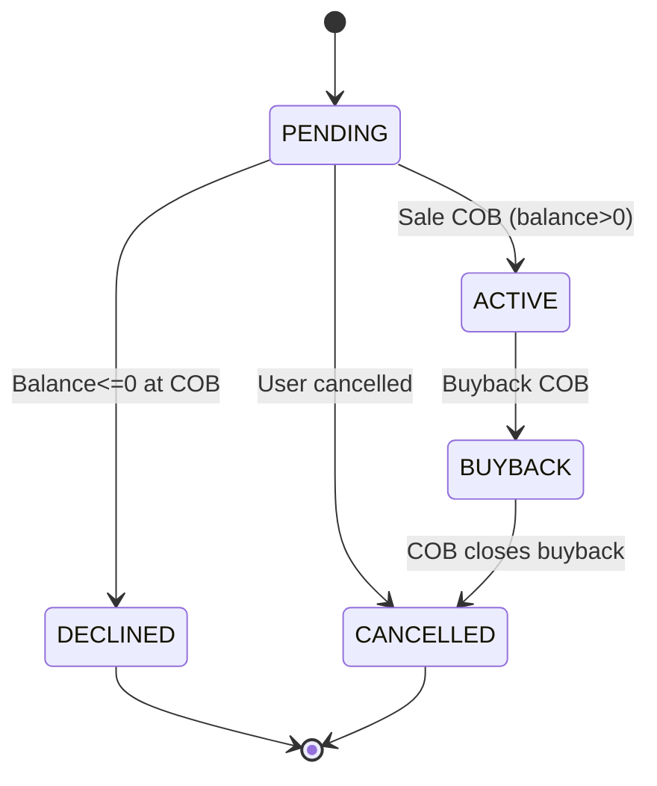

<!-- Labels: user, cross-cutting -->
# Cross cutting changes for Pay in 3/4

This publication describes the cross-cutting changes introduced to the Pay in 3/4 enhancement in the PepperSoup program. It focuses on the asset externalization workflow, including asset ownership transfers to external investors, buybacks, and the related events, validations, and operational effects. The guidance emphasizes day-to-day impact for operations staff, loan officers, branch managers, and credit agents, and it states the verified behaviors and rules that govern these changes.

### What changed and why it matters to operations

The Pay in 3/4 cross-cutting changes formalize the ability to transfer loan ownership to external asset owners (investors) and to perform buybacks. Transfers are initiated for active loans and are completed at close of business (COB) on the settlement date. The transfer creates an external ownership record on the loan, and a sale transaction instance is associated with the loan. The system publishes ownership-related events to support downstream systems and reporting.

Key operational implications:
- A transfer request can only be initiated for loans with an active ownership context and must specify an external owner, a settlement date, and a purchase price ratio. The settlement date is the date on which the ownership transfer becomes effective at COB if the loan balance is greater than zero.
- If the loan balance is zero or negative at COB, a sale request is declined (ownership transfer does not occur).
- A buyback request can be made for loans with active ownership. The balance and ownership state determine whether the buyback proceeds and how the ownership state updates at COB.
- If there is a pending transfer, new transfer requests are refused. This restriction helps prevent overlapping transfer actions on the same loan.
- When a sale and a buyback occur on the same day, the latest policy specifies that the system cancels both transfers and emits cancellation events for each transfer (two CANCELLED events). Journal entries are not created for these dual cancellations in that scenario.
- Ownership changes are reflected in real-time within reporting and in the COB journal processing, with associated events emitted for external systems to consume.

These changes affect day-to-day workflow by introducing a formal lifecycle for asset transfers, enforcing COB-based completion, and requiring staff to manage pending transfers, settlement dates, and status transitions with clarity.

### Concepts and lifecycle at a glance

- Asset Owner: The external investor or owner identified for the loan once ownership is transferred.
- Settlement Date: The COB date on which the ownership transfer becomes active (for sales) or is finalized (for buybacks). Settlement date must not be in the past.
- Purchase Price Ratio: The fraction of ownership being transferred to the external owner, expressed as a percentage. This value is recorded as part of the transfer.
- Sales Transaction ID: An external identifier for the sale transaction, associated with the transfer. If not provided, it will be generated.
- Buyback Transfer ID: An external identifier for a buyback transfer, distinct from the sale transfer identifier.
- Transfer Statuses: PENDING, ACTIVE, BUYBACK, DECLINED, CANCELLED. A transfer progresses from PENDING to ACTIVE (sale) or BUYBACK (buyback) as COB processing completes. DECLINED indicates rejection when conditions are not met; CANCELLED indicates a user-initiated or system-cancelled transfer.

The following lifecycle rules govern these states:
- A sale transfer can proceed only for ACTIVE loans and only if the balance at COB is greater than zero. If the balance is zero or negative, the sale transfer is declined.
- A buyback transfer can proceed for loans with active ownership. If a pending transfer exists, new actions may be restricted according to policy, including cancellation of conflicting transfers in certain cases.
- If sale and buyback are scheduled for the same COB day, cancellation behavior may occur per policy, resulting in two CANCELLED events and no journal entries for that day.
- Ownership changes are recorded at COB and are reflected in customer-facing and investor-facing reporting, with events published to signal the transition.

### How to interact with the workflow (procedural overview)

1) Initiating a sale transfer (Asset to external investor)
- Select a loan that is in ACTIVE ownership state.
- Provide the following required fields: external owner identifier, settlement date (cannot be in the past), purchase price ratio, and a sales transaction identifier (or allow generation by the system).
- Submit the transfer request. The system will validate the loan status, balance, and settlement date, and then place the transfer in a PENDING state if valid.
- If there is already a pending transfer on the loan, the new request is rejected with an standard operation response.

2) Executing the sale transfer at COB
- At COB on the settlement date, if the loan balance is greater than zero, the transfer changes the ownership to ACTIVE and a sale record is finalized. If the balance is zero or negative, the sale is declined and no ownership change occurs.
- The system publishes a ownership change event detailing the transfer; the loan transaction balance remains aligned with the COB posting.
- Journal entries are recorded to reflect the new ownership relationship with the external owner and to verify the general ledger reflects the asset transfer (the specifics of journal line items are defined by the accounting rules for investor-owned loans).

3) Initiating a buyback (external investor to PayPal/owner return)
- For loans with active ownership, staff may initiate a buyback. The transfer will specify the settlement date and related identifiers.
- The COB processing on the settlement date updates the ownership status to BUYBACK and marks the asset owner as inactive when applicable. A buyback transaction identifier is recorded to link the activity.
- A buyback event is published to external systems.

4) Cancellation and edge cases
- If a transfer is in PENDING and a cancellation is requested, the system will reflect the cancellation and emit a CANCELLED event for the transfer.
- If a sale and buyback are requested for the same COB day, the system cancels both transfers and emits two CANCELLED events, one for each transfer; no journal entries are posted for that day in this scenario.
- If a transfer is attempted while another transfer is still pending, the API returns an error indicating that a pending transfer already exists for that loan.

### Data touched and observable results

For operational clarity, staff manage the following data points as part of asset externalization:
- Asset Owner: The external owner assigned to a loan after a successful transfer.
- Sales Transaction ID: The external identifier for the sale action, or generated if not provided.
- Purchase Price Ratio: The percentage representing the portion of ownership being transferred to the external owner.
- Settlement Date: The date on which the ownership change becomes effective at COB and on which the associated journal entries are posted.
- Buyback Transfer ID: The external identifier for a buyback action when applicable.
- Effective Date Range: The period during which the external ownership is valid, including the active from and to dates.
- Transfer Status: The current state of the transfer (PENDING, ACTIVE, BUYBACK, DECLINED, CANCELLED).

Change control and reporting are supported by events that reflect ownership changes and related activities. Staff should monitor the ownership-related events and the COB postings to verify alignment with investor reporting and internal GL activity.

### Events and reporting considerations

The workflow introduces events that signal ownership-related changes. Existing event types associated with asset externalization are extended to include owner information when ownership transitions occur. A new event is emitted to reflect ownership transfers, including sale and buyback actions. These events allows downstream systems to synchronize ownership status and balances in investor-facing reporting and in credit-domain data stores.

Staff should note that the following operational rules apply to event emission:
- Ownership transfer events are emitted at the moment COB processes the transfer (sale or buyback).
- When a transfer is CANCELLED, a associated CANCELLED event is emitted for auditing and reconciliation purposes.

### High-level data integrity and governance considerations

- The system enforces that each period’s opening balance equals the preceding period’s closing balance, and that payment allocations reconcile with the transaction amount.
- Journal entries balance when debit and credit data are available and follow the investment ownership model. When data are available, verify that ownership-related journal entries reflect the current owner.
- The COB-based lifecycle verifies that ownership changes occur only at the end of business processing for the settlement date, maintaining a predictable and auditable sequence of events.
- A new permission may be required to operate the external investor module; staff without the permission should not initiate or modify asset externalization transactions.

### Decision context and current operating rules

Key decisions that shape current behavior:
- Sale and buyback on the same COB day: prior guidance indicated that GL entries would be created; updated policy states that if both actions occur on the same day, both transfers are CANCELLED and two CANCELLED events are emitted, with journal entries not posted for that day.
- If there is a pending transfer, new transfer requests are refused to prevent concurrent transfer workflows on a single loan.
- Settlement date constraints: settlement date cannot be in the past; the transfer becomes effective at COB on the settlement date if the balance is positive.

These rules are applied to verify operational predictability, guard against conflicting actions, and follows reporting and auditing expectations for investor-owned loans.

### Guidance on migration and integration considerations

- allows staff to access the externalization module by assigning the standard permission. Training should cover the lifecycle states (PENDING, ACTIVE, BUYBACK, DECLINED, CANCELLED) and the COB processing cadence.
- Communicate the new event semantics to downstream consumer teams so that external systems can properly interpret ownership-change events and balance transitions.
- Review existing workflows to verify that only initiation is performed via the API and that complete ownership transfers occur at COB as designed.
- Prepare reports and dashboards to reflect ownership status, sale and buyback activity, and the timing of COB postings for investor reporting and GL reconciliation.

### Simple lifecycle diagram (conceptual)

Mermaid diagram (valid as a lightweight visualization of the lifecycle):

### Example scenario (illustrative, exact figures are derived from the baseline Pay in 3/4 calculations and policy)

- A loan is funded with an initial disbursement of 1,000 and an initial down payment of 25% (250). The remaining balance available for transfer is 750.
- At a future settlement date, a sale transfer to an external owner is initiated and the settlement date is scheduled to occur at COB. If the loan balance remains greater than zero at COB on settlement, ownership transfers to the external owner and the loan becomes owned by the investor from the following business day. A sale-related event is emitted, and the system records the asset ownership against the external owner.
- If the sale transfer and a buyback transfer are scheduled for the same COB day, both transfers are CANCELLED as per the current policy, and cancellation events are emitted for both transfers. No journal entries are posted for that COB day.

This page reflects the verified behavior and rules for cross-cutting changes to Pay in 3/4, including asset externalization and the associated operational workflows, events, and governance considerations. Staff should apply these rules consistently in day-to-day operations and in collaboration with accounting and investor-reporting teams.