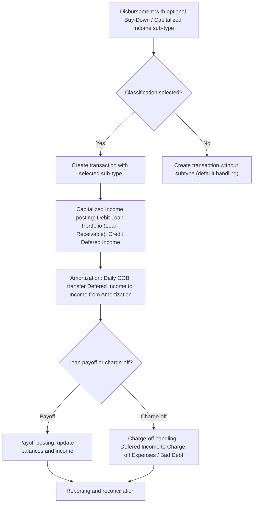

<!-- Labels: user, fee-classification -->
# Buy-Down Fee & Capitalized Income Subtypes

This page documents the enhanced Buy-Down Fee and Capitalized Income capabilities, including optional classifications (subtypes) and the interaction with origination fees as a new, mappable fee type. The change allows configuring and selecting classifications when creating transactions, so users can capture more granular reporting and accounting for these special transaction types. The enhancements apply to the fee classification area under Fees and to transaction creation workflows for Buy-Down Fees, Capitalized Income, and the newly introduced origination fees at the product level.

### What changed and why it matters

- Buy-Down fees and Capitalized Income transactions can now be assigned a sub-type (classification) at creation time. This allows finer categorization for reporting, allocation, and accounting purposes.
- A new origination fee concept is introduced at the product level. Origination fees are configured per loan product, mapped to the loan product, and added to the loan at disbursement on the disbursement date only. The origination fee amount is flat (user-entered) and affects the principal and amortization schedule.
- When capitalized income is recorded, the system uses a deferred income (Defered Income) mapping as part of the accounting flow. Amortization of capitalized income moves amounts from Defered Income to Income from Amortization over time, with special handling in the event of a charge-off.
- A validation rule constrains disbursements with origination fees against the approved amount: disbursement amount plus origination fees must be less than or equal to the approved amount.

These changes impact day-to-day operations by making classifications visible and selectable during transaction creation, improving visibility into fee components, and aligning accounting treatment with the new fee structure.

### Key concepts and terminology

- Buy-Down Fee Subtypes: Optional classifications that you configure to categorize buy-down fee transactions consistently. When you create a Buy-Down Fee or Capitalized Income transaction, you may select a subtype to classify the transaction.
- Capitalized Income: A transaction type used to capture income that is capitalized to the loan (for example, fees that are treated as part of the loan balance and amortized over the loan term).
- Origination Fees: A new fee type introduced at the product level. Origination fees are added to the loan at disbursement and treated as part of the principal for amortization purposes. The amount is flat (entered by the user) and mapped to the loan product.
- Defered Income: A liability (GL) account used to track the deferred income associated with capitalized income until amortization recognizes the income in the period.
- Income from Amortization: An accounting line used to recognize amortized income (revenue) over time from the capitalized income/deferred income stream.

These terms describe implemented behavior and mappings that you will observe in the user interface and in the accounting entries when using the enhanced feature set.

### Configuration and compatibility considerations

- Subtypes (classifications) for Buy-Down Fee and Capitalized Income are configured under Fees > Fee classification > Buy-Down Fee & Capitalized Income Subtypes. Each subtype provides an optional classification for transactions created under these areas.
- Origination Fees: The new fee type must be defined at the product level and mapped to the loan product. The user enters the origination fee amount (flat) at disbursement time; the system adds the origination fee to the disbursement amount to form the base for the principal and for amortization.
- Disbursement validation: The disbursement amount plus origination fees must not exceed the approved amount. This constraint verifies that the total disbursed funds, inclusive of origination fees, remain within the approved limit.
- Accounting implications: The introduction of origination fees and capitalized income changes the standard posting paths. The following are the implemented mappings and flows (summarized):
 - Capitalized Income: Debit Loan Portfolio (Loan Receivable); Credit Defered Income (Defered Income mapping).
 - Capitalized Income Amortization: Debit Defered Income; Credit Income from Amortization (Interest/Fees Income).
 - Capitalized Income Amortization in Charge-Off: Debit Defered Income; Credit Charge-Off Expense and Credit Loss (Bad Debt) related entries.
- Operational readiness: To use these features, update loan products to include Origination Fees and configure the requested Buy-Down Fee & Capitalized Income Subtypes. Users must select the standard subtype when creating relevant transactions; if no subtype is selected, the transaction proceeds with the classification logic configured at the product level.

> Note: A potential governance gap item exists regarding an Origination Fees Adjustment transaction type. Current documentation confirms the standard origination-fee flow and its allocation, but a separate Origination Fees Adjustment transaction type is listed as a potential future addition. This item is not part of verified behavior and should be treated as a待 القرار/possible future enhancement.

### How to use the new classifications and origination fees (operational workflow)

1) Configure subtypes for Buy-Down Fee and Capitalized Income
- Navigate to Fees & Fee classification > Buy-Down Fee & Capitalized Income Subtypes.
- Create or edit subtypes to reflect the classifications you want to use for these transactions. Each subtype represents a distinct category used during transaction creation.
- Save the subtype definitions. These classifications will be available when creating Buy-Down Fee and Capitalized Income transactions.

2) allows and map origination fees at the loan product level
- Open the loan product definition that will use origination fees.
- allows the new fee type Origination Fees and enter the flat amount (per disbursement) to be charged for this product.
- verify that the origination fee amount is mapped to the loan product so that it is included in the disbursement flow and in the amortization calculations.

3) Create a transaction with a classification (subtype)
- When creating a Buy-Down Fee or Capitalized Income transaction, select the standard sub-type from the available classifications. This selection is optional; classifications improve reporting and accounting traceability.
- If you do not select a subtype, the system will continue with the default behavior configured for the product and the transaction type.

4) Validate disbursement against approved amount when origination fees apply
- For disbursements with origination fees, confirm that (disbursement amount + origination fees) <= approved amount. This validation protects against over-disbursement when origination fees are added to the principal base.

5) Review accounting implications and reporting
- Capitalized Income posting: On disbursement, capitalized income increases the Loan Receivable by the origination-fee amount and credits Defered Income.
- Amortization: On each amortization day (daily, COB), a portion of Defered Income is recognized as Income from Amortization.
- Charge-off handling: If a charge-off occurs, the system posts the standard Defered Income against charge-off expenses and cross-cuts to bad debt/credit loss categories as shown by the fixed mappings.
- Reporting: With subtypes in place, reporting can distinguish between different Buy-Down Fee and Capitalized Income classifications, improving insight into fee components and their amortization profiles.

### Accounting mappings and illustrative flows
The following mappings reflect implemented behavior for the capitalized income and related flows. These are the verified, implemented patterns you will observe in postings and reports.

- Capitalized Income
 - Debit: Loan Portfolio (Asset) – Loan Receivable
 - Credit: Defered Income (Liability) – Defered Income mapping
- Capitalized Income Amortization
 - Debit: Defered Income (Liability) – Defered Income mapping
 - Credit: Income from Amortization (Income)
- Capitalized Income Amortization in Charge-Off
 - Debit: Defered Income (Liability) – Defered Income mapping
 - Credit: Charge-off expense / Bad debt related accounts (Expense) and Credit Loss accounts ()
- Capitalized Income Adjustment (future item noted as a potential enhancement in some sources)
 - This item is not considered part of the verified implemented behavior at this time and is listed here for reference only.

These mappings verify consistency between the underlying asset, the deferred liability, and the eventual income recognition as amortization proceeds.

### Calculations and example patterns
Financing changes in Buy-Down Fee and Capitalized Income revolve around two core quantities: the disbursement base (disbursement plus origination fees) and the amortization of the capitalized income over the loan life. The calculation approach follows these principles:

- Calculation inputs:
 - Disbursement amount (principal cash released to the borrower)
 - Origination fees (flat amount added to the disbursement base)
 - Total amount (Disbursement + Origination fees)
 - Interest rate and day-count conventions for the amortization period (as configured in the loan’s terms)
 - Amortization cadence (daily amortization at COB, with reporting on the period basis)
- Calculation method:
 - The origination fee is added to the loan’s principal base, affecting both the schedule’s principal portion and the interest base for the period. Amortization of capitalized income reduces the Defered Income liability over time and recognizes associated income through Income from Amortization.
 - When the loan reaches payoff or is charged-off, the system applies the stated accounting mappings to update the liability and expense accounts .
- Financial effect:
 - The loan balance grows by the origination fee amount at disbursement due to capitalization.
 - Amortization gradually converts the deferred income into recognized income over the life of the loan according to the period’s accruals and daily entries.
 - In a charge-off scenario, the remaining Defered Income balance is treated in line with the charge-off accounting rules for capitalization, verifying the balance follows the loan’s status.

Example calculations (based on the reference content and the defined example patterns):

- Example parameters (UC-1 Simple loan - capitalized income on same day as disbursement):
 - Interest Rate: 7% annually, Day Count: 360, Days in Month: 30
 - Disbursement: 100
 - Capitalized Income: 50
 - Origination Fees: notated in the example as part of the capitalized base for amortization
 - Total Amount (base for amortization): 150
 - Repayment cadence: 1 month

- Calculation pattern (illustrative, using the documented approach):
 - Base principal for amortization = 150 (disbursement 100 + capitalized income 50)
 - Amortization entries move amounts from Defered Income to Income from Amortization daily (COB basis) and reflect the related interest and principal recognition in the period.

- Observed interim results (from the documented UC sequences):
 - The monthly installment (EMI) observed in the provided patterns is approximately 50.58 for the initial period, reflecting the combined base and the interest accrual over the period.
 - The amortization process reduces the Defered Income balance over time, converting it into recognized income.

Notes on precision and verification:
- All shown values illustrate the implemented behavior and are presented to reflect the verified patterns in the reference data. Intermediate numbers in the long schedules are retained from the source materials and should be interpreted in the context of the complete amortization and accounting sequences rather than as standalone benchmarks.
- Rounding: use the rounding conventions defined in the product rules for intermediate steps and final totals, such as HALF_UP or HALF_EVEN, to the financial calculations.

### Diagram: lifecycle of a Buy-Down Fee / Capitalized Income transaction

### Validation, reporting, and governance notes

- Validation: Disbursement amount plus origination fees must be less than or equal to the approved amount. This verifies that origination fees do not push the disbursed funds beyond the approved limits.
- Classification usage: Buy-Down Fee and Capitalized Income sub-types are optional and configurable. When creating a transaction, you may select a subtype to enhance reporting granularity.
- Origination fees: Introduced at the product level, mapped to the loan product, and applied to disbursement as part of the principal base for amortization. The origination fee amount is flat and entered by the user.
- Compatibility: If migrating to this enhanced behavior from a prior baseline, verify loan products are updated to include Origination Fees and the new sub-types so that transactions can be created with classifications and the disbursement flow includes origination fee amounts as part of the base.
- GAP item (Origination Fees Adjustment): A separate Origination Fees Adjustment transaction type is listed as a potential future enhancement in some reference materials. This is not verified as implemented behavior and should be treated as a potential future capability.

### Summary for operations teams

- You now have the option to classify Buy-Down Fee and Capitalized Income transactions using configurable sub-types. Use this to improve reporting fidelity and to support more precise accounting paths for these special transaction types.
- Origination Fees are defined at the loan product level, added to the disbursement base, and included in the amortization calculations. verify that product definitions are updated and that the sum of disbursement plus origination fees does not exceed the approved amount.
- The accounting flows follow the introduction of Defered Income as a liability and Income from Amortization as revenue, with dedicated posting paths for payoff and charge-off scenarios.
- Refer to the lifecycle diagram above to understand the sequence from disbursement through amortization and eventual payoff or charge-off.

If you need a tailored flowchart or a product-specific example using your loan terms, provide the loan term details (disbursement amount, origination fee amount, interest rate, and amortization cadence) and we will illustrate the end-to-end process for your configuration.