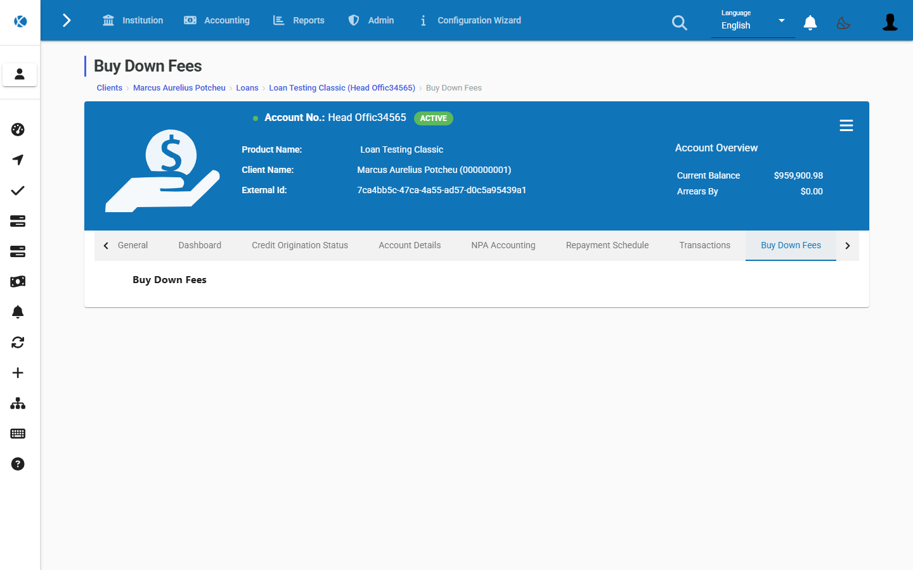
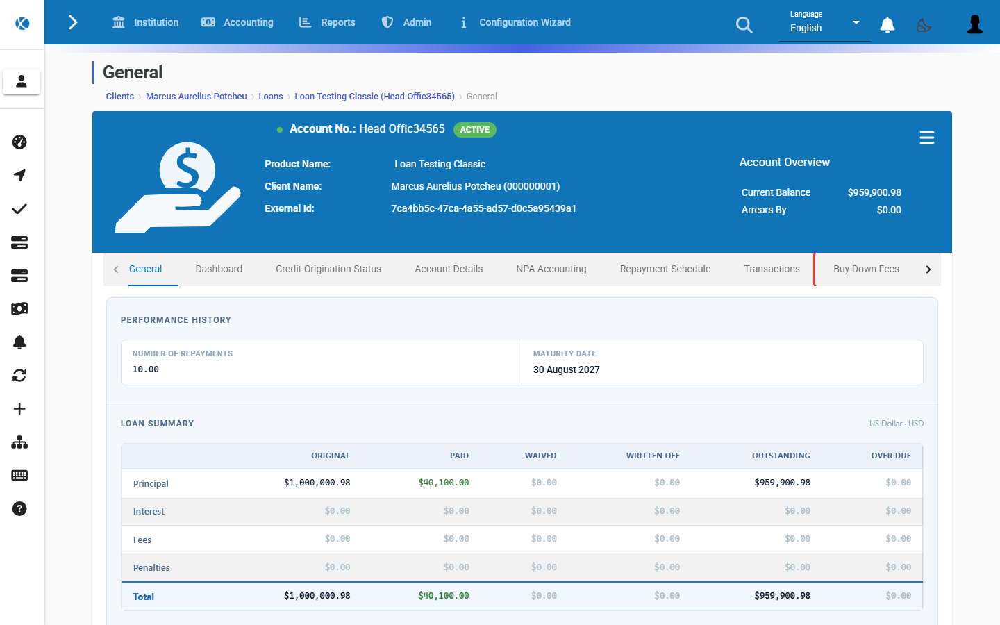
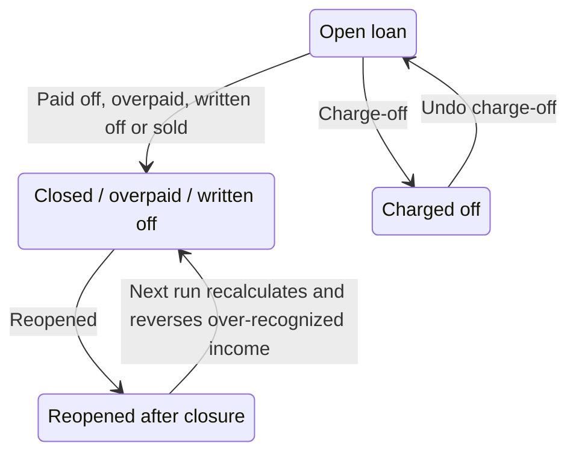
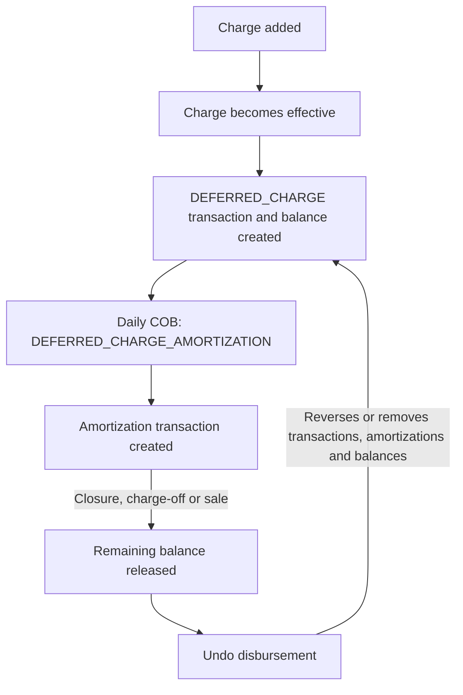

# Charge Amortization

## About charge amortization

Charge amortization spreads a charge's income over the loan term or over a fixed number of days instead of recognizing it all at once. It applies to progressive loans and loan fees with eligible charge time types. Charges without an amortization configuration keep today's behaviour, which is the default. Existing charges, products and loans behave the same, and no data migration is needed.

## View deferred income for an amortized charge

The loan deferred income tab shows how much of an amortized charge is still deferred, how much has been amortized, what remains unrecognized, and any adjustment amount.

1. Select **Institution** > **Clients** and open the client.
2. Under **Loan Accounts**, select the loan account.
3. Open the **Buy Down Fees** tab.

   

## Eligibility and product setup

Only loan fees can be amortized; penalties cannot.

A loan product can use charge amortization only when its enable charge amortization flag is on.

- The flag defaults to false.
- When the flag is off, attaching an amortized charge to the product or adding one to its loans returns a validation error.

Charge amortization works with these accrual types:

- ACCRUAL_PERIODIC
- ACCRUAL_UPFRONT
- NONE

With accrual accounting, a product must have these GL mappings:

| GL mapping | Required when |
| --- | --- |
| Fee receivable | Always |
| Deferred income liability | Always |
| Fee income | Always |
| Interest income | When any attached charge uses income type INTEREST |

A product can optionally override the charge-level amortization configuration for each attached charge.

## Charge-level amortization settings

A charge definition sets how a charge is amortized over the loan term. Each definition has an amortization period type, an amortization calculation type and an amortization income type. When a charge is added to a loan, the definition's amortization settings are copied onto that loan charge. Later changes to the charge definition do not change existing loan charges.

| Setting | Options | Default | Conditions |
| --- | --- | --- | --- |
| Amortization period type | NONE, FULL_LOAN_TERM, NUMBER_OF_DAYS | NONE | NUMBER_OF_DAYS requires a positive integer amortization days value |
| Amortization calculation type | FLAT, EFFECTIVE_RATE | FLAT | EFFECTIVE_RATE is allowed only with FULL_LOAN_TERM |
| Amortization income type | FEE, INTEREST | FEE |  |

## How amortization works

Amortization recognizes a portion of deferred income as income each day at close of business (COB), the nightly job that posts interest and fees. It applies to origination fees and discount fees.

The system keeps the fee balance as follows:

- Balance minus capitalized income minus fee credits or adjustments minus fee income recognized.
- No unrealized discount fee remains; all of it goes into realized income as part of expense.

Each day at end of day (EOD), as part of COB:

- The system recalculates amortization and posts the difference as a discount fee amortization transaction or, if negative, a discount fee amortization adjustment transaction.
- The transaction date is the COB date.
- The realized and unrealized income balance is updated.
- At most one amortization transaction is created per loan per COB day, however many charges there are.
- The COB step does nothing for loans without open deferred charge balances.
- Running COB again for the same business date creates no new transaction; backdated events are corrected by the next run.

Tracking behaviour:

- No accounting entries are created, there is no impact on the outstanding loan balance, and it is purely informational and tracking in nature.
- On prepayment or foreclosure, remaining deferred income is fully amortized at tracking level.
- Amortized charges are excluded from all accrual processing: periodic, upfront, accrual adjustment, accrual activity, and accrual on closure or charge-off.

Traceability and combined amounts:

- The amount per charge stays traceable through allocation mappings, the read API, and fee income accounts mapped to individual charges.
- The amortization schedule calculates and maintains the net amortization balance in real time.

Difference and transaction type:

| Difference | Transaction posted |
| --- | --- |
| Positive | Discount fee amortization transaction |
| Negative | Discount fee amortization adjustment transaction |

## Amortization window and calculation

The amortization window runs from the balance date to either the window end date or the loan's current maturity date, whichever comes first. For a NUMBER_OF_DAYS window, the end date is the earlier of the start date plus the number of days and the maturity date.

For each balance, the delta equals recognizable amount up to the current date minus the amount already amortized. A positive delta creates an allocation mapping of type AM; a negative delta creates one of type AM_ADJ. The deltas are added up into one transaction per loan.

FLAT spreads the amount evenly by day over the window. Waivers and adjustments reduce the amount still to recognize from their date onward, and a change in maturity spreads the remaining amount over the days left.

EFFECTIVE_RATE is a level-yield method based on the loan's contractual cash flows. The rate belongs to the loan, so all effective-rate charges on a loan are amortized as one group and then split back to each charge.

For EFFECTIVE_RATE daily booking, income is spread evenly by day inside each period. For EFFECTIVE_RATE split per charge, the group amount is split across charges in proportion to their unrecognized amounts, with the last period receiving the remainder so the total equals the deferred amount.

After a reschedule, re-age, re-amortization, variable rate change, prepayment that changes future interest, or a new effective-rate charge, the rate is solved again going forward using the current carrying amount, the unrecognized balance, and the remaining cash flows.

The calculated amount is based on the current date total payments versus total amortization amount from the amortization schedule.

| Method | Calculation |
| --- | --- |
| FLAT | Recognizable amount equals the sum over adjustment segments of unrecognized amount at segment start multiplied by days in segment divided by days from segment start to window end. |
| EFFECTIVE_RATE | Starting net carrying amount equals disbursed principal minus effective-rate charge amounts collected at t0; charges collected later count as cash inflows on their due dates. Contractual cash flow on each installment date equals principal plus interest plus any effective-rate charge portion due, taken from the progressive schedule model. The rate is solved so that sum(CFi / (1+r)^(di/365)) equals N0, using Newton–Raphson with bisection fallback and the product's days-in-year setting. For each period, EIR income equals C(k-1) * ((1+r)^(days/365) - 1), amortization equals EIR income minus contractual interest, and C(k) equals C(k-1) plus EIR income minus contractual cash flow. |

## Journal entries

Each charge amortization event posts journal entries that move amounts between fee receivable, deferred income, income accounts, fund source, losses written off, and charge-off accounts.

| Event | Debit | Credit |
| --- | --- | --- |
| Charge becomes effective | Fee receivable | Deferred income |
| Daily amortization | Deferred income | Fee income or Interest income |
| Amortization reversal | Fee income or Interest income | Deferred income |
| Repayment of the charge | Fund source | Fee receivable |
| Waiver or charge adjustment of an amortized charge | Deferred income | Fee receivable |
| Closure (paid off or overpaid) | Deferred income | Fee income or Interest income |
| Closure (written off) | Deferred income | Losses written off |
| Charge-off | Deferred income | Charge-off expense, fraud expense, or the account mapped to the reason |

| Transaction | Debit | Credit |
| --- | --- | --- |
| DEFERRED_CHARGE | FEES_RECEIVABLE | DEFERRED_INCOME_LIABILITY |
| DEFERRED_CHARGE_AMORTIZATION (not charged off) | DEFERRED_INCOME_LIABILITY | INCOME_FROM_FEES or the income account mapped to the charge, or INTEREST_ON_LOANS; LOSSES_WRITTEN_OFF if the loan is written off |
| DEFERRED_CHARGE_AMORTIZATION (charged off) | DEFERRED_INCOME_LIABILITY | The account mapped to the charge-off reason, otherwise CHARGE_OFF_EXPENSE or CHARGE_OFF_FRAUD_EXPENSE |
| DEFERRED_CHARGE_AMORTIZATION_ADJUSTMENT | Fee income or interest income | DEFERRED_INCOME_LIABILITY |
| WAIVE_CHARGES or CHARGE_ADJUSTMENT on an amortized charge | DEFERRED_INCOME_LIABILITY | FEES_RECEIVABLE |
| Repayment (fee portion) | Fund source | FEES_RECEIVABLE |

Journal entry rules:

- When a charge has its own income account mapping, journal lines are split per charge through the allocation mappings.
- With amortization type NONE, no journal entries are posted.
- CASH_BASED is rejected by validation.

> **Note:** A waiver or charge adjustment on an amortized charge replaces the fee income debit, and the next run adjusts any over-recognized income.

## Closure, charge-off, sale and reopening

When a loan closes, is overpaid, is written off, is sold, or is charged off, the remaining deferred charge balance is released. Before charge-off, amortization catches up to the business date. If the loan reopens after closure, the next run recalculates against the real window and reverses any over-recognized income.

Release timing by outcome:

- When the loan is paid off or overpaid, the remaining amount is released on the closed or overpaid date.
- When the loan is written off, the remaining amount is released and credited to Losses written off.
- When an external asset owner sale or transfer settles, the remaining balance is recognized on the settlement date.
- On charge-off, amortization catches up to the charge-off date first, then the remaining balance is released immediately in one amortization transaction linked to the charge-off; charged_off_amount equals unrecognized_amount, then unrecognized_amount becomes 0.
- Undoing a charge-off reverses the linked amortization transaction and restores the unrecognized balance.

Closure release paths:

- Before LoanCloseBusinessEvent, the system releases on closure without journal entries.
- After LoanBalanceChangedBusinessEvent, the system releases on closure with journal entries.
- Before LoanChargeOffPreBusinessEvent, amortization catches up to the business date.
- After LoanChargeOffPostBusinessEvent, the system releases linked to the charge-off.
- After LoanUndoChargeOffBusinessEvent, the system reverses the release and restores the balance.

> **Note:** If a loan is preclosed on the same day, final amortization is done for the balance amount; once paid off there is no reversal or undo of realized income.

## Charge timing and creation

When a charge becomes effective, the system creates a DEFERRED_CHARGE transaction and a deferred charge balance. Future-dated transactions are not created otherwise. Undoing a disbursement reverses or removes all Deferred Charge transactions, amortizations and balances.

The timing of the Deferred Charge transaction depends on the charge type:

- A disbursement charge creates its Deferred Charge transaction at disbursement on the disbursement date.
- A tranche disbursement charge creates its Deferred Charge transaction on the tranche disbursement date, with one balance per tranche.
- A specified due date charge added with a due date on or before the business date creates its Deferred Charge transaction on the due date; a backdated charge is caught up on the next COB run.
- A specified due date charge with a future due date creates its Deferred Charge transaction on the due date via the COB step.

## Waivers, adjustments, deletions and reversals

You can waive or adjust a charge, undo a waiver or adjustment, or delete or inactivate a charge. Each action changes the charge adjustment and recalculates amortization.

Waivers and adjustments:

- Income already recognized above the new amount is reversed with AM_ADJ.

Undoing a waiver or reversing an adjustment:

- When you undo a waiver or reverse a charge adjustment, the charge adjustment is restored and amortization is recalculated.

Deleting or inactivating a charge:

- When you delete or inactivate a loan charge, the DEFERRED_CHARGE transaction is reversed and the balance is marked deleted.
- All recognized income is reversed with AM_ADJ, then the balance is closed.

## Permissions and events

It reverses or removes amortization when you reverse a parent payment, and posts an adjustment when recognized income has to go down.

Events that create or change amortization transactions:

- On payment execution, the system calculates the amortised portion of deferred income, creates a Discount fees Amortization transaction, and links it to the parent payment transaction.
- When recognized income has to go down, a Deferred Charge Amortization Adjustment posts the reverse; triggers are a waiver, a charge adjustment, a deletion, a loan reopening or a recalculation.
- The system replays Amortization transactions along with payment transactions and schedule reprocessing.

## Worked examples

A 1,000.00 loan is disbursed on day 1 and matures after 90 days, made up of three 30-day months. A 90.00 disbursement fee is applied and paid at disbursement, then amortized using the flat method over the full loan term. The figures are illustrative.

| Step | Date | Deferred amount | Recognized to date | Still deferred |
| --- | --- | --- | --- | --- |
| Fee applied at disbursement | Day 1 | 90.00 | 0.00 | 90.00 |
| Daily amortization for 30 days | Day 30 | 90.00 | 30.00 | 60.00 |
| Remaining released on payoff | Day 30 | 90.00 | 90.00 | 0.00 |

A flat fee is recognized evenly each day, and any amount still deferred is released in full when the loan is paid off before maturity.

The same 1,000.00 loan and 90.00 disbursement fee can be amortized over a fixed number of days instead of the full term. With a 60-day amortization period, the daily amount is higher and the window ends on day 60 or at maturity, whichever comes first.

| Setting | Amortization window | Daily flat amount | Recognized by day 30 | Released on payoff day 30 |
| --- | --- | --- | --- | --- |
| Full loan term | 90 days | 1.00 | 30.00 | 60.00 |
| Number of days (60) | 60 days | 1.50 | 45.00 | 45.00 |

Changing the period type to a fixed number of days shortens the window and increases the daily amount, while the total fee recognized over the loan remains the same.
