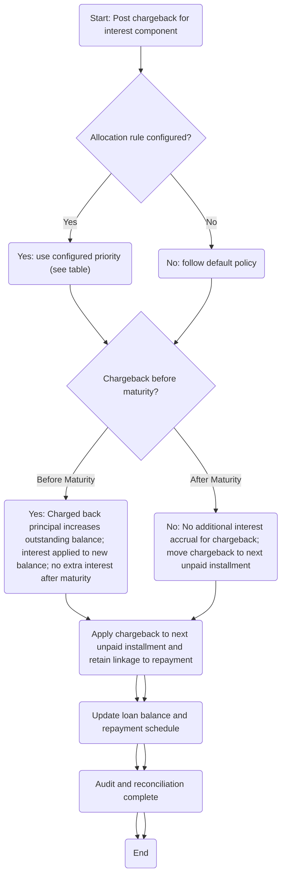

<!-- Labels: user, interest-on-chargeback -->
# Chargeback transaction posting for interest component

This enhancement introduces the ability to post chargeback transactions to a loan account that include the interest component. The change verifies the interest portion of a charged-back payment is reposted against the correct balances, and it defines how the balance, accruals, and repayment schedule are updated when a chargeback affects interest. The behavior depends on whether a chargeback allocation rule exists, and on whether interest recalculation is enabled or disabled. The guidance below reflects verified product behavior and the rules documented in the reference material.

### What changes and why it matters for day-to-day operations

- When a chargeback is posted to a loan account, the system can include the interest portion of the original payment in the chargeback. This verifies the chargeback debits the correct balances (including interest-bearing components) rather than only principal. This is described in the acceptance criteria for chargebacks: a chargeback should include the interest portion if the payment being charged back has any interest.
- The allocation of a chargeback amount is configurable. If a chargeback allocation rule is configured, the system applies the rule’s priority to allocate the chargeback across interest, penalties, fees, and principal according to the rule’s sequence. The primary scenarios in the reference data show different allocation priorities when a rule is present.
- Chargeback interest is treated as a fixed component for the period and will not trigger another interest recalculation. In all scenarios, charged-back interest will not go through the system’s interest recalculation process again, and charged-back interest does not create new accruals (no income recognition).
- The timing of the chargeback relative to maturity changes how the balance is affected and whether interest will accrue on the increased balance. If the chargeback occurs before the loan’s maturity, the outstanding principal increases, and interest will be calculated on this increased amount for future periods. If the chargeback occurs after maturity, no additional interest is generated for the chargeback. The reference material explicitly states these rules across multiple scenarios.
- The chargeback amount is added to the next unpaid installment in the repayment schedule, just as it is for non-interest-bearing chargebacks, and the linkage between the chargeback and the repayment is retained.
- If the original transaction portions are changed, the system recalculates and reallocates the chargeback .

### Configurable rules and behavior by scenario
Operations staff should be aware of which scenario applies in their environment, as it drives how chargebacks are posted and how the balance evolves.

- Allocation rule configured and Interest recalculation ENABLED ( style scenarios)
 - S1: Full chargeback before maturity date
 - Allocation priority: Interest, penalties, fees, Principal
 - S2: Partial chargeback before maturity date-1
 - Allocation priority: Interest, fees, Principal
 - General effects:
 - The chargeback amount includes interest when the original payment had interest.
 - The chargeback is posted with the specified priority, and the next steps in repayment are adjusted .
- No chargeback allocation rule set and Interest recalculation ENABLED ()
 - The chargeback will include the interest portion if the original payment had interest; the operation follows the applicable interest-recalculation-enabled workflow as verified by the scenario. The exact allocation priority is not configured by a rule and relies on the system’s standard post-posting behavior under recalculation-enabled conditions.
- No chargeback allocation rule set and Interest recalculation DISABLED ()
 - Chargeback interest will not generate new accruals, and there will be no new interest recalculation for the chargeback. The chargeback amount is still debited to the loan balance, and the repayment linkage is retained for next installments.
- Allocation rule configured and Interest recalculation DISABLED ()
 - Allocation priority: Interest, fees, Principal
 - Chargeback does not trigger interest recalculation; no new accruals for chargeback interest; principal changes are handled per the before/after maturity rules noted above; the chargeback remains linked to the repayment schedule.

Note: Allocation priorities are configurable and must be set in the policy/configuration layer. The examples above reflect the documented priorities observed in the reference material for the respective scenarios.

### How to perform a chargeback posting for interest component (operational steps)
1. Open the Chargeback posting path for interest components: navigate to Chargeback > Interest on chargeback > Chargeback transaction posting for interest component.
2. Select the loan account and the original payment transaction that is being charged back. Enter the chargeback amount for posting.
3. If a chargeback allocation rule exists in your configuration, confirm the rule is the one to apply. The system will allocate the chargeback according to the configured priority (for example, between interest, penalties, fees, and principal). If no rule exists, follow the applicable policy for recalculation (enabled or disabled).
4. Confirm whether interest recalculation should be applied to the loan after the chargeback. If a rule sets recalculation to ENABLED, note that chargeback interest itself will not re-trigger a recalculation for the chargeback portion. If recalculation is DISABLED, no new accruals are created for the chargeback interest.
5. Post the transaction. The system will apply the chargeback, update the loan balance, and adjust the repayment schedule as described below. After posting, verify that:
 - The period's opening balance equals the previous period's closing balance (integrity requirement).
 - The chargeback allocation reconciles with the posted amount according to the configured priority.
 - The next unpaid installment reflects the chargeback as described (added to the outstanding balance or included in the next payment according to policy).
 - The linkage between the chargeback and the repayment remains intact.
6. Review the updated loan balance and repayment schedule to confirm the financial effect follows the scenario rules (e.g., post-chargeback balance adjustments, and any changes to future interest calculations or installments).

Notes for migration and compatibility
- The enhancement relies on the configuration of chargeback allocation rules and the status of the interest recalculation setting. Staff should verify that the standard rules are configured before posting chargebacks with an interest component.
- No explicit data migration steps are described in the reference material. The changes are behavioral and rely on existing loan posting and allocation capabilities.

### Calculation reference: how the interest portion of a period is derived
- Day-count convention: 360 days per year, 30 days per month (typical for the provided references).
- Interest rate: 7% per year (0.07).
- Per-period interest factor for a 30-day period: 0.07 * 30 / 360 = 0.005833333...
- For a balance of 100, the interest for the 30-day period is 100 * 0.005833333... = 0.583333..., which the system rounds to two decimals as 0.58 using standard rounding rules (HALF_UP).
- Example from the reference scenario (2/1/24): starting balance 100, EMI 17.01, interest 0.58, principal 16.43, new balance 83.57. This illustrates how the interest portion is calculated and how it reduces the principal portion of the payment, yielding the updated balance for the next period.

Balance (start period)100

Interest (30-day period)0.58

### Visualization of the basic flow (Mermaid)

This diagram highlights the high-level decision logic and outcomes when posting a chargeback for the interest component. It follows the verified behavior that allocation rules drive the distribution of the chargeback, and that the maturity timing determines whether additional interest accrues on the charged-back amount.

### Quick reference: key terms and effects
- Chargeback posting for interest component: a chargeback that includes the interest portion of the original payment and updates the loan balances .
- Allocation rule: configurable priority that determines how the chargeback amount is allocated across interest, penalties, fees, and principal.
- Interest recalculation: a separate setting that can be ENABLED or DISABLED; chargeback interest will not trigger a recalculation, and no new accruals occur for the chargeback interest.
- Maturity timing: if the chargeback occurs before maturity, the outstanding principal increases and future interest is calculated on the increased amount; if after maturity, no extra interest accrues for the chargeback.
- Next unpaid installment: the chargeback amount is added to the next installment as standard, and the linkage to the repayment remains intact.

If you need to reference the exact configuration for your environment, verify the chargeback allocation rule and the interest recalculation setting in the policy configuration, and test a representative scenario in a non-production environment to validate the expected posting and repayment adjustments.