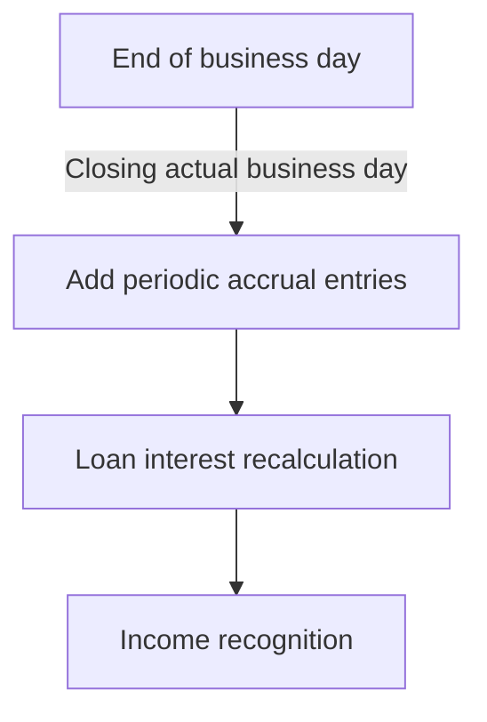
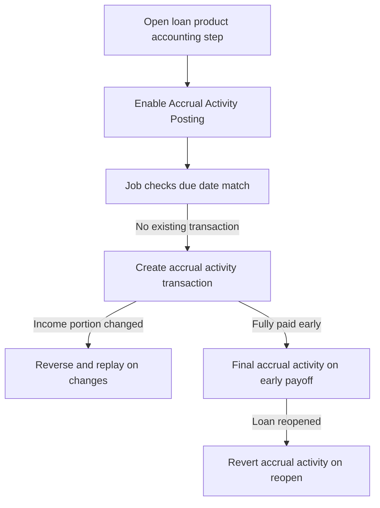
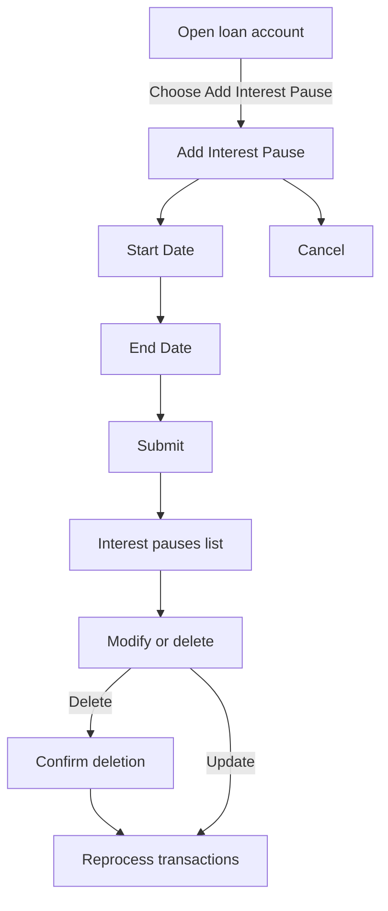

# Accruals

## Enhanced Accrual Handling

When an interest recalculation situation emerges, the system calculates an ADJUSTMENT transaction to avoid too many reverse-replaying efforts.

## Accrual Rework

### Accrual job and posting schedule

The interest accrual job creates accrued interest daily but does not make it due and payable until the next billing cycle due date. Daily interest is accrued and held in a bucket until the next billing cycle, at which point the interest amount becomes due and part of the total balance due on the loan.

Accrual posting follows these rules:

- The accrual entry posts Interest, fees, and penalties calculated for that posting period.
- If the accrual posting period is monthly, the accrual entry posts every month.
- If the accrual posting period is daily, the accrual entry posts every day.
- Accruals calculate interest from the last accrued date or disbursement date till the current accrual date.

The accrual job applies these settings:

- The accrual job allows certain loan statuses and/or balances to be excluded based on setups defined.
- The accrual job calculates interest based on defined balances and rates established during loan creation.
- Accruals are posted on loan accounts through the periodic accrual posting JOB as per the set period.

### COB and periodic accrual processing

The system calculates and creates accrual and accrual adjustment transactions during close of business (COB) rather than in real time. Income recognition happens at the end of the day.

COB processing includes the following steps:

- Closing the actual business day executes the Add periodic accrual business step.
- The Add Periodic Accrual Transactions job calculates accrual and accrual adjustment transactions.
- COB also runs loan interest recalculation.

### Accrual adjustments and corrections

Accrual adjustments correct recognized interest when backdated activity changes the calculated amount. The system does not reverse and replay accruals; instead, the next accrual transaction carries the higher or lower amount, and any negative difference is posted as an Accrual - Adjustment transaction.

Backdated activity on a loan account triggers recalculation of the accrual amount.

- Backdated repayments or reversal of backdated repayments before the last accrual transaction trigger recalculation of the accrual amount, and the differences are adjusted to the latest accrual transaction only.
- A backdated disbursement can change recognized income when interest is recalculated.
- Reversing a previous repayment transaction can change recognized income when interest is recalculated.

The Add periodic accruals business step applies the recalculated amount according to how it compares with amounts already posted.

- When the adjustment accrual amount is higher than the already posted amount, the job creates an Accrual transaction for the current date with the higher amount.
- When the adjustment accrual amount is lower than the already posted amount but not lower than the latest accrual amount, the job creates an Accrual transaction for the current date with the lower amount.
- When the adjustment accrual amount is lower than both the already posted amount and the latest accrual amount, the negative difference is posted as an Accrual - Adjustment transaction.

Accrual adjustments follow these rules.

- Accrual - Adjustment is a transaction type that decreases the accrued portions on the repayment schedule.
- Creating an Accrual - Adjustment transaction can deduct the accrual amount effectively.
- For every business day on which the Add periodic accruals business step runs, an Accrual or Accrual - Adjustment transaction is created; gaps are not wanted.
- All accrual adjustments are done at end of day as part of the periodic accrual job.
- The accrual adjustment logic compares total accrued amounts against calculated accrued amounts up to the current date; it does not base the calculation on the period due date.

### Loan status and balance handling

The system creates a final accrual when a loan becomes overpaid, if applicable. Interest accruals continue as usual for loan accounts marked as charge-off, and their accounting legs remain unchanged. Backdated monetary activity triggers proper handling and recalculation when obligations move between Closed obligations met and Overpaid states.

### Closing and final accrual

When a repayment closes a loan account, the system posts an accrual entry with that repayment if any amount has not been accrued since the last accrued date.

The system reverses a final accrual transaction only when future payable interest or charges remain on the loan.

- If no future payable interest or charges remain, the accrual transaction was correct and the system does not reverse it.

### Transaction rules and limitations

The system posts interest using a unique transaction type so interest transactions that affect the loan balance appear as monetary activity. A transaction with a negative amount is always treated as a bug.

The following transaction behaviours are not supported:

- Transaction reverse-replay.
- Early or late repayment with interest recalculation.

Accrual and repayment handling depends on when it occurs:

- When a charge is created, no accrual is created and repayment is not reversed.
- During COB, accrual is created and repayment is reversed and replayed.

### Charge-off and backdated loan scenarios

Charge-off and backdated loan scenarios control when accrual transactions are created and how interest accrues over the repayment period. Interest accrues daily by default.

The following rules apply to accrual transactions:

- When the charge-accrual-date global configuration is set to submitted-date, the system creates the accrual transaction on the charge submitted date for a backdated loan even if the current date is later than the installment due date.
- The system does not create unusual accrual adjustment or accrual transactions when a repayment was made in advance.
- Interest accrues from the first day of the repayment until the last repayment date, so there is no interest accrual on the disbursement date.

### Worked examples

A 1,200 loan is disbursed on the first of the month with an annual interest rate of 12 percent and 30-day months. These figures are illustrative. Interest accrues daily at 0.40 and is held in a bucket until the billing date. On the billing date, a repayment of 132 is made, allocating 120 to principal and 12 to interest. This example shows daily accrual held in a bucket until the billing date, when the repayment covers both interest and principal.

| Date | Event | Daily interest | Accrued bucket | Interest paid | Principal repaid | Balance |
| --- | --- | --- | --- | --- | --- | --- |
| 1/1 | Disbursement | - | - | - | - | 1,200.00 |
| 1/10 | Daily accrual | 0.40 | 4.00 | - | - | 1,200.00 |
| 1/20 | Daily accrual | 0.40 | 8.00 | - | - | 1,200.00 |
| 1/30 | Daily accrual | 0.40 | 12.00 | - | - | 1,200.00 |
| 1/30 | Repayment at billing | - | 0.00 | 12.00 | 120.00 | 1,080.00 |

A 1,000 loan with monthly accrual posting has 10.00 interest posted at the end of January. A backdated repayment of 200 is applied with an effective date of January 15, lowering the balance to 800 for the second half of the month. When COB runs on February 21, the system recalculates January interest as 8.94. Because 8.94 is lower than the 10.00 already posted and lower than the latest accrual, the system posts an Accrual - Adjustment of -1.06 instead of reversing the original transaction. This example shows that backdated repayments trigger recalculation at COB and the difference is posted as an Accrual - Adjustment without reversing the original accrual.

| Date | Event | Accrual posted | Adjustment | Net interest |
| --- | --- | --- | --- | --- |
| 1/15 | Backdated repayment effective | - | - | - |
| 1/31 | Monthly accrual posted | 10.00 | - | 10.00 |
| 2/21 | COB recalculates accrual | 8.94 | - | 8.94 |
| 2/21 | Accrual - Adjustment posts | - | -1.06 | 8.94 |

A 1,000 loan has an installment due on February 1 with 200 principal and 10 interest. An early principal payment of 200 is made on January 15, reducing the balance to 800. The system does not reverse and replay prior accruals; instead, the next monthly accrual is calculated on the reduced balance, producing 8.00 interest for February. This example shows that early payments reduce the balance for future accrual without reverse-replaying previously posted accrual transactions.

| Date | Event | Accrual amount | Principal repaid | Balance |
| --- | --- | --- | --- | --- |
| 1/1 | Disbursement | - | - | 1,000.00 |
| 1/15 | Early principal payment | - | 200.00 | 800.00 |
| 1/31 | Monthly accrual | 8.00 | - | 800.00 |
| 2/1 | Installment repayment | 8.00 | - | 800.00 |

A 1,000 loan accrues interest daily at 0.33. The business date is moved to January 29 and COB runs, aggregating accrual from January 20 through January 29 before a repayment on January 30. The ten days of accrual total 3.30 and post as a single monthly entry. If the posting period were daily instead of monthly, the same interest would post every day rather than as one aggregate amount. This example shows COB aggregating accrual over a period and posting it once, with the result changing if the posting period is set to daily.

| Date | Event | Daily interest | Accrued amount | Principal repaid | Balance |
| --- | --- | --- | --- | --- | --- |
| 1/20 | Accrual period starts | - | - | - | 1,000.00 |
| 1/29 | COB aggregates accrual | 0.33 | 3.30 | - | 1,000.00 |
| 1/30 | Repayment | - | 3.30 | 100.00 | 900.00 |

## Accrual Activity on Instalment Dates

Accrual activity on instalment dates posts a non-monetary accrual activity transaction for the income portions of an instalment, such as interest, fees and penalties income. It applies only to active loans on the instalment due date and only when accrual activity posting is enabled on the loan product. The transaction has no accounting entries and does not affect balances or the repayment schedule.

The following rules govern accrual activity posting:

- A scheduled job posts an accrual activity transaction when the actual business date minus one day equals an instalment due date, for loans where accrual activity posting on the loan product is enabled.
- If an instalment is found and no accrual activity transaction exists for it, the job calculates the total accruals of that instalment and creates a new transaction.
- If a loan is pre-closed, one accrual activity entry is posted as of the last transaction date.
- If a fully paid or overpaid loan is reopened, the previously created accrual activity transaction must be reverted.
- If a pre-closed loan is reopened due to a new disbursement or chargeback, accrual activity is created for the next instalments up to the current date, with interest calculated from the previously posted accrual activity on the earlier preclose date.
- The accrual activity transaction is reversed and replayed whenever the income portion amount changes during schedule recalculations, like any other transaction.
- Creating a backdated transaction on a product with interest recalculation enabled results in an error.
- During transaction and charge reprocessing if the accrual balances changed on the instalment, the original accrual activity transaction needs to be reverted and a new transaction created.
- If a pre-closed loan is reopened again due to new disbursement or chargeback, the accrual activity created on the date when it got fully paid needs to be reverted.

Configuration and user interface details:

- Configuration at loan product level is required to enable or disable accrual activity transaction posting.
- By default, the accrual activity posting job is not enabled.
- The loan product accounting step screen includes the field Enable Accrual Activity Posting on Installment Due Date.
- The loan product accounting step screen includes the field Advanced Accounting Rules.
- The loan product accounting step screen includes the buttons Previous and Next.
- The loan product accounting step screen shows the text Assets; Liabilities; Income; Expenses.
- UI for accrual activity configuration is included in this story.

To reach the accrual activity configuration screen:

1. Open the loan product creation page.
2. Choose the accounting step to open the loan product accounting step screen.

> **Note:** Transaction reverse-replaying must be supported for accrual activity transactions.

A customer takes a loan of 1,200 at a 12 percent annual interest rate on a declining balance, repaid in three monthly installments over 30-day months. While the loan is active, the system posts a non-monetary accrual activity transaction on each installment due date for the interest portion of that installment. The figures are illustrative. This shows that accrual activity tracks income portions on due dates without changing the loan balance.

| Due date | Opening balance | Interest portion | Accrual activity | Principal repaid | Closing balance |
| --- | --- | --- | --- | --- | --- |
| Disbursement | 1,200.00 | – | – | – | 1,200.00 |
| Due date 1 | 1,200.00 | 12.00 | 12.00 | 400.00 | 800.00 |
| Due date 2 | 800.00 | 8.00 | 8.00 | 400.00 | 400.00 |
| Due date 3 | 400.00 | 4.00 | 4.00 | 400.00 | 0.00 |
| Total | – | 24.00 | 24.00 | 1,200.00 | – |

A 1,200 loan at 12 percent annual interest is scheduled over three monthly installments, but the customer repays the outstanding balance at the end of month two. On the early payoff date, the system posts one final accrual activity transaction of 20.00 as of the last transaction date, covering all income portions from disbursement through that date. If the loan is later reopened, this final entry is reverted.

| Due date | Opening balance | Interest portion | Accrual activity | Principal repaid | Closing balance |
| --- | --- | --- | --- | --- | --- |
| Disbursement | 1,200.00 | – | – | – | 1,200.00 |
| Due date 1 | 1,200.00 | 12.00 | 12.00 | 400.00 | 800.00 |
| Due date 2 (early payoff) | 800.00 | 8.00 | 20.00 | 800.00 | 0.00 |

The same 1,200 loan is preclosed at the end of month two, and a final accrual activity of 20.00 is posted. When the loan is reopened because of a new disbursement or chargeback, the system reverts that 20.00 entry, issues a new disbursement of 400, and posts a fresh accrual activity of 4.00 on the next installment due date for the interest portion.

| Event | Opening balance | Accrual activity | Principal repaid | Closing balance |
| --- | --- | --- | --- | --- |
| Preclosed at month 2 | 800.00 | 20.00 | 800.00 | 0.00 |
| Reopened: prior entry reverted | 0.00 | -20.00 | – | 0.00 |
| New disbursement | 0.00 | – | – | 400.00 |
| New due date (month 3) | 400.00 | 4.00 | 400.00 | 0.00 |

A 1,200 loan at 12 percent annual interest has an installment with an interest portion of 12.00, so the system posts an accrual activity transaction of 12.00 on the due date. If a schedule recalculation changes the income portion to 15.00, the system reverses the original accrual activity transaction and replays a new one for 15.00. The transaction has no accounting entries and does not change balances. If a user creates a backdated transaction on a product with interest recalculation enabled, the system blocks it with an error.

| Step | Accrual activity | Balance effect |
| --- | --- | --- |
| Original posting | 12.00 | None |
| Reversal of original | -12.00 | None |
| Replay after recalculation | 15.00 | None |
| Net posted | 15.00 | None |

## Pausing and Resuming Accruals

### Eligibility and prerequisites

You can pause interest accruals only on an active progressive loan whose schedule type is not cumulative and whose recalculate interest setting is true.

### Date rules and validation

You pause interest between any dates in the loan lifecycle by providing a start date and an end date. The pause start date is inclusive and the end date is not inclusive for interest pause calculation.

The following date rules apply:

- The start date cannot be after the maturity date.
- The end date cannot be earlier than the start date.
- The end date cannot go beyond the maturity date.
- When start date and end date are equal, interest is paused for only that day.
- No resume option is required for interest pause.
- An interest pause period cannot be less than 1 day.

### Interest calculation behavior

An interest pause stops interest calculation for every day of the pause period, including both the start date and the end date. Interest accrual resumes at the loan's defined interest rate with the next end-of-day processing.

The pause works through the following rules:

- The system sets the interest rate to zero from the start date inclusive and restores the original rate from the end date inclusive.
- No interest is calculated during the pause period.
- No interest is calculated as part of end-of-day processing while the pause is active.
- Interest accrual resumes at the loan's defined interest rate with the next end-of-day processing.

> **Note:** Interest accrued during a disabled pause period is ignored and treated as zero; interest accrued during an enabled pause period is not ignored.

### Pause lifecycle management

You can pause interest accrual multiple times during a loan lifecycle, but pauses cannot overlap. The same pause calculation applies to pay-off, charge-off, and reschedule calculations.

You can manage an existing interest pause as follows:

- You can update an interest pause using validation similar to create, and overlap is not allowed.
- You can delete an interest pause as a logical deletion.

### Backdated pauses and recalculation

A backdated start date is allowed, and recalculation is triggered if repayments exist in between, which are reversed and replayed. An accrual adjustment is done if there is any difference in interest recognition due to a backdated interest pause. Pause start date and end date are both inclusive for interest pause calculation.

### Repayment and schedule impact

During an interest pause, the EMI amount stays the same. When the pause covers several repayment periods, the system processes each period in order. The last unpaid installment may be lower because of the pause.

### Charges and penalties

An interest pause changes how charges and penalties accrue. Charges based on interest are recalculated with zero interest during the pause, while charges based on percentage of amount, percentage of principal amount, or flat amounts are not affected by the pause. Charges that do not depend on interest remain unchanged.

Penalties and charge updates behave as follows during an interest pause:

- Penalties based on late payment of interest become zero during the pause.
- Updating or deleting an interest pause resets interest-based charges.
- Only charges or penalties based on interest are reversed and replayed based on new interest.
- No accrual transaction for interest is posted between the pause start date and end date, inclusive.
- Interest pauses are processed as events using the start date, and on that date the pause is the first event processed.
- The batch API supports interest pause API usage.

### User interface

Interest pauses appear under the Term variations tab in a group named Interest pauses, where term variations are grouped by term type. Entries are listed in order by start date ascending, and each entry shows its start date and end date with the number of days calculated as end date minus start date plus one.

1. Open the loan account and choose "Add Interest Pause" from the actions to open the add interest pause screen.
2. Enter the required Start Date and End Date.
3. Choose Submit to create the pause or Cancel to close the screen.

Users can manage existing interest pause periods under the Term variations tab:

- Users can modify an existing interest pause period.
- Users can delete an existing interest pause period, and deletion asks for confirmation.
- Changes to an existing interest pause require transactions to be reprocessed to reflect the changes.

> **Note:** The Add Interest pause option is available in the action menu top right corner under the More submenu.

### Worked examples

A 1,000 loan is disbursed on January 1 with a 12% annual interest rate (1% per month), three monthly installments, and 30-day months. The figures are illustrative. Interest is paused from January 1 through January 31, so no interest accrues for that month. The installment amount stays 340.00 for the first two payments; only the final payment changes. This example shows that a pause lowers total interest while keeping the EMI unchanged until the last installment; a shorter pause would save proportionally less interest.

| Date | Event | EMI | Interest | Principal | Balance |
| --- | --- | --- | --- | --- | --- |
| Feb 1 | No pause | 340.00 | 10.00 | 330.00 | 670.00 |
| Feb 1 | Pause Jan 1-31 | 340.00 | 0.00 | 340.00 | 660.00 |
| Mar 1 | Installment | 340.00 | 6.60 | 333.40 | 326.60 |
| Apr 1 | Final installment | 329.87 | 3.27 | 326.60 | 0.00 |
|  | Totals with pause | 1,009.87 | 9.87 | 1,000.00 | — |

A 1,000 loan with the same terms has a 340.00 installment posted on February 1. An interest pause is then backdated to January 16 through January 31. Because the repayment falls in that window, the system reverses the February 1 entry, recomputes interest at zero for the paused days, and replays the installment. The EMI remains 340.00. Updating or deleting a pause is a logical deletion and similarly resets interest-based charges. This example shows how a backdated pause reverses and replays repayments while keeping the schedule consistent.

| Date | Event | EMI | Interest | Principal | Balance |
| --- | --- | --- | --- | --- | --- |
| Feb 1 | Original posting | 340.00 | 10.00 | 330.00 | 670.00 |
| Feb 1 | Reversal | -340.00 | -10.00 | -330.00 | 1,000.00 |
| Feb 1 | Replayed after pause | 340.00 | 5.00 | 335.00 | 665.00 |
| Mar 1 | Installment | 340.00 | 6.65 | 333.35 | 331.65 |
| Apr 1 | Final installment | 334.97 | 3.32 | 331.65 | 0.00 |
|  | Totals | 1,014.97 | 14.97 | 1,000.00 | — |

On the same 1,000 loan, a late-payment penalty equals 5% of interest due, and a flat administration charge of 5.00 is applied each month. In a normal month with 10.00 interest, the penalty is 0.50. During a paused month, interest is 0.00, so the penalty becomes 0.00 while the flat charge remains 5.00. This example shows that only interest-based charges are recalculated at zero during a pause.

| Month type | Interest | Penalty (5% of interest) | Flat charge | Total charges |
| --- | --- | --- | --- | --- |
| Normal month | 10.00 | 0.50 | 5.00 | 5.50 |
| Paused month | 0.00 | 0.00 | 5.00 | 5.00 |
| Totals | 10.00 | 0.50 | 10.00 | 10.50 |

## Real-Time Charge Accruals

Real-time charge accruals let you recognize charges, fees, or penalties immediately when they are posted instead of waiting for the Close of Business job. This applies to working capital loans and progressive loans.

The charge accrual time setting controls when an accrual entry is created for each applicable charge transaction:

- Real-Time creates an accrual entry immediately when the charge transaction is posted.
- EOD creates an accrual entry through the Close of Business process based on the configured charge accrual date.
- Working capital loans use wcl-charge-accrual-time.
- Progressive loans use pl-charge-accrual-time.
- The default value is EOD.
- The selected value applies consistently to all applicable charge accrual transactions.

When Real-Time is selected:

- An accrual transaction is created immediately when a new charge is added.
- Multiple charges create multiple accrual transactions.

A loan officer opens a working capital loan of 1,000.00 with a 12% annual interest rate, three monthly installments, and 30-day months. The figures are illustrative. During the term, the officer adds a late fee of 30.00. With the global charge accrual time set to Real-Time, the system posts one accrual transaction for 30.00 immediately when the fee is saved.

| Step | Charge amount | Accrual transaction | Accrued income total |
| --- | --- | --- | --- |
| Loan opened | 0.00 | 0.00 | 0.00 |
| Late fee added | 30.00 | 30.00 | 30.00 |
| End of business day | 0.00 | 0.00 | 30.00 |

This example shows that a single charge generates a single immediate accrual transaction under real-time posting.

The same working capital loan of 1,000.00 with a 12% annual interest rate, three monthly installments, and 30-day months remains outstanding. A loan officer adds a late fee of 30.00 and, later the same day, a processing fee of 20.00. With real-time accrual enabled, the system creates two separate accrual transactions immediately, one for each charge.

| Step | Charge amount | Accrual transaction | Accrued income total |
| --- | --- | --- | --- |
| Late fee added | 30.00 | 30.00 | 30.00 |
| Processing fee added | 20.00 | 20.00 | 50.00 |
| End of business day | 0.00 | 0.00 | 50.00 |

This example shows that multiple charges on the same day produce multiple accrual transactions, one per charge, rather than a single combined entry.

A loan officer adds a late fee of 30.00 and a processing fee of 20.00 to a working capital loan of 1,000.00 with a 12% annual interest rate, three monthly installments, and 30-day months. When the global charge accrual time is set to the deferred end-of-day option instead of Real-Time, no accrual transaction is created when the charges are saved.

| Step | Charge amount | Accrual transaction | Accrued income total |
| --- | --- | --- | --- |
| Late fee added | 30.00 | 0.00 | 0.00 |
| Processing fee added | 20.00 | 0.00 | 0.00 |
| Close of business | 50.00 | 50.00 | 50.00 |

With the deferred setting, the two charges are combined into one aggregate accrual of 50.00 at close of business, while Real-Time posting would create two separate transactions immediately.
