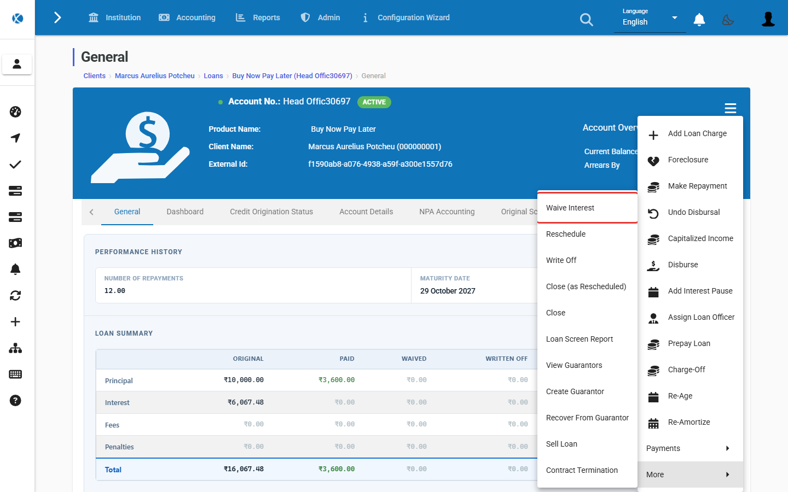
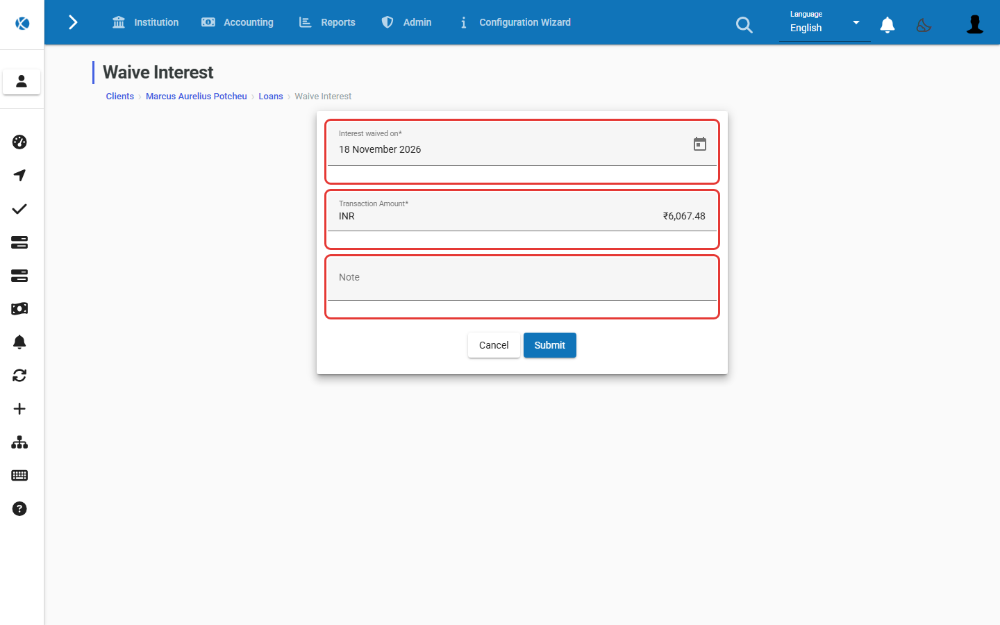
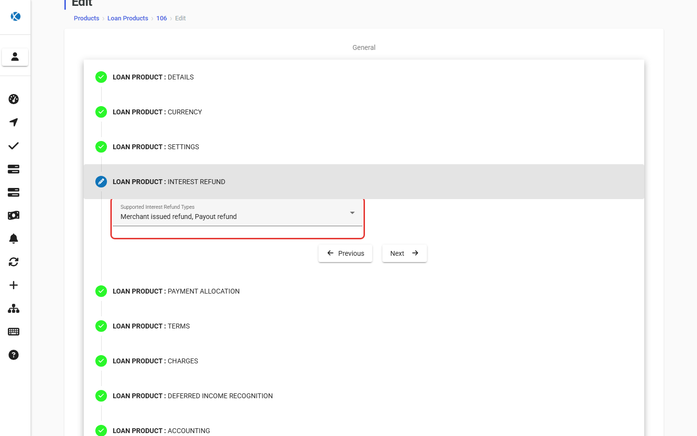
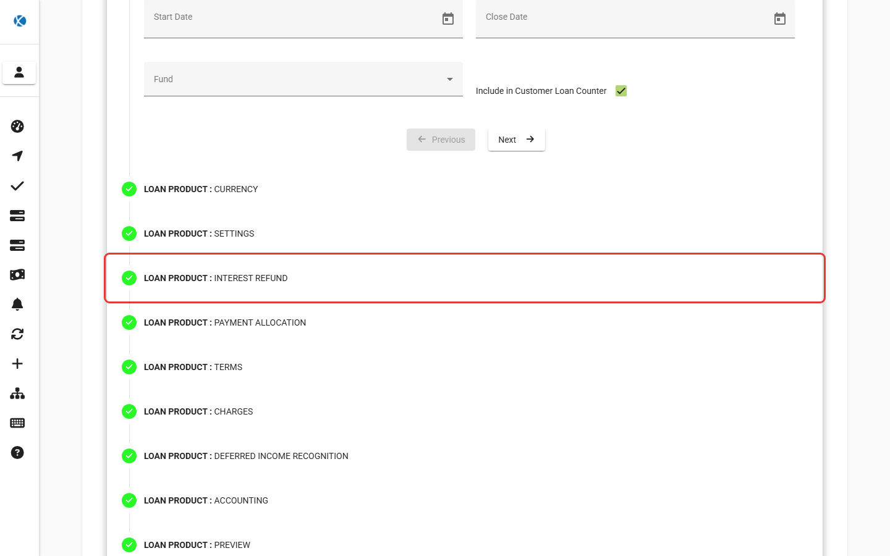

# Interest Transactions

## Interest Waivers

An interest payment waiver reduces the interest balance on a loan account. You can post it on active and closed loan accounts. The waiver applies to interest balances first, then follows the payment allocation order set at the advance allocation strategy.

You can do the following with an interest payment waiver:

- Undo or modify the transaction on the UI.
- Do a charge-back for the transaction from the UI.
- Revert and replay the transaction when allocation changes.

> **Note:** Reverse replay works the same for an interest payment waiver as for any other transaction type.

### Waive interest on a loan

Use this screen to waive interest on active and closed loan accounts by entering the waived amount and date.

1. Select **Institution** > **Clients** and open the client.
2. Under **Loan Accounts**, select the loan account.
3. Open the **Loan Account Actions** menu (the ☰ button next to the account name).
4. Select **Waive Interest**.

   

5. Enter the details described below, then select **Submit**.

| Field | Required | Description |
| --- | --- | --- |
| Interest waived on | Yes | Enter the date on which the interest is waived. |
| Transaction Amount | Yes | Enter the amount of interest to waive. |
| Note | No | Enter a note for the waiver. |

After you submit, the interest waiver transaction is posted and visible on the transaction tab.

### Worked examples

A customer takes out a loan of 900.00 on January 1 and agrees to three monthly installments of 310.00 each, due on February 1, March 1 and April 1. Each installment consists of 300.00 principal and 10.00 interest. On February 1, the officer posts a Payment Waiver of 310.00. The waiver applies 10.00 to the interest balance and 300.00 to principal, so the loan balance falls to 600.00 and the February installment shows no amount due. The March and April installments remain 310.00 each. The figures in this example are illustrative. If the advance payment strategy is set to reduce the final installment instead of the next one, the February installment stays due and the April installment is reduced to zero.

| Date | Event | Principal | Interest | Loan balance | Installment due |
| --- | --- | --- | --- | --- | --- |
| January 1 | Disbursement | 900.00 | — | 900.00 | 310.00 |
| February 1 | Payment Waiver 310.00 | 300.00 | 10.00 | 600.00 | 0.00 |
| March 1 | Installment | 300.00 | 10.00 | 300.00 | 310.00 |
| April 1 | Installment | 300.00 | 10.00 | 0.00 | 310.00 |

The example shows how a waiver reduces principal, clears the next installment, and leaves later installments unchanged.

A loan of 600.00 is disbursed on January 1 and repaid in two installments of 310.00 on February 1 and March 1, bringing the loan balance to zero. Ten dollars of interest remains outstanding. On April 10, the officer posts a Payment Waiver of 20.00 on the closed account. The waiver applies 10.00 to the interest balance and 10.00 to overpayment. The loan balance stays at zero and the overpayment balance increases by 10.00.

| Date | Event | Principal | Interest | Overpayment | Loan balance |
| --- | --- | --- | --- | --- | --- |
| January 1 | Disbursement | 600.00 | — | — | 600.00 |
| February 1 | Repayment | 300.00 | 10.00 | — | 300.00 |
| March 1 | Repayment | 300.00 | 10.00 | — | 0.00 |
| April 10 | Payment Waiver 20.00 | — | 10.00 | 10.00 | 0.00 |

The example shows that a waiver on a paid-off loan can create an overpayment without changing the loan balance.

A loan of 900.00 is disbursed on January 1 with three installments of 310.00 due on February 1, March 1 and April 1. On February 1, the officer posts a Payment Waiver of 310.00, applying 300.00 to principal and 10.00 to interest. The balance falls to 600.00 and the February installment shows no amount due. The officer then reverses the waiver on February 2, which restores the balance to 900.00 and brings the February installment back to 310.00 due. Finally, the officer replays a repayment of 310.00 on February 1, applying 300.00 to principal and 10.00 to interest, leaving the balance at 600.00.

| Date | Event | Principal | Interest | Loan balance | February 1 due |
| --- | --- | --- | --- | --- | --- |
| January 1 | Disbursement | 900.00 | — | 900.00 | 310.00 |
| February 1 | Payment Waiver 310.00 | 300.00 | 10.00 | 600.00 | 0.00 |
| February 2 | Reverse waiver | (300.00) | (10.00) | 900.00 | 310.00 |
| February 1 | Repayment replayed | 300.00 | 10.00 | 600.00 | 0.00 |

The example shows that reversing a waiver restores the original balance and schedule, and replaying a repayment reapplies the allocation.

## Interest Refunds

### Interest Refund overview

An Interest Refund is a system-calculated credit for interest charged to a progressive, interest-bearing loan. It is created when a configured refund transaction posts. The configuration is optional and can be set on the loan product and overridden on the loan account.

### Select interest refund transaction types

Use this screen to choose which refund transaction types trigger an interest refund for a progressive, interest bearing loan product.

1. Select **Admin** > **Products** > **Loan Products**.
2. Select **Create** > **Create Loan Product (Classic)**, or open an existing product and select **Edit**.
3. Select **INTEREST REFUND**.

   

| Field | Required | Description |
| --- | --- | --- |
| Supported Interest Refund Types | No | Select one or both of the available refund transaction types, Payout refund or Merchant issued refund, to control when interest refund transactions occur and their balance. |

The system creates an Interest Refund transaction whenever a configured refund transaction posts on a progressive, interest bearing loan.

### How Interest Refund is calculated

The system calculates an interest refund by reducing the principal balance with the refund amount, then recalculating interest day by day on the lower balance. The refund equals the original interest accrual minus the recalculated interest accrual.

The calculation follows these steps:

- Apply the refund to the oldest disbursement first, working forward in time when the refund is greater than the disbursement record.
- Recalculate total interest to date for the loan.
- For each day, subtract the applicable refund from disbursements to get the new principal balance.
- Multiply the new principal balance by the daily periodic interest rate to get the new interest accrual for that date.
- Subtract the new interest accrual from the original interest accrual to get the interest refund.

> **Note:** The adjusted principal balance cannot be less than 0.00.

### Journal entries for Interest Refund

The journal entries for an Interest Refund depend on whether the loan account is charge-off or non charge-off.

| Account type | Debit | Credit |
| --- | --- | --- |
| Non charge-off | Income from Interest (GL-Code 404000) for the total amount to be refunded | Loan portfolio (GL-Code 112601) for the principal portion allocated; Interest Receivable (GL-Code 112603) for the interest portion allocated; Fees Receivable (GL-Code 112603) for the fees portion allocated; Penalties Receivable (GL-Code 112603) for the penalties portion allocated; Overpayment (GL-Code 245000) for the overpayment portion allocated |
| Charge-off | Income from Interest (GL-Code 404000) for the total amount entered for the Payment Waiver transaction | Income from charge-off Interest (GL-Code 404001) for the principal, interest, fees and penalties portions allocated; Overpayment (GL-Code 245000) for the overpayment portion allocated |

| Account type | Debit | Credit |
| --- | --- | --- |
| Non charge-off | Loan portfolio (GL-Code 112601) for the principal portion allocated; Interest Receivable (GL-Code 112603) for the interest portion allocated; Fees Receivable (GL-Code 112603) for the fees portion allocated; Penalties Receivable (GL-Code 112603) for the penalties portion allocated; Overpayment (GL-Code 245000) for the overpayment portion allocated | Income from Interest (GL-Code 404000) for the total amount to be refunded |
| Charge-off | Income from charge-off Interest (GL-Code 404001) for the principal, interest, fees and penalties portions allocated; Overpayment (GL-Code 245000) for the overpayment portion allocated | Income from Interest (GL-Code 404000) for the total amount entered for the Payment Waiver transaction |

### Payment allocation for Interest Refund

An interest refund pays off interest accrual first. Any amount left over pays down principal. Payment allocation rules control this order.

If the refund is larger than the outstanding principal balance:

- The excess amount is recorded as overpayment.

### Business events and transaction links

Creating an Interest Refund transaction triggers a business event and links the transaction to the related Merchant issued or Payout Refund transaction. The link is automatic when the Interest Refund transaction is the first one created.

### Reversals and reverse-replay

When a Merchant Issued Refund transaction is reverted, the related Interest Refund transaction is reverted as well. If backdated transactions or reversals change the interest due amounts, the Interest Refund transaction amount is recalculated and reverse-replayed during loan transaction reprocessing.

After reverse-replay:

- The related Interest Refund transaction is marked as reverse-replayed automatically when the Merchant Issued Refund transaction is reverse-replayed.
- The RELATED relationship between the Merchant Issued Refund or Payout Refund transaction and the related Interest Refund transaction is reestablished.
- LoanAdjustTransactionBusinessEvent is triggered for both the reverted Merchant Issued Refund transaction and the reverted Interest Refund transaction.

### Partial and multiple refunds

You can refund interest in multiple partial amounts.

### Worked examples

A merchant refund posts on a loan with a single disbursement of 1,000.00 made on January 1. The annual interest rate is 12 percent, the months have 30 days, and the daily periodic rate is 0.0333 percent. A partial refund of 500.00 is applied to the oldest disbursement, leaving an adjusted principal of 500.00. The system posts the calculated interest as a credit adjustment of type Interest Refund. The figures in this example are illustrative. If the same refund is posted after the first installment period or after all installments are paid, the calculation is identical, but any amount above the outstanding principal is recorded as overpayment.

| Date | Original principal | Original daily interest | Original interest PTD | Adjusted principal | New daily interest | New interest PTD | Interest refund |
| --- | --- | --- | --- | --- | --- | --- | --- |
| Jan 1 | 1,000.00 | 0.33 | 0.33 | 500.00 | 0.17 | 0.17 | 0.16 |
| Jan 2 | 1,000.00 | 0.33 | 0.66 | 500.00 | 0.17 | 0.34 | 0.32 |
| Jan 3 | 1,000.00 | 0.33 | 0.99 | 500.00 | 0.17 | 0.51 | 0.48 |
| Jan 4 | 1,000.00 | 0.33 | 1.32 | 500.00 | 0.17 | 0.68 | 0.64 |
| Jan 5 | 1,000.00 | 0.33 | 1.65 | 500.00 | 0.17 | 0.85 | 0.80 |
| Jan 6 | 1,000.00 | 0.33 | 1.98 | 500.00 | 0.17 | 1.02 | 0.96 |
| Jan 7 | 1,000.00 | 0.33 | 2.31 | 500.00 | 0.17 | 1.19 | 1.12 |
| Jan 8 | 1,000.00 | 0.33 | 2.64 | 500.00 | 0.17 | 1.36 | 1.28 |
| Jan 9 | 1,000.00 | 0.33 | 2.97 | 500.00 | 0.17 | 1.53 | 1.44 |
| Jan 10 | 1,000.00 | 0.33 | 3.30 | 500.00 | 0.17 | 1.70 | 1.60 |

The example shows how a partial refund lowers the adjusted principal, reduces daily interest, and creates a daily interest refund equal to the difference between original and new interest accrual.

A loan receives two disbursements on different days: 400.00 on January 1 and 600.00 on January 6, for a total principal of 1,000.00. The annual interest rate is 12 percent and the daily periodic rate is 0.0333 percent. A full refund of 1,000.00 posts on January 10 and is applied to the oldest disbursement first, working forward in time. The system posts the calculated interest as a credit adjustment of type Interest Refund.

| Date | Disbursements to date | Original daily interest | Original interest PTD | Applicable refund | Adjusted principal | New daily interest | New interest PTD | Interest refund |
| --- | --- | --- | --- | --- | --- | --- | --- | --- |
| Jan 1 | 400.00 | 0.13 | 0.13 | 400.00 | 0.00 | 0.00 | 0.00 | 0.13 |
| Jan 2 | 400.00 | 0.13 | 0.26 | 400.00 | 0.00 | 0.00 | 0.00 | 0.26 |
| Jan 3 | 400.00 | 0.13 | 0.39 | 400.00 | 0.00 | 0.00 | 0.00 | 0.39 |
| Jan 4 | 400.00 | 0.13 | 0.52 | 400.00 | 0.00 | 0.00 | 0.00 | 0.52 |
| Jan 5 | 400.00 | 0.13 | 0.65 | 400.00 | 0.00 | 0.00 | 0.00 | 0.65 |
| Jan 6 | 1,000.00 | 0.33 | 0.98 | 1,000.00 | 0.00 | 0.00 | 0.00 | 0.98 |
| Jan 7 | 1,000.00 | 0.33 | 1.31 | 1,000.00 | 0.00 | 0.00 | 0.00 | 1.31 |
| Jan 8 | 1,000.00 | 0.33 | 1.64 | 1,000.00 | 0.00 | 0.00 | 0.00 | 1.64 |
| Jan 9 | 1,000.00 | 0.33 | 1.97 | 1,000.00 | 0.00 | 0.00 | 0.00 | 1.97 |
| Jan 10 | 1,000.00 | 0.33 | 2.30 | 1,000.00 | 0.00 | 0.00 | 0.00 | 2.30 |

The example shows that a full refund is applied to the oldest disbursement first, so the adjusted principal reaches zero and the interest refund equals the original interest accrued to date.

A loan receives a single disbursement of 1,000.00 on January 1. A first refund of 500.00 posts on January 5 and a second refund of 400.00 posts on January 10. The annual interest rate is 12 percent and the daily periodic rate is 0.0333 percent. The refunds are applied to the oldest disbursement, leaving an adjusted principal of 100.00, which cannot fall below zero. The system posts the calculated interest as a credit adjustment of type Interest Refund.

| Date | Original daily interest | Original interest PTD | Adjusted principal | New daily interest | New interest PTD | Interest refund |
| --- | --- | --- | --- | --- | --- | --- |
| Jan 1 | 0.33 | 0.33 | 100.00 | 0.03 | 0.03 | 0.30 |
| Jan 2 | 0.33 | 0.66 | 100.00 | 0.03 | 0.06 | 0.60 |
| Jan 3 | 0.33 | 0.99 | 100.00 | 0.03 | 0.09 | 0.90 |
| Jan 4 | 0.33 | 1.32 | 100.00 | 0.03 | 0.12 | 1.20 |
| Jan 5 | 0.33 | 1.65 | 100.00 | 0.03 | 0.15 | 1.50 |
| Jan 6 | 0.33 | 1.98 | 100.00 | 0.03 | 0.18 | 1.80 |
| Jan 7 | 0.33 | 2.31 | 100.00 | 0.03 | 0.21 | 2.10 |
| Jan 8 | 0.33 | 2.64 | 100.00 | 0.03 | 0.24 | 2.40 |
| Jan 9 | 0.33 | 2.97 | 100.00 | 0.03 | 0.27 | 2.70 |
| Jan 10 | 0.33 | 3.30 | 100.00 | 0.03 | 0.30 | 3.00 |

The example shows that multiple partial refunds reduce the adjusted principal cumulatively, and the interest refund grows each day as the gap between original and new interest widens.
