<!-- Labels: user, investor -->
# Investor Module changes

Asset externalization introduces a structured flow for transferring loan ownership to external investors (asset owners) and, , buyback activities. The enhancement described here updates the Investor Module to include interest balances when determining the total balance subject to sale or buyback. This aligns balance calculations with the data model that exposes detailed components of a loan’s outstanding amounts, including principal, interest, fees, and penalties, and it specifies how these balances affect the eligibility and outcome of asset ownership transfers. The changes apply to day-to-day operations by refining the validation rules, the COB (close of business) state transitions, and the event and journal entry behavior associated with ownership changes.

### What changed and why it matters

- The asset transfer flow now uses explicit interest-related fields as part of the total balance considered for sale or buyback. The transfer details expose total_outstanding_amount along with its components (total_outstanding_principal, total_outstanding_interest, total_outstanding_fee, total_outstanding_penalty) and total_overpaid_amount. The enhancement requires that the sale or buyback decision incorporate the interest component when calculating the balance that could be transferred. This verifies that the investor's interest balance is not ignored in the determination of transfer viability and price.
- The operational behavior at COB remains the control point for applying status changes. If the loan balance at settlement is greater than zero, the asset ownership transfer becomes ACTIVE during COB; if the balance is less than or equal to zero, the transfer is DECLINED during COB.
- Journal entries and event emissions related to ownership changes are updated to reflect ownership state transitions, with considerations described below. A dedicated new ownership-change event is introduced, and existing events gain the asset owner context to improve auditing.
- Access control for the external investor module is clarified: a new permission is required for users to perform external investor module actions, restricting these actions to users with that permission and to super users.

### How the flow behaves (operational workflow)

The asset ownership transfer workflow spans initiation, execution, and post-settlement outcomes. The following outlines the verified behavior, with emphasis on how balances influence decisions and outcomes.

1) Initiating an asset transfer (sale)
- Valid inputs for a sale include: asset owner identifier, a purchase price ratio, a settlement date, and a sales transaction identifier (the sales transaction identifier is optional on input; if not provided, the system will generate one).
- Validation rules enforce: the asset owner identifier must be present and up to 100 characters; the purchase price ratio must be a numeric value; the settlement date cannot be in the past; the transfer must reference a loan with ACTIVE status at the time the request is processed.
- The response, when accepted, includes a transfer resource id, the owning asset identifier, and a status of PENDING. If a sales transaction id was not provided, a new one is generated. If the API rejects the request, a rejection reason is provided.

2) Initiating a buyback
- A buyback request targets a loan with an existing transfer (PENDING or ACTIVE) and includes a settlement date, owner external identifier, transfer external id, and a purchase price ratio.
- On success, the system returns a transfer resource id, the loan details, and a status of PENDING with a new buyback transfer context. The same input validation rules apply for asset owner id and settlement date as for sales.

3) Canceling a pending transfer
- A pending transfer can be canceled prior to COB. A cancellation changes the transfer status to CANCELLED with a sub-status of USER_REQUESTED.

4) Settlement date processing (COB)
- When COB runs, the system evaluates the balance at the transfer’s settlement date:
 - If the loan balance is greater than zero, the asset ownership transfer becomes ACTIVE and the system posts investor-related journal entries as standard to reflect that ownership has transferred. The active state is associated with the investor’s ownership of the asset going forward.
 - If the loan balance is less than or equal to zero, the asset ownership transfer is DECLINED, and no active ownership transfer occurs.
- In the scenario where a sale and a buyback are both scheduled for the same day, GL entries will not be created for those transfers. Instead, two CANCELLED events are emitted—one for the SALE transfer and one for the BUYBACK transfer—per governance decisions.

5) Buyback execution after COB
- If a buyback is executed while the transfer is in ACTIVE (ownership held by the investor), the system moves the transfer into a BUYBACK state to reflect ownership reacquisition. The post-action state and any required journal entries follow the established rules for BUYBACK transitions.

6) Journal entries and auditing
- Journal entries are associated with asset ownership status changes (e.g., PENDING to ACTIVE) when the COB processing occurs. The exact journal entry definitions are documented but the behavior includes creating entries during the COB when ownership becomes ACTIVE.
- An ownership-change event is emitted to signal an ownership transition, and existing events are extended to include the asset owner, improving traceability of which external investor holds the asset at each step.

### New and updated business rules and constraints

- Balance consideration for transfer eligibility: The total balance used to determine transfer viability includes interest balances. The data model provides explicit fields for total_outstanding_amount, total_outstanding_principal, total_outstanding_interest, total_outstanding_fee, total_outstanding_penalty, and total_overpaid_amount. The transfer logic uses these components to determine the amount subject to sale or buyback.
- Settlement date rules: The settlement date is mandatory for sales and buybacks and cannot be in the past. The system evaluates the loan balance on this date to determine the outcome (ACTIVE vs DECLINED).
- Status transitions at COB: The status transitions PENDING → ACTIVE (balance > 0) or PENDING → DECLINED (balance <= 0) occur during COB. CANCELLED remains possible for PENDING transfers prior to COB.
- Same-day sale and buyback handling: When sale and buyback occur on the same day, GL entries are not created for those transfers, and two cancellation events are emitted for the respective transfers.
- Journal entries and ownership context: Journal entries tied to asset ownership changes are generated during COB for ACTIVE transitions. Ownership context in audit events includes the asset owner to improve traceability.
- Permissions: A dedicated permission governs external investor module actions. Only users with that permission, or super users, may perform external investor module operations.

### Migration and compatibility considerations

- Operations staff training: Staff must use the external investor module with the required permission set. Training should cover the new balance components, the COB-based state transitions, and the new event semantics.
- Data completeness and reconciliation: Because the transfer decision uses detailed outstanding components, reconciliation workflows should consider total_outstanding_amount, total_outstanding_principal, total_outstanding_interest, and total_overpaid_amount when validating or auditing transfers.
- COB scheduling and monitoring: The COB process remains the critical trigger for applying ownership state changes. Operations teams should verify COB runs on the standard cadence and monitor transfers that remain in PENDING past their settlement dates.
- Existing transfers: Transfers in flight at the time of the change should be evaluated against the new balance rules. Staff should verify that active ownership transfers respond correctly to balance conditions at COB and that cancellations retain proper audit history.

### Data model context (high level)

The asset externalization data model tracks ownership and transfer events across several interconnected structures:
- m_external_asset_owner_transfer: links a transfer to an investor and a loan, records status, settlement date, and ownership context; includes is_system_created and related transfer identifiers.
- m_external_asset_owner_transfer_details: captures totals related to the transfer, including total_outstanding_amount, total_outstanding_principal, total_outstanding_interest, total_outstanding_fee, total_outstanding_penalty, and total_overpaid_amount.
- m_external_asset_owner: stores the external asset owner (investor) identifier and metadata.
- m_external_asset_owner_journal_entry_mapping and m_external_asset_transfer_journal_entry_mapping: map journal entries to asset owners and transfers for auditing purposes.
- The model supports recording the transfer timestamp, effective date ranges, and related activity for auditing and reporting.

Note: The data model and its fields are used by the transfer logic to determine eligibility, settlement outcomes, and journal impact. The balance components directly influence whether a sale/buyback is permitted and how much is transferred.

### Use cases (summary)

- UC1 Initiate asset transfer: An OK path allows initiating a sale or buyback, subject to validation. If a conflicting pending request exists, or the loan balance renders the action invalid, steps fail with the standard status.
- UC2 Execute asset transfer: Execution of a sale or buyback proceeds, with an explicit outcome (ACTIVE when balance > 0 at COB; DECLINED when balance <= 0 at COB). Pending to Buyback transitions and cancellation rules are supported by the COB process and event logic.
- UC3 Loan got closed: Buyback execution may occur when a loan closes, with associated state transitions and journal implications as defined by the COB processing and policy rules.

### Diagram: asset ownership state transitions (Mermaid)

```mermaid
stateDiagram-v2
 [*] --> PENDING
 PENDING --> ACTIVE : Settlement date; balance > 0 (COB)
 PENDING --> DECLINED : Settlement date; balance <= 0 (COB)
 PENDING --> CANCELLED : User canceled before COB
 ACTIVE --> BUYBACK : Buyback initiated
 BUYBACK --> [*] : Buyback completed
 CANCELLED --> [*] : Transfer cancelled
```

### Operational guidance: initiating and managing transfers (procedural overview)

- Initiate asset transfer (sale or buyback) when the loan status is ACTIVE and the transfer request satisfies the required input fields (asset owner id, settlement date, purchase price ratio, and optional sales transaction id). The system assigns a transfer identifier and marks the transfer as PENDING.
- Monitor COB processing for each transfer. If the loan balance on the settlement date is greater than zero, the transfer status becomes ACTIVE and investor-related postings are recorded at COB. If the balance is less than or equal to zero, the transfer status becomes DECLINED at COB.
- If a transfer is canceled prior to COB, the system sets the status to CANCELLED with sub-status USER_REQUESTED and records the cancellation event for auditing.
- In the event of a same-day sale and buyback, expect no GL entries for those transfers and two associated cancellation events per governance decisions.
- verify staff performing external investor module actions have the required permissions; only users with the dedicated external investor module permission (or super users) may execute these actions.

### Data and calculation considerations (clarified)

The transfer decision relies on the loan’s outstanding balance as captured by the transfer details. The following components are exposed for transparency and auditability:
- total_outstanding_amount: loan summary total outstanding amount.
- total_outstanding_principal: outstanding principal portion.
- total_outstanding_interest: outstanding interest portion.
- total_outstanding_fee: outstanding fees portion.
- total_outstanding_penalty: outstanding penalties portion.
- total_overpaid_amount: any overpaid amount to be considered in the transfer context.

The enhancement requires that interest balances be considered in determining the total balance eligible for sale or buyback, using these components to reflect the true position of the loan at the time of the transfer decision and settlement.

### Glossary of key terms (concise)

- COB: Close of Business, the daily processing cut-off for applying ownership state changes and related financial postings.
- Asset ownership transfer: The process of moving loan ownership from an internal investor to an external asset owner or back to the institution via buyback.
- Buyback: The process by which the institution reacquires ownership of a loan from an external asset owner.
- PENDING / ACTIVE / BUYBACK / DECLINED / CANCELLED: Statuses in the asset ownership transfer lifecycle describing the current state of a transfer request.

### Accessibility and presentation notes

This publication presents verified product behavior without exposing internal development artifacts. It documents user-facing workflows, validations, state transitions, and the financial implications of asset externalization activities so operations staff, loan officers, branch managers, and credit agents can execute transfers confidently and reconcile balances accurately.