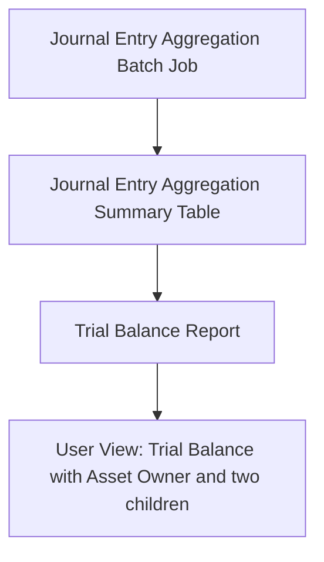

<!-- Labels: user, journal-entries -->
# Journal entry aggregation

The Journal entry aggregation enhancement introduces a two-step data path for the Trial Balance reporting flow. A Journal Entry Aggregation batch job is created to produce a summarized, pre-baked dataset (the Journal Entry Aggregation Summary). The Trial Balance Report is then wired to consume data from this pre-built summary, eliminating the need to perform journal entry aggregation during every Trial Balance run. This change improves report responsiveness and verifies the Trial Balance reflects a consistent aggregation snapshot rather than on-the-fly calculations.

### What changed and why it matters

Previously, the Trial Balance Report could perform journal entry aggregation as part of its data preparation workflow. With this enhancement, the system now first creates a Journal Entry Aggregation Summary via a dedicated batch job, and the Trial Balance Report is updated to read from this summary table. The effect is a shift from on-demand aggregation to a pre-aggregated data path. The benefits include reduced processing time for Trial Balance generation and improved consistency across reports that rely on aggregated journal entries. The outcome aligns the Trial Balance with a stabilized aggregation state rather than a live, potentially variable, daily aggregation process.

### Updated workflow (step-by-step)

1) Access the Journal Entry Aggregation configuration in the user interface at Reporting and Accounting > Journal entries > Journal entry aggregation.

2) Create and configure a Journal Entry Aggregation batch job to produce the Journal Entry Aggregation Summary table. This dataset is the summarized representation of journal entries intended for downstream reporting.

3) Hook up the Journal Entry Aggregation Summary table to the Trial Balance Report. After this change, the Trial Balance Report reads from the pre-baked aggregation data instead of performing journal entry aggregation as part of its own processing.

4) Run or refresh the Trial Balance Report. The report retrieves data from the Journal Entry Aggregation Summary and presents results based on the pre-baked data path.

5) Validate the results. Confirm that the Trial Balance includes the asset owner dimension and the two child components described in the report’s data structure, and verify that totals and allocations reconcile with the aggregation data.

### Data model and scope

- The enhancement centers on the Journal Entry Aggregation Summary table, which serves as the source for the Trial Balance Report.
- The Trial Balance report is designed to present a view that includes an asset owner dimension, with two child groupings in its reporting structure.
- Daily on-the-fly journal entry aggregation for the Trial Balance is replaced by consuming the pre-baked data from the Aggregation Summary table when generating the Trial Balance.

### Migration and compatibility considerations

- Deployment should include the Journal Entry Aggregation feature and its integration with the Trial Balance Report. The new data path relies on the presence of the Journal Entry Aggregation Summary table.
- After upgrade or deployment, operators should verify the Journal Entry Aggregation batch job is configured and enabled so that aggregation data exists for reporting periods.
- The Trial Balance Report must be configured to read from the Journal Entry Aggregation Summary table rather than performing day-to-day aggregation.
- For initial rollout, seed the aggregation data for current and prior periods as needed so the Trial Balance can render from the pre-baked dataset without gaps.

### Validation and reconciliation

- Validate that the Trial Balance Report uses the Journal Entry Aggregation Summary data by comparing a period’s Trial Balance against the associated aggregated data path for that period.
- Verify the asset owner dimension appears correctly in the Trial Balance output and that the two child components are present and follows the aggregation structure.
- verify that totals and allocations reconcile with the aggregation dataset, and that there are no discrepancies between the pre-baked data path and the resulting Trial Balance figures.

### Diagram: data flow

