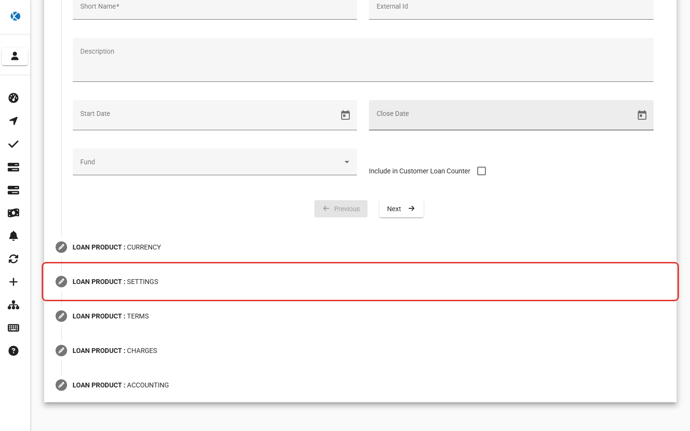
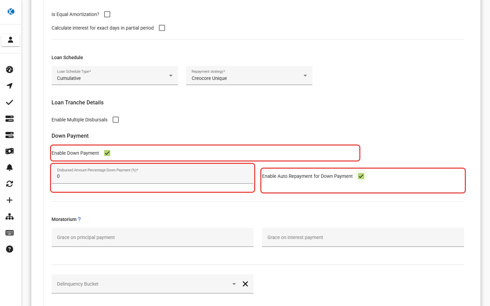

# Down Payments

## Down payment overview

A down payment is an amount collected at disbursement. You can enable it at the loan product level, and it then applies to every loan account of that product and every disbursement of those accounts. Multiple down payments can be collected for multiple disbursements of the same account. Down payments work like installments: amount allocations and repayment fulfillment work the same way. When a down-payment percentage is defined at the loan product, the same percentage applies to all disbursements of those accounts.

## Set up down payments for a loan product

You configure down payments at the loan product level so the system collects a down-payment amount at disbursement, and the setting applies to all new loan accounts and disbursements of that product.

1. Select **Admin** > **Products** > **Loan Products**.
2. Select **Create** > **Create Loan Product (Classic)**.
3. Select **SETTINGS**.

   

4. Set the fields described below, then select **Next** to continue through the form and save it at the end.

| Field | Required | Description |
| --- | --- | --- |
| Enable Down Payment | No | Select this to collect a down payment when the loan is disbursed. The fields below appear once it is on. |
| Disbursed Amount Percentage Down Payment (%) | Yes | Enter the percentage of the disbursed amount to collect as the down payment. |
| Enable Auto Repayment for Down Payment | No | Enable or disable automatic repayment of the down payment; when enabled, disbursements trigger an automatic down-payment transaction for the down-payment amount. |

The down payment is collected at disbursement as a down-payment transaction, and the configuration applies to all new loan accounts and disbursements of the product.

## Enabling and configuring down payment

Down payment lets you collect part of the disbursement amount up front, either as a percentage of the disbursement or through manual collection. You enable and configure it at the loan product level, and the settings apply to new loan accounts only; existing accounts keep their current configuration.

Configure down payment from the product configuration screen:

- Enable or disable down payment at the loan product level.
- Specify the percentage of the disbursement amount to collect as down payment.

Auto repayment of down payment:

- Enable or disable auto repayment at the loan product level.
- When down payment is enabled, you can choose whether auto repayment applies.
- When enabled, auto repayment applies to all new loan accounts and all disbursements for that product.
- It subtracts the down payment from the disbursed amount or from a created payment transaction.

Additional product-level options:

- Choose the repayment start date: Loan Submitted Date or Loan Disbursed Date.
- Enable or disable the “do not extend loan schedule for multi disbursal” checkbox; the loan inherits the setting.

## Auto repayment of down payment

When auto repayment for down payments is enabled, disbursement triggers an automatic down payment transaction for the down payment amount. The system posts this transaction using the down payment transaction type, which works like the repayment transaction type and uses the same accounting as repayment.

You can undo a down payment transaction:

- Open the transaction tab.
- Undo the Downpayment transaction.

## Down payment installments and schedule

A down-payment installment is part of the repayment schedule and is treated like any other installment for overdue, arrears, delinquency, and event handling. It is always due on the disbursement date, and its amount is based on the down-payment percentage set in the product configuration. The schedule shows down-payment installments alongside regular installments, including two installments on the same date when they fall together.

The following rules apply to down-payment installments:

- One down-payment installment is created for each disbursement, even when disbursements fall on the same dates.
- A down-payment installment belongs to its disbursement; if that disbursement is reverted, only the related down-payment installment is deleted.
- The loan term frequency and number of repayments logic ignores down-payment periods, and the number of repayments parameter excludes the down-payment installment.
- When down payment is enabled, re-scheduling the loan repayment schedule gives an error.

The initial schedule includes down-payment installments as follows:

- For loans with down-payment enabled, the schedule shown at the loan created and approved states includes the down-payment installment using the default amount and default date as expected disbursement.

## Repayment priority and allocation

Repayment on down payments follows the payment allocation rules. You can make a repayment using the DownPayment payment type. When a regular installment and a downpayment installment fall due on the same date, the regular installment takes priority and must be fully paid before the downpayment installment is paid.

Specified due-date charges and charge-back amounts are allocated as follows:

- Specified due-date charges are allocated to the next down-payment or installment.
- A charge-back amount applied to a repayment is added to the next down-payment or installment, whichever is next.

## Charges, interest, and chargebacks

You cannot add charges, chargebacks, or interest to a downpayment installment. The system allocates any charge, chargeback, or interest to the next regular installment instead.

## Disbursement reversal

When you reverse a disbursement on a loan with a down payment, the down payment is reversed too. Accounting entries are reverted during the reversal.

The effect depends on whether auto down-payment is enabled:

- Without auto down-payment, if no payment happened, the installment is deleted.
- Without auto down-payment, if there were payments, reversal is not allowed.

## Repayment start date and schedule generation

The loan disbursed date is the default option.

The schedule is generated based on the date you select:

- When Loan Submitted Date is selected, the repayment schedule is generated based on the loan submitted date.
- When Loan Disbursed Date is selected, the repayment schedule is generated based on the loan disbursed date.

## Multi-disbursement schedule behavior

When you make a second disbursement on a multi-disbursement loan, the "do not extend loan schedule for multi disbursal" checkbox decides whether the schedule changes. With the checkbox enabled, the schedule is not extended by the new disbursement. With it disabled, the schedule follows the default behavior of extending to the exact number of repayments. At disbursement, the amount is distributed amongst the existing installments without extending the schedule. A second disbursement added after the second period due date has no impact on earlier installments.

## Loan term and number of repayments

The loan term equals `repay every × number of repayments`. With a down payment, the loan term is defined by the number of repayments minus one. The Loan Term field is read only at loan account creation.

For a Pay in 3 installment loan with down payment:

- The last installment is 33.34.
- The extra amount does not appear in the second installment.

## Backdated disbursement

A backdated disbursement cannot happen before loan submission. If the schedule is based on loan submission date, no reschedule happens when backdated disbursement occurs. If the schedule is based on the first disbursement date and a disbursement has already happened, the loan is rescheduled according to the new disbursement date. When backdated disbursement happens, the loan schedule is regenerated and the transactions are reprocessed.

## Over-applied percentage and EMI calculation

For loans with an over-applied percentage configuration, the available disbursement amount uses the maximum disbursable amount (`principal * over-applied percentage`), not the approved amount. The EMI deducts the down payment principal from the principal balance even when the down payment transaction is not paid.
