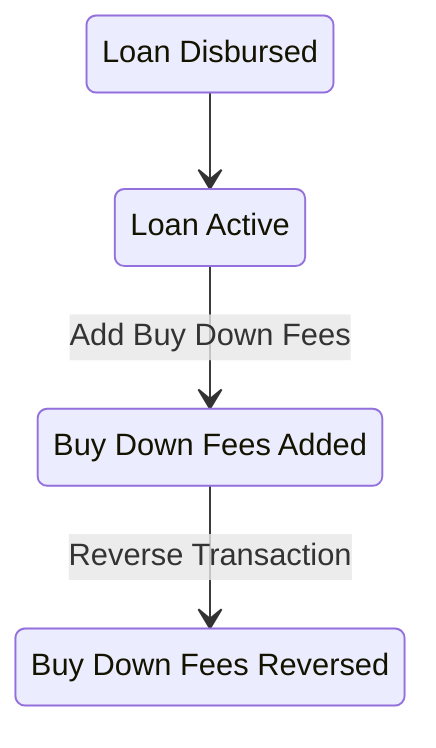
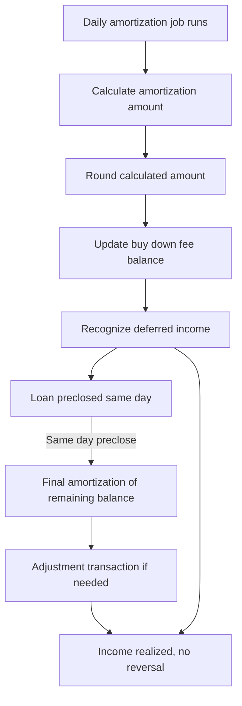
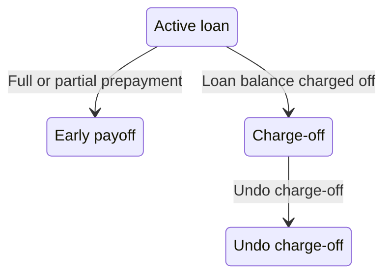
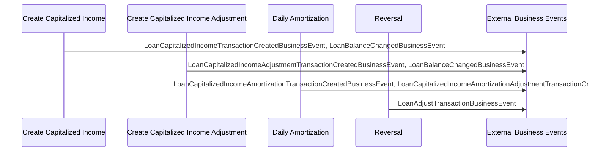
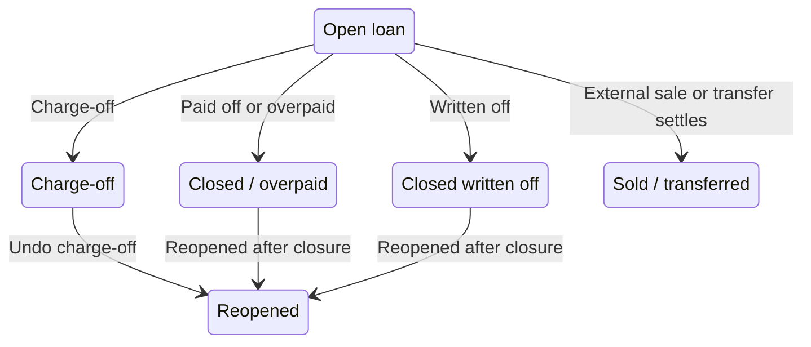

# Fees and Capitalized Income

## Buy-Down Fees

### Feature overview

Buy-down fees are a unique transaction type used to post the buy-down fee to the loan account. They allow merchant fees to be collected at disbursement and amortized into interest income over the loan lifecycle. The buy-down fee amount does not affect the schedule calculation or interest calculation, and it can be recorded as either interest income or fees income.

Buy-down fees can be added in two ways:

- Added at the time of disbursement through API.
- Added from the UI as well.

### Configuration and enablement

Buy Down fees on a loan are enabled and inherited from the loan product. Buy Down fees are configurable at the loan product level and only supported for progressive loans. Once a loan is created, the Buy Down fees configuration is copied from the loan product.

The loan product capitalized income step screen includes the following Buy Down fee fields:

- Enable Buy down fee.
- Buy down fee calculation type (required).
- Buy down fee strategy (required).
- Buy down fee income type (required).
- Merchant Buy down fee.

The loan buy down fees tab screen shows:

- Buy Down Fees.
- No Data Found.
- Date.
- Fee Amount.
- Amortized Amount.
- Not Yet Amortized Amount.
- Adjusted Amount.
- Charged Off Amount.

Buy Down fees configuration is included in the same tab as Capitalized Income configuration, renamed to 'Deferred Income Recognition'.

### Adding buy-down fees

You can add Buy Down fees to a loan after disbursement through the API or manually through the UI. The transaction date must be on or after the first disbursement date. Supported fields are Amount, Transaction date, Payment type, Note, and External id.

Adding Buy Down fees produces the following results:

- A new transaction of type Buy Down fees is created with the Buy Down fees amount.
- Buy Down fees is treated as an Income portion (Interest or Fees).
- Buy Down fees does not affect the loan schedule calculation, recalculation, or interest calculation.

Buy Down fees events include:

- Adding Buy Down fees.
- Daily amortization.
- Buy Down fees Adjustment.

> **Note:** When a Buy Down fees transaction is reversed, all already amortized amounts are corrected in a Buy Down fees amortization adjustment transaction using mirror JE entries, handled by COB, and the related buy down fee balance is deleted.

### Amortization and income recognition

Buy-down fees amortize daily like Capitalized Income, moving deferred income to income over time. A daily job performs the amortization and updates the buy-down fee balance to track amortized and not yet amortized amounts. The configured amortization strategy determines the amortization portion, the GL mapping, and whether the fee is treated as fee or interest.

Amortization rules:

- Equal amortization divides the fee by the number of days.
- Formula-based amortization applies when configured.
- Rounding uses the configured rounding mode on the calculated amount.
- If a loan is preclosed on the same day, final amortization recognizes all remaining deferred income as income at once.
- Once a loan is paid off, realized income is not reversed.
- An adjustment transaction can correct deferred income recognized at end of day.

### Buy-down fee balance tracking

The system maintains a current deferred buy-down fee balance at the loan level. Balances are tracked on both the loan and the buy-down fee transaction basis and are maintained over buy-down fee events.

| Field | Description |
| --- | --- |
| Loan | The loan the buy-down fee balance record links to. |
| Buy-down fee transaction | The transaction the balance record links to. |
| Buy-down fee amount | The amount stored on the balance record. |
| Date | The date stored on the balance record. |
| Not yet recognized income | Income stored on the balance record that has not yet been recognized. |
| Charged-off buy-down fee amount | The charged-off amount stored on the balance record. |
| Adjustment buy-down fee amount | The adjustment amount stored on the balance record. |

For example, a buy-down fee dated 2/1/2025 has an amount of 50.

### Early payoff and charge-off

When a loan is paid off early, any remaining deferred income balance is accelerated. When a loan balance is charged off, any deferred income balance is charged off as well.

Early payoff and charge-off handling works as follows:

- Early payoff scenarios include full prepayment with balance acceleration and partial prepayment handling.
- Charge-off charges off the Buy Down fees and stops daily amortization after the charge-off date.
- Any not yet recognized balance moves to Charge-off and a final amortization with journal entries is created.
- The amount that should have been amortized is calculated and differences are corrected with Amortization/Amortization Adjustment journal entries.
- Undo charge-off undoes the charge-off final amortization transaction and adjusts accounting entries, but does not undo the amortization transaction because it is a catch-up.

> **Note:** No further amortization occurs after a charge-off date.

### Buy-down fee adjustments

You can add a Buy-down fee adjustment transaction to a loan account through the API or UI. It adjusts or credits the deferred income and does not affect the loan balance.

The following rules apply to Buy-down fee adjustments:

- An adjustment can only be invoked on an existing Buy-down fees transaction and uses relation type ADJUSTMENT from the adjustment to the original transaction.
- Multiple adjustments are allowed on the same original Buy-down fees transaction, provided the transaction is not reverted.
- The adjustment transaction date cannot be earlier than the original transaction date.
- The total adjustment amount cannot exceed the original transaction amount, and total Buy-down fees adjustment cannot be more than the original Buy-down fees transaction.
- An adjustment can be done backdated and its accounting entries mirror Buy-down fees entries.
- There is no allocation strategy for Buy-down Fees Adjustment.

The system updates balances and relations as follows:

- The related Buy-down Fee Balance is updated by adding the adjustment amount to the adjustment amount.
- Created adjustment transactions list relations with relation type ADJUSTMENT between the original Buy-down fees transaction and the Buy-down fees Adjustment transaction.

Reversal behaviour:

- A not yet reversed Buy-down fees transaction can be reversed if there is no not yet reversed Buy-down fees Adjustment belonging to that transaction.
- A not yet reversed Buy-down fees Adjustment transaction can be reversed with mirror JE entries passed for the reversal entry.
- Reversing a Buy-down fees Adjustment transaction updates the related buy-down fee balance by subtracting the amount from the adjustment amount.

### Accounting entries

Buy-down fee accounting uses journal entries that differ between merchant and non-merchant lending. The customer sees no impact or visibility for fee amortization or daily income recognition, and buy-down fees do not appear in customer-facing schedules or statements.

Accounting treatment depends on the lending type:

- For merchant lending, the EXPENSE parameter is shown for mapping at the UI loan product level.
- For non-merchant lending, the EXPENSE parameter is hidden and the system takes the Fund Source parameter mapped GL for accounting.

| Transaction | Debit | Credit |
| --- | --- | --- |
| Buy-down fee (non-merchant) | Parameter Fund Source Type ASSET GL cash at hand | Parameter Deferred Income mapping Type Liability GL Deferred Income |
| Buy-down fee amortization (non-merchant) | NEW parameter Buy Down fees Amoritzation Type Income GL Interest/fees Income | Parameter Deferred Income mapping Type Liability GL Deferred Income |
| Buy-down fee amortization in charge-off (non-merchant) | charge-off expense/charge-off expense-bad dept GL credit loss-bad dept/credit loss-bad dept-fraud | Parameter Deferred Income mapping Type Liability GL Deferred Income |
| Buy-down fee adjustment (non-merchant) | Parameter Fund Source Type ASSET GL cash at hand | Parameter Deferred Income mapping Type Liability GL Deferred Income |

Adding a buy-down fee adjustment transaction has no impact on the loan balance.

| Transaction type | Deferred Income mapping (Liability, GL: Deferred Income) | Second mapping |
| --- | --- | --- |
| Daily Amortization (charge-off) | charge-off expense/charge-off expense-bad dept or credit loss-bad dept/credit loss-bad dept-fraud | — |
| Daily Amortization (buy-down fee amortization) | Buy Down fees Amortization parameter (Income, GL: Interest/fees Income) | — |
| Daily Amortization (pay-off) | Buy Down fees Amortization parameter (Income, GL: Interest/fees Income) | — |
| Daily Amortization (write-off) | Losses written off parameter (Expense, GL: Written off) | — |

A new type of origination fees adjustment or credit is introduced. If the fees adjustment amount is greater than unrecognized income, the difference is credited or debited from the Income account.

When Buy Down fees is enabled on a loan product, the following accounts and mappings apply:

- A new Expense account named Buy Down Expense is configured for periodical accounting, available only for progressive loans.
- A new Income account named Buy Down fees Amortization is configured for periodical accounting, available only for progressive loans.
- Buy Down Expense and Buy Down fees Amortization mappings are configurable on a loan product.
- New GL account mappings for a loan product are added for Buy Down Expense and Buy Down fees Amortization.
- Buy Down Expense and Buy Down fees Amortization mappings are mandatory fields if Buy Down fees is enabled.
- New mappings are returned as part of loan product details.
- Update of mappings during loan product update is permitted.

### UI screens and navigation

The loan details view includes a Buy Down fees tab when buy down fee capabilities are allowed on the loan, and each buy down fee entry appears in its own details row. You can also open the loan buy down fees tab screen from the loans view by choosing "Buy Down Fees" from the tab links.

1. Open the Create Loan Product page.
2. Choose "DEFERRED INCOME RECOGNITION" from the stepper to open the loan product capitalized income step screen.

### Calculation limits and defaults

Buy-down fees use a flat calculation mode, with flat as the default and only option. The transaction amount equals whatever amount is given for the buy-down fees. The maximum allowed amount equals the approved loan amount minus the total disbursed amount minus total capitalized income, with total buy-down fees removed from the calculation.

The following configuration defaults apply to buy-down fees:

- Calculation mode is FLAT.
- Strategy is EQUAL_AMORTIZATION, with daily buy-down fee recognition done by equal portions based on the number of days between the buy-down fee date and the loan maturity date.
- Income type is FEE or INTEREST, with FEE as the default.

Buy-down fees also follow these rules:

- Deferred balance tracks correctly through the loan lifecycle.
- Payoff and charge-off scenarios are handled correctly.

### Worked examples

A loan officer disburses a loan and adds a buy-down fee at disbursement. The fee is collected up front and later amortized into interest income, but it does not alter the repayment schedule or the interest calculation. The figures in this example are illustrative. The buy-down fee appears as a separate deferred amount and never changes the installment amounts shown to the customer.

| Date | Event | Principal | Interest | Payment | Balance |
| --- | --- | --- | --- | --- | --- |
| 1/1 | Disbursement plus buy-down fee 120.00 | - | - | - | 1,000.00 |
| 2/1 | Installment 1 | 330.02 | 10.00 | 340.02 | 669.98 |
| 3/1 | Installment 2 | 333.32 | 6.70 | 340.02 | 336.66 |
| 4/1 | Installment 3 (final) | 336.66 | 3.37 | 340.03 | 0.00 |
| Total |  | 1,000.00 | 20.07 | 1,020.07 |  |

A product administrator sets up equal amount amortization for a buy-down fee. Each day the system moves a fixed portion of the deferred fee into interest or fees income, reducing the deferred balance until it reaches zero. The customer does not see this amortization on statements or schedules. The deferred balance declines by the same amount every day until the fee is fully recognized.

| Date | Transaction | Amortization | Deferred balance |
| --- | --- | --- | --- |
| 1/1 | Buy-down fee posted | - | 90.00 |
| 1/2 | Daily amortization | 1.00 | 89.00 |
| 1/3 | Daily amortization | 1.00 | 88.00 |
| 1/4 | Daily amortization | 1.00 | 87.00 |
| 1/5 | Daily amortization | 1.00 | 86.00 |
| 3/31 | Final daily amortization | 1.00 | 0.00 |

A loan officer posts a buy-down fee adjustment to credit part of the deferred income before the loan matures. The adjustment lowers the deferred fee balance but has no effect on the outstanding loan balance or the repayment schedule. Multiple adjustments are allowed, but their total cannot exceed the original buy-down fee. If an adjustment is later reversed, mirror journal entries restore the deferred balance.

| Date | Transaction | Amount | Deferred fee balance | Loan balance |
| --- | --- | --- | --- | --- |
| 1/1 | Buy-down fee posted | 100.00 | 100.00 | 1,000.00 |
| 1/6 | Daily amortization (5 days × 2.00) | 10.00 | 90.00 | 1,000.00 |
| 3/1 | Buy-down fee adjustment | 30.00 | 60.00 | 1,000.00 |
| 3/6 | Daily amortization (5 days × 2.00) | 10.00 | 50.00 | 1,000.00 |

When a borrower pays off a loan early, any buy-down fee that has not yet been amortized is recognized immediately at payoff. After payoff, no further daily amortization occurs and the deferred balance is zero. The unamortized fee is fully recognized at early payoff, so the deferred balance does not carry forward after the loan closes.

| Date | Event | Amortization | Deferred balance | Loan balance |
| --- | --- | --- | --- | --- |
| 1/1 | Buy-down fee posted | - | 60.00 | 1,000.00 |
| 1/15 | Cumulative daily amortization | 14.00 | 46.00 | 1,000.00 |
| 1/30 | Scheduled amortization to payoff date | 15.00 | 31.00 | 1,000.00 |
| 1/30 | Acceleration of remaining deferred income | 31.00 | 0.00 | 0.00 |

## Capitalized Income

### Overview and purpose

Capitalized Income, formerly referred to as Origination Fee, is a fee-based or interest-based income item added to the principal of a loan at disbursement and amortized over time. It is treated as part of the loan's principal for repayment and interest calculations, enabling financial institutions to recognize deferred income systematically over the loan term in line with regulatory requirements. This improves income recognition accuracy.

### Supported loan types

Capitalized income is supported only for progressive loans and progressive loan schedules. You can add capitalized income to a loan after disbursement through the API.

### Configuration at loan product level

Capitalized income is configurable at the loan product level. You enable it with a boolean toggle that defaults to disabled. The calculation mode defaults to FLAT and is the only option, while the amortization strategy defaults to Equal amortization and supports only EQUAL_AMORTIZATION. Income type defines allocation rules with FEE as default and INTEREST as option.

The configuration includes the following options:

- Calculation Mode supports only Flat, which is the default.
- Amortization Strategy supports only EQUAL_AMORTIZATION, with daily equal portions recognized over the life of the loan.
- Income Type offers FEE as the default and INTEREST as an option.
- GL Mapping includes Deferred Income as a Liability and Income from Capitalization as Income.

Daily capitalized income recognition is done by equal portions based on the number of days between capitalized income date and loan maturity date.

The system stores the configuration on the loan product as enable_income_capitalization, capitalized_income_calculation_type, capitalized_income_strategy, and capitalized_income_type.

### Configuration copied to loan

When a loan is created, the system copies the Capitalized Income configuration from the loan product to the loan. The copied configuration includes enable_income_capitalization, capitalized_income_calculation_type, capitalized_income_strategy, and capitalized_income_type. Loan-level balances include capitalized_income_derived and capitalized_income_adjustment_derived.

### GL mapping and accounting setup

When income capitalization is enabled on a progressive loan product, you configure GL mapping based on income type (FEE/INTEREST). Proper GL accounts must be set for Deferred Income and Income from Capitalization to enable Capitalized Income functionality.

The following rules apply to GL mapping for capitalized income:

- A new Liability account named Deferred income must be configured for periodical accounting when capitalized income is enabled on a loan product.
- The Deferred income liability and Income Capitalization income GL mappings can be configured on the loan product when it is a progressive loan and income capitalization is enabled.
- The new GL account mapping for the loan product is a mandatory field if income capitalization is enabled.
- Correct business events are fired for all operations.

The allocation strategy for Capitalized Income Adjustment applies payments in this order:

- past due Principal
- past due Int
- Past due fees
- Past due Penalty
- due Principal
- due Int
- due fees
- due Penalty
- advance Principal
- advance Int
- advance fees
- advance Penalty

### Adding capitalized income

You add capitalized income to a loan account at disbursement level on the disbursement date only, using the API. The loan must be active, and the transaction date can be any date on or after the first disbursement date.

The following rules apply when adding capitalized income:

- The system supports payment type, note, and external id for the transaction.
- The amount given is the transaction amount of the capitalized income.
- Capitalized income is available only for progressive loans with income capitalization enabled.
- Validation changes so that disbursement amount plus capitalized income is less than or equal to the approved amount.
- Validation changes so that disbursement amount plus capitalized income is less than or equal to the applied amount.

Capitalized income is treated as a principal portion that recalculates the repayment schedule and updates interest and amortization schedules to include the capitalized income amount.

Capitalized income amortization is recognized daily using the configured strategy, moving portions from Deferred Income to Income from Capitalization; on preclosure the remaining balance is recognized in full on the preclosure date; on charge-off amortization stops and the remaining balance is charged off.

### Validation rules

Validation for capitalized income enforces amount limits and date restrictions. Capitalized income and capitalized income adjustment transaction dates cannot be in the future. The disbursement amount plus capitalized income must not exceed the applied amount.

### Principal treatment and schedule impact

Capitalized income is treated as part of the loan principal. It increases outstanding principal and affects both schedule calculation and interest calculation, while allocation and other monetary transactions remain unchanged.

The capitalized income amount behaves as follows:

- It is added to the loan principal as a deferred income item booked as part of principal.
- It creates a distinct loan transaction tracked separately.
- It updates the repayment schedule to include the added amount in outstanding principal.
- It follows daily amortization through Capitalized Income Amortization transactions.
- It triggers accounting entries debiting Loan Portfolio (Asset) and crediting Deferred Income (Liability).
- A not yet reversed Capitalized Income transaction can be reversed if there is no not yet reversed Capitalized Income Adjustment belonging to it.
- When a Capitalized Income transaction is reversed, all already amortized amounts are corrected in a Capitalized income amortization adjustment transaction with mirror JE entries.

### Repayment schedule recalculation

When a loan is rescheduled and its maturity date changes, the amortization schedule changes with the new maturity date. If the loan is preclosed on the same day, final amortization is done for the balance amount and all remaining not yet recognized capitalized income is recognized as income in one shot. Once a loan is paid off, there is no reversal or anything that undoes the realized income.

Capitalized income recalculation applies as follows:

- When Capitalized Income is applied on closed or overpaid loans, future installments from the Capitalized Income posting date are recalculated accordingly.

### Daily amortization process

Capitalized income amortization runs daily at close of business for origination fees. It recognizes a portion of deferred income as income each day until maturity or full amortization.

The daily amortization process works as follows:

- A background close-of-business job performs daily amortization of capitalized income.
- The system uses the Equal Amortization strategy, which divides total capitalized income evenly over the remaining days until maturity.
- The amortization amount equals `not yet amortized capitalized income / days between current date and loan maturity date`.
- The calculated amount is rounded according to the rounding mode configuration.
- The system creates a new loan transaction of type Capitalized Income Amortization for each daily interest recognition and triggers a new business event.
- Each daily amortization creates new journal entries that debit Deferred Income (Liability) and credit Income from Capitalization (Income).
- Fineract tracks both the amortized and not yet amortized capitalized income balances.

Amortization posts automatically each day from the capitalized income date until maturity or full amortization. Adjustment transactions must not predate the original capitalized income.

Once capitalized income is added, a new Capitalized income transaction is created with the capitalized income amount, which is considered a principal portion on the loan transaction.

Adjustment logic includes proper balance reduction and accounting splits, and reversal handling covers transaction dependencies and mirror entries. No automatic reversal is supported; reversal must be handled manually via dedicated transactions.

Capitalized Income works with charge-off, preclose, and reschedule integration. All accounting entries must be balanced with proper GL mapping.

The amortization strategy is based on the configured income type (Fee vs Interest), which determines the GL mapping used.

### Balance tracking

The system tracks capitalized income balances on a loan and on each capitalized income transaction, keeping one balance entry per transaction per loan.

| Field | Stored value |
| --- | --- |
| Loan | Link to the loan |
| Capitalized income transaction | Link to the capitalized income transaction |
| Capitalized income amount | Amount of capitalized income |
| Date of capitalized income | Date the capitalized income was added |
| Not yet recognized income | Income not yet recognized |
| Charged-off capitalized income amount | Amount charged off |
| Adjustment capitalized income amount | Amount adjusted |

Database balances are maintained over events including adding capitalized income and daily amortization of capitalized income.

Capitalized Income Amortization stops on preclosure by triggering final amortization for remaining unrecognized income, and on charge-off by halting further amortization and charging off the remaining deferred income. If the original Capitalized Income transaction is reversed, all associated amortization transactions are reversed via Capitalized Income Amortization Adjustment transactions.

The system maintains the fees balance during Amortization as balance minus Capitalized income minus fee credits/adjustments minus fee income recognized.

### Charge-off behavior

Charge-off charges off the capitalized income and stops daily amortization after the charge-off date. Any not yet recognized balance moves to charge-off. Undoing charge-off reverses this behavior and adjusts the accounting entries.

Once a loan is paid off, nothing reverses or undoes the realized income.

### Capitalized Income Adjustment

A Capitalized Income Adjustment is a credit transaction that reduces the capitalized income balance. You can create it only against an existing capitalized income transaction, and multiple adjustments are allowed against the same original transaction.

The following rules apply to a Capitalized Income Adjustment:

- The adjustment transaction date cannot be earlier than the original transaction date.
- The total adjustment amount cannot exceed the original transaction amount.
- The adjustment amount is deducted from the remaining not yet recognized amount of the capitalized income balance.
- The adjustment can have its own allocation strategy set.
- The created adjustment transaction lists an ADJUSTMENT relation between the original capitalized income transaction and the adjustment transaction.
- An unreversed adjustment transaction can be reversed, and mirror journal entries are used as the basis for the reversal entry.
- The adjustment can be backdated.
- Accounting entries work like a mirror of capitalized income entries.
- The adjustment reduces loan balances as per the allocation set.
- If a loan is in overpaid state or goes into overpaid, Principal maps to Overpayment amount during Capitalized Income reverse-replay.
- Reverse-replay reuses the same logic as Repayment transaction handling.
- Accounting entry for Capitalized Income on closed or overpaid loans remains CR GL Loan Receivable (Parameter: Loan Portfolio), CR GL Deferred Income GL (Parameter: Defered income mapping).
- It is possible to add a Capitalized Income Adjustment transaction with value equal to the original Capitalized Income transaction.
- Reversing a Capitalized Income transaction triggers a Capitalized Income Amortization Adjustment event, and also triggers standard balance and status update events if the loan is affected.

Accounting entries depend on whether the adjustment stays within the unrecognized balance.

| Condition | Debit | Credit |
| --- | --- | --- |
| Adjustment within the unrecognized balance | Deferred Income (Liability) | Loan Portfolio (Asset) |
| Adjustment exceeds the unrecognized balance | Deferred Income plus Income | Loan Portfolio (Asset) |

The adjustment triggers a Capitalized Income Adjustment event, updates the loan balance and possibly the loan status depending on impact, reduces the amortization basis, and may modify future amortization amounts. It does not directly affect the repayment schedule unless recalculated manually.

On closed or overpaid loans, the adjustment follows the payment allocation strategy set, and the overpaid amount credits the overpaid portion. No changes are made to the repayment schedule side for the overpaid portion.

### Capitalized Income Amortization Adjustment

A Capitalized Income Amortization Adjustment is generated automatically when a Capitalized Income transaction is reversed. It reverses all amortized income recognized up to that point, restoring Deferred Income balances and reversing income recognition. The adjustment debits Income from Capitalization and credits Deferred Income, and it links to the original Capitalized Income transaction for traceability. It cannot be created manually through the API or UI.

### Transaction types and accounting entries

Capitalized income uses four transaction types: Capitalized Income, Capitalized Income Amortization, Capitalized Income Adjustment, and Capitalized Income Amortization Adjustment. These transactions support backdating.

| Transaction type | Debit | Credit |
| --- | --- | --- |
| Capitalized Income | Loan Portfolio (Asset) | Deferred Income (Liability) |
| Capitalized Income Amortization | Deferred Income (Liability) | Income from Capitalization (Income) |
| Capitalized Income Adjustment | Deferred Income (Liability) / Income from Capitalization (Income) | Loan Portfolio (Asset) |

### Business events

Fineract triggers external business events when capitalized income is added, adjusted, amortized, or reversed.

Creating a capitalized income transaction produces two business events:

- LoanCapitalizedIncomeTransactionCreatedBusinessEvent
- LoanBalanceChangedBusinessEvent

Creating a capitalized income adjustment transaction produces two business events:

- LoanCapitalizedIncomeAdjustmentTransactionCreatedBusinessEvent
- LoanBalanceChangedBusinessEvent

A capitalized income adjustment updates the loan balance and may update the loan status depending on its impact.

Daily amortization produces two business events:

- LoanCapitalizedIncomeAmortizationTransactionCreatedBusinessEvent
- LoanCapitalizedIncomeAmortizationAdjustmentTransactionCreatedBusinessEvent

Reversing a capitalized income transaction produces one business event:

- LoanAdjustTransactionBusinessEvent

When a capitalized income adjustment exists and the loan is closed or overpaid, the system calculates and creates the capitalized income amortization adjustment in real time during end-of-day processing.

### UI behavior and display

Capitalized income appears on the UI when a progressive loan is selected or when capitalized income capabilities are allowed on the loan.

The UI shows capitalized income details as follows:

- Each row represents one capitalized income entry.
- The loan deferred income tab shows Deferred income, Capitalized Income, Amount, Amortized Amount, Unrecognized Amount, and Adjustment Amount.
- A Capitalized Income Adjustment transaction does not appear in the Transaction list until the page is refreshed.
- Creating a Capitalized Income Adjustment transaction with a value equal to the Capitalized Income transaction shows an invalid validation message.

### API response fields

Capitalized Income lets you add capitalized income to a loan after disbursement through the API. User documentation for Capitalized Income briefly introduces the functionality and its benefits, refers to the API endpoints in concern, and refers to any configuration that affects it.

The supported fields are:

- amount
- transaction date on or after the first disbursement date
- payment type
- note
- external id

Available disbursement amount equals approved loan amount minus total disbursed amount minus total capitalized income when capitalized income functionality is enabled. Schedule calculation and interest calculation are both based on disbursement amount plus capitalized income.

The Capitalized Income and adjustment transaction response returns office ID, client ID, loan ID, resource ID, changes, and resource external ID like other transactions. Omitting changes in Capitalized Income and adjustment transaction responses is acceptable.

### Worked examples

A loan officer disburses a progressive loan of 1,000 and adds 200 of capitalized income at disbursement. The figures are illustrative. The total principal becomes 1,200. Interest accrues on 1,200 at 12% per year, or 1% per month, and the loan has 3 monthly installments with 30-day months. The 200 capitalized income is treated as principal for the repayment schedule and is amortized daily from deferred income to income from capitalization. This example shows that capitalized income increases the loan principal and is repaid through the normal installments.

| Date | Description | EMI | Principal | Interest | Balance |
| --- | --- | --- | --- | --- | --- |
| 1/1 | Disbursement |  | 1,000.00 |  | 1,000.00 |
| 1/1 | Capitalized income |  | 200.00 |  | 1,200.00 |
| 2/1 | Installment 1 | 408.03 | 396.03 | 12.00 | 803.97 |
| 3/1 | Installment 2 | 408.03 | 399.99 | 8.04 | 403.98 |
| 4/1 | Installment 3 | 408.02 | 403.98 | 4.04 | 0.00 |
| Total |  | 1,224.08 | 1,200.00 | 24.08 |  |

A capitalized income adjustment reduces the deferred income balance. On a loan with 1,000 disbursed and 200 capitalized income added at disbursement, a loan officer posts an adjustment of 100 on 3/1. The figures are illustrative. The adjustment is a credit transaction. Because 100 does not exceed the remaining unrecognized amount, the entry debits deferred income and credits loan portfolio for 100. The deferred income balance falls from 200 to 100, and future amortization is calculated on the lower amount. If the adjustment exceeded the unrecognized balance, the excess would also debit income from capitalization.

| Date | Description | Debit | Credit | Deferred income balance |
| --- | --- | --- | --- | --- |
| 1/1 | Capitalized income added |  | 200.00 | 200.00 |
| 3/1 | Adjustment posted | 100.00 |  | 100.00 |
| 4/1 | Remaining amount recognized |  | 100.00 | 0.00 |

When a loan ends early, any capitalized income not yet recognized is handled according to the exit type. On the same loan, suppose 100 of the capitalized income remains unrecognized when the loan closes on 3/1. The figures are illustrative. If the loan is preclosed, the remaining 100 is recognized in full on the preclosure date. If the loan is charged off, amortization stops and the remaining 100 is charged off instead. With preclosure the remaining balance becomes income immediately; with charge-off it is charged off and no further daily amortization occurs.

| Exit type | Date | Unrecognized balance | Accounting entry |
| --- | --- | --- | --- |
| Preclosure | 3/1 | 100.00 | Debit deferred income, credit income from capitalization 100.00 |
| Charge-off | 3/1 | 100.00 | Debit charge-off expense, credit deferred income 100.00 |

Capitalized income is amortized daily using the equal amount strategy. On a loan with 90 of capitalized income and a maturity 90 days after disbursement, the system recognizes 90 divided by 90 each day. The figures are illustrative. Each day recognizes 1.00, reducing the unrecognized balance by the same amount until it reaches zero at maturity. The equal amount strategy spreads the capitalized income evenly across every day until maturity.

| Day | Date | Recognized | Unrecognized balance |
| --- | --- | --- | --- |
| 1 | 1/1 | 1.00 | 89.00 |
| 2 | 1/2 | 1.00 | 88.00 |
| 3 | 1/3 | 1.00 | 87.00 |
| 89 | 3/30 | 1.00 | 1.00 |
| 90 | 3/31 | 1.00 | 0.00 |
| Total |  | 90.00 |  |

See also: [Buy-Down Fees](confluence-link:Fees%20and%20Capitalized%20Income#buy-down-fees).

## Fee Classification

You can classify capitalized income and BuyDown fee transactions. Classification selection is optional, and when you create such a transaction you may provide a classification that Fineract stores at transaction level; if you do not set one, it remains null. Fineract checks whether a provided classification is valid based on the related codes.

Classification affects how amortization is stored and reported:

- The system calculates and stores Daily Amortization schedules at each classification level.
- When an adjustment transaction happens, the system recalculates.
- A Daily Amortization transaction can be aggregated to one entry at transaction level, but you can drill down to classification level if required.
- The UI loan transaction details view lists the classification if it is not null.

An adjustment transaction created for an existing capitalized income or BuyDown fee transaction inherits the target transaction classification, and you cannot set a different classification. This inheritance rule does not apply to amortization transactions because those contain only an aggregated amount.

You can map a different income GL account for Daily Amortization based on the classification:

- You can map a different income account for Daily Amortization based on the classification at the Advanced accounting rule section.
- You can select a different income GL for Daily Amortization depending on the classification selected.
- For a classification added at a code value, you can define a different credit income account at Advance Accounting rule.
- For different reason code values, you can add a GL entry for Buydown fee or Capitalized income classification mapping.

Default amortization GL accounts when no classification is selected:

| Transaction type | Debit parameter | Credit parameter |
| --- | --- | --- |
| Capitalized income | Deferred Income mapping Type Liability GL Deferred Income | Income from Amortization Type Income GL Interest/fees Income |
| Buy Down fees | Deferred Income mapping Type Liability GL Deferred Income | Buy Down fees Amortization Type Income GL Interest/fees Income |

When multiple capitalized income or BuyDown fee transactions exist, the system determines the amortization amount as follows:

- When only one transaction exists, the full amount is considered.
- When multiple transactions exist with the same classification, the full amount is considered.
- When multiple transactions exist with different classifications, the system fetches the allocation mapping from the amortization mapping table.
- If the mapping table does not exist or has no entry, the system calculates today’s amortization for each transaction on the fly, groups them by classification, and uses the appropriate income GL account.

Advanced accounting rules support classification mappings:

- The Advanced accounting rules view adds an option for Capitalized Income with mapping options Classification code values capitalized_income_transaction_classification and GL Income account; one GL account per classification code value maximum; mappings can be added, updated, deleted.
- The Advanced accounting rules view adds an option for Buy down fee with mapping options Classification code values buydown_fee_transaction_classification and GL Income account; one GL account per classification code value maximum; mappings can be added, updated, deleted.

A new fee type named originiation fees is introduced at the product level. A user can map the originiation fees to a loan product at loan product level. The origination fees amount is flat based and entered by the user. Origination fees are added to the loan account at disbursement level and on disbursement date only.

Amortization ready schedule source is Amortization Ready Schedule.

A loan officer creates a $200 buy-down fee on a $1,000 loan and leaves the Classification blank. Because no classification is selected, the system applies the default mapping: it debits the deferred income liability account and credits the standard interest and fees income account as the fee amortizes. The fee is spread evenly over five days at $40.00 per day. The figures in this example are illustrative. This example shows the default ledger postings when no classification is selected.

| Day | Deferred income debit | Interest and fees income credit | Deferred balance |
| --- | --- | --- | --- |
| 1 | 40.00 | 40.00 | 160.00 |
| 2 | 40.00 | 40.00 | 120.00 |
| 3 | 40.00 | 40.00 | 80.00 |
| 4 | 40.00 | 40.00 | 40.00 |
| 5 | 40.00 | 40.00 | 0.00 |

A product administrator adds a classification named Usage Fees and, under the loan product's Advanced accounting rule, maps it to a dedicated Usage Fees Income account. A loan officer then creates a $300 capitalized income fee and selects Usage Fees. Each day the system debits the deferred income liability account and credits the Usage Fees Income account instead of the default income account. The fee amortizes over six days at $50.00 per day. This example shows that a classification can route daily amortization to a different income account.

| Day | Deferred income debit | Usage Fees Income credit | Deferred balance |
| --- | --- | --- | --- |
| 1 | 50.00 | 50.00 | 250.00 |
| 2 | 50.00 | 50.00 | 200.00 |
| 3 | 50.00 | 50.00 | 150.00 |
| 4 | 50.00 | 50.00 | 100.00 |
| 5 | 50.00 | 50.00 | 50.00 |
| 6 | 50.00 | 50.00 | 0.00 |

A loan carries two capitalized income fees: one for $60 and one for $40. When both fees use the same classification, the system treats the full $100 as one pool and posts a single amortization amount under that classification. When the fees use different classifications, the system checks the amortization mapping table; if no entry exists, it calculates each fee's daily amortization separately and groups the postings by classification. If both fees shared the same classification, the full $100 would post under one classification instead of being split.

| Day | First classification credit | Second classification credit | Total credit |
| --- | --- | --- | --- |
| 1 | 20.00 | 20.00 | 40.00 |
| 2 | 20.00 | 20.00 | 40.00 |
| 3 | 20.00 | 0.00 | 20.00 |
| Total | 60.00 | 40.00 | 100.00 |

A buy-down fee of $100 was created with the Setup Fees classification. A loan officer later posts a $25 adjustment against that fee. The adjustment automatically inherits Setup Fees and the officer cannot choose a different classification. Because amortization entries are aggregated, they do not carry a classification. The remaining $75 balance amortizes over five days at $15.00 per day. This example shows that an adjustment inherits the original fee's classification and cannot be overridden.

| Day | Deferred income debit | Income credit | Deferred balance |
| --- | --- | --- | --- |
| 1 | 15.00 | 15.00 | 60.00 |
| 2 | 15.00 | 15.00 | 45.00 |
| 3 | 15.00 | 15.00 | 30.00 |
| 4 | 15.00 | 15.00 | 15.00 |
| 5 | 15.00 | 15.00 | 0.00 |

See also: [Buy-Down Fees](confluence-link:Fees%20and%20Capitalized%20Income#buy-down-fees), [Capitalized Income](confluence-link:Fees%20and%20Capitalized%20Income#capitalized-income).

## Charge Amortization

### Purpose and accounting basis

Some loan charges are earned over the life of the loan rather than when they are booked or paid. Origination, arrangement and processing fees are deferred and recognized as a yield adjustment over the loan term under IFRS 9 5.4.1, B5.4.1–B5.4.3 and US GAAP ASC 310-20.

### Feature scope and defaults

Charge amortization applies to progressive loans and loan fees with the eligible charge time types. It does not apply to cumulative loans, penalties, installment and overdue fees, savings charges, or recalculating historical periods under the effective rate method.

Patterns, naming and lifecycle semantics match Capitalized Income and Buy-down Fee, and the flat calculation uses shared code rather than a copy.

The default is NONE everywhere. Existing charges, products and loans behave the same, no data migration is needed, and API changes only add fields.

### Product and charge setup

Charge amortization lets you spread a loan fee over time instead of recognizing it all at once. It applies only to progressive loans that use the advanced-payment-allocation strategy, and only when the loan product has charge amortization enabled. Amortized charges can be attached to a product or added to its loans only while the flag is on; otherwise the system returns a validation error.

Each loan charge definition carries the following amortization settings:

- Amortization period type: NONE (default), FULL_LOAN_TERM, or NUMBER_OF_DAYS.
- NUMBER_OF_DAYS requires a positive integer amortization days value.
- Amortization calculation type: FLAT (default) or EFFECTIVE_RATE.
- Amortization income type: FEE (default) or INTEREST.
- Only loan fees can be amortized; penalties cannot. Allowed charge time types are DISBURSEMENT, TRANCHE_DISBURSEMENT, and SPECIFIED_DUE_DATE.

| Period type | Behaviour |
| --- | --- |
| NONE | Keeps today's behaviour: periodic or upfront accrual accrues, cash based recognizes on payment, and none posts no journal entries. |
| FULL_LOAN_TERM | Amortizes over the full loan term. |
| NUMBER_OF_DAYS | Amortizes over the configured positive integer number of days. |

The following rules apply to how amortization is configured and copied:

- EFFECTIVE_RATE is allowed only with FULL_LOAN_TERM.
- The charge definition configuration is copied onto the loan charge when the loan charge is created; later changes to the charge definition do not affect existing loan charges.
- A product can optionally override the charge-level amortization configuration for each attached charge.

### How amortization works

Amortization spreads a charge's income over the loan term or over a fixed number of days instead of recognizing it all at once. It applies only to charges that have an amortization configuration; charges without one keep today's behaviour. Amortization runs daily at close of business for origination fees.

When an amortized charge is applied, the following occurs:

- The full charge amount goes to a deferred income liability and the receivable is booked against it.
- Daily amortization transactions move income from deferred income into income over the configured period and method.
- Accrual does not recognize income for that charge, so income is never counted twice.
- The remaining deferred balance releases in one shot when the loan is fully paid, overpaid, written off or sold, and releases immediately when the loan is charged off.
- Final amortization is done for the balance amount if the loan is preclosed on the same day.

The system maintains the fees balance during amortization as origination fee minus fee credits minus fee income recognized. No changes occur in any other monetary transactions and their accounting entries.

The feature reuses the Capitalized Income / Buy-down Fee rulebook: a deferred balance per source, daily close-of-business amortization, allocation mappings, one-shot release on closure, and release linked to the charge-off.

Today Fineract recognizes charge income depending on the product's accounting rule: ACCRUAL_PERIODIC accrues periodically (installment or daily accrual), ACCRUAL_UPFRONT accrues fully at disbursement, CASH_BASED is recognized when paid, and NONE creates no journal entries. None of these can spread a fee's income over the loan term or over a fixed number of days independently of when the fee is due or paid.

### Daily amortization processing

Daily amortization processing runs as part of end-of-day processing and creates at most one amortization transaction per loan per business date. It does nothing for loans without open deferred charge balances.

The following rules govern how the amortization window and income recognition are determined:

- The amortization window runs from the balance date to either the window end date or the loan's current maturity date.
- NUMBER_OF_DAYS windows end at the earlier of the start date plus X days or the maturity date.
- A COB run for business date D recognizes income through the end of D, using the day after D as the exclusive end.
- Running COB again for the same business date creates no new transaction; backdated events are corrected by the next run.

Balance lookups use indexes on loan ID and closed status.

### Calculation methods

The EFFECTIVE_RATE calculation method spreads deferred income across periods and recalculates the effective rate forward after specified events.

Income is booked daily under EFFECTIVE_RATE as follows:

- Daily booking spreads income evenly by day within each period.
- The group amount is split across charges in proportion to their unrecognized amounts, with the last period receiving the remainder so the total equals the deferred amount.
- After a reschedule, re-age, re-amortization, variable rate change, prepayment that changes future interest, or a new effective-rate charge, the rate is solved again going forward using the current carrying amount, the unrecognized balance, and the remaining cash flows.

### Transaction handling and allocation

When a loan carries several amortized charges, the system combines their amounts into one transaction per day. Each amount remains traceable to its charge through allocation mappings, the read API, and fee income accounts mapped to individual charges. Charge-off releases link to the charge-off transaction.

The following transaction types are excluded from payment allocation and replay:

- The three new transaction types
- Accrual amortization
- Capitalized Income amortization

### Permissions and documentation

Read access to the new endpoints requires the existing READ_LOAN permission, while configuration changes use the existing charge and loan product permissions. The fineract-doc documentation covers configuration, accounting and the lifecycle rulebook. A loan charge holds a copy of the configuration and verifies that the charge is allowed when added to a loan.

### Waivers, adjustments, deletions and inactivation

When a charge is waived or adjusted, the system increases the charge adjustment from that date, recalculates amortization, and reverses any income already recognized above the new amount using AM_ADJ. Undoing a waiver or reversing a charge adjustment restores the charge adjustment and recalculates amortization. Deleting or inactivating a charge reverses the deferred charge transaction, marks the balance deleted, reverses all recognized income with AM_ADJ, and closes the balance.

Backdated repayments and reversals are handled as follows:

- A backdated repayment or reversal replay has no effect for FLAT loans.
- For EFFECTIVE_RATE loans, the system recalculates the effective rate only if the cash flows changed.

Rescheduling, re-aging, re-amortizing, or changing maturity affects amortization as follows:

- FULL_LOAN_TERM picks up the new maturity.
- NUMBER_OF_DAYS is unaffected apart from the maturity cap.
- The system recalculates the effective rate.

### Closure, charge-off, reopening and sale

When a loan closes, is charged off, reopens, or is sold or transferred to an external asset owner, any remaining deferred charge balance is recognized or released according to the event. Listeners apply charge amortization only when charge amortization is enabled and the loan has open balances. Before charge-off, amortization catches up to the business date.

The following events release or recognize the remaining deferred balance:

- Paid off or overpaid: the remaining amount is released on the closed or overpaid date.
- Written off: the remaining amount is released and credited to Losses written off.
- Closed obligations met: the remaining deferred balance is recognized in one shot.
- Charge-off: amortization catches up to the charge-off date first, then the remaining balance is released immediately in one amortization transaction linked to the charge-off; charged_off_amount equals unrecognized_amount, then unrecognized_amount equals 0, and the credit goes to charge-off expense, charge-off fraud expense, or the account mapped to the charge-off reason.
- External asset owner sale or transfer: when settlement occurs, the remaining balance is recognized on the settlement date.

Reversals and adjustments work as follows:

- Reopening after closure: the next run recalculates against the real window and reverses any over-recognized income.
- Undoing a charge-off reverses the linked amortization transaction and restores the unrecognized balance.
- Undoing disbursement reverses or removes all Deferred Charge transactions, amortizations and balances.
- When recognized income has to go down, a Deferred Charge Amortization Adjustment posts the reverse; triggers are a waiver, a charge adjustment, a deletion, a loan reopening or a recalculation.

Repayment of an amortized charge follows the standard accrual repayment path:

- Repayment of an amortized charge posts DEBIT Fund source / CREDIT Fee receivable.

### Accrual interaction and exclusions

Charge amortization applies to ACCRUAL_PERIODIC, ACCRUAL_UPFRONT and NONE, and is rejected for CASH_BASED. With NONE, balances and transactions are tracked but no journal entries are posted.

Accrual processing excludes amortized charges in the following cases:

- Periodic accrual processing.
- Upfront accrual processing.
- Accrual adjustment processing.
- Accrual activity processing.
- Accrual on closure or charge-off.

With accrual accounting, the product must have GL mappings for fee receivable, deferred income liability, fee income, and interest income if any attached charge uses income type INTEREST.

### Worked examples

A disbursement fee of 120.00 is added to a 1,000.00 loan with a 120-day term made of four 30-day months. The charge is set to amortize flat over the full loan term, so the full fee is deferred at disbursement and earned at 1.00 per day. The figures in this example are illustrative. The loan is paid off after 30 days, so the remaining unearned balance is released in one shot on the closure date. If the same fee used a fixed number of days instead of the full term, the window would end at the earlier of the start date plus the day count or maturity, making the daily amount larger and stopping recognition after the day count.

| Date | Event | Deferred charge | Amortized today | Released on closure | Deferred balance | Recognized total |
| --- | --- | --- | --- | --- | --- | --- |
| Day 0 | Fee applied at disbursement | 120.00 | — | — | 120.00 | 0.00 |
| Day 30 | 30 days of daily amortization | — | 30.00 | — | 90.00 | 30.00 |
| Day 30 | Loan paid off, one-shot release | — | — | 90.00 | 0.00 | 120.00 |

A disbursement fee of 100.00 is added to a loan with a 100-day term and amortized flat over the full term, earning 1.00 per day. After 60 days, 60.00 has been earned and 40.00 remains deferred. A waiver then cuts the charge by 60.00, so the new charge amount is 40.00. Because 60.00 was already earned, the excess 20.00 is reversed through an AM_ADJ entry and no further amortization is posted.

| Date | Event | Deferred charge | Amortized today | Reversal (AM_ADJ) | Deferred balance | Recognized total |
| --- | --- | --- | --- | --- | --- | --- |
| Day 0 | Fee applied at disbursement | 100.00 | — | — | 100.00 | 0.00 |
| Day 60 | 60 days of daily amortization | — | 60.00 | — | 40.00 | 60.00 |
| Day 60 | Waiver cuts charge to 40.00; excess reversed | — | — | 20.00 | 0.00 | 40.00 |

A disbursement fee of 120.00 is added to a loan with a 120-day term and amortized flat over the full term, earning 1.00 per day. After 40 days, 40.00 has been earned and 80.00 remains deferred. The loan is then charged off, so the remaining 80.00 is released in one shot and posted to the charge-off or losses-written-off account.

| Date | Event | Deferred charge | Amortized today | Released on charge-off | Deferred balance | Recognized total |
| --- | --- | --- | --- | --- | --- | --- |
| Day 0 | Fee applied at disbursement | 120.00 | — | — | 120.00 | 0.00 |
| Day 40 | 40 days of daily amortization | — | 40.00 | — | 80.00 | 40.00 |
| Day 40 | Loan charged off, one-shot release | — | — | 80.00 | 0.00 | 120.00 |

A specified-due-date fee of 60.00 is attached to a 90-day loan and becomes due on day 30. It is amortized flat from its due date to maturity, a 60-day window, earning 1.00 per day. The deferred balance starts on the due date and is fully earned by the end of the term.

| Date | Event | Deferred charge | Amortized today | Released on closure | Deferred balance | Recognized total |
| --- | --- | --- | --- | --- | --- | --- |
| Day 30 | Charge becomes effective on due date | 60.00 | — | — | 60.00 | 0.00 |
| Day 60 | 30 days of daily amortization | — | 30.00 | — | 30.00 | 30.00 |
| Day 90 | 30 days of daily amortization to maturity | — | 30.00 | — | 0.00 | 60.00 |

See also: [Capitalized Income](confluence-link:Fees%20and%20Capitalized%20Income#capitalized-income).
