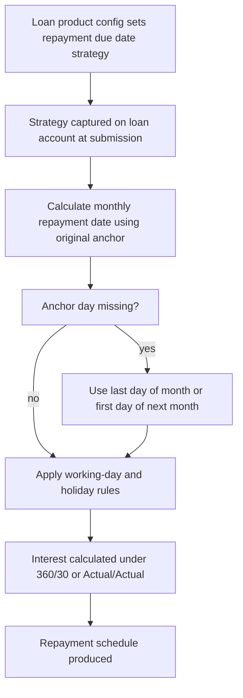

# Repayment Schedule

## Repayment Due Date Strategy

### Repayment due date strategy overview

When a monthly repayment due date does not exist in a target month, Apache Fineract adjusts the date according to the repayment due date strategy configured for the loan product. Financial institutions can choose how these dates are handled, and the setting applies at both the loan product and loan account level.

| Strategy | Effect when the repayment day does not exist |
| --- | --- |
| LAST_DAY_OF_MONTH | The repayment date rolls back to the last day of the month. |
| FIRST_DAY_OF_NEXT_MONTH | The repayment date rolls forward to the first day of the following month. |

### Strategy values and defaults

When the repayment due date strategy is not provided, the system uses LAST_DAY_OF_MONTH as the default. A null value is interpreted as LAST_DAY_OF_MONTH, and existing records with null values continue to use LAST_DAY_OF_MONTH.

### Applicability and conditions

The month-end repayment due date strategy applies to both cumulative and progressive loan schedules and covers every repayment due date, including the final installment. It applies only to monthly repayment frequency when the original repayment anchor is the 29th, 30th, or 31st and the target month does not contain that day. The attribute must not be restricted to progressive schedules.

The strategy applies under these conditions:

- Repayment frequency is monthly.
- The original repayment anchor is the 29th, 30th, or 31st.
- The target month does not contain the original repayment day.
- The strategy is FIRST_DAY_OF_NEXT_MONTH when the target month is shorter than the original anchor day.

Daily, weekly, and yearly repayment frequencies continue using their existing behavior.

### Date adjustment rules

The system preserves the original repayment anchor day for subsequent installments and never changes it when rolling a repayment due date. Each subsequent repayment date is calculated from the original anchor rather than from the previously adjusted due date. When the anchor day is less than or equal to the number of days in the target month, the adjusted due date is the target date with its day of month set to the anchor day. When the anchor day exceeds the number of days in the target month, the adjusted due date is the first day of the month following the target month under the FIRST_DAY_OF_NEXT_MONTH strategy, or the last day of the target month under any other strategy.

### Processing order and integration

The repayment due date strategy determines the calendar due date before any holiday, working-day, or other schedule adjustments are applied. Interest calculation remains the responsibility of the existing loan schedule and interest calculation components, and the strategy does not change the loan product's day-count configuration or replace the interest calculation formula. The generated repayment periods are processed according to the loan product's configured day-count convention.

Processing follows this order:

- Read the strategy configured on the loan product at loan submission, apply the default if the product value is absent, and store the strategy on the loan account.
- Calculate the monthly repayment date using the original anchor.
- Apply the due date strategy whenever a monthly repayment due date is calculated; if the anchor day does not exist, use either the last day of the month or the first day of the next month.
- Apply existing working-day and holiday adjustment rules.
- Calculate interest under 360/30 or Actual/Actual and produce the repayment schedule.

Schedule regeneration uses the same stored strategy:

- Read the stored strategy from the loan account.
- Regenerate the repayment dates using that strategy.
- Apply existing working-day and holiday rules.
- Recalculate interest according to the configured day-count convention.
- Preserve normal schedule and transaction processing behavior.

| Component | Role |
| --- | --- |
| Due Date Strategy | Produces Scheduled From/Due Dates |
| Configured Day-Count Convention | Branches to 360/30 Monthly 30/360 Treatment or Actual/Actual Actual Days/Actual Year |
| Interest Calculation and Principal/Interest Allocation | Receives dates from the day-count convention |

> **Note:** The strategy controls the repayment date only; it does not directly add or subtract interest days. Existing interest calculation components evaluate the adjusted schedule according to the configured day-count convention.

### Interest calculation conventions

Interest calculations follow the day-count convention configured for the loan product, and changing a repayment due date can affect interest depending on that configuration. Interest always reflects the outstanding principal applicable to each period. For periods crossing calendar-year boundaries, the existing Actual/Actual year-length handling remains applicable.

| Convention | Interest formula |
| --- | --- |
| 360/30 | Interest = Outstanding Principal × Annual Interest Rate × 30 / 360 |
| Actual/Actual | Interest = Outstanding Principal × Annual Interest Rate × Actual Number of Days / Actual Days in Year |

The effect of rolling a repayment date depends on the convention:

- Under 360/30 monthly interest, rolling a repayment date from 28 February to 1 March does not change the interest calculated for each regular monthly period.
- Under Actual/Actual, interest is calculated using the actual number of calendar days between repayment dates, so rolling a repayment date forward changes the number of days in the affected periods and may change the amount of interest charged.
- Under 360/30 with monthly frequency and FIRST_DAY_OF_NEXT_MONTH, interest per regular monthly period remains unchanged when a due date is rolled forward.
- Under Actual/Actual with monthly frequency and FIRST_DAY_OF_NEXT_MONTH, interest is calculated using the actual number of calendar days between consecutive repayment dates.
- Both strategies produce the same monthly interest fractions under 360/30, and changing the due date strategy must not introduce additional interest under that convention.

Rolling a repayment date can shift interest between periods:

- Period 1 accrues one additional day of interest on the higher outstanding balance.
- Period 2 accrues one fewer day of interest on the reduced outstanding balance.
- Total interest may change because the interest increase and decrease are calculated on different principal balances.

Under Actual/Actual, interest can also be calculated using Outstanding Principal × Annual Interest Rate × Actual Days / 365.

### Schedule generation and consistency

Schedule generation applies the configured month-end due date strategy consistently across cumulative and progressive loans, covering initial generation, regeneration, progressive EMI calculation, fixed-length maturity calculation, and holiday adjustment processing. The strategy produces equivalent repayment dates, interest amounts, EMI values, and principal allocations for equivalent repayment terms.

The following consistency rules apply:

- Holiday processing does not reverse an already rolled repayment date to the last day of the previous month.
- For cumulative loans linked to a repayment meeting calendar, the meeting calendar takes precedence and the month-end due date strategy does not override dates generated through the meeting calendar recurrence.
- For progressive loans configured with fixed length, the schedule generator and loan maturity-date calculation use consistent date calculation behavior, and the final repayment due date is not reverted to the last day of the month by a separate fixed-length calculation path.
- The same month-end strategy applies to both the maturity date calculation path and the scheduled date generator path.

### Product and account configuration

A loan account inherits the repayment due date strategy from its loan product at submission. The account keeps that stored strategy, so later changes to the product configuration affect only newly submitted loans. Schedule regeneration, including rescheduling and interest recalculation, reuses the strategy stored on the account.

The strategy is persisted for both the loan product and the loan account and remains available after application restart and during future schedule regeneration.

### Backward compatibility and scope

Backward compatibility with existing loan products and loan accounts is maintained. Existing loan products without the new attribute generate identical repayment schedules and interest calculations to the current implementation. The implementation preserves existing interest calculation conventions, rounding behavior, and financial precision, and the due date strategy does not implicitly replace or change the day-count convention.

The feature covers these areas.

- Product-level configuration, loan-level inheritance and persistence.
- Monthly repayment date generation.
- Cumulative and progressive loan schedules.
- Interest calculation integration and verification.
- Fixed-length maturity consistency.
- Loan product and loan account APIs.
- Regression and integration testing.

The feature does not cover these areas.

- Non-monthly repayment frequencies.
- Changes to existing interest day-count conventions.
- Retroactive regeneration of existing loans solely because of a product configuration change.
- Changes to meeting calendar recurrence rules.
- Changes to existing holiday and working-day adjustment policies.

### Worked examples

An operations officer configures a loan product for monthly repayments due on the 31st and disburses a loan on 31 January with three installments. The figures are illustrative. Because February has only 28 days, the system adjusts the first due date according to the chosen month-end strategy. With the last-day-of-month setting, the first repayment falls on 28 February and the second on 31 March. With the first-day-of-next-month setting, the first repayment falls on 1 March and the second remains on 31 March. The original anchor of the 31st is preserved for later months, so the third repayment is due on 30 April under the last-day setting and on 1 May under the roll-forward setting. This shows that rolling a date never changes the original repayment anchor used for later installments.

| Installment | Last day of month | First day of next month |
| --- | --- | --- |
| 1 | 28 Feb | 1 Mar |
| 2 | 31 Mar | 31 Mar |
| 3 | 30 Apr | 1 May |

A loan officer reviews a loan with an initial principal of 1,200, an annual interest rate of 12 percent, and monthly installments. After the first installment, 200 of principal is repaid, leaving 1,000 outstanding for the second period. Under the 360/30 convention, every monthly period counts as 30 days whether the due date falls on the last day of February or on 1 March. Period 1 interest is 12.00 and period 2 interest is 10.00, for a total of 22.00 under both strategies. This shows that the roll-forward setting adds no extra interest under the 360/30 convention.

| Period | Outstanding principal | Days in period | Interest fraction | Interest amount |
| --- | --- | --- | --- | --- |
| 1 | 1,200.00 | 30 | 30/360 | 12.00 |
| 2 | 1,000.00 | 30 | 30/360 | 10.00 |
| Total |  |  |  | 22.00 |

A loan officer reviews the same loan, disbursed on 30 January with monthly repayments due on the 30th, now under the Actual/Actual convention. Interest uses the real number of calendar days between due dates. With the last-day setting, period 1 runs from 30 January to 28 February, or 29 days, and period 2 runs from 28 February to 30 March, or 30 days. With roll-forward, period 1 runs from 30 January to 1 March, or 30 days, and period 2 runs from 1 March to 30 March, or 29 days. Because the extra or missing day falls on different outstanding balances, the period interest amounts shift and the total changes slightly. This shows that under Actual/Actual, rolling a due date can change total interest because the day shift applies to different principal balances.

| Period | Last day of month days | First day of next month days | Last day interest | First day interest |
| --- | --- | --- | --- | --- |
| 1 | 29 | 30 | 11.44 | 11.84 |
| 2 | 30 | 29 | 9.86 | 9.53 |
| Total |  |  | 21.30 | 21.37 |

A product administrator sets up a loan product for monthly repayments due on the 30th and disburses a loan on 30 January. February has no 30th, so the first due date rolls to 28 February under the last-day setting or to 1 March under roll-forward. For the next installment, the system returns to the original anchor of the 30th, so the repayment falls on 30 March under both settings. A loan anchored on the 28th never needs rolling because February contains the 28th, so the due date stays on 28 February under both settings. This shows that adjusted dates do not become the new anchor for later installments.

| Anchor day | February due date (last day) | February due date (roll forward) | March due date (both settings) |
| --- | --- | --- | --- |
| 30 | 28 Feb | 1 Mar | 30 Mar |
| 28 | 28 Feb | 28 Feb | 28 Mar |
