# Working Capital Loans (EIR)

## Effective Interest Rate Product

### Product overview

The Working Capital Loan product uses an Effective Interest Rate (EIR)–based calculation that supports and aligns with PayPal’s Working Capital financing offerings. It is a zero-interest loan product and a single disbursement product, not a traditional term loan with a traditional full tenure repayment schedule. Repayments and reversals are possible, and no monetary transaction occurs once the loan is fully paid. No accrual or accrual activity type of transactions are required for these loan accounts.

The following terms describe how the product works:

- A Working Capital Loan is a financing facility provided to support short-term operational liquidity needs of the merchant, typically repaid through flexible cash flow–based payments.
- Amortization is the process of gradually reducing a loan balance over time through payments that include principal recovery and income recognition.
- An amortization installment is a defined time period within the loan lifecycle for which payment expectations, amortization, and balances are calculated.
- The expected payment amount is the forecasted payment amount for a given installment period calculated using configured repayment parameters and financial formulas.
- The actual payment amount is the real payment amount received from the borrower within a given installment period.
- The actual amortization amount is the amortized portion of the loan calculated based on the actual payment received, reflecting the true reduction of deferred value or balance.
- The expected amortization amount is the amortization amount that would occur if payments were made exactly as projected.
- Balance is the remaining discounted value of the loan after accounting for amortization and payment activity.
- Deferred balance is the portion of fees, discount, or deferred income that has not yet been amortized or recognized.
- Deferred balance reduces over time as the loan is amortized.
- Income modification is the adjustment required when actual amortization differs from expected amortization due to payment behavior (overpayment, underpayment, or missed payment).
- The effective interest rate is the rate used to discount future cash flows to present value so that the total discounted cash flows equal the initial disbursement amount.
- The effective interest rate represents the true economic cost or yield of the loan.
- Discount amount is the fee or financial adjustment deducted from or associated with the loan that is amortized over the loan lifecycle.
- An on-time payment is a payment made as expected according to the projected schedule.
- A missed payment occurs when no payment is received during the expected installment period.
- An overpayment occurs when the payment amount exceeds the expected payment for the period.
- An underpayment occurs when the payment amount is less than the expected payment for the period.
- The loan term is the total number of amortization periods required to recover principal and discount amount based on expected payment levels.
- The installment date is the scheduled date that represents the end or reference point of a repayment period.
- Total payment value is the total amount expected to be recovered from the borrower over the loan lifecycle.
- Period payment rate is the configured rate used to determine expected payment per period relative to total payment value.
- NPV day count basis is the time measurement used to determine discounting intervals, such as actual days between dates.
- The current state schedule always reflects real-time loan conditions based on actual transactions.
- Re-age is the adjustment of future amortization values after a change in loan parameters or payment activity.
- Projected is calculated using expected payment behavior.
- Actual is calculated using real borrower payment activity.

The framework supports the following working capital financing behaviors:

- The loan framework supports discount/fees-based working capital financing commonly offered by PayPal to merchants.
- The loan framework accurately calculates and amortizes loans using EIR methodology, ensuring transparent cost of credit and compliance with accounting and regulatory standards.
- The loan framework supports excess payments, fewer payments, no payment calculation scenarios without impacting financial accuracy.
- Specified duedate charges to be allowed (in some regions, NSF is applied).
- Only full fee adjustments are possible; no partial fee adjustments, and full and partial charge adjustment is supported with total amount cannot be higher than original charge.
- The actual repayment transaction will calculate and post the Actual Amortization(Income) on the payment date, along with the repayment transaction.

Abbreviations used for this product:

| Abbreviation | Meaning |
| --- | --- |
| WCP | Working Capital Product |
| EIR | Effective Interest Rate |
| TPV | Total Payment Volume |
| NPV | Net Present Value |
| COB | Close of Business (end-of-day processing) |
| NSF Fee | Non Sufficient Fund Fee |

The projected amortization schedule behaves as follows:

- A projected amortization schedule is a time-based financial schedule that represents expected and actual loan cash flows across the full loan lifecycle.
- The projected amortization schedule reflects the current financial state of the loan and dynamically updates based on approval, disbursement, and repayment activity.

### Product creation and lifecycle

You can create Working Capital loan products in the system. These products use input parameters specific to Working Capital types, and existing fields and configurations behave like they do on term loan products.

You can manage an existing Working Capital loan product as follows:

- Modify an existing Working Capital loan product.
- Delete a Working Capital loan product if it was not yet used anywhere.
- Set Configurable Terms and Settings on a Working Capital loan product.
- Override selected fields during loan creation.

### Loan account creation and management

You can create a loan account from a working capital product, approve it, undo the approval, disburse it, and undo the disbursal. You can also modify a loan account while it remains in the created state.

When you create a loan account, the following values come from the loan product:

- Currency, settings, and term are copied from the loan product.
- All default values from the product are inherited to the loan application screen.
- The rest of the values are inherited from the loan product for fields not listed as modifiable.

Enhancements required include interest recognition formula, EIR formula calculation, NPV calculation, discount formula calculation, schedule generation, schedule regeneration with income modifiers when payment does not meet expected, delinquency schedule configuration/event/UI/BE, and loan account API changes.

### Repayment percentage rate changes

A repayment percentage rate determines repayment amounts based on a defined base such as outstanding or inflows. You can modify this rate multiple times, and each modification saves the history of the EIR and other calculated values. The system applies the updated rate prospectively from the effective date onward and recalculates EIR, dependent values, and the amortization schedule.

The following rules govern repayment percentage rate changes:

- Multiple rate modifications on the same day are allowed to enable easy undo in case of a mistake.
- Payments, including backdated payments, consider the rate in effect for them based on segments.
- The system retains historical amortization entries as-is and recalculates only the future portion of the schedule.
- Past Discount fees Amortization transactions remain unchanged, while future ones are based on the updated EIR and revised amortization schedule.
- No explicit transaction is created for a repayment percentage rate modification.
- The current reversed logic for previous entries is kept only for entries on the same date.
- The RATE based effective interest rate calculation only works for loans with equal daily payment amounts throughout their lifecycle.
- IRR based calculation replaces the RATE based calculation to handle a non uniform schedule.
- A rate change's effective date cannot be later than the current expected maturity date.
- A validation error is thrown if a rate change with an effective date later than the current expected maturity date is submitted.
- The loan level value expected maturity date is never written and never updated; it is kept up to date based on the last day of the expected amortization schedule.

The updated rate applies to all future repayment calculations and all future amortization calculations, and any modification impacts projected repayment cash flows, EIR calculation, and future amortization values.

To modify the repayment percentage rate:

1. Set the effective date for the modification.
2. Submit the rate change through the UI or API.

> **Note:** The effective date must equal the current business date; backdated rate changes are not allowed.

### Amortization methods

Amortization methodologies generate amortization schedules and recalculate them dynamically based on actual cash flows. The system supports two amortization calculation types: Flat Amortization and Declining Amortization.

Flat Amortization applies a fixed amortization amount per period in a straight-line manner across the loan term.

- Flat Amortization distributes deferred income equally across the loan term.
- Flat Amortization is independent of actual repayment patterns.
- Flat Amortization has simpler calculation logic.
- Flat Amortization has minimal recalculation unless tenure changes.
- Flat Amortization is considered low priority and may have limited initial support.

Declining Amortization amortises income using the Effective Interest Rate (EIR) methodology based on the time value of money.

- Declining Amortization aligns income recognition with actual cash flows.
- Declining Amortization is dynamic and recalculated based on repayments.
- Declining Amortization amortization amount varies over time.
- Declining Amortization strongly depends on repayment amounts and timing of payments.

Declining Amortization offers higher accuracy in financial reporting and compliance and is the primary and preferred approach for implementation.

### Amortization schedule

The system generates a projected amortization schedule for Working Capital Loans that covers projected amortization amounts, deferred income balance, and the expected timeline of income recognition. The schedule is not fixed; it is continuously recalculated and updated based on actual repayments, payment timing, changes in outstanding balance, approval, disbursement, and repayment activity across the full loan lifecycle. Amortization is triggered by repayment transactions, goodwill credit transactions, and discount and discount adjustments, and backdated reprocessing keeps it consistent with actual cash flow history. Amortization, income recognition, and deferred balance movement use effective interest rate methodology.

Amortization logic depends on total deferred income, loan principal or outstanding balance, repayment amounts and frequency, loan tenure or expected duration, and EIR for the declining method. Amortization calculation itself does not directly create accounting entries; any accounting impact is handled through payment transactions.

Each record in the projected amortization schedule contains the following fields:

- Amortization Installment Number
- Amortization Installment Date
- Expected Payment Amount
- Discount Factor
- NPV Value
- Balance
- Net Amortization Amount
- Actual Payment Amount
- Actual Amortization Amount
- Income Modification
- Deferred Balance

Working Capital Loans are zero-interest, discount or fee-based products with flexible, sales-based repayments, using effective interest rate methodology for income recognition, deferral, and NPV calculation. Each payment period is exactly one day, where period N date equals expected disbursement date plus N days.

The projected amortization schedule uses these input parameters:

- Upfront discount or fee amortized over the lifecycle
- Principal disbursed, must be positive
- Merchant's total payment value
- Rate applied to total payment value
- Day-count convention, must be positive
- Loan start date

Schedule field calculations:

| Field | Calculation |
| --- | --- |
| Installment number | 1-based; row 0 is disbursement |
| Installment date | Loan start date plus installment number days |
| Count | Loan term plus applied payment count minus installment number; can be negative for tail periods |
| Payments left | Maximum of zero and installment number minus applied payment count; zero for row 0 |
| Expected payment amount | Constant; row 0 is negative principal disbursed; tail is null |
| Forecast payment amount | Expected payment reduced by excess backward from last period, clamped to zero; row 0 is null |
| Discount factor | 1 divided by (1 plus EIR) raised to payments left; row 0 and paid periods are 1.0 |
| NPV value | Maximum of zero and NPV source times discount factor; row 0 is negative principal disbursed |
| Balance | Previous balance times (1 plus EIR) minus expected payment; row 0 is positive principal disbursed; tail is null |
| Expected amortization amount | Minimum of balance plus expected payment minus previous balance and origination fee; row 0 and tail are null |

Disbursement row (installment number 0):

| Field | Value |
| --- | --- |
| Count | Loan term plus applied payment count |
| Payments left | 0 |
| Expected payment amount | Negative principal disbursed |
| Forecast payment amount | null |
| Discount factor | 1.0 |
| NPV value | Negative principal disbursed |
| Balance | Positive principal disbursed |
| Deferred balance | Origination fee |
| All other nullable fields | null |

Tail periods are appended when shortfall remains after loan term:

- Each tail period forecasts the smaller of remaining shortfall and expected payment.
- Structural fields installment number, installment date, count, and payments left are always set.
- Among nullable fields, only forecast payment amount, discount factor, NPV value, and net amortization amount (zero) are populated; the rest are null.
- Trailing rows with zero forecast are trimmed.

### Transaction framework

The transaction framework captures, processes, displays, and accounts for loan transactions at loan account level. All transaction types use APIs and parameters consistent with term loan product implementations, and the framework keeps transaction types consistent, supports accurate accounting integration, and handles backdated processing and reprocessing.

### Monetary transaction types

Monetary transaction types include Disbursement, Repayment, Discount fees Amortization, Prepayment, Charge Adjustment, Discount Fees, Credit Balance Refund, Goodwill Credit Transaction, Recovery Payment (post write-off), and Payout Refund.

### Non-monetary transaction types

Non-monetary transaction types do not move money between accounts. They include Charge Application, Charge Waiver, Write-Off / Charge-Off, and Adjustments / Reversals.

### Transaction fields and validation

Every transaction records its penalty component, outstanding balance after the transaction, payment reference or mode, reversal flag when applicable, and linked transaction ID for reversals.

Transaction validation rules:

- The transaction date must not precede the loan disbursement date.
- The transaction date must comply with backdating rules.
- A monetary transaction amount must be greater than zero.

### Transaction states and allocation

Transactions are allowed only for valid loan states: Active, Charged-Off (with restrictions), and Written-Off (restricted to recovery transactions).

Transaction allocation distributes amounts into Penalties, Fees, and Principal.

- Allocation priority order is configurable at Transaction level.

### Transaction reversal

You can reverse a transaction when there are no dependency conflicts and the loan status is valid. Backdated transactions are supported for most transaction types.

### Post write-off and charge-off transactions

Every transaction triggers journal entries based on configuration. After write-off, only recovery transactions are allowed if enabled, and accounting follows write-off-specific rules. After charge-off, transactions are allowed based on configuration, and all accounting follows charge-off-specific rules.

### Disbursement transaction

The disbursement transaction releases the approved loan funds to the borrower, activates the loan account, initiates repayment obligations, and triggers all related accounting and schedule generation. It is a monetary transaction executed on an approved loan account and triggers Journal Entries.

The following rules apply to disbursement:

- Charges configured as disbursement-time charges are applied automatically.
- The disbursement date must not precede the loan approval date.
- The disbursement date must comply with backdating rules.
- The disbursement amount must be greater than zero.
- For single disbursement, the disbursement amount must not exceed the approved loan amount.

### Disbursement reversal

You can reverse a disbursement on a working capital loan. The reversal creates a linked reversal transaction, reverses all other monetary transactions and principal outstanding, reverses accounting entries, and returns the loan to the approved state.

### Repayment transaction

A repayment transaction records a payment made by the borrower toward the loan obligations on an active loan account. It reduces the outstanding balance and updates the amortization schedule.

When a repayment is processed, the system performs the following:

- It calculates the actual amortization amount.
- It allocates the payment across components.
- It posts a Discount Fees Amortization transaction.
- It adjusts the amortization schedule.
- It triggers the corresponding accounting entries.

### Repayment types and rules

Repayments can be regular repayments, partial payments, or excess payments (advance payments). A repayment amount must be greater than zero and the repayment date must not precede the loan disbursement date. Repayments are allowed when the loan is Active, Closed, or Charged-Off.

The repayment amount follows the allocation strategy set for the Repayment transaction type.

- If no strategy is set for the Repayment transaction type, the repayment amount follows the default strategy.

### Repayment processing effects

When you record a repayment, the system adjusts outstanding balances, updates the amortization schedule, recalculates future periods, and triggers journal entries. For a backdated repayment, the system reprocesses the schedule and replays all subsequent transactions and accounting entries.

### Repayment reversal

You can reverse a Repayment transaction. The reversal creates a linked reversal transaction that reverses allocated components such as penalty, fee and principal, reverses the outstanding balance impact, reverses accounting entries, reprocesses the amortization schedule, and replays subsequent transactions if applicable.

### Repayment special cases

Repayment special cases cover overpayments and repayments made after a loan is charged off or written off.

The following rules apply:

- An overpayment is refunded through a credit balance refund transaction.
- A repayment made after charge-off is treated as a regular payment and its accounting follows charge-off rules.
- A repayment made after write-off is treated as recovery income.

### Prepayment transaction

The Prepayment transaction lets a borrower fully settle and close an active loan account by paying the exact outstanding amount required as of a specified payoff date. It behaves similarly to a standard Repayment transaction, and the system automatically calculates the payoff amount required to close the loan.

Users cannot change any calculated values in the Prepayment transaction.

- Users cannot modify any calculated amounts.
- Users cannot enter repayment allocation amounts.
- Users cannot modify principal, interest, fee, or penalty portions.
- Users cannot override the total payoff amount.
- The system uses the system-calculated values as-is during transaction processing.

The Prepayment Date must meet the following conditions.

- The Prepayment Date must be less than or equal to the Current Business Date.
- The Prepayment Date must be greater than or equal to the Latest Payment Transaction Date.
- The system rejects the transaction if the Prepayment Date is in the future.
- The system rejects the transaction if the Prepayment Date is earlier than the latest repayment, prepayment, or payment transaction date on the loan.

Prepayment uses the same accounting entries as a standard repayment transaction, so no new accounting mappings are required. Existing repayment accounting rules are reused for principal settlement, fee settlement, and penalty settlement, and all journal entries generated during prepayment processing are identical to those generated by an equivalent repayment transaction.

> **Note:** The system supports backdated prepayment transactions.

### Discount fees transaction

The discount fees transaction is a monetary transaction applied to a loan account that represents the upfront income adjustment applied at or as of disbursement. It is recognised over time using Effective Interest Rate (EIR) Amortization.

The following rules apply to discount fees:

- Discount fees can be added at loan creation or after disbursement, but the transaction date must equal the disbursement date and cannot be after it.
- The discount fee amount must be greater than zero.
- Discount fees create deferred income rather than immediate income recognition.
- The total discount amount is amortised over the loan tenure and recognised as fee income progressively.
- On each repayment, a portion of deferred income is recognised as fee income based on the recalculated EIR schedule.
- Amortization is repayment-driven and system-driven only; no direct or manual amortization entries are allowed.
- Accounting entries are created when the discount fee is applied and during amortization on repayment.
- Discount fees impact the Effective Interest Rate (EIR) and the amortization schedule, which the system recalculates and updates dynamically.

The discount fees transaction ensures proper income recognition over the loan tenure, alignment with EIR-based accounting standards, and accurate discount fees amortization linked to repayments.

Discount fees result in creation of deferred income, adjustment to effective yield (EIR), and amortization of income over time based on repayments.

Discount fees are amortised using Effective Interest Rate (EIR) methodology.

Amortization is repayment-driven and ensures matching of income with cash flows.

### Discount fee adjustment

You can adjust a discount fee on a Working Capital Loan when the loan is active, a non-reversed Discount Fee transaction exists as the parent transaction, and the adjustment amount is greater than zero but no more than the remaining adjustable discount. The adjustment transaction date must be on or after the parent Discount Fee date.

Discount fee adjustment is allowed subject to the deferred income balance. On prepayment, charge-off, or write-off, the remaining unamortised discount fee is recognised immediately or adjusted as per configuration.

### Payment allocation rules

Payment allocation rules for Working Capital loan products specify only whether a payment pays the principal, fee, or penalty portion. They do not include past due, due, or in advance rules.

### Delinquency handling

Delinquency is calculated on the range schedule created from the expected period and amount. Re-age expectation is precalculated and reevaluated during the lifecycle of the loan, and delinquency handling enforces minimal payment. For re-age, the period payment amount does not change.

Delinquency handling follows these behaviours:

- Delinquency Pause works similarly to what is implemented for Term Loans.
- Delinquency Buckets work similarly to what is implemented for Term Loans.
- Payment Holidays affect only the range schedules.
- There are two types of charge-offs: Fraud and Charge-off.

### LP configuration strategies

A working capital loan product uses one of three LP configuration strategies: Revenue based, Fix payment amount, or Fix EIR. The strategy decides which values are provided, calculated, and stored at the loan account level.

| Strategy | Provided | Calculated | Stored |
| --- | --- | --- | --- |
| Revenue based | — | Period Payment amount, Total Days, Daily EIR, Calc. Annual EIR | Period Payment amount, Total Days, Daily EIR, Calc. Annual EIR |
| Fix payment amount | Period payment amount | Total days, Daily EIR, Annual EIR | Period payment amount, Total days, Daily EIR, Annual EIR |
| Fix EIR | Annual EIR | Period payment amount, Total days, Daily EIR | Period payment amount, Total days, Daily EIR, Annual EIR |

Repayment-based values and payment handling work as follows:

- The calculated and stored values based on the repayments are Payment amount, Actual Amortization (Income), and Income Modification.
- Payment allocation order is always charges first and then principal (penalty, fees and principal).
- The loan framework supports excess payments, fewer payments, and no payment calculation scenarios without impacting financial accuracy.
- The daily amortization calculation supports EIR accelerated recognition of deferred fee income for origination and buy-down fees.

### Discount behavior

Discount behavior depends on whether the working capital loan product allows discount attribute override. When override is disallowed, the discount value defined on the product is fixed and cannot be changed after the loan account is created. When override is allowed, leaving the discount value empty on the Approve/Disburse screen sets the discount to null or empty.

The following rules apply to discount handling on working capital loans:

- When override is disallowed, the discount field on the Approve/Disburse loan screen is disabled and shows the pre-populated discount value passed during loan account creation.
- When override is allowed and the discount value is left empty on Approve/Disburse, the discount is set to null or empty.

### Credit Balance Refund

A Credit Balance Refund (CBR) is a monetary transaction that refunds excess funds to a borrower when a loan account has been overpaid. It applies when total repayments exceed the total payable amount and the account holds an available credit balance. A credit balance arises when the borrower pays more than the total outstanding dues, and the excess amount is maintained as a credit balance on the loan account. CBR results in reduction or elimination of the credit balance, refund of the excess amount to the customer, and triggering of accounting entries. The excess amount can be adjusted against future dues or refunded to the customer via CBR. CBR is performed only if the loan account has an available credit balance, and CBR status validation allows CBR for overpaid loans.

The following rules govern CBR:

- The refund amount must equal the full credit balance.
- The transaction date must comply with business date rules and backdating rules.
- Backdated CBR is supported, but the refund date cannot be before the smallest repayment transaction date.
- CBR reversals are allowed subject to no dependency conflicts and valid loan or account status.

When CBR executes:

- The system reduces the credit balance by the refund amount.
- The overpayment amount is reduced by the refund amount.
- Loan balances are updated accordingly.
- The system triggers journal entries.
- No amortization schedule recalculation is triggered.
- No delinquency or breach payment-application flow is triggered.

After CBR, the loan account status changes as follows:

- If repayment creates overpayment, the status transitions from ACTIVE to OVERPAID.
- If the overpayment amount remains greater than zero after CBR, the status stays OVERPAID.
- If the overpayment amount equals zero and principal outstanding equals zero after CBR, the status transitions from OVERPAID to CLOSED_OBLIGATIONS_MET.

> **Note:** CBR reversal reverses the credit balance adjustment and its accounting entries.

### Goodwill Credit

Goodwill Credit is a monetary transaction applied to a loan account that credits an amount to the borrower without expecting repayment, typically as a gesture of goodwill to address customer grievances, service issues, or operational corrections. It ensures controlled handling of customer compensation, proper adjustment of outstanding dues, and accurate accounting of goodwill expenses. Functionally, Goodwill Credit is the same as a Repayment Transaction. It reduces the outstanding loan balance and triggers accounting entries.

Goodwill Credit applies under the following conditions:

- The loan account must be Active, Charged-Off, or Closed.
- The credited amount must be greater than zero.

When Goodwill Credit is applied, the system:

- adjusts outstanding balances
- updates the amortization schedule
- recalculates future periods
- allocates payment across components
- posts Discount Fees Amortization transaction
- triggers Journal Entries
- calculates the actual Amortization amount
- adjusts the Amortization schedule

When a Goodwill Credit transaction is reversed, the system:

- creates a linked reversal transaction
- reverses allocated components such as penalty, fee, and principal
- reverses the outstanding balance impact
- reverses accounting entries
- reprocesses the amortization schedule
- replays subsequent transactions if applicable

> **Note:** Standard accounting entries for Goodwill Credit are mentioned in the Accounting section.

Repayments made after charge-off or write-off are treated as follows:

- Post Charge-Off Repayment is treated as regular payment.
- Post Write-Off Repayment is treated as recovery income.

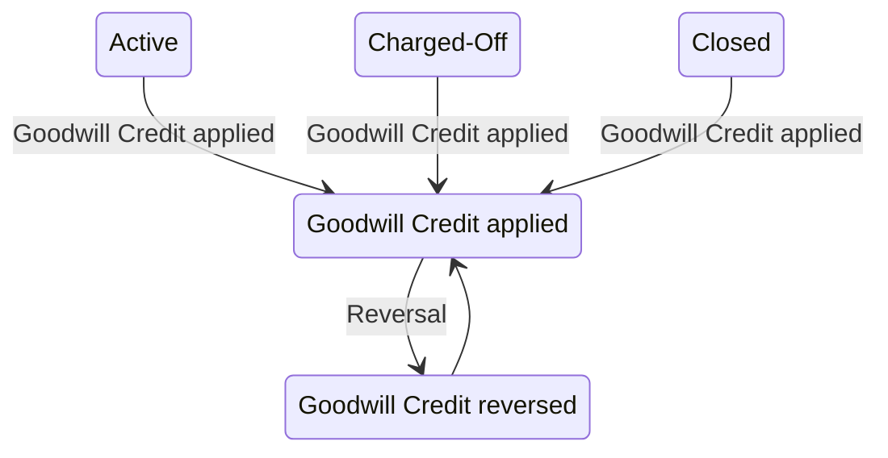

### Discount Fees Amortization

Discount fees amortization is a system-generated, non-monetary transaction that recognizes deferred income from discount fees as payments occur. It supports EIR-based tracking without affecting the loan outstanding balance, accounting balances, or GL accounts. It represents system-driven recognition of deferred income aligned with payment events, ensures visibility of deferred income movement, and maintains logical linkage between payments and income recognition. The transaction consists of deferred income value that is amortised.

The following rules govern discount fees amortization:

- The system generates the transaction automatically during payment processing when a valid payment exists and the deferred income balance is greater than zero.
- Each payment generates a corresponding amortization transaction, and the system calculates the amortised portion of deferred income, updates the schedule, and links the transaction to the parent payment.
- The transaction creates an amortization record for reporting and audit and reduces tracked deferred income in the logical view.
- It cannot be manually created, modified, deleted independently, or reversed independently.
- On reversal of the parent repayment, goodwill credit, or discount fees adjustment transaction, the associated amortization transaction is reversed or removed as part of system recalculation.
- For backdated payment transactions, the system recalculates and recreates or reprocesses the amortization transaction.
- On prepayment or foreclosure, any remaining deferred income is fully amortized at the tracking level.
- No amortization transaction is generated when no deferred income is available.

| Associated transaction | Role |
| --- | --- |
| Repayment Transaction | Parent payment that triggers amortization |
| Discount fees Adjustment | Parent payment that triggers amortization |
| Goodwill Credit Transaction | Parent payment that triggers amortization |

> **Note:** Discount fees amortization is purely informational and tracking in nature; it generates no accounting entries and does not affect financial balances.

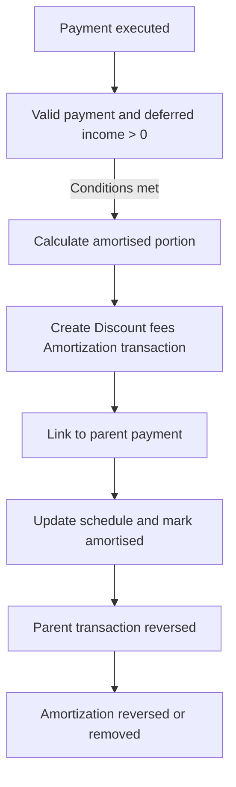

### Payout Refund

The Payout Refund transaction recovers previously disbursed loan funds from fraudulent Working Capital Product (WCP) loan accounts. It reduces the outstanding principal balance and fees according to the allocation rule and applies to active WCP loans. You enter the refund amount and transaction date when you submit the transaction.

1. Enter the refund amount.
2. Select the transaction date.
3. Submit the transaction for system validation and processing.

The system processes the transaction as follows:

- It validates eligibility when you submit the transaction.
- It applies the refund amount against the outstanding principal and Fees/Penalty balance as per allocation rules.
- It calculates and posts the Amortization transaction at close of business.
- It calculates and posts the Discount fee amortization transaction at close of business.
- If the refund exceeds the outstanding principal balance, the excess amount results in the loan entering an Overpaid status.
- Backdated Payout Refund transactions are allowed, and the system recalculates and posts the amortization transaction as of the current date.

> **Note:** You can configure an allocation rule specific to Payout Refund.

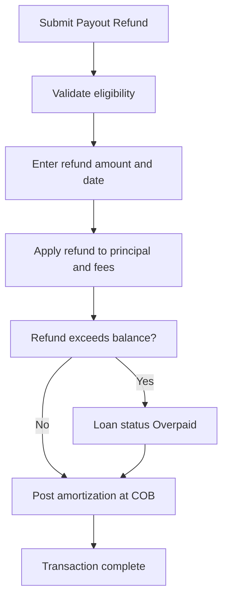

The transaction is named Payout Refund and works similar to a repayment transaction. It enables lenders to recover disbursed funds from fraudulent WCP loans while reducing the loan principal and fees/penalty balance. Backdating and reversal of the Payout Refund transaction is allowed. The system allows overpayments when the refund exceeds the remaining principal balance.

The Payout Refund transaction applies to WCP loans.

Upon confirmation, the system processes the transaction using pre-calculated payoff values, reduces outstanding balances to zero, and updates loan status following existing loan closure rules.

Whenever the Prepayment Date changes, the system recalculates the payoff amount, recalculates outstanding principal, interest, fees, and penalties as of the selected date, and displays the updated payoff amount before transaction submission.

When a Discount Fee Adjustment is processed, the system creates a linked adjustment transaction linked to the parent Discount Fee transaction, supports multiple adjustments until the remaining adjustable discount is zero, stores a row with the full amount allocated to the principal portion, reduces the loan-level discount by the adjustment amount with a minimum of zero, recalculates principal outstanding from disbursement plus updated discount, restates projected amortization by regenerating the schedule with new discount and disbursement parameters, re-applies all recorded actual repayments from the previous model, recalculates EIR-based projected payments, NPV, and deferred balance, raises the business event WorkingCapitalLoanDiscountFeeAdjustmentTransactionBusinessEvent, posts new accounting entries for the adjustment, and reprocesses amortization, outstanding balances, and subsequent transactions.

On backdated execution, the system reprocesses loan balances, recalculates charge components, and replays subsequent transactions and accounting entries.

### Charge Transaction

A Charge Transaction applies fees or penalties to a loan account and tracks charge liabilities without affecting principal. It is a system-generated monetary transaction created when a charge is applied at the loan account level, added at the disbursement level, or configured with a specific due date. A Charge Adjustment Transaction offsets or reverses already paid charges and adjusts paid charges properly.

Accounting entries are created as follows:

- For a Disbursement Charge, entries are created as of the transaction date.
- For a charge with a specific due date, entries are created as of the submitted date.

### Charge Adjustment Transaction

A Charge Adjustment Transaction is a monetary transaction used to offset charges that have already been paid. It applies when previously paid charges need to be adjusted or refunded and results in a reduction of the collected amount.

Charge adjustment follows these rules:

- The adjustment amount must be greater than zero.
- The adjustment amount cannot exceed the paid charge amount or the available charge balance.
- Charge adjustment can be performed only if charges have been previously paid.
- The adjustment date must comply with business date rules and backdating rules.
- Charge adjustment supports backdated processing.
- Charge adjustment transactions support reversal subject to validations.

Charge adjustment affects balances and accounting as follows:

- Charge adjustment adjusts principal or charge balances depending on the allocation strategy priority.
- Charge adjustment applies only to fees, penalty, or principal components based on allocation priority.
- Charge adjustment triggers accounting entries.
- Charge adjustment results in nullification of receivables or reversal of income standard accounting entry.
- When charges are paid via repayment, receivable is reduced.
- When charges are adjusted via charge adjustment, previously recognized income is reversed.
- Charge receivables are created at charge application and cleared during payment or adjustment.

Charge adjustment works similar to a repayment transaction, and reversal reverses charge impact or adjustment impact and accounting entries.

### Charge-Off Process

Charge-off lets a lender recognize a loan as uncollectible after prolonged delinquency or breach by writing off outstanding balances for accounting purposes while optionally continuing recovery efforts. It is an accounting classification, not a loan closure, and the loan remains eligible for recovery tracking and reporting.

Charge-off applies under these conditions and effects:

- Charge-off is supported only on active loan accounts.
- The loan account status changes from Active Delinquent to Charged-Off.
- The system writes off all outstanding dues, including principal, fees, and penalties.
- Outstanding balances are removed from loan asset books.
- Accounting entries post according to the configured charge-off journal entry rules.
- Accounting entries also post as defined in the accounting configuration for deferred income amortization on charge-off.
- No further income amortization occurs after charge-off.

Transactions around charge-off follow these rules:

- Backdated charge-off is allowed but must not precede the last monetary transaction date.
- Backdated repayments and reversals before the charge-off date are allowed.
- Any transaction or reversal after the charge-off date must strictly follow charge-off accounting rules.
- Transactions after the charge-off date are typically treated as recoveries based on configuration.

Charge-off reversal is supported subject to configuration and controls.

### Fraud Flag

No business logic or functionality for fraud exists at the moment. All actions must be auditable with proper user or system traceability. The fraud flag is only used to determine the accounting JE entry for charge-off at the moment.

### Write-Off Process

The write-off process permanently closes a loan account when recovery is no longer feasible by extinguishing all outstanding dues and removing them from the accounting books.

Write-off applies under the following conditions and effects:

- You can perform write-off manually through the UI or API only on an active loan account.
- Write-off is not permitted on charged-off accounts.
- The loan account status changes to Closed (Written-Off).
- All outstanding principal, interest, fees and penalties are marked as written-off and removed from the books through accounting entries.
- No further amortization occurs after write-off.
- Delinquency and breach evaluation are automatically disabled upon write-off.

Transaction behaviour on a written-off account is as follows:

- All monetary transactions are blocked except recovery payments.
- Backdated repayments or reversals with an effective date before the write-off date are allowed.
- Write-off can be backdated or reversed only when no monetary transactions exist after the effective write-off date.

The system captures the following fields at the time of write-off:

- Write-Off Date
- Write-Off Reason
- External ID
- Notes

### Charge Configuration

Charges are predefined or event-based amounts applied during the loan lifecycle to support consistent fee management and accurate accounting. You configure them at the product level, and loan products and loan accounts inherit them.

Charges follow these configuration rules:

- Charges must be reusable across products with the same currency.
- You can configure charges through the API or the UI, aligned with term loan charge structures.
- Each charge type maps to specific GL accounts.
- Accounting behavior for charges is configurable at product level and runs according to defined Journal Entry rules.
- You can post the accounting entry for charges in real time or at end of day.
- Charges may be configured as tax-inclusive.
- For tax-enabled charges, the system calculates and splits the tax component at the accounting level, creating separate GL entries for the charge amount and the tax amount.

The system applies charges as follows:

- At disbursement, charges are applied immediately and are typically added to the disbursement amount.
- Charges applied on a specified due date run based on configured triggers such as fixed date charges.
- Charges applied after the maturity date create an N+1 installment as of the charge date.
- You cannot apply charges if the loan account is Closed or Written-Off.
- Additional restrictions may apply based on loan status and charge configuration.

Waivers and backdated changes work as follows:

- You can fully waive a charge only if it has not been paid.
- A waiver reverses or adjusts the charge amount in the system, with corresponding accounting impact as per configuration.
- Backdated charge application is supported, and the system recalculates and reprocesses transactions and accounting entries.
- If historical transactions are modified, related charges or penalties are re-evaluated and reapplied or reversed accordingly.

Charges are configurable, reusable, and auditable, aligned with product-level definitions, and the system supports accurate accounting and reprocessing on backdated changes.

### Delinquency Range Schedule

The Range Schedule feature lets you generate and maintain a range schedule for a loan based on configurable repayment intervals and percentage allocations. The schedule tracks delinquency, expected payments, actual payments, and outstanding balances across defined time periods.

The system generates the range schedule from the delinquency configuration parameters, which you can override at the loan level using the Reschedule delinquency action to change the minimum payment percentage and frequency for that loan without changing the product-level configuration.

- The first period starts on the loan disbursement date plus grace days.
- Each subsequent period follows sequentially based on the defined interval.
- Generation continues until repayment allocation is completed or the loan closure condition is met.
- The system creates one period at a time and generates the next period when the current date crosses the last period due date.
- Each schedule record includes From Date, To Date, Expected Amount, Paid Amount, Outstanding Amount, Delinquent days, and Delinquent amount.

The system recalculates the minimum payment amount when a period is generated, when reschedule occurs and the minimum payment amount or frequency changed, or when a backdated or reversed monetary transaction affected only the period where the outstanding loan balance is lower than the originally calculated minimum payment.

Range Schedule objectives include:

- Flexible repayment tracking based on time ranges instead of fixed installment amounts.
- Visibility into expected versus actual payments within defined periods.
- Tracking unpaid balances carried forward across repayment periods.
- Dynamic schedule generation based on user-defined repayment parameters.
- Tracking Overdue and Delinquency at defined periods.

### Delinquency Pause

The Delinquency Pause action temporarily suspends delinquency tracking for a Working Capital loan. It applies only to delinquency schedule evaluation and does not affect breach management.

The following rules apply when pausing delinquency:

- Pause is allowed only on loans with active status.
- The start and end dates are mandatory, and the start date must be before the end date.
- The start date cannot be before the first disbursement date.
- Pause cannot start within an already evaluated range schedule period where the minimum payment criteria have been met.
- Pause periods cannot overlap with other existing pause periods.

During the pause period, the system extends the delinquency range schedule as follows:

- The active and all future periods shift forward by the number of pause days.
- All non-evaluated range schedule periods that overlap with or follow the pause start date have their end dates shifted forward by the pause duration.
- Future periods' start dates shift accordingly to maintain continuity.

### Delinquency Resume

You can resume delinquency only while a delinquency pause is active, between its configured start date and end date. Resumption ends the pause as of the resume date, and the system recalculates delinquency using the shortened pause duration. Resumption affects the delinquency schedule and calculation only and does not change breach management.

Resume a delinquency pause.

1. Confirm that the current business date falls between the pause start date and end date.
2. Select Resume Delinquency.

### Delinquency Reschedule

Delinquency Reschedule lets you change the minimum payment amount and/or the frequency of the delinquency range schedule for a Working Capital loan. It applies only to active loans that have at least one disbursement with an actual disbursement date and an already generated delinquency range schedule.

The minimum payment can be set in one of two ways:

- Percentage Amount calculated based on principal plus discount.
- Flat Amount where you provide the new minimum payment amount.

The following values must meet these conditions:

- minimum payment must be a positive number as a percentage of approved principal.
- frequency must be a positive integer.
- frequency type must be one of DAYS, WEEKS, MONTHS, YEARS.

When you reschedule, the system behaves as follows:

- The start date is automatically set to the current business date.
- The system identifies the current period containing the business date and updates its expected amount based on the new minimum payment percentage or flat amount.
- Already evaluated periods where the minimum payment criteria have been met are not affected, and historical data is preserved.
- Evaluated periods remain unchanged before and after reschedule.
- Future periods before reschedule follow the original schedule; after reschedule they are deleted and regenerated with the new parameters.
- If multiple reschedule actions exist, the latest one by ID takes precedence for generating new periods during COB.
- The current period before reschedule has the original expected amount; after reschedule it has the updated expected amount and outstanding is recalculated.

The expected amount and frequency change as follows:

- Before reschedule, expected amount is based on product-level minimum payment configuration; after reschedule, it is a percentage of approved principal or a flat amount from the reschedule action.
- Before reschedule, frequency is based on product-level delinquency bucket configuration; after reschedule, it is the new frequency and frequency type from the reschedule action.

Delinquency Reschedule does not affect the following:

- Breach Schedule of Evaluation.

### Delinquency Reset

Delinquency Reset marks a delinquent Working Capital Product (WCP) account as regularized once compliance is restored, restarts delinquency monitoring cycles, and stops further penal actions if applicable.

The following rules apply to Delinquency Reset:

- Delinquency evaluation resets effective only from the current system date; backdated resets are not permitted.
- After a reset, delinquency evaluation restarts from the current evaluation period.
- All delinquency records and evaluations before the reset date are nullified and are not considered for future delinquency tracking or calculations.
- Backdated repayments or adjustments with a value date before the reset date do not impact or alter the delinquency evaluation after the reset.
- The system permits multiple delinquency resets for an account over time, but only one reset per account per day.
- A user with appropriate permissions can undo or delete a delinquency reset.
- Undoing or deleting a reset reverts the delinquency status to its previous state and recomputes delinquency evaluation accordingly.
- All undo or deletion actions are captured in the audit trail.

### Product setup and defaults

The working capital loan product defines product-level financial defaults, repayment settings, allowable principal and rate ranges, default delinquency bucket classification, and currency and amortization setup. One product may be used by many loans.

Product configuration controls how defaults behave and how payments are allocated:

- Product configurable attributes indicate whether selected product defaults can be changed during loan creation or update.
- Product payment allocation rules define default payment allocation logic at product level by transaction type.
- Product payment allocation rules define how incoming transactions are allocated for loans created from a product.
- Product payment allocation rules support per-transaction-type allocation ordering.
- Product defines default allocation order for each transaction type.
- allocation_types are parsed into ordered values such as PENALTY, FEE, PRINCIPAL; exact values depend on business rules.

### Product validation rules

Product validation rules apply when you create or edit an effective interest rate product. The system checks that identifying fields are unique, amounts and rates stay within configured limits, dates are valid, and required currency and repayment fields are populated.

The following validation rules apply to a product:

- Product name must be unique.
- Product short name must be unique.
- Product external ID must be unique if provided.
- Product principal amount must fall within the minimum and maximum when both are present.
- Product period payment rate must fall within the minimum and maximum when both are present.
- Product start date must be on or before the close date when both are present.
- Product required currency fields must be populated.
- Product required repayment configuration must be populated.

### Loan account validation rules

Validation rules apply to loan account fields such as account number, external ID, product, client, principal and override values. They check that required identifiers exist and that principal values stay within permitted limits.

The following validation rules apply:

- The loan account number must be unique.
- The loan external ID must be unique when provided.
- The loan product ID must exist.
- The client ID must exist when the business flow requires it.
- The proposed and approved principal must be non-negative.
- The approved principal must respect the product minimum and maximum when configured.
- Loan override values must honor configurable-attribute permissions.

### Loan lifecycle commands

Loan lifecycle commands move a loan through its states. Approval, rejection, undoing approval, disbursement, and undoing disbursement each apply only from a specific starting state and require particular dates and amounts. Closure applies when business closure criteria are met.

Approval rules:

- The approve command moves a loan from Submitted and pending approval to Approved.
- It requires an approval date and an expected disbursement date.
- The approval date must not be in the future and must not be before the submitted date.
- The approved loan amount must be less than or equal to the proposed principal.
- The discount amount must be less than or equal to the created discount.

Rejection rules:

- The reject command moves a loan from Submitted and pending approval to Rejected.
- It requires a rejection date.
- The rejection date must not be in the future and must not be before the submitted date.

Undo approval rules:

- The undoapproval command moves a loan from Approved back to Submitted and pending approval.
- It is only allowed when the loan is in the Approved state.

Disbursement rules:

- The disburse command moves a loan from Approved to Active.
- It requires an actual disbursement date and a transaction amount.
- The actual disbursement date must not be in the future, must not be before the submitted date, and must not be before the approved date.
- The transaction amount must be greater than 0 and less than or equal to the approved principal.
- The client must be active, and payment detail fields must meet length and format requirements.

Undo disbursal rules:

- The undodisbursal command moves a loan from Active back to Approved.
- It is only allowed after disbursement when the loan is in the Active state.

Closure rules:

- Loan closure requires business closure criteria to be met.

Disbursement amount and date limits:

- Disbursement expected amount and actual amount must be non-negative.
- The actual disbursement date must not be before the approval date.
- The actual amount must not exceed the approved principal unless explicitly allowed.
- Total actual disbursements must not exceed the approved principal unless the product allows multi-overdraw logic.

### Amortization behavior

Working capital loans do not follow regular repayment schedules with defined installments and a maturity date like term loans. They do not carry interest rate allocations for interest, fees and principal, and total days to be amortized are not synchronized with a loan repayment schedule and maturity date.

Amortization works as follows:

- Daily amortization amount is posted only when the payment is made.
- Calculation of amortization is done until the payment is made.
- Fees can be added at any point in the loan life cycle, similar to origination fees.
- Fees or principal adjustments in the middle of the loan life cycle are possible with full adjustment possible.
- When EIR changes in the middle of the loan life cycle, it is applied only to future installments amortization calculation.
- Fee waivers initiated by PayPal are allowed and work just like today, with charge adjustment and discount fee adjustment supported; these behave differently, with repayment like a transaction reducing outstanding balance.

Other behavior:

- After maturity there can be penalty or fee added, and only repayment later than the fee due date can pay off the fee; post maturity fee does not change the loan’s maturity date.
- Re-aging works only for range schedule and does not impact the amortization.

### Product capabilities and restrictions

The Working Capital Loan product supports charge-offs or write-offs for 180 days, 360 days, or the full tenure. Charge-backs are supported using repayment reversals. Re-age is precalculated, reevaluated during the loan lifecycle, and enforced through delinquency handling for minimal payment without changing the period payment amount. Re-amortization does not apply.

The product supports the following capabilities:

- Payment holidays are supported.
- All types of charges and penalties are supported, such as NSF in Germany, and allocation is always charges first and then principal.
- Delinquency and delinquency pause are supported.
- Delinquency bucket classification is supported.
- Fee waivers initiated by PayPal are allowed as waiver types.
- Overpayments and credit balance refund scenarios are supported, with a credit balance refund issued for any overpayment.
- Trailing activity such as repayment reversal or charge back can occur.

The product does not support the following capabilities:

- Contract termination is not supported.
- Asset externalization is not supported.
- Interest rate modification is not supported.
- Income pause periods are not supported.
- Refund types of transactions, such as interest refund and merchant refund, are not supported.
- Downpayments are not supported.
- No interest percentage is charged on the disbursed loan account.
- Multi-disbursements (tranches) do not exist for a loan account.
- Traditional installments with defined amount allocations do not exist.
- No transactions or disbursements occur after the loan account is paid in full and closed.

### Delinquency restart period option

You can perform a Delinquency Reset with an optional setting called Restart Period from Reset Date. This option applies when you reset delinquency for a loan account.

When you select Restart Period from Reset Date, the following rules apply:

- The system treats the Delinquency Reset Date as the new starting point for delinquency period calculations.
- All existing delinquency periods are reset as part of the process.
- A new delinquency period starts from the Delinquency Reset Date.
- Subsequent delinquency periods are calculated from the new start date using the existing delinquency-period generation logic.
- Previous delinquency periods remain available for audit and history but do not influence newly generated delinquency periods after the reset.

If you do not select Restart Period from Reset Date, the Delinquency Reset works exactly as before, with no changes to existing delinquency period calculations.

### Delinquency disable

Delinquency Disable lets authorized users stop delinquency evaluation for a loan account in business scenarios such as charge-off or write-off. The disable takes effect only as of the current system date; backdated disability is not permitted.

While Delinquency Disable is active:

- Delinquency evaluation stops for the account from the disable date onward.
- Delinquency Reschedule is not permitted.
- Delinquency Reset is not permitted.
- Delinquency Pause is not permitted.
- Delinquency Disable cannot be applied again until the active disable is undone or reversed.

Undoing or reversing Delinquency Disable re-triggers and recomputes delinquency evaluation as of the undo date.

### Delinquency payment and past due

Delinquency payment and past due handling applies when a borrower misses the minimum payment expected for a delinquency period. The system recognizes the unpaid portion as past due and allocates later payments to the oldest delinquent period before the current period.

The following rules govern delinquency payment and past due amounts:

- The minimum payment amount on the delinquency period defines the expected paid amounts for that interval.
- Missing the minimum payment amount puts the period into delinquency, and the past due amount equals the minimum payment amount minus the amounts paid.
- Consecutive payments first pay off the outstanding amount of the oldest past due, delinquent period.
- After the oldest past due delinquent period is paid, consecutive payments then pay the current period.
- Any excess amount is not applied to upcoming delinquency periods.

Breach Management identifies, monitors, and resolves violations of predefined loan conditions and merchant performance thresholds.

### Breach range schedule

The Breach range schedule lets users generate and maintain a Range Schedule for loans based on configurable repayment intervals and percentage allocations. It tracks Breach, expected payments, actual payments, outstanding balances, Overdue, and Delinquency across defined time periods, providing visibility into expected versus actual payments within those periods.

### Breach period generation

The system generates one breach period at a time and creates the next period only when the current date passes the last period's due date. No future periods are pre-generated.

The system recalculates the minimum payment amount in these situations:

- When the current date passes the last period's due date and a new period is generated.
- When a reschedule changes the minimum payment amount or frequency.
- When a backdated or reversed monetary transaction lowers the outstanding loan balance below the originally calculated minimum payment for that period.

Every schedule record includes:

- Near Breach, which evaluates whether the payment tendency shows a possibility for breach.
- Breach, which shows true or false depending on whether a breach occurred.

### Breach pause

Breach Pause temporarily suspends Breach tracking for a Working Capital loan. It affects only the Breach schedule and breach evaluation, and it does not affect delinquency, repayment schedules, or other loan calculations. It functions similarly to Delinquency Pause, but its applicability is restricted to breach evaluation only.

The following rules apply to Breach Pause:

- The system extends the Breach range schedule during the pause by shifting the active and all future periods forward by the number of pause days.
- You can apply Breach Pause as of the current business date at initiation, and the system allows backdated entries.
- When you apply a backdated Breach Pause, the system re-triggers and recomputes breach evaluation for the affected period.
- You can create multiple Breach Pause records for an account, but overlapping pause periods are not permitted.
- The Resume breach action is permitted only during an active pause period, between the configured pause start date and end date.
- After resumption, the system recalculates breach based on the revised shortened pause duration.

### Breach reschedule

The Breach Reschedule action lets you change the minimum payment amount and/or the frequency of the Breach range schedule for a Working Capital loan.

You can set the minimum payment using one of two options:

- Percentage Amount calculated based on principal plus discount.
- Flat Amount where you provide the new minimum payment amount.

Already evaluated periods where the minimum payment criteria have been met are not affected, so historical data is preserved.

### Breach reset

Breach Reset marks a breached Working Capital Product account as regularized once compliance is restored, restarts breach monitoring cycles from the current evaluation period, and stops further penal actions if applicable. The reset takes effect only from the current system date, and backdated resets are not permitted.

The following rules apply to breach resets:

- All breach records and evaluations before the reset date remain unchanged and are not considered for future breach tracking or calculations.
- A reset tag is added to the period where the reset is applied so evaluation happens from that period only.
- The system permits multiple breach resets for an account over time, but only one breach reset per account per day.
- Changes on periods prior to the reset date have no effect on current evaluations and calculations.

### Breach reset undo

You can undo or delete a breach reset when you have the required permissions and controls. The breach status returns to its state before the reset, and breach evaluation is recomputed. All undo or deletion actions are captured in the audit trail.

### Breach reset restart period option

During a Breach Reset, you can optionally restart the breach period from the reset date. This option applies only when you select it; otherwise the reset behaves as before and existing breach period calculations remain unchanged.

When you select Restart Period from Reset Date:

- The system treats the Breach Reset Date as the new starting point for breach period calculations.
- All existing breach periods are reset.
- A new breach period starts from the Breach Reset Date.
- Subsequent breach periods are generated from this new start date using the existing breach period generation logic.
- Previous breach periods remain available for audit and history but do not influence the newly generated breach periods after the reset.

### Breach disable

Breach Disable lets authorized users stop breach evaluation for a loan account under specific business scenarios, such as charge-off or write-off. The disable takes effect only as of the current system date; backdated disable is not permitted.

While Breach Disable is active, the following evaluations and actions stop or are not permitted:

- Breach evaluation stops for the account from the disable date onward.
- Near Breach evaluation stops.
- Breach Past Due amount evaluation stops.
- Breach Reschedule is not permitted.
- Breach Reset is not permitted.
- Breach Pause is not permitted.

Breach Disable can be applied only once until the current disable is reversed. Upon reversal, breach evaluation is re-triggered and recomputed as of the undo date.

### Breach past due amount

The Breach Past Due Amount is the amount by which an account remains in breach in the current period. It is calculated at the end of each breach period as defined in the breach schedule.

The following rules govern how the Breach Past Due Amount behaves:

- The amount is never negative.
- Once computed, it carries forward cumulatively across periods until fully resolved or reset.
- Recalculations respect reset, disable, and reschedule rules.
- Backdated repayments or adjustments trigger recalculation for the affected periods.
- A breach reschedule recomputes the amount based on the revised breach schedule and applicable terms.
- Breach pause has no impact on the calculation.
- When breach disable is active, calculation stops from the disable date onward.
- Past due amount continues to be computed irrespective of pause periods.

Breach past due differs from delinquency past due in the following ways:

- For breach, past due is cumulative: any unpaid amount from the previous period carries forward and is added to the current period's past due.
- For breach, incoming payments are allocated only to the current period and are not applied to past or future periods.
- No history is maintained for breach evaluations.
- Periods prior to a reset remain unchanged; a reset flag is recorded against the reset period, and all subsequent breach evaluations and past due calculations consider only periods from the reset point onward.
- Backdated payments or reversals update the affected period's actual payment amount, past due amount, and breach status, but do not trigger recalculation of subsequent periods or alter the current breach evaluation.
- Near breach functionality provides early warning signals when a merchant's performance or repayment behavior is approaching predefined breach thresholds but has not yet resulted in an actual breach.
- Payment holiday has no impact on effective interest rate (EIR) calculation.

Delinquency past due works differently from breach past due:

- For delinquency, past due is calculated independently for each period and does not carry forward from previous periods.
- For delinquency, incoming payments are allocated to the oldest unpaid minimum due period; payments are applied to past due periods first, then the current period; no allocation is made to future periods.
- Delinquency tag history is maintained for audit and tracking purposes.
- For delinquency, when a reset is performed, all periods prior to the reset period are nullified for delinquency evaluation, and the delinquency tag history is updated accordingly.
- For delinquency, backdated payments or reversals do not affect periods prior to the reset; delinquency calculations continue from the reset period without re-evaluating earlier periods.

### Accounting entries

Each transaction posts debit and credit entries to general ledger accounts. Entries differ before and after charge-off.

| Transaction | Debit | Credit |
| --- | --- | --- |
| Disbursement | GL 112601 Loans Receivable Principal (Asset, Prin) | GL 145023 Suspence/clearing account (Asset/Liability, Prin) |
| Disbursement Reversal | GL 145023 Suspence/clearing account (Asset/Liability, Prin) | GL 112601 Loans Receivable Principal (Asset, Prin) |
| Repayment | GL 145023 Suspence/clearing account (Asset/Liability, Prin, Fees, and Penalty and excess) | GL 112601 Loans Receivable Principal (Asset, Prin); GL 245000 Other Credit liability (Liability, excess); GL 112603 Fee Receivable Fees Receivable (Asset, fees); GL 112603 Fee Receivable Penalty Receivable (Asset, Penalty) |
| Repayment Reversal | GL 112601 Loans Receivable Principal (Asset, Prin); GL 245000 Other Credit liability (Liability, excess); GL 112603 Fee Receivable Fees Receivable (Asset, fees); GL 112603 Fee Receivable Penalty Receivable (Asset, Penalty) | GL 145023 Suspence/clearing account (Asset/Liability, Prin, Fees, and Penalty and excess) |
| Amortization | GL 240005 Deferred Interest (Liability, Int) | GL 404000 Interest income (Income, Int) |
| Write-off | GL 744008 recoveries (Expense, Prin, fees, and Penalty) | GL 112603 Fee Receivable Fees Receivable (Asset, fees); GL 112603 Fee Receivable Penalty Receivable (Asset, Penalty); GL 112601 Loans Receivable Principal (Asset, Prin) |
| Write-off Reversal | GL 112601 Loans Receivable Principal (Asset, Prin); GL 112603 Fee Receivable Fees Receivable (Asset, fees); GL 112603 Fee Receivable Penalty Receivable (Asset, Penalty) | GL 744008 recoveries (Expense, Prin, fees, and Penalty) |
| Credit Balance Refund | GL 245000 Other Credit liability (Liability, excess) | GL 145023 Suspence/clearing account (Asset/Liability, excess) |
| Credit Balance Refund Reversal | GL 145023 Suspence/clearing account (Asset/Liability, excess) | GL 245000 Other Credit liability (Liability, excess) |
| Goodwill Credit | GL 744003 Principal bal adjustment (Expense, Prin,excess); GL 404008 Fee Charge off (Income, fees); GL 404008 Fee Charge off (Income, Penatly) | GL 112601 Loans Receivable Principal (Asset, prin); GL 112603 Fee Receivable Fees Receivable (Asset, fees); GL 112603 Fee Receivable Penalty Receivable (Asset, Penalty); GL 245000 Other Credit liability (Liability, excess) |
| Goodwill Credit Reversal | GL 112601 Loans Receivable Principal (Asset, prin); GL 112603 Fee Receivable Fees Receivable (Asset, fees); GL 112603 Fee Receivable Penalty Receivable (Asset, Penalty) | GL 404008 Fee Charge off (Income, fees); GL 404008 Fee Charge off (Income, Penatly); GL 112601 Loans Receivable Principal (Asset, prin); GL 112603 Fee Receivable Fees Receivable (Asset, fees); GL 112603 Fee Receivable Penalty Receivable (Asset, Penalty); GL 245000 Other Credit liability (Liability, excess) |
| Charge addition | GL 112603 Fee Receivable Fees Receivable (Asset, fees) | GL 404007 Fee Income (Income, fees) |
| Charge waive | GL 404007 Fee Income (Income, fees) | GL 112603 Fee Receivable Fees Receivable (Asset, fees) |
| Charge-off | GL 744007/744037 Credit loss-bad dept/credit loss-bad dept- fraud (Expense, Prin); GL 404008 Fee Charge off (Income, fees); GL 404008 Fee Charge off (Income, Penalty) | GL 112601 Loans Receivable Principal (Asset, Prin); GL 112603 Fee Receivable Fees Receivable (Asset, fees); GL 112603 Fee Receivable Penalty Receivable (Asset, Penalty) |
| Charge-off Reversal | GL 112603 Fee Receivable Fees Receivable (Asset, fees); GL 112603 Fee Receivable Penalty Receivable (Asset, Penalty) | GL 112601 Loans Receivable Principal (Asset, Prin); GL 404008 Fee Charge off (Income, fees); GL 404008 Fee Charge off (Income, Penalty) |
| Discount fees | GL 112601 Loans Receivable Principal (Asset, Prin, Fees, and Penalty) | GL 240005 Deferred Interest (Liability, Prin, Fees, and Penalty) |
| Discount fees Adjustment | GL 240005 Deferred Interest (Liability, Prin, Fees, and Penalty) | GL 112601 Loans Receivable Principal (Asset, Prin, Fees, and Penalty) |

After charge-off, repayment, reversal, amortization, credit balance refund, reversal, goodwill credit and reversal entries use recoveries or charge-off income accounts instead of the standard principal, interest and fee accounts.

| Transaction after charge-off | Debit | Credit |
| --- | --- | --- |
| Repayment | GL 145023 Suspence/clearing account (Asset/Liability, Prin, Fees, and Penalty and excess) | GL 744008 recoveries (Income, Prin); GL 245000 Other Credit liability (Liability, excess); GL 744008 recoveries (Income, Penalty); GL 744008 recoveries (Income, fees) |
| Repayment Reversal | GL 744008 recoveries (Income, Prin); GL 245000 Other Credit liability (Liability, excess); GL 744008 recoveries (Income, Penalty); GL 744008 recoveries (Income, fees) | GL 145023 Suspence/clearing account (Asset/Liability, Prin, Fees, and Penalty and excess) |
| Amortization | GL 240005 Deferred Interest (Liability, Int) | GL 404000 Interest income (Income, Int) |
| Credit Balance Refund | GL 245000 Other Credit liability (Liability, excess) | GL 145023 Suspence/clearing account (Asset/Liability, excess) |
| Credit Balance Refund Reversal | GL 145023 Suspence/clearing account (Asset/Liability, excess) | GL 245000 Other Credit liability (Liability, excess) |
| Goodwill Credit | GL 744003 Principal bal adjustment (Expense, Prin,excess); GL 404008 Fee Charge off (Income, fees); GL 404008 Fee Charge off (Income, Penatly) | GL 744008 recoveries (Income, prin); GL 744008 recoveries (Income, fees); GL 744008 recoveries (Income, Penalty); GL 245000 Other Credit liability (Liability, excess) |
| Goodwill Credit Reversal | GL 744008 recoveries (Income, prin); GL 744008 recoveries (Income, fees); GL 744008 recoveries (Income, Penalty); GL 245000 Other Credit liability (Liability, excess) | GL 404008 Fee Charge off (Income, fees); GL 404008 Fee Charge off (Income, Penatly) |

### Delinquency action data model

Delinquency actions record PAUSE or RESCHEDULE for a Working Capital loan and drive schedule modifications, with pause extending periods and reschedule changing expected amounts and frequency. They also supply override parameters for COB period generation.

The action field accepts one of two values:

- PAUSE
- RESCHEDULE

Date rules depend on the action:

- For PAUSE, both start_date and end_date are user-provided.
- For RESCHEDULE, start_date is set automatically to the current business date and end_date is null.

The following fields apply only to RESCHEDULE:

- minimum_payment is DECIMAL(19,6).
- frequency is INT.
- frequency_type is VARCHAR(50) with values DAYS, WEEKS, MONTHS, or YEARS.

### Product overview and configuration

The Working Capital loan product supports discount/fees-based working capital financing commonly offered by PayPal to merchants. Loans are calculated and amortized using EIR methodology to ensure transparent cost of credit and compliance with accounting and regulatory standards. Working Capital loan products use a dedicated product configuration implemented as a separate module without impacting existing loan products.

The loan product selector offers two options:

- Regular (default)
- Working capital

Users can perform the following actions through the UI:

- Modify loan product details
- Approve loans
- Disburse loans

The UI includes the following tabs:

- Details
- Currency
- Settings
- Terms
- Payment allocations

The UI looks like and behaves like an existing loan product, but with fewer fields.

A Working Capital Loan Product represents the product template from which loan accounts are created.

### Loan product terms screen

The loan product terms screen defines the principal, payment rate, annual EIR, payment amount, number of repayments, interest rates, floating rate, variations, repayment frequency, and fixed length settings for a working capital loan product. You use Add, Previous, and Next to move through the step.

| Field group | Purpose |
| --- | --- |
| Principal | Defines the minimum, default, and maximum principal allowed for the loan product. |
| Period Payment Rate | Defines the minimum, default, and maximum period payment rate. |
| Annual EIR | Defines the minimum, default, and maximum annual EIR. |
| Payment Amount | Defines the minimum, default, and maximum daily payment amount. |
| Number of repayments | Defines the minimum, default, and maximum number of repayments allowed for the loan product. |
| Interest Rates | Defines the minimum, default, maximum, and period for the nominal interest rate, expressed as percentages. |
| Floating Interest Rate | Defines the minimum, default, maximum, and period for the floating interest rate, expressed as percentages. |
| Variations | Defines principal by loan cycle, annual interest rate by loan cycle, and number of repayments by loan cycle. |
| Repayment schedule inputs | Determines when payments are due, including repayment frequency, frequency type, first and second repayment day of month, fixed length, and minimum days between disbursal and first repayment date. |
| Fixed Length | Sets a maximum loan length in days due to regulatory requirements; the last installment is shorter than the first installments. |

The screen also includes the following required fields:

- Over Amount Calculation Type
- Over Amount
- Payment Amount Calculation Strategy
- Discount
- Installment day calculation from
- Frequency
- Floating Rate
- Differential Rate
- Minimum days between disbursal and first repayment date

The screen also includes the following yes/no fields:

- Is interest recognition on disbursement date?
- Is Zero Interest Rate?
- Is Linked to floating interest rates?
- Is Floating calculation allowed?
- Terms vary based on loan cycle

### Loan account lifecycle

A loan account is created from an existing loan product. Product-level rules are copied into loan-level rules, which become the effective rules used at runtime. After creation, you can modify, approve, or reject the loan account.

1. Approve the created loan account.
2. Disburse the approved loan account.
3. Undo the disbursal after disbursement.

When you undo a disbursement, the loan account returns to the approval state.

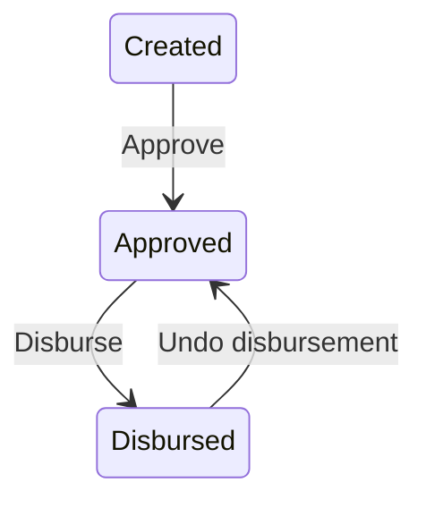

### Amortization schedule lifecycle

The amortization schedule lifecycle runs through three stages: Create, Disburse, and Repayment. The system generates the initial schedule from application parameters at loan creation, recalculates it at disbursement using actual amounts and dates while preserving applied payments, and performs a full schedule rebuild whenever a payment is applied. Loan approval formally authorizes the loan terms and may change financial parameters and trigger schedule recalculation. Every state change triggers a full rebuild of the projected amortization schedule.

Each full schedule rebuild follows this sequence:

- Aggregate payments.
- Build the payment list from 1 to the loan term, with actual or null values.
- Calculate balances.
- Run payment analysis.
- Run cursor amortizations.
- Distribute excess amounts.
- Build the tail.
- Calculate net amortization.
- Assemble rows.
- Trim the schedule.

1. Open the loan product creation page.
2. Choose the TERMS step to open the loan product terms step screen.

### Amortization schedule generation and recalculation

The system generates a projected amortization schedule when you create the loan account, based on the minimum expected payment amount, calculated loan term, and total deferred income. It recalculates the schedule at approval and disbursement stages, and disbursement activates the loan, books principal outstanding, updates the amortization schedule, and triggers accounting entries. After disbursement, actual repayments post Actual Amortization (Income) on the payment date, and the schedule continuously updates to reflect actual repayment behavior.

When a loan is modified, the system recomputes the following from the current date onward:

- EIR based on remaining outstanding balance, remaining deferred income, and updated repayment projections.
- Projected repayment amounts for future payments only.
- Remaining loan tenure when it is dynamically derived.
- Future deferred Discount fees Amortization values.
- The amortization schedule.

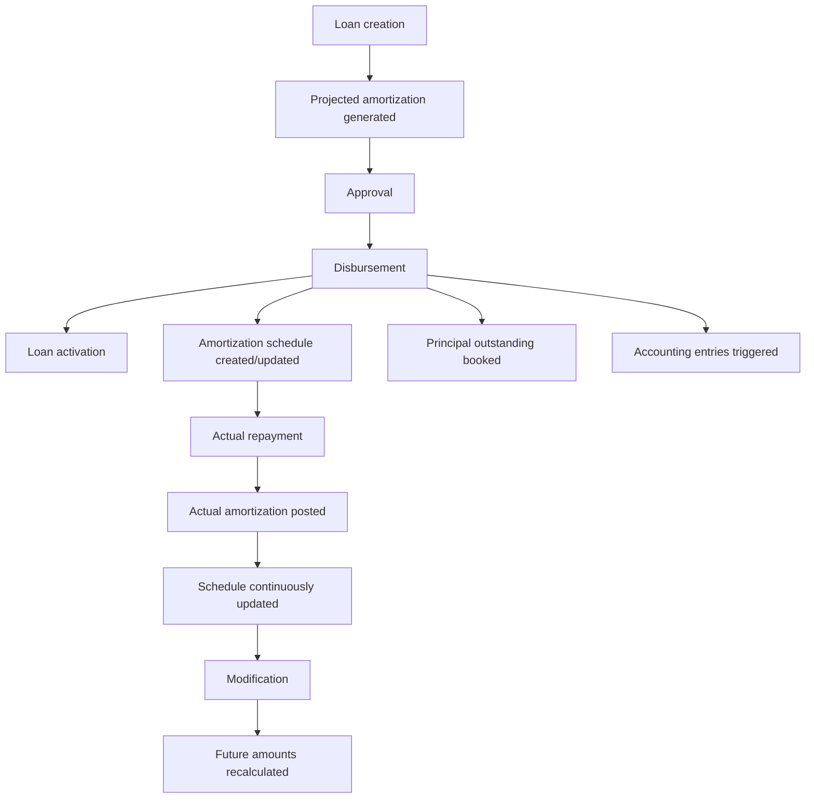

### EIR calculation methodology

The EIR calculation methodology determines the Period Payment amount, Total Days, Daily EIR, and Calc. Annual EIR for each loan account. It uses day count between disbursement and installment dates for discounting calculations.

The calculation performs the following steps:

- expected payment amount = (TPV × period payment rate) / npv day count
- loan term = round up((net disbursement + origination fee) / expected payment)
- EIR = RATE(loan term, -expected payment, net disbursement) solved with Newton-Raphson using tolerance 1E-10 and a maximum of 100 iterations
- payments left = max(0, payment no - applied payment count)
- discount factor = 1 / (1 + EIR) ^ payments left, with the model wrapper returning 1.0 if the result is less than or equal to 0
- npv source is actual payment if applied or forecast payment if not
- npv value = max(0, npv source × discount factor), with row 0 as -net disbursement amount unclamped

The RATE function and amortization behaviour follow these rules:

- RATE solves pv×(1+r)^n + pmt×((1+r)^n−1)/r = 0 using Newton-Raphson with an initial guess of 2×(pmt×n+pv)/(pv×n), fallback 0.01, tolerance 1E-10, and a maximum of 100 iterations
- balance[i] = balance[i-1]×(1+EIR) - expected payment, with expected amort capped at origination fee
- payments on the same date are summed and occupy consecutive day slots starting from day 1
- each applied payment is compared to expected payment for shortfall or excess analysis
- a cursor advances by actual payment/expected payment periods interpolating partial periods
- excess is distributed by reducing forecast payments backward from the last period
- tail periods are appended for remaining shortfall
- total net amortization = -net disbursement + Σ(npv source[i] × DF[i]) + tail npv
- rows are assembled and trailing zero-forecast rows are trimmed

The Discount Factor calculation applies as follows:

- Discount Factor = 1/(1+eir)^days
- Discount Factor returns 1.0 when days equals 0

### Payment processing and allocation

A loan product defines the allocation priority order for repayments. When you make a repayment, the system applies the amount up to the outstanding obligation to that obligation and records any excess as an overpayment.

The repayment calculation uses these rules:

- Amount applied to outstanding equals the smaller of the transaction amount and the principal outstanding before repayment.
- Overpayment increment equals the transaction amount minus the amount applied to outstanding.

Amortization is calculated based on the Effective Interest Rate methodology or configured logic.

### Backdated transactions and replay

When you enter a backdated transaction, the system recalculates the amortization schedule, recomputes EIR if applicable, and replays all amortization values. It also recalculates outstanding balances, discount fee amortization, all subsequent transactions, and all associated accounting entries.

For backdated payments, the system reprocesses the schedule and replays all subsequent transactions and accounting entries.

Because the discount fee is applied as of the disbursement date, the system recomputes EIR and reprocesses amortization, outstanding balances, and subsequent transactions.

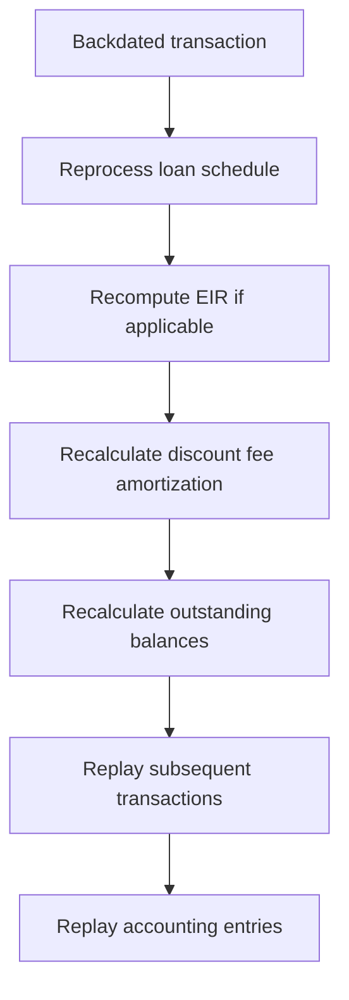

### Reversals

Reversing a transaction creates a linked reversal transaction that fully reverses its financial impact and accounting entries. Reversing a credit balance refund also recomputes the account balances accordingly.

Reversing a charge adjustment creates a linked reversal transaction.

Undoing a transaction returns the loan account to an earlier state:

- Undoing disbursement moves the loan back to the approval state.
- Undoing another action moves the loan back to the created state.

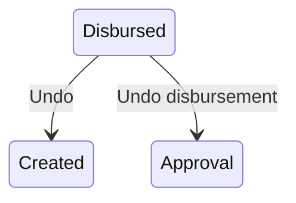

### Charge-off

Charge-off is a manual action on a loan account that does not automatically change delinquency or breach status. You can choose to disable delinquency and breach tracking at the time of charge-off.

When you charge off a loan, capture the following details:

- Charge-Off Date
- Charge-Off Reason
- External ID for integration or reference
- Notes as free-text for additional context

Charge-off handling includes the charge-off step plus rules and a job that can automatically trigger it. On charge-off, the system performs a one-time amortization of total deferred income as of the charge-off date.

Fraud is a flag set at the loan account level through the API or UI.

### Delinquency configuration

Delinquency configuration sets the range interval and breach calculation used to track overdue amounts on a loan account.

The following parameters are defined at the loan account level:

- Name, Frequency, Frequency Type, Breach amount type (calculation), and Breach amount.
- Frequency is a numeric value representing the range interval.
- Frequency Type is the time unit of the range interval, such as days, weeks, or months.
- Breach amount type supports Percentage of loan amount and Flat amount.

Bucket and schedule behaviour works as follows:

- Bucket configuration works similar to Term loans.
- Sample buckets are D00 (01-30), D30 (31-60), D60 (61-90), D90 (91-120), D120 (121-150), D150 (151-180), D180 (181-210), D210 (210-240), and D270 (>270).
- The range schedule is generated based on the input parameters.
- Multiple Breach configurations can be done, and the relevant configuration can be mapped to the relevant loan product.
- Each schedule record must include From Date, the start date of installment period, and To Date, the end date of installment period.

Key charge configuration parameters include Charge Name, Currency, Charge Type (Flat amount or Percentage-based), Application Timing (At disbursement or On a specified due date), Calculation Basis (Principal, Outstanding balance, or Flat), Penalty Configuration, and Tax Applicability.

### Delinquency calculation

Delinquency calculation compares the amount expected for a period with the amount paid and measures how long an unpaid balance remains after the period end date. The system also calculates pause duration and breach past due amounts.

| Measure | Calculation |
| --- | --- |
| Expected Amount | % per frequency applied to the configured base amount |
| Paid Amount | Sum of payments made within the date range |
| Outstanding Amount | Expected Amount minus Paid Amount |
| Delinquent days | Days between To date and current date where outstanding amount is greater than 0 |
| Delinquent amount | Outstanding amount after To date |
| Pause duration in days | Difference between start and end dates |
| Period Past Due Amount | Total Amount Due in the Period minus Total Amount Paid in the Period |
| Breach Past Due Amount | Previous Period Past Due Amount plus Current Period Past Due Amount |

### Pause and reschedule actions

You can pause a working capital loan account for a defined period and then resume it, or reschedule the account by changing its minimum payment, frequency, and frequency type. The system recalculates future periods when you reschedule and updates the current period based on the new minimum payment.

The following behaviour applies to pause and reschedule actions:

- A pause action is created with a start date and an end date.
- When you execute the resume action, the pause end date is updated to the resume date.
- When you execute the resume action, the breach pause is considered terminated as of the resume date.
- A reschedule action is created with new minimum payment, frequency, and frequency type parameters.
- All future periods not yet evaluated are deleted and regenerated with the new frequency and expected amount.
- The system identifies the current period, which contains the business date, and updates its expected amount based on the new minimum payment percentage or flat amount.

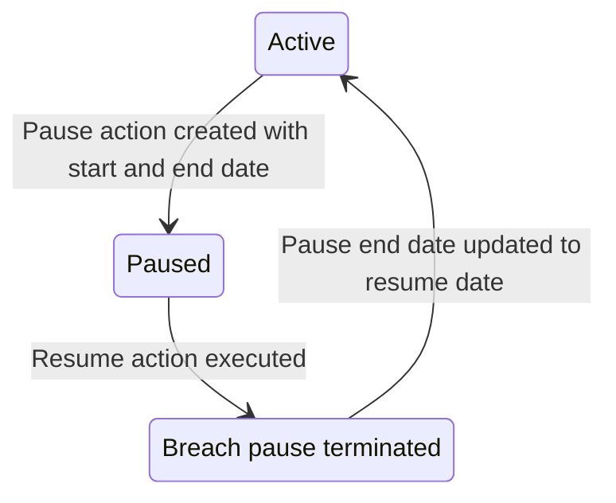

### Write-off and CBR

When you process a credit balance refund (CBR) with a backdated date, the system reprocesses subsequent transactions and recalculates balances and accounting entries. For backdated repayments or reversals before the write-off date, the system replays the write-off transaction and its corresponding accounting entries accordingly.

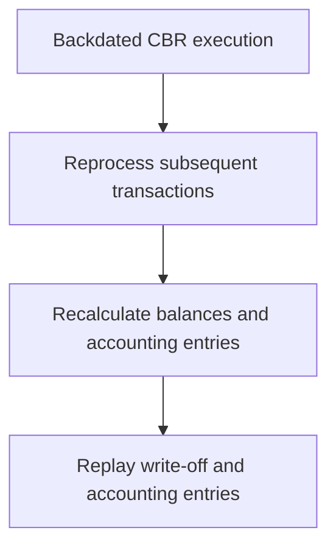

### Charge transactions

A Charge transaction increases charge receivable and charge income, adds the charge amount to the loan balance charge portion only, and adds to the amount to be collected under Fees or Penalties based on configuration.

| Entry | Account |
| --- | --- |
| Debit | Charge Receivable / Loan Account |
| Credit | Fee Income / Penalty Income Account |

### Transaction display

Transactions appear in chronological order based on transaction date. Each transaction shows its type, amount, component breakdown, and reversal status. Accounting entries are available under the accounting section.

The UI supports the following capabilities:

- Filtering by type and date range.
- Drill-down view for detailed transaction data.
- Linkage between original and reversal transactions.

| Calculated and stored value |
| --- |
| Payment amount |
| Actual Amortization (Income) |
| Income Modification |
| Deferred balance |

### Fee amortization by product type

Fee amortization depends on the product type. Working Capital Products use origination fees with straight line amortization and accelerated recognition based on anticipated or actual payments. Merchant Term Loan Products use origination fees with straight line amortization. Consumer Loan Products use buy down fees with straight line amortization and take rate fees. No partial fee adjustments occur. Working Capital Products support single disbursements per loan account. N+1 type of special scenarios could exist.

### UI modifiable fields during loan creation

During loan creation, you can modify several fields in the Term category.

The following Term category fields are modifiable:

- Disbursement Amount shows the default amount and you can change it between the Min and Max values.
- Period Payment Rate shows the default amount and you can change it between the Min and Max values.
- Total Payment Value is user entered.
- Discount shows the default amount and you can change it.
- Loan Application Submitted Date uses the current date if you do not provide one.
- Expected Disbursement Date can be changed.
- LP overridables can be changed if enabled.
- Flat - % amount can be changed.
- Delinquency Bucket Classification can be changed.
- Period payment frequency can be changed.

### UI modifiable fields during approval

During approval, you can modify several fields on the loan account. Principal Amount and Approved Date are mandatory, while Discount Amount and Notes are non-mandatory.

The following fields are modifiable during approval:

- Principal Amount is mandatory and shows the default amount entered during loan creation; you can change it to a lesser amount.
- Discount Amount is non-mandatory and shows the default amount entered during loan creation; you can change it to a lesser amount.
- Approved Date is mandatory.
- Expected disbursement date is mandatory and shows the Expected Disbursement of the loan account.
- Notes is non-mandatory.

### UI modifiable fields during disbursal

GL mapping is defined at the loan product level. During disbursal you can modify several fields on the loan account. Disbursed on and disbursement amount are mandatory; all other fields are optional.

The following fields are available during disbursal:

- Disbursed on is mandatory and records the actual disbursement date.
- Disbursement amount is mandatory and defaults to the approved amount; you can change it to any amount less than the approved amount.
- Discount Amount is optional and defaults to the amount entered during loan approval; you can change it to an amount less than the created amount.
- External ID is optional.
- Payment Type is optional and is a drop-down of payment type entities.
- Payment Details is optional and contains Account No, Cheque No, Routing Code, Receipt No, and Bank code.
- Notes is optional.

### Worked examples

A working capital loan is created with a principal of 1,000.00 and an upfront origination fee of 100.00. The product expects daily repayments of 100.00, so the projected term is 11 days. The effective interest rate is 0.10 percent per day and the NPV day count is 360. These figures are illustrative. The system builds the projected amortization schedule starting with the disbursement row and then lists each expected payment with its discount factor and net present value.

| Period | Date | Expected payment | Discount factor | NPV value | Balance | Deferred balance |
| --- | --- | --- | --- | --- | --- | --- |
| 0 | 1/1 | -1,000.00 | 1.0000 | -1,000.00 | 1,000.00 | 100.00 |
| 1 | 1/2 | 100.00 | 0.9990 | 99.90 | 901.00 | 99.00 |
| 2 | 1/3 | 100.00 | 0.9980 | 99.80 | 801.90 | 98.10 |
| 3 | 1/4 | 100.00 | 0.9970 | 99.70 | 702.70 | 97.30 |

The disbursement appears as a negative expected payment, and each future repayment is discounted to its present value using the effective interest rate.

After disbursement, the borrower pays 150.00 on the first repayment day although the expected payment was 100.00. The system applies the excess to the obligation, calculates actual amortization from the actual payment, and records an income modification because actual amortization differs from expected amortization. On the next day the borrower pays exactly 100.00, and on the following day pays only 60.00, creating an underpayment. These figures are illustrative.

| Period | Date | Expected payment | Actual payment | Actual amortization | Income modification | Deferred balance |
| --- | --- | --- | --- | --- | --- | --- |
| 0 | 1/1 | -1,000.00 | - | - | - | 100.00 |
| 1 | 1/2 | 100.00 | 150.00 | 15.00 | 5.00 | 85.00 |
| 2 | 1/3 | 100.00 | 100.00 | 10.00 | 0.00 | 75.00 |
| 3 | 1/4 | 100.00 | 60.00 | 6.00 | -4.00 | 69.00 |

Overpayments accelerate income recognition, underpayments defer it, and the deferred balance moves only by the actual amortization amount.

A loan officer adjusts the origination fee from 100.00 to 80.00 after the third repayment. The system leaves the first three schedule rows unchanged, recalculates the effective interest rate for the remaining periods, and applies the new rate only from the next day forward. Historical discount fee amortization stays as recorded. These figures are illustrative.

| Period | Date | Fee balance | Effective rate | Expected payment | Discount factor | NPV value | Balance |
| --- | --- | --- | --- | --- | --- | --- | --- |
| 3 | 1/4 | 97.30 | 0.10% | 100.00 | 0.9970 | 99.70 | 702.70 |
| -- | Fee adjustment | 80.00 | -- | -- | -- | -- | -- |
| 4 | 1/5 | 79.65 | 0.05% | 100.00 | 0.9995 | 99.95 | 603.05 |
| 5 | 1/6 | 79.35 | 0.05% | 100.00 | 0.9990 | 99.90 | 503.35 |

Past rows are never reversed; only future amortization and the effective rate reflect the new fee.

## Delinquency Restrictions

### Delinquency configuration

Delinquency configuration applies when you select Working capital as the loan product. You must define the minimum payment period and rule, frequency, range interval, frequency type, minimum payment amount type, and minimum payment amount. The minimum payment amount type is either Percentage of loan amount or Flat amount.

Grace days can be zero or a positive number. Delinquency management starts from either the loan creation date or the disbursement date.

The Enable Near Breach checkbox is disabled by default. When enabled, you can configure the Name field, the Near Breach Threshold percentage field, and the Near Breach Evaluation Frequency, which consists of a frequency numeric value and a frequency type such as days, weeks, or months. If the percentage of paid amount in the period is lower than the threshold percentage, the loan is considered Near Breach.

You can change the minimum payment amount, minimum payment type, frequency, and frequency type during the loan cycle. The date used for the change is the current date implicitly, and changes affect only the future schedule from the current date. Minimum payment ranges are updated after the changes.

The loan product selector offers Regular as the default and Working capital as options. In the Loan details view, the Delinquency tags tab or top right corner menu includes Delinquency, with Pause applicable for all loans and Change delinquency minimum payment % per frequency applicable only for Working capital loans.

### Delinquency range schedule

The Range Schedule calculates overdue amounts, delinquency, and payment holidays for a working capital loan account using the parameters set at the delinquency configuration step. Delinquency ranges must be provided to bucket the account, with the same behaviour as existing delinquency management.

| Column | Description |
| --- | --- |
| From Date | Start of the range |
| To Date | End of the range |
| Expected Amount | Amount expected to be paid in the range |
| Paid Amount | Amount paid in the range |
| Outstanding Amount | Difference between Expected Amount and Paid Amount |
| Delinquent days | Number of days the account is delinquent |
| Delinquent Amount | Amount that is delinquent |

The Range Schedule installment start date is calculated from the disbursement date and the repaid every parameter.

### Delinquency evaluation and tagging

Working Capital loans use two types of delinquency evaluation: minimum payment evaluation checks whether a period became delinquent, while delinquency range evaluation checks whether a period was cured or changed. Minimum payment evaluation runs periodically based on minimum payment rules and is re-evaluated as part of real-time monetary events. Delinquency range evaluation runs daily at end of day or in real time based on configuration. Backdated payments or reversals of past payments trigger re-evaluation of earlier periods, which may then be cured or become delinquent.

Delinquency tags and balances are updated by the following services:

- One service updates or lifts delinquency tags on the loan based on real-time monetary events and configuration.
- Another service monitors and updates delinquency status of periods and updates balances.

The system re-evaluates tags and delinquent amounts in these situations:

- After a payment or close of business.
- After the minimum payment amount is updated, when the system reevaluates the ranges and updates balances and delinquency status if applicable.

Configuration and workflow details:

- The global configuration 'Delinquency re-evaluation real-time in case of monetary events' defaults to true.
- The business step 'Delinquency evaluation' evaluates minimum payment rules and updates or lifts delinquency tags on the loan.

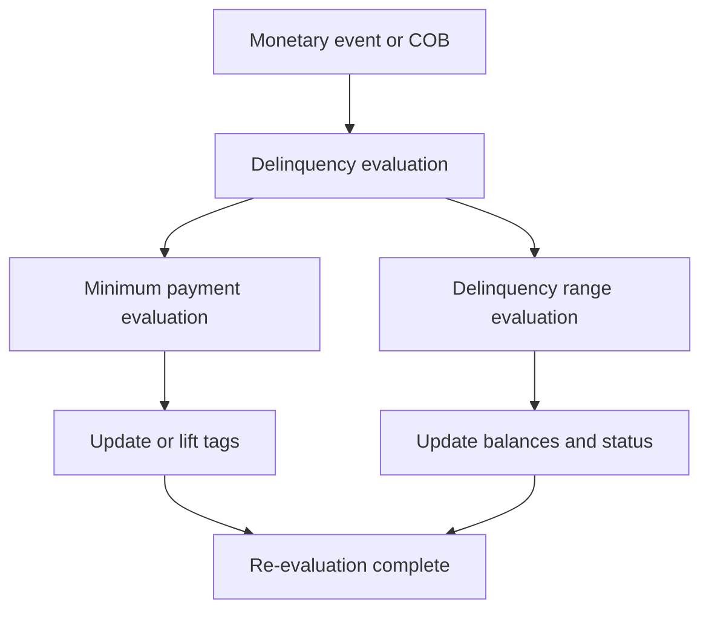

### Delinquency pause

Delinquency pause is supported for Working Capital loans that already have delinquency actions, using the same rules and allowing no overlapping pauses. The pause extends the current minimum payment and breach ranges, which are calculated from delinquency configuration and loan configuration.

The following rules apply to delinquency pauses:

- Creating overlapping delinquency pauses produces an error message saying that pauses overlap.
- A pause is applied as of the current business date at initiation.
- A user can do a backdated pause for Delinquency Evaluation.
- After a backdated pause, the system retriggers and recomputes the Delinquency schedule and evaluation based on the new backdated pause.
- Backdated Pause for Delinquency Evaluation is available from the UI.
- The Delinquency breach action is permitted only during an active Delinquency pause period, between the configured pause start date and end date.
- The Resume Delinquency action is permitted only during an active Delinquency pause period, between the configured pause start date and end date.
- Undo of Resume, backdated resume, and multiple resumes are not allowed.

### Delinquency resume

Delinquency resume ends a Delinquency pause and affects only the Delinquency schedule and calculation; it has no impact on Breach management.

Resume requires the following:

- Only a user with specific permission or all functions permissions can perform the resume action.
- Upon executing the resume action, the pause end date is updated to the resume date and the Delinquency pause is considered terminated as of the resume date.

### Delinquency disable

Delinquency Disable stops delinquency evaluation for an account as of the current date. Backdated disable is not permitted, and the disable can be applied only once until it is reversed. Reversing the disable re-triggers and recomputes delinquency evaluation as of the undo date.

Once delinquency is disabled, the following restrictions apply:

- Delinquency evaluation stops for the account from the disable date onward.
- Delinquency Reschedule is not allowed.
- Delinquency Reset is not allowed.
- Delinquency Pause is not allowed.

Permissions and user interface behaviour:

- Only a user with the permission "disable Delinquency" or with "all functions" can perform Delinquency Disable.
- An authorised user can disable delinquency evaluation from the UI.
- The UI displays that delinquency is disabled and no previous evaluation is shown.
- Once delinquency is disabled, the user cannot perform Delinquency Reschedule, Delinquency Reset, or Delinquency Pause from the UI.

Delinquency Disable can be reversed and applied again as of the current date. If the disable is reversed, the UI shows the recomputed delinquency schedule and evaluation.

### Delinquency reset

Delinquency reset regularizes a Delinquency WCP account once compliance is restored, restarts delinquency monitoring cycles, and stops further penal actions if applicable. Evaluation restarts from the current evaluation period and is effective only from the current system date; backdated resets are not permitted.

The following rules apply to Delinquency reset:

- Only a user with the specific Delinquency reset permission and super user (all functions access) can perform this action.
- Multiple resets are allowed on the Delinquency schedule, but only one reset per period.
- A validation message appears if a user tries to reset a second time on the same Delinquency period.
- All reset history is maintained and shown to support undo or deletion of the latest reset.
- Upon undo or deletion, the Delinquency status reverts to its previous state and Delinquency evaluation is recomputed accordingly.

The Start New Period from Reset Date option is optional during the Delinquency Reset process:

- If it is not selected, Delinquency Reset works normally without changes to period dates.
- If it is selected, new Delinquency periods are created from the Delinquency reset date.

After a reset, prior delinquency records are treated as follows:

- All Delinquency records and evaluations prior to the reset date are nullified and will not be considered for future delinquency tracking or calculations.
- Once delinquency is reset, no prior period matters or is maintained.

> **Note:** The system maintains Delinquency reset records to provide capability to undo or delete a Delinquency reset, subject to appropriate user permissions and controls.

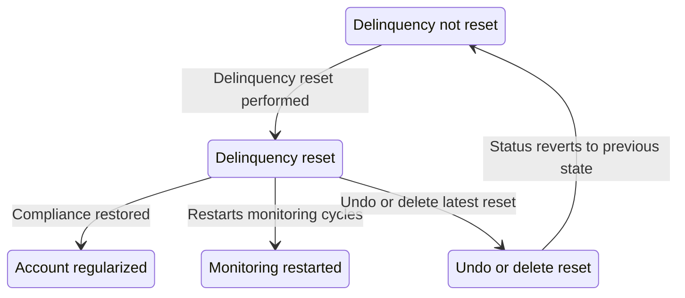

### Delinquency reschedule

You can reschedule an active loan account multiple times, including more than once on the same date. Each reschedule recalculates the delinquency schedule and evaluation according to the resolved inherited parameters.

When a reschedule omits a parameter group, the system applies the following rules:

- An omitted parameter group inherits its value from the latest previous reschedule action that set that group.
- If no earlier reschedule ever set the group, the product or breach configuration supplies the value.
- The same partial reschedule parameter inheritance applies to both the Delinquency reschedule action and the Breach reschedule action.
- The reschedule history remains append-only, and each action stores only the fields it was created with.

Because rescheduling changes periods, evaluation of paid amounts can vary and is reevaluated.

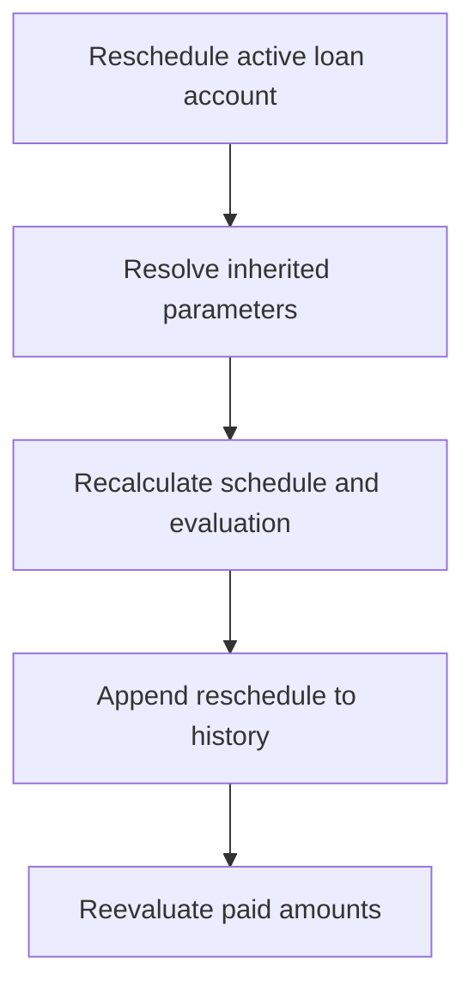

### Minimum payment calculation

The minimum payment for a delinquency period is the aggregate of that range's minimum payment amount plus all previous ranges' amounts. When the remaining principal balance is lower than the computed minimum payment, the expected amount for the period equals the remaining balance. This handling applies to both product-configuration-based amounts and reschedule-based amounts. A period whose expected amount equals the remaining balance is evaluated as minimum payment criteria met once the remaining balance is fully paid.

Breach schedule remaining-balance handling is out of scope for this story.

### Delinquency grace days

Delinquency grace days extend the first delinquency period by the configured number of days. The first period starts on the original submitted or disbursed date, and its end date shifts by the grace days. A customer can repay the first delinquency period before the grace days end.

Deleting a delinquency bucket or breach assigned to a working capital loan product produces an error message.

- Deleting a delinquency bucket assigned to a working capital loan product produces an error message indicating it is assigned to a loan product and already in use.
- Deleting a breach assigned to a working capital loan product produces an error message indicating it is assigned to a loan product and already in use.

> **Note:** Acceptance criteria require delinquency grace days to be honoured.

### Near Breach

Near Breach is an early warning that a condition is close to being violated. It continuously monitors parameters such as merchant sales and repayment trends against configurable near breach thresholds, and flags the account when those thresholds are reached.

The following rules apply to near breach:

- Multiple near breach configurations can be mapped to a loan product, and multiple evaluations can be tagged to the loan product.
- As the breach period approaches its end, the required proportion of payment increases to avoid being flagged as near breach: 33.33% when less than 60 days remain, and 66.66% when less than 30 days remain.
- Near breach is typically 70–90% of the breach limit, while breach is 100% or beyond the defined limit.
- Near breach is a preventive step, whereas breach is a correction step.

### Payment holidays

Payment holidays let you defer repayments without classifying the account as delinquent. In Working Capital products, where fixed installment schedules do not apply, a payment holiday directly affects delinquency and breach schedules and evaluation. It does not affect amortization or income recognition calculations.

The following rules apply to payment holidays:

- The system allows backdated payment holiday entries.
- When you apply a backdated payment holiday, the system recalculates delinquency and breach evaluations for the affected period.
- An account can have multiple payment holiday periods.
- Overlapping payment holiday periods are not permitted and must be validated by the system.

### Credit Balance Refund

The Credit Balance Refund transaction refunds excess funds paid by the borrower when the loan has an overpayment balance. Overpayment is tracked explicitly, and principal outstanding never goes below zero.

### Re-age

Re-age regularizes a delinquent merchant loan account by resetting Days Past Due (DPD) to zero after the borrower meets defined repayment conditions, without restructuring the loan. You can perform re-age only as of the current system date; backdated re-age is not permitted.

Re-age resets evaluations and keeps prior records unchanged.

- Re-age resets both Delinquency and Breach evaluations as of the re-age date, and new evaluations begin from that date based on the current outstanding balance.
- All evaluations and records before the re-age date remain unchanged and are not reprocessed.
- The system permits multiple re-age actions on an account over time, but only one re-age per account per day.

Re-age leaves breach tracking and Near Breach evaluation unchanged unless Hardship Termout is applied.

- Re-age does not affect the existing breach past due amount, which continues to be tracked independently based on the new breach schedule.
- Near Breach evaluation continues to function as per existing configuration without interruption or reset, unless Hardship Termout is applied, after which Near Breach Evaluation stops.

Loans cannot exceed 89 days maximum length in France, and the maximum length defines the length of the last installment which will be shorter than the first two installments.

### Breach reset

When you reset a breach, the breach past due amount returns to $0. Past periods before the reset remain unchanged.

> **Note:** Breach reset is renamed to breach past due amount reset.

### Backdated repayment

Backdated repayment updates the past period rather than creating a new entry for the current period. Any backdated repayment or reversal triggers reprocessing of the delinquency schedule and evaluation.

The following rules apply to backdated repayment:

- No audit record is created while the system updates the past period.
- Repayment on past due periods updates the breach past due amount; otherwise, the system evaluates it at period due date close of business.
- Backdated actions reprocess the delinquency schedule and evaluation, usually with no change in the evaluation before the reset date.
- A new delinquency action changes the minimum payment amount for appropriate minimum payment or breach ranges based on a provided date and updates all consecutive periods with the new value.
- Leaving Grace Days and Grace Days Start date blank on a working capital loan account is allowed when the product does not allow overriding terms and settings at loan account level.
- The global configuration for delinquency re-evaluation covers regular loans as well, with a default value of true causing no disruption in service.

### Worked examples

A working capital loan is disbursed on 01-01-2026 with a principal of 1,000. The product defines a delinquency minimum payment of 250 every 30 days and a breach minimum payment of 500 every 60 days. A delinquency pause and a breach pause both run from 03-20-2026 to 03-29-2026. The figures in this example are illustrative.

| Period | From | To | Expected | Paid | Past due | Bucket |
| --- | --- | --- | --- | --- | --- | --- |
| 1 | 01-01-2026 | 01-30-2026 | 250.00 | 250.00 | 0.00 | - |
| 2 | 01-31-2026 | 03-01-2026 | 250.00 | 100.00 | 150.00 | D30 |
| 3 | 03-02-2026 | 04-10-2026 | 250.00 | 0.00 | - | - |
| 4 | 04-11-2026 | 05-10-2026 | 250.00 | 0.00 | 250.00 | D00 |

On 04-15-2026 the officer resets delinquency and breach evaluation for the same 1,000 loan. Every period before the reset date is nullified and no longer counts for future tracking. New periods start from the reset date and keep the same 250 every 30 days and 500 every 60 days.

| Period | From | To | Expected | Paid | Past due | Bucket |
| --- | --- | --- | --- | --- | --- | --- |
| 1 | 04-15-2026 | 05-14-2026 | 250.00 | 0.00 | 250.00 | D00 |
| 2 | 05-15-2026 | 06-13-2026 | 250.00 | 0.00 | 250.00 | D00 |
| 3 | 06-14-2026 | 07-13-2026 | 250.00 | 0.00 | - | - |

A loan principal of 800 uses a product default of 25 percent every 30 days, so each period expects 200. The first reschedule changes the minimum payment to 33.33 percent, making each period expect 266.64. The second reschedule changes only the frequency to 15 days; the minimum payment percentage is inherited from the first reschedule and stays 33.33 percent. If the remaining balance falls below the computed amount, the expected amount equals the remaining balance.

| Reschedule | Frequency | Minimum payment % | Expected per period | Remaining balance | Expected used |
| --- | --- | --- | --- | --- | --- |
| Product default | 30 days | 25.00 | 200.00 | 800.00 | 200.00 |
| First reschedule | 30 days | 33.33 | 266.64 | 800.00 | 266.64 |
| Second reschedule | 15 days | 33.33 (inherited) | 266.64 | 100.00 | 100.00 |

A delinquency period runs from 01-04-2026 to 02-02-2026 with grace days set to 3. The business date is 02-03-2026, one day after the period end. Grace days only set the cosmetic start date; classification counts raw days past the period end, so the account is delinquent immediately. A separate breach period expects 500, and near breach thresholds are 33.33 percent with fewer than 60 days left and 66.66 percent with fewer than 30 days left.

| Days remaining | Threshold % | Required amount | Paid | Proportion paid | Near breach? |
| --- | --- | --- | --- | --- | --- |
| 45 | 33.33 | 166.65 | 100.00 | 20.00 | Yes |
| 15 | 66.66 | 333.30 | 100.00 | 20.00 | Yes |
| 15 | 66.66 | 333.30 | 400.00 | 80.00 | No |

See also: [Effective Interest Rate Product](confluence-link:Working%20Capital%20Loans%20(EIR)#effective-interest-rate-product).

## Transaction Types

### Transaction types overview

Working Capital Loans (EIR) support several transaction types, each with required fields that depend on the type of transaction.

| Transaction type | Required fields |
| --- | --- |
| Repayment | Transaction amount, transaction date, classification, payment type |
| Disbursement | Disbursement amount, transaction date, classification, payment type |
| Discount fee | Transaction amount (default value), classification, payment type |
| Credit Balance Refund | Transaction amount, transaction date, classification, payment type |
| Charge Adjustment | Behaves like a repayment and decreases the income of the target charge, with the amount allocated as repayment |
| Goodwill Credit | Behaves like a repayment |
| Payout Refund | Works similar to a repayment transaction |

### Repayment transaction

A repayment transaction allocates payment to principal and deferred income amortization in real time. Interest is calculated using the current amortization schedule plus the full repayment amount, and the schedule is updated with the payment. Repayments can result in a closed or overpaid loan status.

You can post repayments on active loans and on closed or charge-off loan accounts.

- You can post a repayment on a closed loan that is fully paid or overpaid.
- Repayment on a closed loan is treated as an overpayment and moves the loan to overpaid status.
- You can post a repayment and close a loan when it is fully paid.
- You can undo a repayment transaction.
- You can view repayments on the transaction tab.

> **Note:** Backdated repayment is out of scope.

### Discount fee transaction

A Discount fee transaction records the discount fee for a working capital loan (EIR). It is created together with the Disbursement transaction when a discount fee is set during disbursement, and it must occur on the same day as the Disbursement. Only one Discount transaction is allowed per Disbursement, and additional Discount fees cannot be added later. The system links the Discount transaction to its Disbursement, sets the Discount balance, allocates the fee to Principal in real time, and reflects the fee as Capitalized in the amortization schedule.

The system creates transactions as follows:

- A Disbursement without a Discount fee amount creates one Disbursement transaction.
- A Disbursement with a Discount fee creates one Disbursement transaction and one Discount fee transaction in one shot.

### Disbursement transaction

A disbursement transaction allocates funds to Principal in real time. Only one disbursement is supported per loan account. The amortization schedule reflects and calculates the disbursement and any undo disbursement based on what was approved, and loan disbursement detail is updated.

Undoing a disbursement reverts the current disbursement transaction.

- Undo disbursement is not allowed if any monetary transaction other than Disbursement or Discount has occurred.

When overriding select terms and settings is disabled, creating a loan account with discount set up results in an error.

- This applies whether or not the discount field value is set.
- After loan creation, discount is inherited from product level (for example, 50).

### Credit Balance Refund

A Credit Balance Refund (CBR) moves money back to the borrower when a loan is overpaid. It works like a repayment in reverse and is processed in real time against the overpayment balance. You can start a CBR only when the loan is overpaid, and the refund amount cannot exceed the overpaid amount.

The loan status after a CBR depends on how the refund amount compares with the overpayment:

- When the CBR amount matches the overpayment, the loan moves from Overpaid to Closed (fully paid).
- When the CBR amount is less than the overpayment, the loan moves from Overpaid to Active and the remaining overpayment becomes the principal balance.
- When the CBR amount is greater than the overpayment, the loan remains in Overpaid status and the overpayment amount becomes the difference between CBR and overpayment balance.
- The system rejects a CBR amount greater than the overpaid amount through validation.

After a CBR, you can still post backdated repayments or reverse old transactions, but you cannot post backdated transactions or reverse repayments that occurred before the CBR. During reprocessing, the system treats a CBR the same way it treats one on a term loan.

Loan statuses are Created, Approved, Disbursed, Active, Closed (fully paid), and Overpaid.

Backdated charge adjustment is not supported because charge adjustments are posted as of the current date.

You can reverse any Charge Adjustment on active or closed loans through a reversal transaction only, and the loan status changes according to the new loan balance created by the reversal transaction.

If you reverse a payment on a closed loan account, the loan becomes active again.

You can post charge-adjustment transactions on closed loan accounts, and these transactions are treated as overpayment, moving the loan to overpaid status.

### Undo and reversal of transactions

You can undo any monetary transaction so that it appears as if it never happened, while keeping its details for auditing and compliance. The system recalculates schedules and balances when you reverse a transaction. Reversal applies only to transactions that have not already been reversed.

When you reverse a transaction, the system performs the following actions:

- The transaction is marked with a reversal flag and set to reversed=true.
- A reversal external ID is accepted or auto-generated and set on the transaction, along with the reversal date.
- Mirror accounting entries and reversal journal entries undo the transaction from an accounting point of view.
- Paid and outstanding balances are updated.
- The amortization schedule is updated, with recalculation possible from the original transaction date only.
- The delinquency schedule and breach schedule are updated.
- You can add a note to the reversal.

Reversal can also affect how payments are allocated:

- Transaction allocation might change because of a reversal or a backdated transaction, and allocation may need to be reprocessed and updated.
- Allocation follows the configured payment allocation by transaction type.
- The transaction itself is not reversed and replayed; only its allocation changes.
- Disbursement cannot be undone through this API; a dedicated undo disbursal API handles disbursement reversals.
- If Advance accounting rule is enabled and Configure Fund Sources for Payment Channels is mapped, then Advance accounting rule takes priority than the regular Fund Source mapping.

### Backdated transactions and reversals

You can post backdated repayments or reverse repayments on active, closed, or charge-off loan accounts. The system does not allow backdated repayments or reversals on written-off loan accounts.

The loan status changes according to the new balance created by the backdated repayment or reversal:

- If the balance becomes zero, the loan moves to closed status.
- If the balance becomes negative, the loan moves to overpaid status.
- If a repayment reversal is done on a closed loan account, the loan becomes active again.

Delinquency and Breach Evaluation are recalculated when a backdated repayment or reversal happens.

Transaction allocation changes only occur when charges exist on the loan and a backdated transaction occurs:

- If all charges are fully paid before the backdated transaction, the backdated transaction pays no charges and no allocation changes occur.
- If an undo transaction reverts a transaction that paid portions of any charges, existing transactions after the reverted transaction might need reevaluation and allocation changes.
- Otherwise, allocation is always principal and no existing transaction allocation changes.

### Charge Adjustment

Charge Adjustment adjusts an existing charge on a loan and pays the adjustment directly to principal. It is linked to the original charge through a transaction relationship.

Charge Adjustment follows these rules:

- The adjustment amount cannot exceed the original charge amount.
- The adjustment cannot be dated earlier than when the original charge was added to the loan.
- A charge adjustment can be reverted at any time with no validation on reversal.

### Goodwill Credit

Goodwill Credit allocates based on the configured rules. You can post backdated Goodwill Credit or reverse any Goodwill Credit on active or closed loans, including posting Goodwill Credit directly on closed loans.

The loan status changes according to the new loan balance created by backdated Goodwill Credit or reversal:

- If the balance becomes zero, the loan moves to closed status.
- If the balance becomes overpaid, the loan moves to overpaid status.
- Goodwill Credit on a closed loan is treated as overpayment and moves the loan to overpaid status.
- Reversing Goodwill Credit on a closed loan makes the loan active again.

> **Note:** Backdated Goodwill Credit or reversals are not allowed on written-off loan accounts.

### Discount fee adjustment

A discount fee adjustment reduces the discount fee on a working capital loan (EIR). You can create multiple adjustments, and each one requires a classification and a payment type. The adjustment amount cannot exceed the discount fee, and the total value of all adjustments is validated against the discount fee.

The system allocates and records the adjustment as follows:

- Real-time allocation covers a principal decrease.
- The amortization schedule reflects and calculates the adjustment as uncapitalized from the discount fee transaction date.
- A positive difference creates a discount fee amortization transaction.
- A negative difference creates a discount fee amortization adjustment transaction.
- The COB date is used as the transaction date.
- Business event handling and backdated transaction handling are out of scope.

> **Note:** Discount fee amortization adjustments are created as of the current date, not as of the backdated transaction date.

### Discount fee amortization

Discount fee amortization releases deferred income as payments are made, using the current date total payments to calculate the amount. It works similarly to buydown fees on term loans, and no amortization occurs when there is no payment or no discount fee on the loan.

The following rules govern discount fee amortization:

- The amortization schedule calculates and maintains the net amortization balance in real time.
- The system uses the close of business date as the transaction date for discount fee amortization.
- All unreleased deferred income balance moves to expenses, leaving no unrealized discount fee balance.
- If a charge-off is reversed, the final amortization transaction and its accounting entries are undone, and discount fee amortization is recalculated as of the current date.
- No further discount amortization occurs after charge-off.

When a charge-off happens on an active loan account, the system creates a final discount fee amortization transaction as of the charge-off date for the unreleased deferred income balance.

> **Note:** Undoing a transaction reverses the balances as well.

Payment allocation for discount fee amortization behaves like a repayment, applying the configured priority rules for the specific transaction or the default, whether the amount is paid in full, partially, or in excess.

### Write-off

Write-off zeros all outstanding balances and closes the loan with status written-off. A write-off can be undone, but backdated transactions or undoing any transactions on a written-off loan are not supported. Incoming parameters follow the current behaviour from progressive loans.

### Payout Refund

A Payout Refund applies to active, closed or overpaid Working Capital Product (WCP) loans and reduces the outstanding principal and fees balance according to the allocation rule. If the refund exceeds the outstanding principal balance, the excess is recorded as overpayment and the loan status changes to Overpaid.

### Transactions on charge-off loans

Repayment on a charge-off loan behaves as normal repayment on an active loan, except for accounting handling. Backdated monetary transactions are not supported on charged-off loans, and reversing a transaction that occurred before charge-off is not supported.

### Transaction data fields

Every transaction records a fixed set of data fields that identify the transaction, its timing, value and accounting components.

| Field | Description |
| --- | --- |
| Transaction ID | System-generated identifier for the transaction. |
| External ID | Identifier used for integrations. |
| Transaction Type | The type of transaction being recorded. |
| Transaction Date | The business date of the transaction. |
| Created Date / System Date | The date and time the transaction was created. |
| Amount | The transaction amount. |
| Currency | The currency of the transaction. |
| Principal Component | The principal portion of the transaction. |
| Fee Component | The fee portion of the transaction. |

Transaction level GL entries are documented in the Accounting section.

### Accounting entries

Standard accounting entries are described in the Accounting section.

Breach Management identifies, tracks, and resolves violations of predefined loan conditions to detect risk signals such as repayment delays and revenue declines early, minimize credit losses, maintain portfolio health, and ensure compliance with internal risk policies.

The system adds an origination fees transaction type alongside the disbursement transaction. Origination fees count as part of the principal, so schedule calculation uses the disbursement amount plus origination fees, and interest calculation uses the same combined amount without changes to allocation during monetary transactions. Disbursement validation requires that the disbursement amount plus origination fees not exceed the approved amount.

### Payout Refund accounting entries

A payout refund posts accounting entries based on the refund type, whether the transaction is cash in or cash out, and whether the loan account is active or charge-off. Every entry debits or credits GL 145023 Fund source on one side.

| Loan status | Transaction direction | Refund type | Debit GL | Credit GL |
| --- | --- | --- | --- | --- |
| Active | Cash in | Penalty | 145023 Fund source | 112603 Penalties Receivable |
| Active | Cash in | Fees | 145023 Fund source | 112603 Fees Receivable |
| Active | Cash in | Principal | 145023 Fund source | 112601 Loan portfolio |
| Active | Cash in | Unallocated Credit (UNC) | 145023 Fund source | 245000 Over payment liability |
| Charge-off | Cash in | Penalty | 145023 Fund source | 404008 Income from ChargeOff Penalty |
| Charge-off | Cash in | Fees | 145023 Fund source | 404008 Income from ChargeOff Fees |
| Charge-off | Cash in | Principal | 145023 Fund source | 744007/740037 ChargeOff Expense/Charge Off Fraud Expense |
| Charge-off | Cash in | Unallocated Credit (UNC) | 145023 Fund source | 245000 Over payment liability |
| Active | Cash out | Penalty | 112603 Penalties Receivable | 145023 Fund source |
| Active | Cash out | Fees | 112603 Fees Receivable | 145023 Fund source |
| Active | Cash out | Principal | 112601 Loan portfolio | 145023 Fund source |
| Active | Cash out | Unallocated Credit (UNC) | 245000 Over payment liability | 145023 Fund source |
| Charge-off | Cash out | Penalty | 404008 Income from ChargeOff Penalty | 145023 Fund source |
| Charge-off | Cash out | Fees | 404008 Income from ChargeOff Fees | 145023 Fund source |
| Charge-off | Cash out | Principal | 744007/740037 ChargeOff Expense/Charge Off Fraud Expense | 145023 Fund source |
| Charge-off | Cash out | Unallocated Credit (UNC) | 245000 Over payment liability | 145023 Fund source |

### General transaction accounting entries

Each transaction type posts accounting entries to general ledger accounts. The entries depend on the transaction type and its reversal.

| Transaction type | Debits | Credits |
| --- | --- | --- |
| Discount fees | GL 112601 Loans Receivable Principal | GL 240005 Deferred Interest |
| Discount fees Adjustment | GL 240005 Deferred Interest | GL 112601 Loans Receivable Principal |
| Disbursement | GL 112601 Loans Receivable Principal | GL 145023 Suspence/clearing account |
| Disbursement Reversal | GL 145023 Suspence/clearing account | GL 112601 Loans Receivable Principal |
| Repayment | GL 145023 Suspence/clearing account | GL 112601 Loans Receivable Principal, GL 245000 Other Credit liability, GL 112603 Fee Receivable Fees Receivable, GL 112603 Fee Receivable Penalty Receivable |
| Repayment Reversal | GL 112601 Loans Receivable Principal, GL 245000 Other Credit liability, GL 112603 Fee Receivable Fees Receivable, GL 112603 Fee Receivable Penalty Receivable | GL 145023 Suspence/clearing account |
| Amortization | GL 240005 Deferred Interest | GL 404000 Interest income |
| Write-off | GL 744008 recoveries | GL 112603 Fee Receivable Fees Receivable, GL 112603 Fee Receivable Penalty Receivable, GL 112601 Loans Receivable Principal |
| Write-off Reversal | GL 112601 Loans Receivable Principal, GL 112603 Fee Receivable Fees Receivable, GL 112603 Fee Receivable Penalty Receivable | GL 744008 recoveries |
| Credit Balance Refund | GL 245000 Other Credit liability | GL 145023 Suspence/clearing account |
| Credit Balance Refund Reversal | GL 145023 Suspence/clearing account | GL 245000 Other Credit liability |
| Goodwill Credit | GL 744003 Principal bal adjustment, GL 404008 Fee Charge off Income from Goodwill Credit Fees, GL 404008 Fee Charge off Income from Goodwill Credit Penalty | GL 112601 Loans Receivable Principal, GL 112603 Fee Receivable Fees Receivable, GL 112603 Fee Receivable Penalty Receivable, GL 245000 Other Credit liability |
| Goodwill Credit Reversal | GL 112601 Loans Receivable Principal, GL 112603 Fee Receivable Fees Receivable, GL 112603 Fee Receivable Penalty Receivable | GL 744003 Principal bal adjustment, GL 404008 Fee Charge off Income from Goodwill Credit Fees, GL 404008 Fee Charge off Income from Goodwill Credit Penalty, GL 245000 Other Credit liability |
| Charge addition | GL 112603 Fee Receivable | GL 404007 Fee Income |
| Charge waive | GL 404007 Fee Income | GL 112603 Fee Receivable |
| Charge-off | GL 744007/744037 Credit loss-bad dept/credit loss-bad dept- fraud, GL 404008 Fee Charge off Income from ChargeOff Fees, GL 404008 Fee Charge off Income from ChargeOff Penalties | GL 112601 Loans Receivable Principal, GL 112603 Fee Receivable Fees Receivable, GL 112603 Fee Receivable Penalty Receivable |
| Charge-off Reversal | GL 112603 Fee Receivable Fees Receivable, GL 112603 Fee Receivable Penalty Receivable | GL 112601 Loans Receivable Principal, GL 404008 Fee Charge off Income from ChargeOff Fees, GL 404008 Fee Charge off Income from ChargeOff Penalties |

### Charge-off loan transaction accounting entries

Charge-off loan transactions post to specific general ledger accounts depending on the transaction type. A principal adjustment balance supports CBR edge cases where the credit balance refund exceeds the amount owed based on current state.

| Transaction | Debits | Credits |
| --- | --- | --- |
| Repayment | GL 145023 Suspence/clearing account | GL 744008 recoveries Income from Recovery Repayment, GL 245000 Other Credit liability Overpayment Liability |
| Repayment Reversal | GL 744008 recoveries Income from Recovery Repayment, GL 245000 Other Credit liability Overpayment Liability | GL 145023 Suspence/clearing account |
| Amortization | GL 240005 Deferred Interest | GL 404000 Interest income |
| Credit Balance Refund (CBR) | GL 245000 Other Credit liability | GL 145023 Suspence/clearing account |
| CBR Reversal | GL 145023 Suspence/clearing account | GL 245000 Other Credit liability |
| Goodwill Credit | GL 744003 Principal bal adjustment, GL 404008 Fee Charge off Income from Goodwill Credit Fees, GL 404008 Fee Charge off Income from Goodwill Credit Penalty | GL 744008 recoveries Income from Recovery Repayment, GL 245000 Other Credit liability |
| Goodwill Credit Reversal | GL 744008 recoveries Income from Recovery Repayment, GL 245000 Other Credit liability | GL 404008 Fee Charge off Income from Goodwill Credit Fees, GL 404008 Fee Charge off Income from Goodwill Credit Penalty |

### Accrual transactions

An accrual transaction records charge income for a Working Capital Loan product, since this product does not earn interest income. The system posts it as of either the due date or the submitted date, depending on the global charge-accrual-date configuration.

Accrual timing depends on the submitted_date configuration:

- When the configuration is submitted_date, the accrual transaction is created in real time when the charge is added.

Other configuration options:

- A user can configure an allocation rule specific to Payout Refund.

### Transaction table and UI fields

The Transaction table shows each transaction on a working capital loan account, and the General Tab displays loan summary fields similar to regular loan accounts.

| Field | Meaning |
| --- | --- |
| Serial number | Position of the transaction in the table |
| Id | Transaction identifier |
| External Id | External reference for the transaction |
| Transaction Date | Date the transaction occurred |
| Transaction Type | Type of transaction |
| Amount | Transaction amount |
| Principal | Principal portion of the transaction |
| Amortized Income | Amortized income portion |
| Fees | Fee portion of the transaction |
| Penalty | Penalty portion of the transaction |
| Principal balance | Total principal balance |
| Principal outstanding | Principal still outstanding |
| Total paid principal | Total principal paid |
| Total payment | Total payment amount |
| Unrealized income (Discount fee) | Unrealized discount fee income |
| Realized income (Discount fee) | Realized discount fee income |

Undo a disbursement to reverse its effects.

1. The system reverts accounting entries.
2. The system reverts balances.
3. The system moves the loan from Active back to Approved.
4. The system triggers external business events.
5. The system records the LoanTransaction as reversed.

### EOD and COB processing

At end of day, the system calculates amortization as part of close of business processing. It posts the difference as a discount fee amortization transaction, or as a discount fee amortization adjustment transaction when the difference is negative.

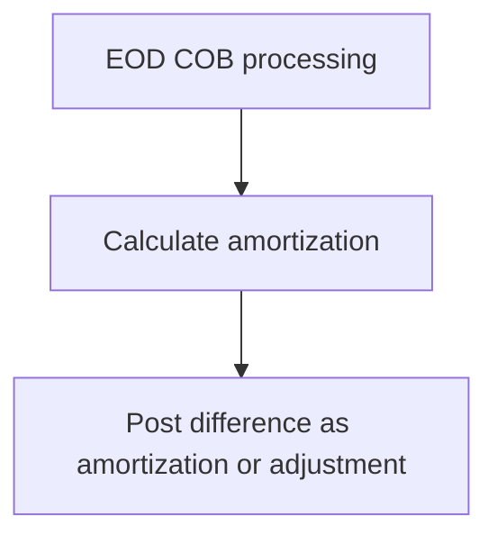

### Schedule and balance updates

When a transaction posts, the system updates the amortization schedule, the loan balance, the delinquency schedule, and the breach schedule.

Each schedule updates as follows:

- The amortization schedule payment related to the transaction is undone, the schedule is updated, and the updated schedule is saved.
- The loan balance is updated.
- The delinquency schedule is updated, and the unpaid amount subtracts from the last paid period; if the amount exceeds the last period paid amount, the previous period becomes unpaid recursively.
- The breach schedule is updated, and the breach flag is set to null if the related period ends before the business day.

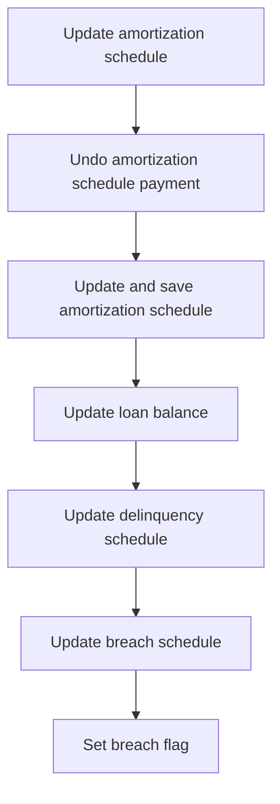

### Backdated discount adjustment

You can post a discount adjustment backdated on a working capital loan. When you do, the system recalculates the amortization schedule and posts the relevant amortization adjustment or amortization transaction for the difference amount. You can also undo the discount adjustment transaction; doing so reverses the amortization adjustment or amortization transaction posted with it, recalculates the amortization schedule, and posts the relevant amortization adjustment or amortization transaction for the difference amount.

Amortization or amortization adjustment transactions are calculated and created at end of day by a business step.

You can also post and undo payout refunds and post repayments on charged-off accounts.

- You can post the payout refund transaction backdated, similar to repayment.
- You can undo the payout refund transaction.
- You can post repayment on charged-off loan accounts.

### Discount fee API endpoints

You create discount fee transactions through the working capital loan API using the discount fee command, either on a loan identified by its internal ID or by its external ID. The three discount fields are available in the GET loan API.

| Endpoint | Loan identifier |
| --- | --- |
| POST /v1/working-capital-loans/{loan id}?command=discount fee | Internal loan ID |
| POST /v1/working-capital-loans/{loan external id}/transactions?command=discount fee | External loan ID |

The API supports adding a new Period Payment Rate modification operation and fetching existing ones.

The calculated amount is based on current date total payments versus total amortization amount from the amortization schedule, which calculates and maintains the net amortization balance in real time.

When WCP loans is selected, the following charge parameters are available:

- Charge name (text)
- Currency (dropdown, regular currency dropdown)
- Charge time type (dropdown, Disbursement / Specified due date charges)
- Charge calculation type (dropdown, Flat, % amount; Flat only when charge time type is Specified due date; %amount and Flat when charge time type is Disbursement)
- Charge payment mode (dropdown, Regular)
- Amount (numeric)
- Tax Group (dropdown, tax component created)
- Active (boolean)
- Is penalty (boolean)

### Goodwill Credit API and UI

Goodwill Credit uses the same API and parameters as term loans. You can perform a Goodwill Credit transaction on active and closed or charge-off loan accounts, view it on the transaction tab, and undo it. The amount field label changes from discount amount to transaction amount.

You can do a charge adjustment transaction on active loan accounts.

You can trigger Write-off from the UI with the same capability and parameters as progressive loans.

### Payout Refund UI

You can record a Payout Refund on an active or closed loan account by entering the transaction amount and transaction date. You can also undo a processed payout transaction from the UI. When accounting is enabled, you can view the respective journal entry records for the payout transaction.

### Delinquency and Breach recalculation

The system recalculates Delinquency and Breach Evaluation when a backdated Goodwill Credit or reversal occurs, and when any reversal occurs. Backdated actions after a Credit Balance Refund trigger reprocessing and recalculation, and any difference in amortization is adjusted at the end-of-day jobs at close of business.

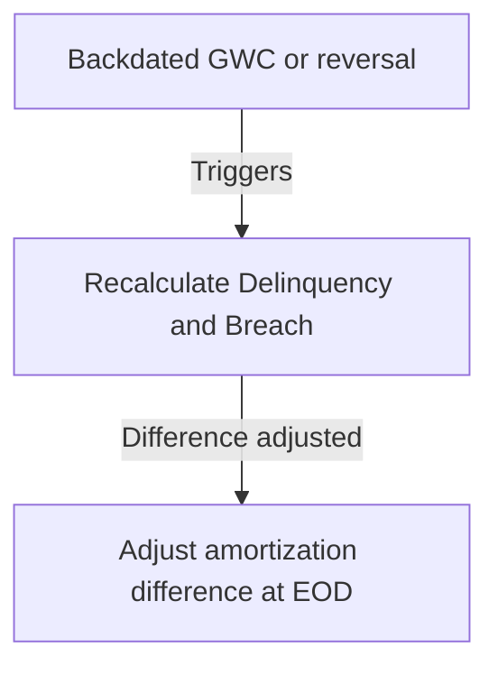

### Worked examples

A loan officer posts a repayment on an active loan. The figures are illustrative. The loan has a principal balance of 1,000 and an unpaid NSF fee of 10. The officer enters a repayment of 50. The system allocates 10 to the fee and 40 to principal. The officer then reverts that repayment. A second repayment of 40 that was already posted is reprocessed, so the system allocates 10 to the fee and 30 to principal.

| Step | Transaction | Amount | Fee portion | Principal portion | Principal balance |
| --- | --- | --- | --- | --- | --- |
| Start | — | — | — | — | 1,000.00 |
| First repayment posted | Repayment | 50.00 | 10.00 | 40.00 | 960.00 |
| Second repayment posted | Repayment | 40.00 | 0.00 | 40.00 | 920.00 |
| First repayment reverted | Reversal | 50.00 | 10.00 | 40.00 | 960.00 |
| Second repayment reprocessed | Repayment | 40.00 | 10.00 | 30.00 | 930.00 |

This shows that reverting a repayment releases its fee allocation, so a later repayment is reprocessed to cover the fee first.

A loan is overpaid by 80. An officer issues a Credit Balance Refund. When the refund is 80, the overpayment is fully cleared and the loan moves to closed. When the refund is only 30, the loan stays overpaid and the remaining overpayment is 50. The refund amount is the one setting that changes between the two outcomes.

| Overpayment | Refund amount | Resulting balance | Loan status |
| --- | --- | --- | --- |
| 80.00 | 80.00 | 0.00 | Closed |
| 80.00 | 30.00 | 50.00 | Overpaid |

A refund smaller than the overpayment leaves the loan overpaid by the difference.

A loan is overpaid by 120 and a Credit Balance Refund of 120 brings the balance to zero, so the loan moves to closed. The officer then reverses a past repayment of 70. Because the reversal is posted on a closed loan, the loan becomes active again and the outstanding balance is 50.

| Event | Amount | Balance after | Loan status |
| --- | --- | --- | --- |
| Overpayment | 120.00 | -120.00 | Overpaid |
| Credit Balance Refund | 120.00 | 0.00 | Closed |
| Repayment reversal | 70.00 | 50.00 | Active |

Reversing a repayment after a refund can reopen a closed loan and leave a new outstanding balance.

A loan is overpaid by 80. An officer tries to issue a Credit Balance Refund of 100. The system rejects the request because a refund cannot exceed the overpayment amount.

| Overpayment | Refund requested | Allowed | Result |
| --- | --- | --- | --- |
| 80.00 | 100.00 | No | Rejected by validation |

The system blocks any Credit Balance Refund larger than the overpayment.

See also: [Effective Interest Rate Product](confluence-link:Working%20Capital%20Loans%20(EIR)#effective-interest-rate-product).

## Accounting

### Accounting options and defaults

Working Capital loan products have two accounting options: None (default) and Cash based. You select the accounting type on the loan product configuration at create and modify screens, where the options appear as No Accounting and Cash Based.

The accounting options behave as follows:

- When None accounting is selected, no accounting configuration is needed and no journal entries are created during the loan lifecycle.
- When No Accounting is selected, the loan product is created or updated without accounting mapping.
- When Cash Based is selected, GL mappings are available for you to configure, similar to regular term loans.
- Cash based accounting recognizes interest only in case of a monetary event like repayment and calculates income based on the transaction amount.

Advanced accounting is out of scope for Working Capital loan product accounting configuration.

GL account mapping can be configured for Working Capital loan products when Cash based accounting is selected.

### Accounting rule parameter

The accounting rule parameter is mandatory when you create a Working Capital product. It must be set to either NONE or CASH_BASED, and NONE is the default so the product can be created without an accounting error.

### GL mapping configuration

You can configure GL accounting mapping when you create a Working Capital loan product and on its modify screen. Each parameter must be mapped to a GL before you submit. You can also update or delete an existing GL accounting mapping on the product. Journal entries created for Working Capital loans are stored in the regular acc_gl_journal_entry table.

### Advance accounting rules

Advance accounting rules apply to Working Capital loans when the rule is enabled and fund sources are mapped for payment channels. In that case, the Advance accounting rule takes priority over the regular fund source mapping.

Advance accounting rules mapping works for Working Capital loans in the same way as for term loan products, with two exceptions:

- Capitalized income mapping is not available.
- Buydown fees mapping is not available.

Loan product configuration includes new account mapping parameters for charge-off specific mappings.

- Charge-off specific mappings are supported through new account mapping parameters.

### Accounting terminology rename

The system uses the accounting term Accrual accounting with deferred revenue amortization throughout the backend, frontend, and documentation. You can view the journal entry created for any transaction, similar to the progressive loan feature.

### Goodwill credit entries

A goodwill credit posts debit and credit entries to the general ledger for principal, fees, penalties and excess amounts.

| Entry type | GL code | GL account | Category | Type | Sub-type |
| --- | --- | --- | --- | --- | --- |
| Debit | 744003 | Principal bal adjustment | Expense from Goodwill Credit | Expense | Prin,excess |
| Debit | 404008 | Fee Charge off | Income from Goodwill Credit Fees | Income | fees |
| Debit | 404008 | Fee Charge off | Income from Goodwill Credit Penalty | Income | Penalty |
| Credit | 112601 | Loans Receivable Principal | Loan Portfolio | Asset | prin |
| Credit | 112603 | Fee Receivable | Fees Receivable | Asset | fees |
| Credit | 112603 | Fee Receivable | Penalty Receivable | Asset | Penalty |
| Credit | 245000 | Other Credit liability | Overpayment Liability | Liability | excess |

### Goodwill credit reversal entries

Goodwill credit reversal entries apply to goodwill credit transactions on closed loan accounts. The system posts debit entries to principal, fee, penalty, and overpayment liability accounts, and credit entries to income and expense accounts.

| Entry type | GL code | Account name | Account type | Category |
| --- | --- | --- | --- | --- |
| Debit | 112601 | Loans Receivable Principal | Asset | Principal |
| Debit | 112603 | Fee Receivable | Asset | Fees |
| Debit | 112603 | Penalty Receivable | Asset | Penalty |
| Debit | 245000 | Other Credit liability | Liability | Overpayment |
| Credit | 404008 | Fee Charge off | Income | Goodwill Credit Fees |
| Credit | 404008 | Fee Charge off | Income | Goodwill Credit Penalty |
| Credit | 744003 | Principal bal adjustment | Expense | Goodwill Credit Principal/excess |

| Entry type | GL code | Account name | Account type | Category |
| --- | --- | --- | --- | --- |
| Debit | 744003 | Principal bal adjustment | Expense | Goodwill Credit Principal/excess |
| Credit | 245000 | Other Credit liability | Liability | Overpayment |

### CBR transaction entries

| Transaction | Dr GLCode | Cr GLCode |
| --- | --- | --- |
| CBR Transaction | 245000 Other Credit liability (Overpayment Liability, Liability, excess) | 145023 Suspence/clearing account (Fund source, Asset/Liability, excess) |
| UNDO CBR Transaction | 145023 Suspence/clearing account (Fund source, Asset/Liability, excess) | 245000 Other Credit liability (Overpayment Liability, Liability, excess) |

### Charge adjustment entries

| Debit GL code | Credit GL code | Account type | Category | Component |
| --- | --- | --- | --- | --- |
| 404007 Fee Income / Penalty Income | 112601 Loans Receivable Principal | Asset | Loan Portfolio | Principal |
| 404007 Fee Income / Penalty Income | 112603 Fee Receivable | Asset | Fees Receivable | Fees |
| 404007 Fee Income / Penalty Income | 112603 Fee Receivable | Asset | Penalty Receivable | Penalty |
| 404007 Fee Income / Penalty Income | 245000 Other Credit liability | Liability | Overpayment Liability | Excess |

### Charge adjustment on charge-off loan entries

| Entry | GL code | GL name | Type | Category |
| --- | --- | --- | --- | --- |
| Debit | 404007 | Fee Income | Income | prin, fees, and excess |
| Credit | 404008 | Fee Charge off | Asset | prin |
| Credit | 404008 | Fee Charge off | Asset | fees |
| Credit | 245000 | Other Credit liability | Liability | excess |

### Charge-off transaction entries

A charge-off transaction posts debit entries to charge-off expense and fee or penalty income accounts, and credit entries to principal, fee receivable, and penalty receivable accounts.

| Entry type | GL code | Account name | Account type | Category |
| --- | --- | --- | --- | --- |
| Debit | 744007/744037 | Credit loss-bad dept / Credit loss-bad dept- fraud | Expense | Charge off expense / charge-off fraud expense |
| Debit | 404008 | Fee Charge off | Income | Income from ChargeOff Fees |
| Debit | 404008 | Fee Charge off | Income | Income from ChargeOff Penalties |
| Credit | 112601 | Loans Receivable Principal | Asset | Principal |
| Credit | 112603 | Fee Receivable | Asset | Fees |
| Credit | 112603 | Fee Receivable | Asset | Penalty |

### Undo charge-off transaction entries

Undoing a charge-off reverses the charge-off accounting entries by debiting fee receivable, penalty receivable and loan principal, and crediting fee charge-off income and charge-off expense.

| Entry type | GL code | Account | Category | Type |
| --- | --- | --- | --- | --- |
| Debit | 112603 | Fee Receivable | Asset | Fees |
| Debit | 112603 | Penalty Receivable | Asset | Penalty |
| Debit | 112601 | Loans Receivable Principal | Asset | Principal |
| Credit | 404008 | Fee Charge off | Income | Fees |
| Credit | 404008 | Fee Charge off | Income | Penalty |
| Credit | 744007/744037 | Credit loss-bad dept/credit loss-bad dept- fraud | Expense | Charge-off expense/charge-off fraud expense |

The system maps either charge-off expense or charge-off fraud expense based on the fraud flag status.

### Charge-off GL mapping validation

Charge-off GL mapping validation checks that new parameters are mapped to GL accounts before the charge-off feature can be used on a loan account. Accounting entries remain the same for cash based and accrual based accounting types.

The following rules apply to GL mapping for charge-off:

- All new parameters are non mandatory for users to map to GL.
- Validation at loan account checks GL mapping of new parameters to use the charge-off feature.

### Cash-based product creation validations

Cash-based accounting validation applies when you create or edit a working capital loan product. The system checks mandatory fields before saving the product.

The following rules apply to product creation:

- Creating or editing a working capital product fails when Cash Based accounting is selected and the receivable fee account is not set.
- Product creation succeeds when all mandatory fields are set.
- Breach grace days left empty are treated as not set or zero, and product creation succeeds.
- If breach grace days are genuinely required, the API returns HTTP 400 naming that field and the UI marks the field as required instead of returning HTTP 500.

### Payout refund cash-in entries on active loans

A payout refund cash-in on an active loan account debits GL 145023 Fund source and credits the receivable or liability GL that matches the refund type.

| Refund type | Debit GL | Credit GL |
| --- | --- | --- |
| Penalty | 145023 Fund source | 112603 Penalties Receivable |
| Fees | 145023 Fund source | 112603 Fees Receivable |
| Principal | 145023 Fund source | 112601 Loan portfolio |
| Unallocated Credit (UNC) | 145023 Fund source | 245000 Over payment liability |

### Payout refund cash-in entries on charge-off loans

| Payout refund type | Debit GL | Credit GL |
| --- | --- | --- |
| Penalty | 145023 Fund source | 404008 Income from ChargeOff Penalty |
| Fees | 145023 Fund source | 404008 Income from ChargeOff Fees |
| Principal | 145023 Fund source | 744007/740037 ChargeOff Expense/Charge Off Fraud Expense |
| Unallocated Credit (UNC) | 145023 Fund source | 245000 Over payment liability |

### Payout refund cash-out entries on active loans

Payout refund cash-out entries on an active working capital loan account move the refunded amount from the relevant receivable, liability or loan portfolio GL to the fund source GL 145023.

| Refund type | Debit GL | Credit GL |
| --- | --- | --- |
| Penalty | 112603 Penalties Receivable | 145023 Fund source |
| Fees | 112603 Fees Receivable | 145023 Fund source |
| Principal | 112601 Loan portfolio | 145023 Fund source |
| Unallocated Credit (UNC) | 245000 Over payment liability | 145023 Fund source |

### Payout refund cash-out entries on charge-off loans

| Transaction | Debit GL | Credit GL |
| --- | --- | --- |
| Payout Refund Penalty Cash Out | 404008 Income from ChargeOff Penalty | 145023 Fund source |
| Payout Refund Fees Cash Out | 404008 Income from ChargeOff Fees | 145023 Fund source |
| Payout Refund Principal Cash Out | 744007/740037 ChargeOff Expense/Charge Off Fraud Expense | 145023 Fund source |
| Payout Refund Unallocated Credit Cash Out | 245000 Over payment liability | 145023 Fund source |

The Discount Fee Amortization transaction credits GL 240005 Deferred Interest and debits GL 404000 Interest income.

See also: [Effective Interest Rate Product](confluence-link:Working%20Capital%20Loans%20(EIR)#effective-interest-rate-product), [Transaction Types](confluence-link:Working%20Capital%20Loans%20(EIR)#transaction-types).

## Breach Management

### Breach management overview

Breach management applies only to working capital loan products and calculates breach and near breach for those accounts. You configure it at the product level, similar to delinquency management.

### Breach configuration parameters

Breach configuration parameters define how the system identifies a breach for a Working Capital Loan product. You set a breach period and rule, choose how the breach amount is calculated, and enter the breach amount. Breach grace days are also configured on the product.

| Parameter | Description |
| --- | --- |
| Breach period and rule | Defines the range interval for evaluating a breach. |
| Name | Unique name of the breach configuration. |
| Frequency | Numeric value representing the range interval. |
| Frequency Type | Time unit of the range interval, such as days, weeks, or months. |
| Breach amount type | Calculation method: Percentage of loan amount or Flat amount. |
| Breach amount | Amount used to determine whether a breach has occurred. |
| Breach grace days | Grace days added to the Working Capital Loan product. |

The Enable Near Breach checkbox is disabled by default. When you enable it, the Near Breach Threshold percentage field becomes available for configuration. Near Breach Evaluation Frequency consists of a numeric frequency value representing the range interval.

### Breach schedule structure

The system creates a Breach schedule from the parameters you specify at the Breach configuration step, starting from the Disbursement date and using the Repaid every interval to set each installment's start date. Each installment row covers one period and shows its date range, length, minimum payment amount, outstanding amount, near breach flag, and breach flag.

| Column | Description |
| --- | --- |
| From Date | Created from the input parameters and starts from the Disbursement date |
| To Date | Period End date of that Installment |
| No of Days | Total number of days in a period |
| Min Payment Amount | Calculated based on the input parameters |
| Outstanding | Outstanding amount of that period |
| Near breach | True or false |
| Breach | True or false |

### Breach evaluation and status

The system evaluates a breach at the end of every period as of the current date and stores the breach status at each period level. A breach occurs when the total payment received in that period is less than the minimum payment amount; otherwise it is not a breach.

Breach status follows these rules:

- Paying an excess amount in one period does not change the breach status of another period.
- The system maintains only the breach status and does not store breach days or breach amount.

### Grace days and period start dates

Breach grace days must be specified when creating a working capital loan product; leaving them empty causes an HTTP 500 Internal Server Error. If breach is allowed, the start date of the first period shifts by the number of grace days. If near-breach is allowed, the initial start date shifts in the same way.

### Near breach configuration and evaluation

Near breach configuration is available at the product level for Working Capital loan products. The system evaluates whether a Working Capital loan is near-breach based on the near-breach configuration, and evaluation occurs only if breach is enabled. Near Breach status is stored at each period level.

The system considers a period as Near Breach when any of the following conditions is met:

- The percentage of outstanding amount in the period is greater than the Near Breach Threshold percentage.
- The percentage of paid amount in the period is lower than the Near Breach Threshold percentage.
- The total outstanding percentage is greater than the Near breach threshold configuration.

Near breach evaluation follows these rules:

- Near breach evaluation occurs only one time.
- Near breach frequency and frequency type must be lower than breach frequency and frequency type.
- Near Breach evaluation is done at the end of every near-breach period frequency as per the configuration.
- Near Breach changes are applicable only for periods after the current date on field change.
- Near Breach status of one period does not change if the customer pays excess amount in another period.

### Breach pause

Breach Pause applies only to the Breach schedule and affects breach evaluation exclusively. It does not affect delinquency, repayment schedules, or other loan calculations.

Breach Pause rules:

- You can apply Breach Pause from the UI only for active loan accounts.
- You can apply multiple Breach Pause records for an account, but their pause periods must not overlap.
- The pause starts as of the current business date at initiation and counts both the start and end dates as paused days.
- You can resume an active paused Breach from the UI only during the active pause period, between the pause start date and end date.
- The resume date counts as a paused day, and after resumption the pause end date updates to the resume date.
- The system does not allow undoing a resume, backdating a resume, or performing multiple resumes.
- After resumption, the system recalculates breach based on the revised shortened pause duration.

### Breach reset

Breach reset clears the breach state and restarts breach evaluation from the current evaluation period. You can perform the reset from the UI, and multiple resets on the breach schedule are allowed, with only one reset permitted per breach period.

When you reset a breach, the following changes take effect:

- All prior periods reset.
- The breach flag is removed.
- The past due amount is removed.
- The cycle resets to 0.
- All breach records and evaluations prior to the reset date are nullified and are not considered for future breach tracking or calculations.
- Breach evaluation restarts from the current evaluation period.
- No breach period recalculation or other operations occur before the current period.
- Backdated actions before the reset are ignored; the transaction date matters.
- We do not reevaluate breach period or schedule before the reset date anymore.

The optional Restart Period from Reset Date option controls how period dates behave:

- If the option is not selected, Breach Reset works normally without changes to the period dates.
- The option appears during the Breach Reset process, for example as a checkbox or toggle.
- By default, the checkbox is disabled.

Reset history and permissions work as follows:

- The system maintains breach reset records so that a breach reset can be undone, subject to appropriate user permissions and controls.
- Upon undo or deletion, the reset is lifted and all prior breach periods are recalculated.
- Only a user with the specific breach reset permission and a super user can perform a breach reset.
- All reset history is maintained and shown to help with undo or deletion of the latest reset.
- You can undo or delete only the latest reset from the UI.
- A validation message appears if you try to reset a second time on the same breach period.

> **Note:** You can see the reset breach data in the UI.

### Breach disable and re-enable

Breach Disable stops breach-related evaluation and actions for an account from the current date onward. Only users with permissions or super user can perform this action, and only users with the “disable breach” permission or “all functions” permission can perform it. You can reverse it through Breach Enable, which re-triggers and recomputes breach evaluation as of the undo date.

Breach Disable applies under these conditions:

- Breach Disable applies only as of the current date; backdated disable is not permitted.
- Once applied, breach evaluation stops for the account from the disable date onward.
- Near Breach evaluation stops.
- Breach Past Due amount evaluation stops.
- Breach Reschedule, Breach Reset, and Breach Pause are not allowed once Breach is disabled.
- Users cannot perform Breach Reschedule, Breach Reset, or Breach Pause from the UI once Breach is disabled.
- Breach Disable is allowed only once until the current disable is reversed.
- History is maintained for the action.

Breach Disable can be reversed as follows:

- Breach Disable can be reversed through Breach Enable.
- After reversal, Breach Disable can be applied again as of the current date.

### Breach past due amount

Breach Past Due Amount is calculated as part of breach evaluation and never falls below zero. Once computed, it carries forward cumulatively across periods until it is fully resolved or reset.

The following rules govern how Breach Past Due Amount is calculated and affected by other breach actions:

- The system calculates Breach Past Due Amount at the end of each breach period as defined in the breach schedule.
- Any backdated repayments or adjustments trigger recalculation of Breach Past Due Amount for the affected periods.
- A breach reschedule causes the system to recompute Breach Past Due Amount based on the revised breach schedule.
- Breach pause has no impact on the calculation of Breach Past Due Amount.
- When breach disable is active, the system stops calculating Breach Past Due Amount from the disable date onward.
- Breach Past Due Amount is calculated at the end of each period as part of COB in every scenario.

### Breach reschedule

You can reschedule a breach on an active loan account, including multiple times on the same date. The system maintains the reschedule history and recalculates the breach schedule and evaluation from the current date according to the latest reschedule. Any backdated repayments or reversals also trigger this reprocessing.

When you change the breach frequency, the system applies these rules:

- The new period end date is always the period start date plus the new frequency.
- If the resulting end date falls before the current business date, the system rejects the change with the message: “Frequency change results a breach period end date before current business date is not allowed”.

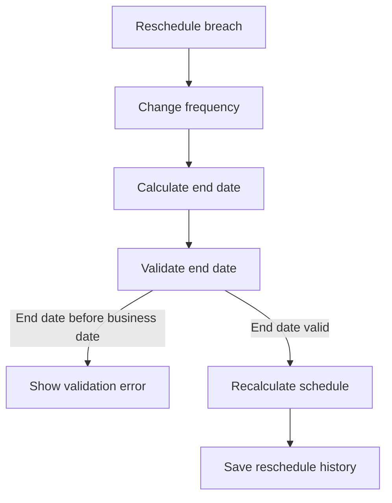

### Near breach changes during loan life

You can change the Near Breach Threshold and Frequency fields while a loan is active, and the system applies the new threshold to update the near breach. Multiple changes are supported, including changes made on the same date, and the system keeps a history of each change with its values.

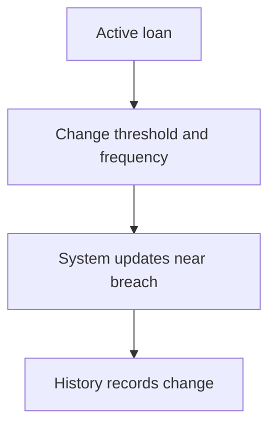

### Breach reset undo behavior

Undoing a breach reset restores any new period that was started and regenerates the breach schedule, reprocessing the periods and payments on them.

A breach reset includes an optional restart setting:

- Users can select Restart Period from Reset Date when performing a breach reset.
- When selected, new breach periods are created from the breach reset date.

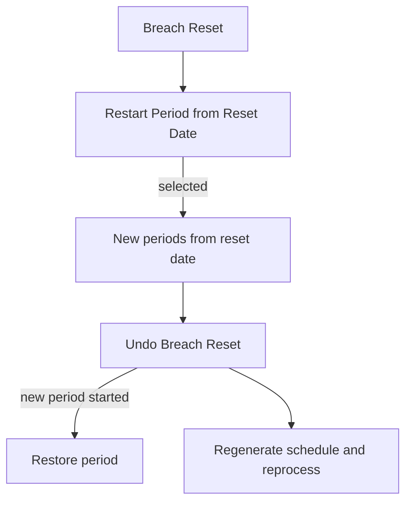

### Breach evaluation timing

Breach evaluation occurs at a point determined by the breach start date plus the configured length, or by the breach range start date plus frequency and frequency type. When multiple near-breach evaluation points exist, the threshold is divided by the multiplicator. Backdated Breach Pause entries re-trigger and recompute breach evaluation for the affected period upon application.

### Breach user interface screens and actions

Working Capital loans expose breach controls on the Loan details view through the Breach tags tab or top right corner menu, and near breach controls through the Near Breach tags tab or top right corner menu. Authorised users can disable breach evaluation from the UI; when disabled, the UI shows that status and no previous evaluation. Reversing a disable shows the recomputed breach schedule and evaluation.

The Breach action menu includes these options:

- Breach
- Change breach
- Frequency
- Breach amount (applicable only for Working Capital loans)

The Near Breach action menu includes these options:

- Near Breach
- Change Near Breach Threshold (% field)
- Frequency fields (applicable only for Working Capital loans)

1. Open the Breach Configuration screen.
2. Enter Name, Frequency Type, Calculation Type and Amount.
3. Choose Cancel or Submit.

1. Open the Breach Configuration screen.
2. Enter Name, Frequency Type, Calculation Type and Amount.
3. Choose Cancel or Submit.

1. Open the loan account and choose "Breach Schedule" from the tabs.
2. View Id, Name, Frequency, Frequency Type, Calculation Type and Amount.
3. Choose Edit or Back.

1. Open the loan account and choose "Breach Schedule" from the tabs.
2. Choose Undo Reset or Reset.

1. Open the loan account and choose "Breach Actions" from the tab.
2. Choose Resume Breach, Pause Breach, Reset, Enable Breach, Update Breach or Update Near Breach.

| Screen | Shown text |
| --- | --- |
| Loan breach schedule tab | Breach evaluation disabled since {{date}}; Breach Periods; Total Days in Breach; Peak Outstanding; Past Due Amount; Average Gap; In Breach; Near Breach; Resolved; Compliant; Breach Timeline; Mild; Moderate; Severe; Today; Severity; Reset; From Date; To Date; Days; Minimum Payment; Outstanding Amount; Gap; Reset History; Id; Action; Date; Status; No resets have been recorded for this loan. |
| Loan breach actions tab | Total Actions; Active Pause; Total Days Paused; days; Last Action; Breach evaluation disabled since {{date}}; Pause Active; Pause Timeline; Active; Scheduled; Expired; Pauses; Today; Total Records; Id; Action; Status; Start Date; End Date; Duration; Ongoing; No records match the selected filter; No Breach Actions; No breach actions have been recorded for this loan; Breach Actions; Minimum Payment; Frequency; Near Breach Actions; Threshold; Submitted On; No Near Breach Actions. |

| Column | Value |
| --- | --- |
| Id |  |
| Name |  |
| Frequency |  |
| Calculation Type |  |
| Amount |  |
| Actions |  |

Users can view the Breach PastDue amount parameter as part of the breach evaluation.

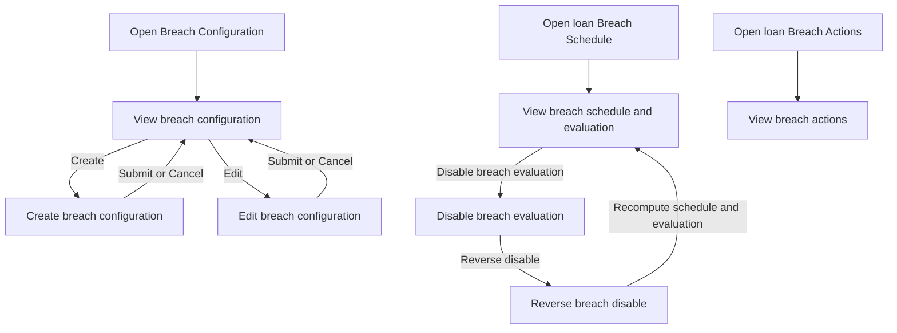

### Close of Business process

The Close of Business (COB) process executes daily scheduled end-of-day processing. The COB business date determines which date is being closed and is typically set to the day before the current business date, though internal logic can set it dynamically in scenarios such as catch-up processing.

Business steps control how COB processes loans:

- Business steps can be enabled or disabled and are executed in a configurable order.
- COB business steps execution is controlled by configuration, including enablement and execution order.
- During COB, all enabled business steps are applied to each loan selected for processing.

COB selects loans for processing based on their last run date:

- The COB job processes all open loans where the last COB run date is equal to the previous business date.
- The COB job processes all open loans where the last COB run date is null, meaning COB has never been executed.

Catch-Up COB applies missed executions as if they had run daily on schedule:

- Inline COB automatically performs catch-up processing for the selected loans.
- Catch-Up COB start date is determined by the last COB run date stored at the loan account level.
- If no previous COB run date exists, Catch-Up COB processing starts from the current COB business date.

COB processing follows this sequence:

- COB processing selects loans for processing.
- Selected loans are partitioned into batches based on a configured size.
- Partitions are marked for batch execution.
- Loans are processed sequentially within each partition.
- A lock is applied on loans within a single partition.
- Each loan is read.
- Applicable business steps are resolved and determined.
- The processed loan is persisted.
- The last COB run date on the loan is updated.

COB processing updates balances when it executes:

- Balance is recalculated or updated when a loan is disbursed, repayment is posted, income is accrued, income is realized, adjustments or reversals happen, or COB processing executes.

| Field | Rule |
| --- | --- |
| principal_outstanding | must be &gt;= 0 |
| total_paid_principal | must be &gt;= 0 |
| total_payment | must be &gt;= 0 |
| realized_income | must be &gt;= 0 |
| unrealized_income | must be &gt;= 0 |

The COB job can be triggered manually or scheduled to run automatically.

Users can configure Near Breach from the UI, similar to Breach management configuration page.

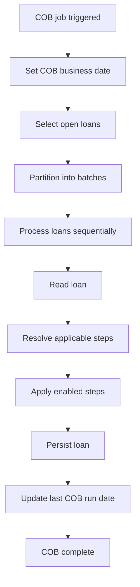

### Working capital overpayment and CBR

Overpayment and close business refund (CBR) apply only to Working Capital loans. Any repayment above the outstanding obligation is stored as an overpayment amount.

A close business refund (CBR) is a monetary transaction on a loan account in OVERPAID status.

- CBR is allowed only when the loan status is OVERPAID and the overpayment amount is greater than zero.
- The transaction amount must be greater than zero and no more than the overpayment amount.
- The transaction date must follow standard transaction date rules: it cannot be a future date or before the disbursement date.
- CBR reduces the overpayment amount by the refund amount and persists transaction and allocation records.
- After the refund, the system evaluates loan status transition based on the resulting balance fields.

> **Note:** Limitations and constraints for EIR Calculation Phase 2 - Breach Management documentation come from the epic description.

### Worked examples

A loan officer sets up a working capital loan of 1,000 with a breach minimum payment of 250 every 30 days. The figures in this example are illustrative. At the end of each period the system compares the payment received with the minimum due, calculates the period past due amount as the greater of zero and the shortfall, and adds it to the cumulative breach past due amount. The breach flag is stored for each period and is not changed by later payments.

| Period | From day | To day | Minimum due | Payment received | Period past due | Cumulative past due | Breach |
| --- | --- | --- | --- | --- | --- | --- | --- |
| 1 | 1 | 30 | 250.00 | 250.00 | 0.00 | 0.00 | No |
| 2 | 31 | 60 | 250.00 | 100.00 | 150.00 | 150.00 | Yes |
| 3 | 61 | 90 | 250.00 | 0.00 | 250.00 | 400.00 | Yes |

A product administrator configures a 90-day breach range with near-breach evaluation every 30 days. The first evaluation date falls 30 days after disbursement and the second 60 days after disbursement. If the breach range is set in months instead of days, a near-breach frequency of one or two months is allowed under a three-month breach range, but three months or longer is not; changing the unit does not change the rule that the near-breach frequency must be shorter than the breach frequency. At each evaluation the system marks the period as near breach when the share paid so far is below the expected share.

| Evaluation | Day | Expected share | Expected amount | Payment received | Near breach |
| --- | --- | --- | --- | --- | --- |
| 1st | 30 | 33% | 99.00 | 50.00 | Yes |
| 2nd | 60 | 66% | 198.00 | 250.00 | No |

An operations user applies a breach pause to a 60-day breach period starting on 1 January. The pause runs from 20 January to 29 January. Because both the start and end days count as paused, the pause lasts 10 days and the period end moves from 2 March to 12 March. If the user resumes the breach on 24 January, the pause ends on that day, the paused length becomes 5 days, and the period end moves to 7 March. After resumption the system recalculates breach from the shortened pause and continues evaluation from the current period.

| Action | Pause start | Pause end | Paused days | Period end |
| --- | --- | --- | --- | --- |
| No pause | 1 January | 2 March | 0 | 2 March |
| Pause initiated | 20 January | 29 January | 10 | 12 March |
| Resume on 24 January | 20 January | 24 January | 5 | 7 March |

See also: [Effective Interest Rate Product](confluence-link:Working%20Capital%20Loans%20(EIR)#effective-interest-rate-product), [Transaction Types](confluence-link:Working%20Capital%20Loans%20(EIR)#transaction-types), [Delinquency Restrictions](confluence-link:Working%20Capital%20Loans%20(EIR)#delinquency-restrictions).

## Projected Balances

### Projected balances overview

The new EIR calculation method supports discount/fees-based working capital financing. When a working capital loan is created, the system calculates and creates a projected amortization schedule for the whole loan life cycle. The schedule is recalculated at approval based on the approved amount and at disbursement based on the disbursement amount. It stays current as payments are made, missed, or overpaid, with daily calculations matching expected formulas and deferred balance tracking correctly through the loan lifecycle.

### Discount fee setup

The PPWC product charges an up-front one-time fixed fee at origination instead of spreading it across installments. The system adds this fee to principal to create the total amount to repay.

The single Discount field is broken down into three fields at loan account level:

- Proposed discount is the discount entered or modified when you create the loan.
- Approved discount is the discount entered when you approve the loan.
- Disbursed discount is stored at loan account level.
- The Approved discount field resets to zero when you undo an approval.
- All three fields appear on the loan account view.

> **Note:** Delinquency and Breach are out of scope for the loan account view screen enhancement.

### Adding discount fee

You can add the discount fee to the loan account through the API or the UI. If the discount was added at loan creation or approval, you cannot add it again after disbursement.

Projected balances documentation and calculation support the new EIR calculation method.

### Discount fee amortization

Discount fee amortization calculates the current amortization amount from the total actual amortization balance in the schedule and the total discount fee amortization transactions minus adjustments. The difference controls whether a transaction is created and updates realized and unrealized discount fee income balances.

The system creates transactions based on the calculation difference:

- If the diff is positive, a new Discount fee amortization transaction with the diff amount is created.
- If the diff is negative, a new Discount fee amortization adjustment transaction with the diff amount is created.
- If the diff is zero, no transaction is created.

Additional rules for discount fee amortization:

- Realized and unrealized discount fee balances are controlled only by the discount fee amortization business step.
- When the loan is fully paid or overpaid, a Discount fee amortization or Discount fee amortization adjustment transaction is created immediately based on balances, and realized and unrealized discount fee income balances are updated.
- If the loan is fully paid, total aggregated discount fee amortization matches the initial Discount fee.
- Discount fee adjustment decreases the total aggregated discount fee amortization.

Flat amortization rules:

| Condition | Effect |
| --- | --- |
| Flat amortization is configured | Payable Discount fee equals Discount Fee minus Discount Fee adjustment |
| Flat amortization is configured on the loan product | The amortization schedule follows discount fee calculation based on the flat ratio |
| Flat amortization is configured | Initial Loan balance equals Disbursed amount plus Discount Fee minus Discount Fee adjustment |

### Period Payment Rate modification

You can modify the Period Payment Rate only on an Active loan and only as of the current date. The change recalculates the Daily Payment Amount, Total Days, and EIR, and future amortization calculations use the newly calculated values. Previously computed and posted amortizations remain unchanged.

The following conditions and effects apply to Period Payment Rate modification:

- Modification is not allowed on closed, overpaid, charge-off, and written-off accounts.
- You can undo the modification by reversing the operation or by allowing multiple values on the same date.
- Delinquency and Breach are not affected because they use specific parameter configurations.
- Backdated repayments are out of scope.
- Repayment reversal before the change operation is out of scope.

### EIR and payment calculation

The system calculates Daily Payment Amount, Total Days, and EIR from Principal Amount, Total Payment Value, Discount Amount, NPV Day count, and Period Payment Rate.

The system rejects invalid input in these cases:

- Input field values become too low for the calculated values to be calculated.
- Total Days exceed 1000, which causes EIR calculation failure.

### Amortization schedule contents

The projected amortization schedule lists each installment with its date, expected payment, discount factor, net present value, balance, net amortization amount, actual payment, actual amortization amount, income modification, and deferred balance. The Projected Amortization Schedule table shows the serial number, installment date, Expected Payment, and Expected Amortization Amount.

Expected Payment and Expected Amortization Amount are calculated values.

- Expected Payment in the Projected Amortization Schedule is the calculated Period Payment amount value.
- Expected Amortization Amount in the Projected Amortization Schedule is a calculated value.

The Amortization Schedule/running Schedule table shows the serial number, Amortization Date, Expected Payment, Expected Amortization Amount, Paid Date, Actual Payment, Balance of the loan, Actual Amortization Amount, Fees, Penalty, Income Modification, and Deferred Balance. Expected Payment in this table is the calculated Period Payment amount value.

### Schedule recalculation and rounding

The system recalculates future expected payment periods when an actual payment differs from the expected amount. Only periods after the payment date are recalculated; past rows stay unchanged. Actual payments form the baseline for the recalculation.

Rounding and schedule calculation work as follows:

- Totals in the amortization table can differ by a couple of cents because the precise model is rounded to the currency of the loan.
- Rounding handling for amortization table totals follows the same approach as progressive loans.
- The amortization schedule is calculated accordingly.

### Working capital balance types

Working Capital loans use DUE and IN ADVANCE balances; PAST DUE does not apply.

The balance types are defined as follows:

- DUE Principal is the projected principal payment.
- DUE Fee / Penalty is current or older charges based on a specific due date.
- IN ADVANCE Principal is over projected principal payment.
- IN ADVANCE Fee / Penalty is future charges based on a specific due date.

Transaction allocation uses these fine-grained rules:

- DUE PRINCIPAL
- DUE FEE
- DUE PENALTY
- IN ADVANCE PRINCIPAL
- IN ADVANCE FEE
- IN ADVANCE PENALTY

### End-of-day zero filling

At close of business, the system zero-fills elapsed days on working capital loans.

When a day passes with no payment on a working capital loan, close of business fills the actual column as if a zero-amount repayment landed that day.

- Zero-filled rows do not create an actual transaction; they are cosmetic changes on the schedule.
- The expected payment schedule treats zero-filled rows as actual payments and recalculates expectations as if a zero-amount repayment transaction landed.

### Loan account view fields

The loan account view screen shows the loan’s key figures and schedule information, including the Period Payment amount, Daily EIR, Annual EIR, No. of Repayments, Currency, Proposed Discount, Approved Discount, Disbursed Discount, Amortization type, and Projected Amortization Schedule.

The following fields are calculated values:

- Period Payment amount
- Daily EIR
- Annual EIR
- No. of Repayments
- Expected Amortization Amount

The remaining fields are set as follows:

- No. of Repayments is the calculated Total Days value.
- Currency is the currency configured at product.
- Proposed Discount is the discount amount entered at create loan stage.
- Approved Discount is the discount amount entered at approve loan stage.
- Disbursed Discount is the discount amount entered at disburse or after disbursement stage.
- Amortization type is Flat or EIR.

### Running amortization schedule fields

| Field | Meaning |
| --- | --- |
| Balance of the loan | Disbursement plus Discount amount minus payment amount when a payment is made |
| Actual Amortization Amount | The calculated amortized amount |
| Income Modification | Total expected amortization minus actual amortization as of the payment date |
| Deferred Balance | The Discount amount balance |

### Schedule lifecycle and schedules created

After disbursement, the system creates an amortization schedule for the loan. It also creates a delinquency schedule when delinquency is enabled and a breach schedule when breach management is enabled. You can fetch the current amortization schedule using the working capital loan endpoint.

Period Payment Rate modification works by generating a sub model based on changed parameters. The first model keeps its original parameters and calculated amounts and balances, while the second embedded model covers the remaining days with its NPV balance originating from the first model.

### Amortization schedule tab UI

The loan amortization schedule tab shows projected balances and related loan details, including status, payment dates, balances, amortization amounts, and discount fee balances. You can hide projected amounts and export the schedule to PDF.

The tab displays the following labels:

- Completed
- Executed
- Projected
- Pricing
- Payment Amount Calculation Strategy
- Annual EIR
- Period Payment Rate
- Payment Amount
- Daily Effective Rate
- Not Available
- Net Present Value Day Count
- Expected
- Actual
- Status
- Payment Date
- Balance
- Amortization Amount
- Discount Fee Balance

The Period Payment Rate field accepts a BigDecimal value.

- The Period Payment Rate field accepts a BigDecimal value.

You can modify the Period Payment Rate from the Loan details view or the top right corner menu.

- You can modify the Period Payment Rate from the Loan details view or the top right corner menu.

The Modify Period Payment Rate option applies only to active Working Capital loans.

- The Modify Period Payment Rate option applies only to active Working Capital loans.

The WC Flat Amortization Configuration and its UI are implemented.

- The WC Flat Amortization Configuration and its UI are implemented.

### Worked examples

A working capital loan product uses flat amortization. The flat ratio is 10 percent. A loan is disbursed with a principal of 1,000 and a discount fee of 100, to be repaid in two monthly installments of 500 each. The figures are illustrative. By the final installment the entire discount fee has been amortized.

| Installment | Repayment amount | Discount fee amortized | Discount fee remaining |
| --- | --- | --- | --- |
| 1 | 500.00 | 50.00 | 50.00 |
| 2 | 500.00 | 50.00 | 0.00 |
| Total | 1,000.00 | 100.00 | — |

A loan officer enters values that make the calculated term impractically long. For example, the principal is 5,000, the total payment value is 10, the discount amount is 500, the NPV day count is 365, and the period payment rate is 12 percent. The figures are illustrative. The user must adjust the inputs before the loan can be created.

| Field | Entered value |
| --- | --- |
| Principal amount | 5,000.00 |
| Total payment value | 10.00 |
| Discount amount | 500.00 |
| NPV day count | 365 |
| Period payment rate | 12.00% |
| System result | Error: total days above 1,000; EIR cannot be calculated |

A working capital loan shows a projected schedule with a principal of 1,000 and an expected payment of 100 per installment. The figures are illustrative. The borrower pays the expected amount in the first installment, pays 150 in the second installment, and the system recalculates only the remaining installments; the first row stays exactly as posted. An excess payment reduces the balance faster and lowers future expected amounts; a short or missed payment leaves the balance higher and raises future expected amounts, while past rows are never recalculated.

| Installment | Expected payment | Actual payment | Balance after payment |
| --- | --- | --- | --- |
| 1 | 100.00 | 100.00 | 900.00 |
| 2 | 100.00 | 150.00 | 750.00 |
| 3 | 750.00 | 750.00 | 0.00 |
| Total | 950.00 | 1,000.00 | — |

See also: [Effective Interest Rate Product](confluence-link:Working%20Capital%20Loans%20(EIR)#effective-interest-rate-product), [Transaction Types](confluence-link:Working%20Capital%20Loans%20(EIR)#transaction-types).
