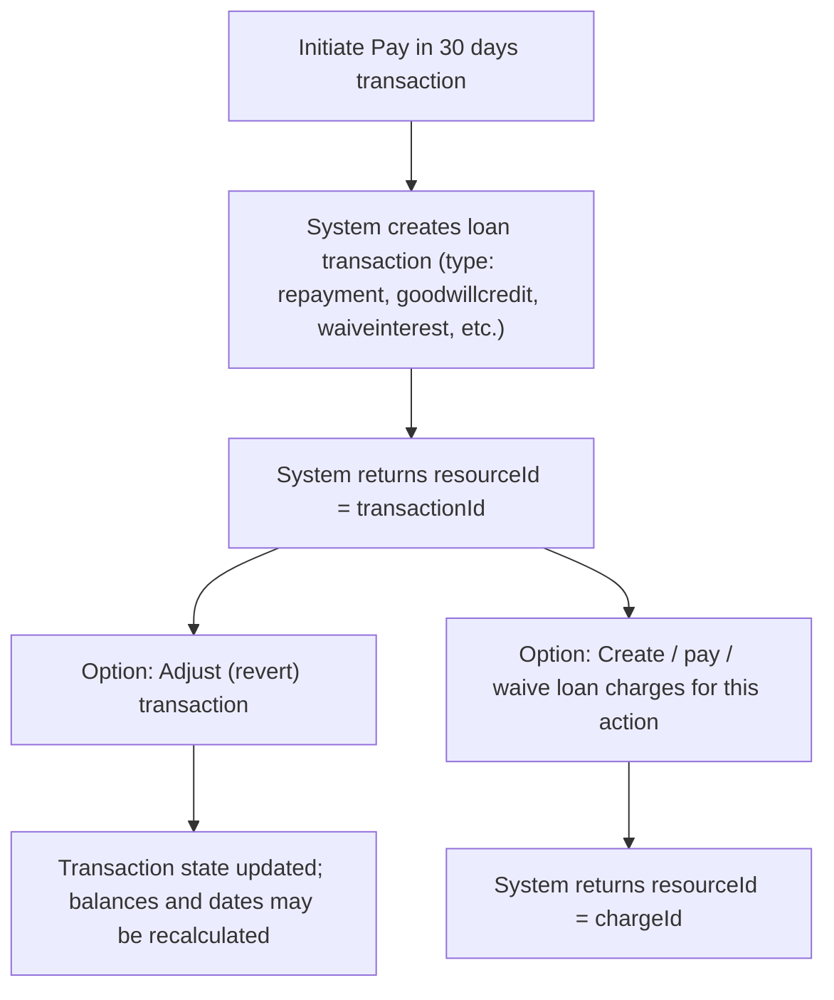

<!-- Labels: user, pay-in-30-days -->
# Pay in 30 days - Phase 2 [Nice to have]

completes the implementation required to support the Pay in 30 days feature. This work builds on the BNPL Pay in 3/4 and Pay in 30 flows, integrating Pay in 30 days actions with the existing loan transaction and loan charge processing pathways. The outcome is a consistent, auditable trail of Pay in 30 days activity visible to operations staff, loan officers, branch managers, and credit agents, with clear linkage between initiated actions, resulting transaction identifiers, and any associated charges.

### What the feature does and why it matters

The Pay in 30 days capability records customer arrangements as standard loan transactions and, , related charge records. Each action within the Pay in 30 days workflow produces a concrete, identifiable record in the system, enabling traceability, reconciliation, and post-facto reporting. The implemented behavior guarantees that every action creates an unambiguous identifier that can be referenced in subsequent processing (adjustments, refunds, waivers, etc.).

Key aspects evidenced by the reference behavior include:
- A Pay in 30 days action is represented as a loan transaction with a concrete type such as repayment, refunds, goodwill credits, waivers, and related adjustments.
- When a loan transaction is created, the system returns a resource identifier that corresponds to the transaction identifier (resourceId equals the transactionId).
- The Pay in 30 days workflow supports subsequent operations that adjust or revert actions, and it accommodates related charges that may be paid, waived, or adjusted, with identifiers returned for each operation.

### How the system records Pay in 30 days actions

- Transaction types: Executing a loan transaction in the Pay in 30 days context supports a defined set of types, including repayment, merchantIssuedRefund, payoutrefund, goodwillcredit, waiveinter­est, writeoff, undowriteoff, recoverypayment, refundByCash, foreclosure, and creditbalanceRefund. Each created transaction yields a resourceId that is the transactionId.
- Adjustments and reversals: The system supports an adjust (revert) operation on existing loan transactions. The operation returns a resourceId equal to the transactionId.
- Undo waive charges: For waived charges, an undo action is supported; the operation returns a resourceId that identifies the related charge (chargeId), reflecting reversal of the waiver when applicable.
- Loan charges: The Pay in 30 days workflow interacts with loan charges as a separate but related construct. Creating a loan charge does not itself produce a transactionId (the resourceId in that operation is the chargeId). Paying or waiving a loan charge creates or updates a transaction context that yields a resourceId associated to the chargeId or related transaction as documented.
- Charge payments and waivers: Paying or waiving a loan charge is supported via dedicated operations and results in a resource identifier tied to the charge. An adjustment to a loan charge may yield a transaction identifier, depending on the specific operation used.

These behaviors verify that Pay in 30 days actions are recorded with traceable identifiers and that related charges are managed in a coordinated, auditable manner.

### Calculation and accounting integrity (what to expect in the system)

The Pay in 30 days implementations rely on established accounting and balance-tracking rules that apply to loan transactions and charges. These rules, evidenced in the reference material, include:
- Each period’s opening balance must equal the previous period’s closing balance.
- Payment allocations must reconcile with the transaction amounts they accompany.
- Remaining cash and outstanding dues must reconcile with posted transactions.
- Journal entries must balance when debit and credit data are available for the same event.
- Calculations and balances require verification of intermediate calculations, running balances, totals, precision, and rounding.
- Rounding must follow documented conventions, such as HALF_UP or HALF_EVEN, as evidenced by the source data.

The outcome of Pay in 30 days actions is therefore not only the immediate transaction or charge identifiers but also the correct, balanced accounting impact across the customer’s loan account and the related financial records.

### Operational observations and user-visible outcomes

- After a Pay in 30 days action is initiated, a loan transaction record is created and a transactionId is returned as the resourceId. This identifier is used in any subsequent adjustments or reference in customer service notes, reconciliations, and reporting.
- If an adjustment (reversion) is performed on a Pay in 30 days transaction, the system returns the same transactionId as the resourceId, signifying the updated state of the original action.
- When a related loan charge is involved, creating, paying, or waiving the charge results in a chargeId as the resourceId for charge-related actions. Any subsequent adjustments or reversals provide traceable identifiers tied to the standard charge context.
- The combination of loan transactions and loan charges creates a coherent trail that supports downstream reconciliation, reporting, and customer-facing explanations of Pay in 30 days activity.

### Diagram: Pay in 30 days transaction lifecycle (conceptual)

Note: This diagram presents a high-level depiction of the Pay in 30 days workflow lifecycle and does not reveal internal API paths or implementation details. It is intended to illustrate the sequencing and relationships between transaction creation, adjustments, and related charges.

### Related operations and what they imply for users

- Creating a loan charge: A charge related to the loan is created without producing a transactionId at that moment; the resulting resourceId is the chargeId.
- Paying a loan charge: The system accepts a payment against the loan charge and returns a resourceId tied to the charge (the chargeId).
- Waiving a loan charge: The system supports waiving a loan charge and returns the chargeId as the resource identifier for that action.
- Adjusting a loan charge: An adjustment on a loan charge may produce a transactionId as the resourceId, depending on the specific operation used.
- Deleting a loan charge: Deletion of a loan charge returns the chargeId as the resource identifier for the deleted resource.

Together, these mechanisms allows the Pay in 30 days workflow to cover both the transactional movements on the loan and the management of any associated charges, while preserving a clear audit trail.

### Scope and guidance for users

This page describes verified behavior for of the Pay in 30 days feature. It documents the transaction types that can be created, how identifiers are returned, and how charges interact with transactions. It does not introduce external or internal implementation details beyond what is evidenced in the reference data. When performing Pay in 30 days actions, users should expect to see new transaction and charge identifiers for initiated actions, with the system maintaining reconciliation and balanced accounting per the established integrity rules.