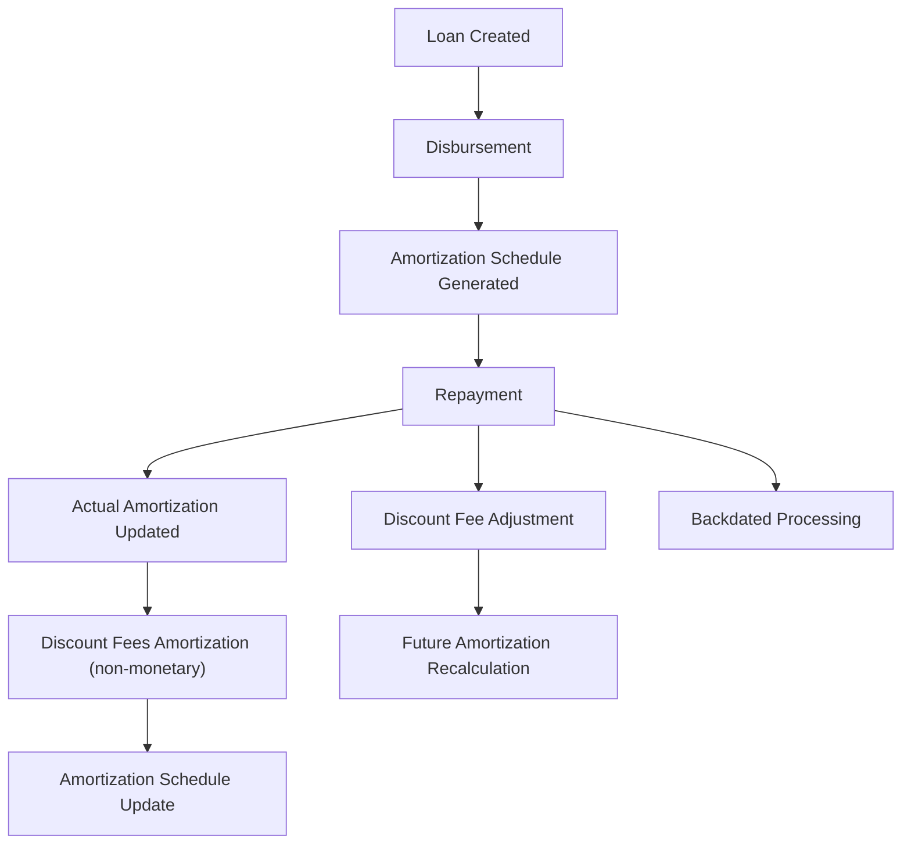

<!-- Labels: user, product -->
# Loan product support for Effective interest rate (PPWC)

The Pepper-Soup Working Capital (PPWC) product introduces an Effective Interest Rate (EIR)–based calculation framework designed to follows PayPal’s Working Capital financing offerings. This feature describes a zero-interest, single-disbursement loan product that uses an EIR methodology to recognize income over the life of the loan, supports flexible repayment patterns, and provides reliable configuration and accounting capabilities. The target audience includes operations staff, loan officers, branch managers, and credit agents who require precise, verified behavior for product setup, servicing, and reporting.

### What the feature does and why it matters

- It allows a Working Capital loan product that uses EIR to recognize income and to amortize deferred income over the loan tenure. This approach provides transparent cost of credit and supports regulatory and accounting requirements for working capital financing typically offered by PayPal.
- The product is zero-interest from the borrower’s perspective; no traditional interest accrues. Instead, revenue is recognized through the EIR-based amortization of deferred income (discount fees) over the life of the loan.
- The design supports single disbursement per loan, with the ability to apply charges at disbursement or later, and to manage repayments and adjustments (including partial or full fee adjustments, reversals, and refunds).
- The feature includes explicit accounting behavior, backdating and reprocessing rules, and a projected amortization schedule that updates as actual cash flows occur.
- Roles benefiting from this capability include loan officers who configure the product and enter disbursements, operations staff who service the loan accounts, branch managers who monitor portfolio performance, and credit agents who oversee delinquencies and recoveries.

### Key concepts and configuration options

- Zero-interest, EIR-based product: The borrower does not incur traditional interest. The system calculates and posts income recognition using EIR, and the amortization schedule tracks how much income is recognized over time.
- Single disbursement: Each PPWC loan is modeled as a single disbursement; no multi-tranche disbursements are supported for this product variant.
- Amortization methodologies: The product supports two higher-level configuration approaches for amortization and income recognition:
 - Revenue-based configuration: The system stores calculated values at the loan account level based on actual repayments, including Period Payment Amount, Total Days, Daily EIR, and Calc Annual EIR.
 - Fix payment amount configuration: The loan account stores provided (or calculated) values for Period Payment Amount, Total Days (calculated), Daily EIR (calculated), and Calc Annual EIR (calculated).
 - Fix EIR configuration: The system stores values with a provided Period Payment Amount, while Total Days and Daily EIR are calculated; Annual EIR may be provided.
- Payment allocation and charges: Charges may be charged at disbursement or later, and the allocation order generally places charges before principal (subject to region-specific rules and configuration). Full and partial discount adjustments are supported, but the total amount cannot exceed the original charge.
- Amortization observation and posting: The actual repayment posting includes the calculation and posting of the Actual Amortization (Income) on the payment date, in addition to the repayment itself. A separate discount-fees amortization record is created to reflect income recognition, but it does not alter the outstanding balance or accounting entries.
- Data storage and reporting: Several values are calculated and stored at the loan account level, including Period Payment Amount, Total Days, Daily EIR, and Calc Annual EIR, with updates driven by repayments and changes to the loan’s cash flows.
- Delinquency and governance: Delinquency buckets, grace periods, and related change control are part of the broader PPWC product design to manage risk and timing of income recognition.

> Note: The material includes reference tables and sheets that describe detailed calculations, schedules, and scenarios. This publication presents the verified, product-level behavior and operational guidance without exposing internal artifacts that are not part of the customer-facing documentation.

### Working capital product requirements and governance

- The PPWC product is implemented as a separate module with its own product configuration, enabling creation and servicing without impacting existing loan products.
- The product supports API and UI pathways for creating a product, creating loan accounts, approving, and disbursing. It also supports servicing actions such as repayments, reversals, prepayments, and adjustments.
- The product configuration requires the following parameters at minimum:
 - Product name, Short name, Currency, Decimal places, Currency multiples
 - Amortization methodology (EIR or Flat)
 - NPV Day count (day-count convention for NPV and amortization)
 - Payment allocation strategy (fees, penalties, principal allocation order)
 - Principal amount controls (Min, Default, Max) and Period Payment Rate controls (Min, Default, Max)
 - Period payment frequency and frequency type
 - Discount (origination fees) handling and default values
- The system supports three LP configuration strategies (Revenue-based, Fix payment amount, Fix EIR), enabling flexibility to model PPWC options that follows various merchant financing arrangements.

### Operational procedures: UI and data-entry steps

1) Create a Working Capital loan product (PPWC) with EIR
- Bold field: Product name, Product short name, Currency, Decimal places, Currency in multiples
- System outcome: A new PPWC product is created with the selected currency and basic identifiers.
- Bold field: Amortization, NPV Day count, Payment allocation
- System outcome: Amortization method is set to EIR (or Flat, as configured) and NPV day-count convention is stored for the product.
- Bold field: Principal amount min/max, Period Payment Rate min/default/max, Period payment frequency and type
- System outcome: Baseline governance ranges are established for the product; the product is ready for loan account creation.

2) Choose LP configuration strategy for the PPWC product
- Bold field: LP configuration strategy (Revenue-based / Fix payment amount / Fix EIR)
- System outcome: The product stores the configured strategy and the associated values (either calculated or provided) for Period Payment Amount, Total Days, Daily EIR, and Annual EIR as defined in the selected strategy.

3) Create a loan account from the PPWC product
- Bold field: Currency, Settings (Amortization, NPV Day count), Term (Principal Amount, Period Payment Rate, Discount, Payment frequency)
- System outcome: A loan account is created using the PPWC product defaults and the loan product references. The account inherits currency, lifecycle configuration, and term defaults from the product.

4) Approve the loan account
- Bold field: Approved Date, Expected disbursement date, Principal Amount, Discount Amount
- System outcome: The loan account moves into an approved state with an approved disbursement date and amount; all other fields not overridden by the user are inherited from the product configuration.

5) Disburse the loan account
- Bold field: Disbursed on, Disbursement amount, Discount Amount, External ID, Payment Details
- System outcome: The loan becomes active; the Amortization schedule is created or updated, and principal outstanding is booked. Charges configured for disbursement-time are applied automatically as defined in the product rules.

6) Make a repayment
- Bold field: Date, Amount, Allocation (optional, if not defined the system uses the loan product default allocation)
- System outcome: The payment reduces the outstanding balance, updates the Amortization schedule, and triggers the creation of the Discount Fees Amortization (non-monetary) transaction, which records the amortized movement of deferred income.

7) Apply a discount fee adjustment (if needed)
- Bold field: Discount Fee Adjustment transaction, Amount, Adjustment date, Related parent Discount Fee transaction
- System outcome: A linked adjustment transaction is created, the loan’s discount balance is updated, the amortization schedule is regenerated for future periods, and future discount amortization reflects the updated EIR and schedule.

8) Process a credit balance refund (CBR) when overpayments occur
- Bold field: Refund amount, Date, Allocation rule (to be defined per product)
- System outcome: The credit balance (overpayment) is reduced or eliminated; accounting entries are created if applicable and the loan status transitions as defined by policy (e.g., overpaid status ).

9) Process a payout refund (Payout Refund) for WCP loans
- Bold field: Refund amount, Date, Allocation rule (specific to Payout Refund)
- System outcome: The refund reduces outstanding principal and related balances; if the refund exceeds the outstanding balance, the excess amount results in an overpaid status.

10) Handle backdated transactions and reprocessing
- Bold field: Transaction date, Backdating enablement, Reprocessing scope
- System outcome: The system reprocesses the affected amortization schedule, discount amortization, and balances, replaying subsequent transactions and updating related accounting entries as required by the policy.

### Calculations and reporting: how EIR-based income recognition works

The PPWC product uses an EIR-based approach to recognize income and to reflect it in the amortization of deferred income (discount fees) over the loan term. The starting position for a PPWC loan is the disbursed amount net of any upfront discounts or fees. The Revenue recognition follows the EIR methodology, where the scheduled income recognition is tied to repayments and the outstanding balance, adjusting dynamically as actual cash flows occur.

- Inputs and starting position
 - Net disbursement: the amount available to the borrower after any upfront charges allocated to the loan balance (subject to product configuration)
 - Discount fees: the upfront income adjustment recognized over the life of the loan as deferred income
 - Total Payment Volume (TPV) and related day-count conventions provide context for cash-flow timing and NPV calculations
- Calculation method (conceptual)
 - Amortization is calculated using the selected configuration strategy (Revenue-based, Fix payment, or Fix EIR), in conjunction with the EIR rate and the number of days in each period
 - On each repayment, the system determines the amortized portion of the deferred income (Actual Amortization) and updates the amortization schedule 
 - The Discount Fees Amortization transaction is created to track the amortized portion of deferred income associated to the repayment event; this transaction is non-monetary and does not affect loan balance or accounting entries
- Financial effect and reconciliation
 - The loan’s principal outstanding is reduced by the cash repayment amount and any allocated principal component per the configured rules
 - Deferred income (discount fees) is reduced according to the amortization calculation, with the amortized portion recorded in the system for reporting and auditing purposes
 - The amortization schedule is continuously updated to reflect realized repayments, updated EIR, and future projected payments

 
Calculation

 
<strong>Inputs:</strong> Net disbursement, Discount fees, Total Payment Volume, NPV Day count, Period payment rate

 
<strong>Method:</strong> EIR-based amortization with period-level discount recognition and repayment-driven updates

 
<strong>Result:</strong> Updated Actual Amortization and amortization schedule reflecting repayments and changes in cash flows

### Projected Amortization Schedule: structure and usage

The system maintains a projected amortization schedule for Working Capital loans, updated at key lifecycle events (creation, approval, disbursement, and repayments). Each record in the projected amortization schedule includes the following fields:

- Amortization Installment Number
- Amortization Installment Date
- Expected Payment Amount
- Discount Factor
- NPV Value
- Balance
- Net Amortization Amount
- Actual Payment Amount
- Actual Amortization Amount
- Income Modification
- Deferred Balance

The schedule represents the projected income recognition plan and is recalculated dynamically in response to repayments and changes in outstanding balances. It is not a fixed static schedule; it adapts to actual cash flows to verify alignment with the EIR methodology.

### Delinquency and collection considerations

Delinquency management supports bucket classification and delinquency pauses in line with the broader product design. The PPWC rules use range schedules to determine when and how delinquency progresses, and the system recalculates projections as delinquencies evolve. Re-aging and delinquency-related adjustments are pre-calculated within the lifecycle, and the system enforces minimal payments when required by policy.

### Transaction types overview (servicing and accounting)

The PPWC servicing model covers a broad set of transaction types that mirror term loan implementations while accommodating working capital specifics. Monetary transactions include: Disbursement, Repayment, Discount Fees Amortization, Prepayment, Charge Adjustment, Discount Fees, Credit Balance Refund, Goodwill Credit, Recovery Payment, and Payout Refund. Non-monetary transactions include: Charge Application, Charge Waiver, Write-Off / Charge-Off, and Adjustments / Reversals.

Each transaction captures essential attributes: Transaction ID, External ID, Transaction Type, Transaction Date, Created Date, Amount, Currency, Principal Component, Fee Component, Penalty Component, Outstanding Balance, Payment Reference/Mode, Reversal Flag, Linked Transaction ID, and Notes. Transactions are validated against the loan’s state and lifecycle (Active, Charged-Off, Closed, etc.), and backdating rules are enforced with standard reprocessing when necessary.

### Special scenarios and rules

- Delinquency and range scheduling drive how and when payments are expected and how income recognition follows actual cash flows.
- Overpayments and credit balances trigger a separate Credit Balance Refund (CBR) workflow, with the balance managed according to policy (refund or offset against future dues).
- Prepayment is a payoff action that closes the loan account by paying the exact payoff amount as of the chosen date; the system computes the payoff amount and restricts user entry to the calculated value.
- Discount fee adjustments allow adjustments to the deferred income with a linked adjustment transaction; the system restates the amortization schedule and replays subsequent transactions as needed.
- Charge adjustments reverse previously paid charges and adjust allocations in line with the policy for charge handling.
- Payout Refund (for WCP loans) allows the recovery of disbursed funds when a loan is fraudulently originated; the refund reduces principal and related balances, with overpayments resulting in an overpaid status.

### Backing data and confidentiality

This page describes verified product behavior and operational procedures for the PPWC EIR-based loan product without exposing internal materials or confidential implementation details. All behavior, fields, calculations, and outcomes are described in terms of user-facing concepts and confirmed system behavior.

### Diagram: PPWC EIR lifecycle (Mermaid)

### Summary of verified behavior

- The PPWC product is designed as a zero-interest loan with EIR-based income recognition and amortization.
- It supports a single disbursement, repayment and reversal capability, forward-looking and backdated processing, and a set of region-aware charges.
- The Actual Amortization (Income) is posted on the payment date alongside the repayment transaction; a separate Discount Fees Amortization record tracks the amortization of deferred income for reporting purposes only.
- The loan life cycle includes creation, approval, disbursement, repayment, and adjustments, with continuous recalculation of the amortization schedule based on actual cash flows.
- The system maintains a projected amortization schedule with clearly defined fields and an emphasis on alignment with the EIR methodology for accounting and reporting purposes.

This publication provides operation-ready guidance for configuring and servicing PPWC loans with EIR-based calculations, including the necessary UI navigations, data-entry steps, validations, and the expected outcomes observed in the system.