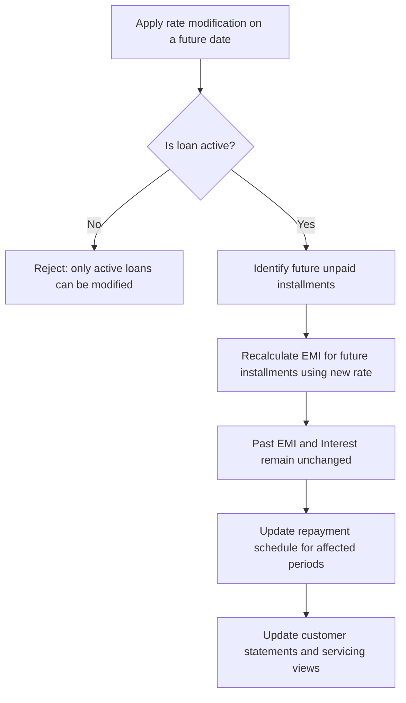

<!-- Labels: user, rate-change -->
# Interest rate modification

Interest rate modification is a controlled capability that allows authorized staff to adjust the interest rate on active loan accounts for future periods. When applied, the modification takes effect from the applied date itself, and the EMI for future installments is recalculated . Installments that have already been paid, including EMI and interest amounts, are not retroactively adjusted by the rate change. The feature applies only to active loan accounts and affects the portion of the repayment schedule that has not yet been settled.

The business purpose is to align an active loan’s cost of funds with changing conditions while preserving the integrity of payments already made by the customer. Branch staff, loan officers, and operations personnel who manage servicing tasks related to rate changes will observe the updated EMI and updated repayment schedule for future installments on affected loans. The customer’s historical payments remain intact; new calculations apply only to the remaining, unpaid installments.

### Scope and eligibility

- The modification may be applied only to future dates, with the earliest applicable date being the current date plus one day (current date + 1). In other words, changes cannot affect dates prior to or including today.
- The applied rate change is effective starting from the applied date itself for future installments.
- EMI calculations will consider only future, non-paid installments when recomputing the installment schedule. Past installments do not retroactively change in response to the rate modification.
- The modification affects EMI, i.e., the monthly payment amount is adjusted based on the new interest rate. The guidance currently specifies EMI adjustments; installments themselves remain as initially defined for historical periods.
- The rate modification can be performed only on active loan accounts, i.e., loans that are currently in an active state and not already closed or settled.

### Business rules and policy constraints

- Backdated repayments or reversals after an interest modification are permitted. When such adjustments occur, the system will recalculate in light of the old and new rate , and reverse-replay logic is triggered as needed.
- The modification is observed as an EMI change rather than a change to the installment identifiers or due dates for existing periods; the system recalculates the remaining EMI values for future installments while preserving the existing schedule structure for already-due or already-paid installments.
- For the purpose of recalculations, the system uses only future, unpaid installments in computing the new EMI under the new rate. Past installments remain unchanged in amount and allocation.
- After an interest rate change, the repayment schedule is recalculated to reflect the new rate for the remaining principal. If there are pay-down scenarios (early repayment, additional payments), the model will re-evaluate the allocation and the applicable interest for the affected periods in light of the new rate.
- Interest refunds, when applicable, are calculated by charging the old rate for the portion already accrued and applying the new rate for subsequent periods, consistent with the verified behavior described in the reference material.

### How the system calculates the new EMI and interest

The product uses established amortization logic tied to the period-based rate factor. The rate factor for a period is determined by the rate of interest and the period’s timing relative to the year and month definitions. The following formulas are part of the verified behavior used to recalculate EMI and interest for future installments:

- Rate factor

 
Calculation

 
<strong>Formula:</strong> Rate factor = 1 + (rate of interest × (repaid every × days in month / days in year) × actual days in period / calculated days in period)

 
<strong>Notes:</strong> This factor is applied to determine both the EMI and the interest portion for the period when a new rate is in effect.
 

- EMI calculation

 
Calculation

 
<strong>Formula:</strong> EMI = (Rate factor × Ri × Principal) / Fn, summed over i from 1 to n

 
<strong>Notes:</strong> Ri represents the period-specific repayment component, and Fn denotes the normalization factor used by the amortization schedule. The exact interpretation of Ri and Fn follows the standard repayment model used in the system.

- Installment interest per period

 
Calculation

 
<strong>Formula:</strong> Installment Interest = Principal balance × (Rate factor − 1)

 
<strong>Notes:</strong> Interest for the period derives from the outstanding balance and the period’s rate factor. The decomposition into principal and interest follows the EMI allocation rules for the period.

> Integrity considerations: For every period, the opening balance must equal the previous period’s closing balance. Payment allocations must reconcile with the transaction amount, and remaining cash and outstanding dues must reconcile across the full repayment timeline. When actual journal entries are available, they must balance (debit equals credit). Rounding should follow supported conventions (e.g., HALF_UP or HALF_EVEN) as evidenced in the reference data.

### Observability and user-facing outcomes

After a rate modification is applied and validated, users servicing the loan will observe the following changes for the affected account:
- The EMI amount for future installments changes to reflect the new rate. The adjustment does not retroactively alter past installments; their principal, interest, and totals remain as previously recorded.
- The repayment schedule for future, unpaid installments is updated to reflect the new EMI, with the remaining principal reamortized under the new rate.
- Customer-facing statements and loan servicing dashboards will display the updated EMI and the revised schedule for the future periods; past periods retain their original values.
- If the loan has multiple disbursements or nonstandard payment patterns, recalculation behavior adheres to the same rules: future, unpaid installments are used to compute the new EMI under the new rate, while previously settled amounts and any completed periods are not altered by the rate change.

### Decision notes and answers to common questions

- Should we allow backdated repayments/reversals after interest modification? Yes.
- Should we give the option to apply the rate change to EMI or to Installments? For now, only EMI is affected; Installments will remain the same.
- Based on the recalculation strategy and configuration, will the repayment schedule be recalculated with the new rate? Yes.
- How is interest refunded after an interest rate change? Yes: the first installments continue to accrue on the old rate, and subsequent installments apply the new rate.

### UI and servicing considerations (what operators will observe)

There is no prescriptive, platform-wide requirement to change a non-EMI component; the implemented behavior focuses on EMI adjustments for future, unpaid installments while preserving prior payments. Operators should verify that:
- The applied date is in the future (at least current date + 1).
- The loan is active before applying the modification.
- The system correctly identifies future installments that are unpaid and recalculates EMI for those installments only.
- The opening balances of subsequent periods reflect the closing balances of the preceding period, maintaining the integrity of the amortization flow.

### Diagram: high-level flow of interest rate modification

### What it means in practice

In practical terms, applying an interest rate modification shifts the cost basis for the remaining balance of the loan. The system applies the new rate to the portion of the loan that has not yet been paid in full, using the rate-driven rate factor to determine the new EMI for those future periods. The old rate continues to govern any installments or interest that have already been settled, and no retroactive corrections are applied to past periods unless explicitly initiated by backdated adjustments in accordance with the policy noted above. The result is a recalibrated path for the customer’s remaining payments, consistent with the verified rules described in the reference material.

If you need to review a specific calculation scenario, refer to the verified formulas for rate factor, EMI, and installment interest, and apply them to the remaining principal and future periods using the new rate as the basis for the calculation. Always validate the period-by-period balances to confirm that opening balances follows prior period closures and that allocations reconcile with the total transaction amounts.