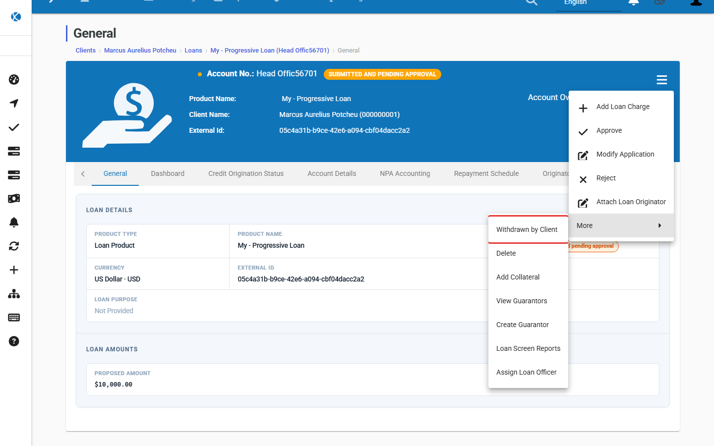
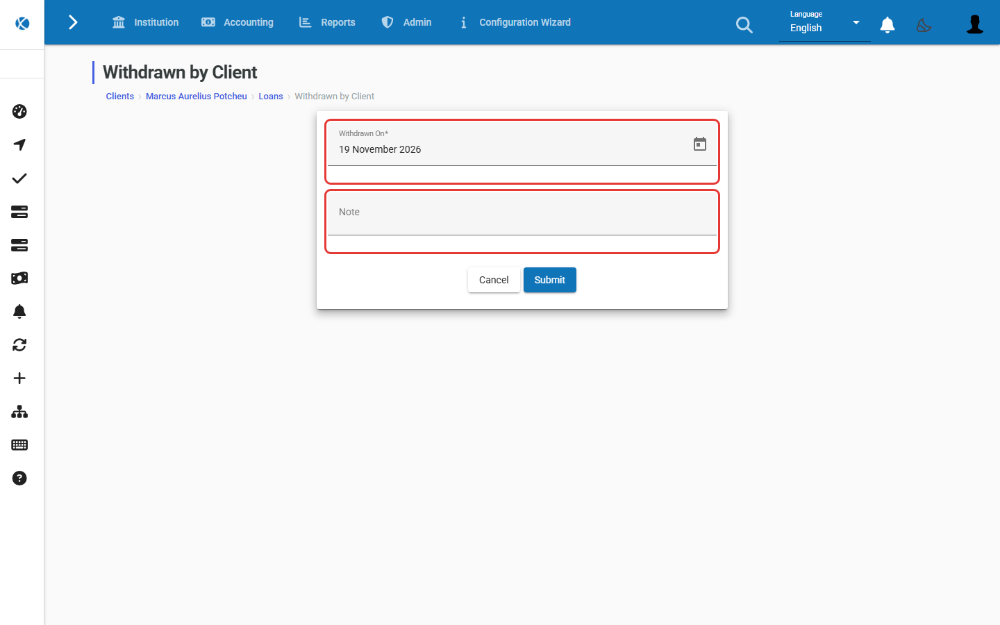

# Future-Dated Termination and Loan Withdrawal

## Contract termination and loan withdrawal

Contract termination lets you set a transaction date, including a future date before the loan’s current maturity date. Loan withdrawal is a separate transaction type with comparable early termination behavior, so the system can distinguish loan withdrawal from contract termination while sharing date validation, interest calculation, and transaction processing. Loan withdrawal means early termination of an existing loan and remains distinct from withdrawal of a loan application.

## Withdraw a loan

Use this screen to record an early termination of an existing loan as a loan withdrawal, distinct from withdrawing a loan application or contract termination.

1. Select **Institution** > **Clients** and open the client.
2. Under **Loan Accounts**, select the loan account.
3. Open the **Loan Account Actions** menu (the ☰ button next to the account name).
4. Select **Withdrawn by Client**.

   

5. Enter the details described below, then select **Submit**.

| Field | Required | Description |
| --- | --- | --- |
| Withdrawn On | Yes | Enter the effective transaction date for the loan withdrawal. It is required and defaults to the current tenant business date if omitted; a malformed date fails validation. |
| Note | No |  |

The system records the loan withdrawal as a distinct transaction type, updates the loan substatus, calculates interest up to the selected date, recalculates the schedule where applicable, and processes the transaction immediately rather than waiting for the selected date.

## Transaction date rules

The transaction date is the effective date for contract termination or loan withdrawal. If you omit it, the system uses the current tenant business date. A malformed date fails validation and does not fall back to the business date.

Accepted and rejected dates:

| Requested date | Contract termination | Loan withdrawal |
| --- | --- | --- |
| Past date | Rejected | Accepted only when it is not earlier than the latest relevant transaction or charge submission |
| Current business date | Accepted when eligible | Accepted when eligible |
| Future date before maturity | Accepted when eligible | Accepted when eligible |
| Future date on or after maturity | Rejected | Rejected |

## Eligibility and permissions

You can request future-dated termination or loan withdrawal only for an open loan belonging to an active client or group with a progressive repayment schedule. Existing eligibility, permission, and transaction processing restrictions still apply, along with any configured permission and maker-checker mechanisms.

> **Note:** The validator skips the maturity comparison when maturity is absent, so whether a loan without a maturity date can be terminated in the future remains a business-rule decision.

## Transaction types and substatuses

| Transaction type | Transaction type ID | Loan substatus |
| --- | --- | --- |
| CONTRACT_TERMINATION | 38 | CONTRACT_TERMINATION — 900 |
| LOAN_WITHDRAWAL | 48 | LOAN_WITHDRAWAL — 901 |

## Processing and schedule effects

When you submit a future-dated termination or withdrawal request, the system records the transaction with its future effective date and updates the loan substatus immediately. Transaction processing runs at submission time, not on the selected date, and no scheduled job waits for that date.

Schedule and transaction processing calculate interest, principal, fees, penalties, and transaction allocation using the selected effective date and the loan’s configured calculation conventions. Interest accrues only up to that date.

For interest-bearing loans with interest recalculation enabled, the system regenerates the repayment schedule and reprocesses transactions with the new transaction so that the revised schedule and outstanding balances reflect early termination.

Subsequent business-date processing does not add interest beyond the effective termination date contrary to the revised schedule.

The shared early termination service reuses existing interest, rounding, allocation, and schedule calculation logic. Each operation supplies its own transaction type, loan substatus, validation rules, and business events.

## Undoing termination or withdrawal

You can undo a future-dated termination or loan withdrawal when the termination transaction is the last user transaction. Undoing reverses the transaction, clears the early termination substatus, regenerates the schedule where applicable, reprocesses transactions, and emits the corresponding events.

## Validation and error handling

The system rejects malformed dates and unsupported parameters with meaningful errors. The user interface and API apply the same business rules, and server validation is authoritative. Client-side validation improves feedback, but the API repeats all required checks.

## User interface

You select and submit a transaction date for contract termination or loan withdrawal. For contract termination, you can choose a future date strictly before maturity, but not a past date. For loan withdrawal, the agreed historical-date rule applies. The selected effective date appears before submission.

The user interface shows:

- The date selector.
- The operation label.
- Validation feedback.
- Server validation errors against the date field where applicable.
- The correct transaction label and effective date in transaction history.

## Request processing flow

When you submit a future-dated termination or loan withdrawal request, the system resolves the operation and transaction date, validates loan eligibility and date rules, creates the termination transaction, recalculates the schedule, processes the transaction, persists the transaction and loan changes, publishes existing business events, and returns the transaction identifier and changes.

The system validates request parameters as follows:

- For a past date, the system rejects contract termination.
- For loan withdrawal, the system rejects a date earlier than the last user transaction date, excluding amortization.
- For loan withdrawal, the system rejects a withdrawal date earlier than the submission date of any active charge.
- For a future date, the system rejects a date equal to or later than the current maturity date.

## Worked examples

Future-dated contract termination before maturity. A loan officer opens a loan with a principal of 1,000, an annual interest rate of 12 percent, three monthly installments, 30-day months, and a 360-day year. The figures are illustrative. The tenant business date is 1 January, installments fall due on 1 February, 1 March, and 1 April, and maturity is 1 April. The officer selects 1 March as the termination date, which is a future date before maturity. One repayment of 340.02 has already been posted on 1 February.

The termination payment clears the balance because interest is calculated only up to the selected date.

| Date | Event | Payment | Interest | Principal | Balance |
| --- | --- | --- | --- | --- | --- |
| 1 January | Opening balance | – | – | – | 1,000.00 |
| 1 February | Repayment | 340.02 | 10.00 | 330.02 | 669.98 |
| 1 March | Contract termination | 676.68 | 6.70 | 669.98 | 0.00 |
| Total |  | 1,016.70 | 16.70 | 1,000.00 | 0.00 |

Loan withdrawal with the same early payoff. The setup is identical: principal of 1,000, annual interest rate of 12 percent, three monthly installments, 30-day months, business date 1 January, one repayment of 340.02 on 1 February, and a selected effective date of 1 March. The officer processes the payoff as a loan withdrawal rather than a contract termination. The calculation and the money movement are the same; only the transaction type label and the loan substatus recorded in the history differ.

The amounts are identical to contract termination; the record differs only in the transaction type label and loan substatus.

| Date | Event | Payment | Interest | Principal | Balance |
| --- | --- | --- | --- | --- | --- |
| 1 January | Opening balance | – | – | – | 1,000.00 |
| 1 February | Repayment | 340.02 | 10.00 | 330.02 | 669.98 |
| 1 March | Loan withdrawal | 676.68 | 6.70 | 669.98 | 0.00 |
| Total |  | 1,016.70 | 16.70 | 1,000.00 | 0.00 |
