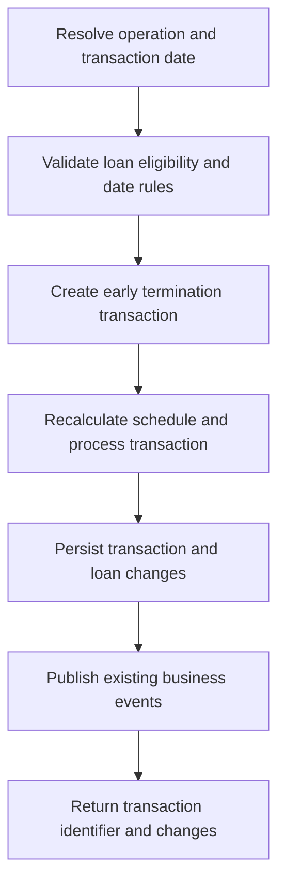
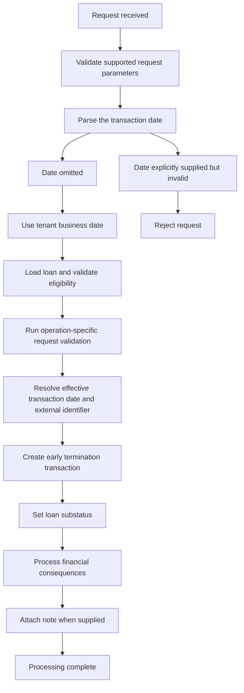

# Future-Dated Termination and Loan Withdrawal

## Future-Dated Termination and Loan Withdrawal

### Feature overview

Contract termination supports a user-selected transaction date, including a future date before the loan's current maturity date. Loan Withdrawal is a distinct transaction type with comparable early termination behavior, sharing date validation, interest calculation, and transaction processing with contract termination.

### Transaction date rules

You can enter a transaction date for contract termination or loan withdrawal. If you omit the date, the system uses the current tenant business date. Interest accrues up to the selected date using the loan's configured calculation conventions.

Contract termination accepts the following dates:

- The current business date, subject to existing eligibility rules.
- A future date strictly earlier than the loan's current maturity date.
- A past date is rejected.

Loan withdrawal accepts the following dates:

- The current business date, subject to existing eligibility rules.
- A future date strictly earlier than the loan's current maturity date.
- A past date only when it does not precede the latest relevant transaction or charge submission, and only when the date is not earlier than the latest relevant transaction or charge submission.

The system rejects dates that fall outside these ranges:

- Contract termination when the date is later than the current business date and on or after the maturity date.
- Loan withdrawal when the date is later than the current business date and on or after the maturity date.

The maturity boundary applies specifically to future dates. Same-day termination after maturity retains existing behavior, and existing transaction ordering determines ordering within the same day.

Loan Withdrawal is recorded as a distinct transaction type and its label appears in transaction history and API responses.

Requests that omit the transaction date retain current-business-date behavior.

For past-dated withdrawal, equal dates are permitted by the current date comparisons.

### Validation and error handling

Validation rejects malformed dates and unsupported parameters with meaningful errors. An explicitly supplied date that cannot be parsed fails validation and never falls back to the business date.

The following validation errors apply:

- A supplied date that cannot be parsed produces error suffix invalid.date.format.
- Contract termination before the business date produces error suffix cannot.be.before.business.date.
- A future date on or after maturity produces error suffix must.be.before.maturity.date.
- A withdrawal before the last relevant transaction produces error suffix cannot.be.before.last.transaction.date.
- A withdrawal before an active charge submission produces error suffix cannot.be.before.charge.submitted.on.date.

The following dates are accepted when eligible:

- When the transaction date is omitted, the business date is used.
- Either operation on the business date is accepted.
- A future date before maturity is accepted.

The following dates are rejected:

- Contract termination before the business date is rejected.
- A future date equal to maturity is rejected.
- A future date after maturity is rejected.
- A historical withdrawal before a relevant transaction is rejected.
- A historical withdrawal before an active charge submission is rejected.

A historical withdrawal after all relevant transactions and charge submissions is accepted under the working interpretation. Existing loan eligibility, permission, and transaction processing restrictions remain in force, and the prohibition on backdated transactions applies to contract termination.

### Transaction processing

Contract termination and loan withdrawal share an early termination service. Each operation supplies its own transaction type, loan substatus, validation rules, and business events, while reusing existing interest, rounding, allocation, and schedule calculation logic. UI and API apply the same business rules, and server validation is authoritative.

When you submit a future-dated request, processing runs immediately.

- The service uses the selected date as the transaction’s effective date.
- Schedule and transaction processing calculate the financial consequences at that date.
- The transaction is recorded with its future effective date.
- The loan substatus is updated.
- The system persists the transaction, loan changes, and related accounting changes within the existing transaction boundary.
- The system preserves the effective transaction date, transaction type, external identifier, notes, and existing command audit information.
- Existing permission and maker-checker mechanisms apply where configured.

The design does not introduce a scheduled job that waits until the selected date.

### Architecture and service flow

REST resources route contract termination, withdrawal, and undo commands to the appropriate command handlers. The handlers invoke the corresponding early termination service operation, which checks eligibility, creates transactions, updates substatus, and coordinates processing. The progressive loan validator validates supported request parameters and operation-specific date rules, while schedule and transaction services calculate interest and allocation using the selected effective date. Persistence and event infrastructure store results and publish the appropriate balance and operation events.

### Request parameters

The request accepts an optional effective date, an optional external transaction identifier, and an optional transaction note. When you omit the effective date, it defaults to the tenant business date.

The following parameters control how the date is interpreted:

- The date format is used to parse the supplied date.
- The locale is used for date parsing.

### Transaction types and substatuses

Contract termination and loan withdrawal are separate operations, each with its own transaction type, transaction type ID, and loan substatus. Loan withdrawal means early termination of an existing loan and stays distinct from withdrawing a loan application.

| Operation | Transaction type | Transaction type ID | Loan substatus |
| --- | --- | --- | --- |
| Contract termination | CONTRACT_TERMINATION | 38 | CONTRACT_TERMINATION — 900 |
| Loan withdrawal | LOAN_WITHDRAWAL | 48 | LOAN_WITHDRAWAL — 901 |

The system keeps the two operations separate across responses, history, reporting, and event mappings.

- For interest-bearing loans with interest recalculation enabled, regenerate the repayment schedule and reprocess transactions with the new transaction.
- Otherwise, process the new transaction through the existing latest-transaction path.

### Response and audit

The system returns the existing command processing result, which includes the created transaction identifier, the loan identifier, and the applicable changes.

The system rejects termination or withdrawal requests under the following conditions:

- Contract termination is rejected for a past date.
- Loan withdrawal is rejected for a date earlier than the last user transaction date, excluding amortization.
- Loan withdrawal is rejected for a date earlier than the submission date of any active charge.
- Contract termination is rejected for a future date equal to or later than the current maturity date.

The system applies the following eligibility rules:

- Existing loan eligibility restrictions apply.
- The loan must be open, the client or group must be active, and the repayment schedule must be progressive.
- Remaining existing eligibility checks are preserved.
- The validator skips the maturity comparison when maturity is absent.

### UI behavior

You open the withdrawn by client screen from the loan account actions and submit a future-dated withdrawal. The transaction date defaults to the tenant business date, and you may select any future date strictly before maturity. Past dates are not allowed for contract termination. For loan withdrawal, apply the agreed historical-date rule.

1. Open the loan account and choose "Withdrawn by Client" from the actions.
2. Enter Withdrawn On and optionally enter Note.
3. Choose Submit.

The withdrawn by client screen behaves as follows:

- Withdrawn On is required.
- Cancel and Submit buttons are available.
- The system shows the selected effective date before submission.
- The UI presents the date selector, operation label, and validation feedback.
- Server validation errors appear against the date field where applicable.

Transaction history displays the correct transaction label and effective date.

Users select and submit a transaction date, with validation consistent with the API.

### Command processing steps

1. Resolve the operation and transaction date from the UI or API request.
2. Validate loan eligibility and date rules.
3. Create the early termination transaction.
4. Recalculate the schedule and process the transaction.
5. Persist the transaction and loan changes.
6. Publish existing business events.
7. Return the transaction identifier and changes.

### Validator processing steps

1. Validate the supported request parameters.
2. Parse the transaction date.
3. Use the tenant business date when the date is omitted.
4. Reject the request when an explicitly supplied date is invalid.
5. Load the loan and validate eligibility.
6. Run operation-specific request validation.
7. Resolve the effective transaction date and external identifier.
8. Create the appropriate early termination transaction.
9. Set the corresponding loan substatus.
10. Process the financial consequences.
11. Attach a note when one is supplied.

### Worked examples

A customer takes a loan of 1,000.00 at 12 percent per annum. The product uses 30-day months and three monthly installments. The business date is the second installment due date, and the first installment has already been paid. The officer opens contract termination and chooses the transaction date. The figures in this example are illustrative. Termination on the business date is accepted, interest runs only to that date, and the balance reaches zero; a future date before maturity is likewise accepted, with only the effective date and interest days changing.

| Date | Event | Principal | Interest | Balance |
| --- | --- | --- | --- | --- |
| Day 0 | Disbursement | — | — | 1,000.00 |
| Day 30 | Installment 1 | 330.02 | 10.00 | 669.98 |
| Day 60 | Contract termination | 669.98 | 6.70 | 0.00 |
| Total |  | 1,000.00 | 16.70 | — |

Using the same loan, the business date is day 60 and maturity is day 90. The officer attempts contract termination on a date before the business date, on the maturity date, and after the maturity date. Contract termination rejects every date before the business date and every date on or after maturity.

| Selected date | Business date | Maturity date | Decision |
| --- | --- | --- | --- |
| Day 30 | Day 60 | Day 90 | Rejected — before business date |
| Day 90 | Day 60 | Day 90 | Rejected — on or after maturity |
| Day 100 | Day 60 | Day 90 | Rejected — on or after maturity |

Loan withdrawal is a separate early termination transaction. The business date is day 75, maturity is day 90, the last repayment was posted on day 60, and a charge was submitted on day 50. The officer chooses a past transaction date of day 70. Because the chosen date is after the last transaction and the charge submission, the withdrawal is accepted and recorded as a loan withdrawal, distinct from contract termination.

| Date | Event | Principal | Interest | Balance |
| --- | --- | --- | --- | --- |
| Day 0 | Disbursement | — | — | 1,000.00 |
| Day 30 | Installment 1 | 330.02 | 10.00 | 669.98 |
| Day 60 | Installment 2 | 333.32 | 6.70 | 336.66 |
| Day 70 | Loan withdrawal | 336.66 | 1.12 | 0.00 |
| Total |  | 1,000.00 | 17.82 | — |
