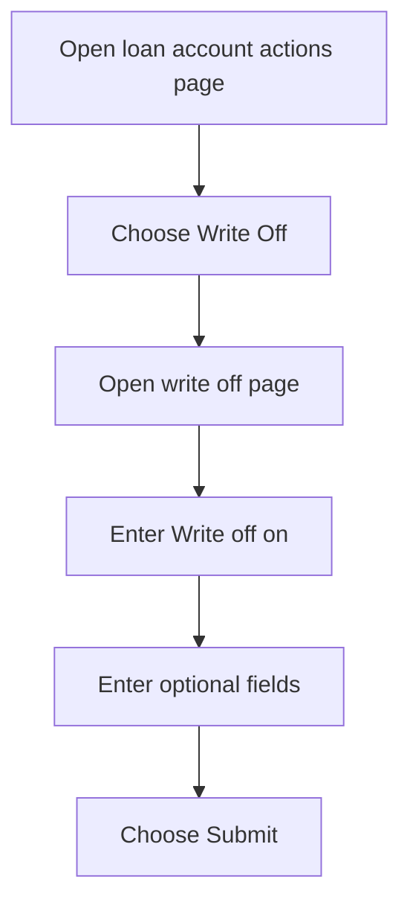

# Write-Off

## Write-Off

### Write-off accounting for charged-off loans

When a loan has already been charged off and you trigger a write-off, the system does not credit the receivable GL account again. Instead, it posts principal, interest, fee and penalty amounts to separate charge-off income accounts. You cannot write off a loan that has not been charged off.

| Amount type | Account used |
| --- | --- |
| Principal | Charge-off Expense |
| Interest | Income from Charge-off Expense |
| Fee | Income from Charge-off Fee |
| Penalty | Income from Charge-off Penalty |

### Write-off reason to GL account mapping

You can map each write-off reason to an expense GL account. When a loan product has no write-off reason configurations set and a loan is written off with a reason, the default mapping is shown.

The following rules apply to write-off reason to GL account mappings:

- The write-off reason field is optional.
- Multiple write-off reason to expense GL mappings can be configured, but the same reason code cannot be configured twice.
- For one write-off reason code, only one GL account can be configured.
- The same GL account can be configured for multiple write-off reasons.
- Adding the same write-off reason twice with different expense accounts on a loan product is prohibited and shows an error on submit.
- When advance accounting is mapped for a write-off reason and that reason is used, the mapped GL account is used instead of the default mapping.

A mapping entry uses two identifiers:

- The write-off reason code value id must be a valid, existing id of a write-off reason code value.
- The expense GL account id must be a valid, existing Expense GL account id.

A new Advance Accounting rule maps write-off reason code with accounting mapping.

The loan product request includes the write-off reasons to expense mappings list with write-off reason code value id and expense GL account id fields.

Undoing a write-off works as follows:

- When undoing a transaction of type WRITEOFF (Close as written-off), the UI calls command=undowriteoff instead of command=undo.
- Undo write-off is listed as an available option in the upper, right corner menu alongside Recovery payment.

### Write-off reason selection

During write-off, the UI lists all available write-off reason code values and lets you select one. Loan details retrieve the selected write-off reason code value.

### Write-off page fields and actions

The write-off page marks Write off on as required and offers Cancel and Submit buttons.

### Performing a write-off

You write off a loan account from its actions page. The write-off applies when the loan was not charged off, and no changes are required for it to work as expected.

1. Open the loan account actions page and choose "Write Off" from the actions to open the write-off screen.
2. Enter Write off on, optionally enter Amount, Reason for Write-Off, Note and External Id, then choose Submit.

