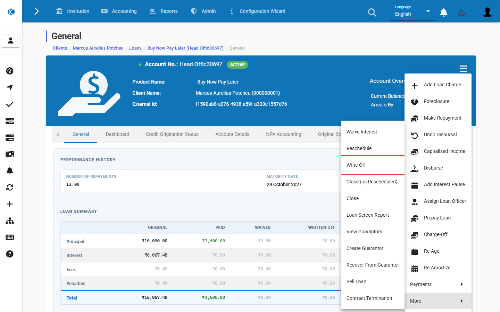
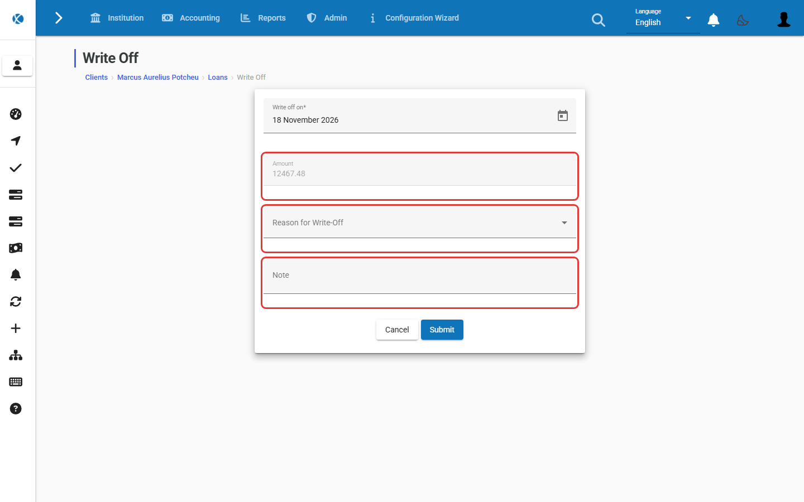
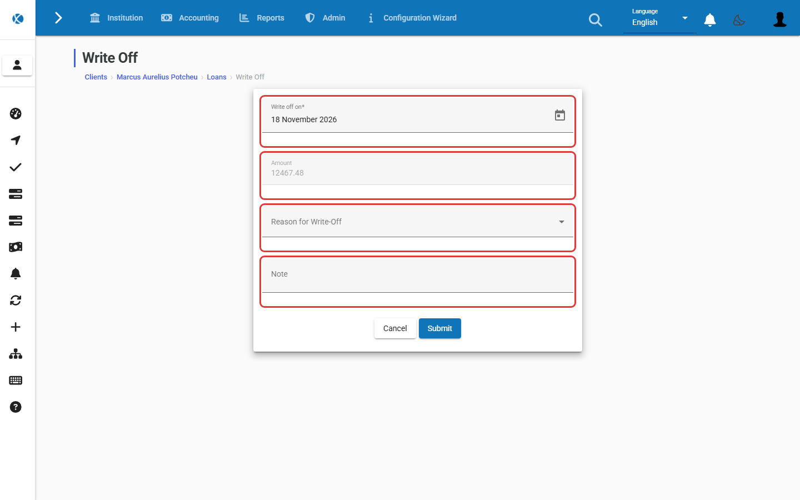

# Write-Off

## Write-off overview

A write-off marks a closed or overpaid loan as fraud. If the loan was not charged off before it was written off, no changes are required and everything works as expected. Write-off processing avoids double credit receivable accounts when both charge-off and write-off occur.

## Write off a loan

Use this screen to mark a loan as written-off and close it with that status.

1. Select **Institution** > **Clients** and open the client.
2. Under **Loan Accounts**, select the loan account.
3. Open the **Loan Account Actions** menu (the ☰ button next to the account name).
4. Select **Write Off**.

   

5. Enter the details described below, then select **Submit**.

| Field | Required | Description |
| --- | --- | --- |
| Write off on | Yes | Enter the date the write-off takes effect. |
| Amount | No | Enter the amount to write off. |
| Reason for Write-Off | No | Select one of the available write-off reason code values. |
| Note | No | Enter an optional note. |

The loan is closed with status written-off, no further amortization occurs, and the selected write-off reason code value is set on the loan and shown in the loan details.

## Write off a loan

Use the write-off screen to close a loan with a written-off status and record the write-off details.

1. Select **Institution** > **Clients** and open the client.
2. Under **Loan Accounts**, select the loan account.
3. Open the **Loan Account Actions** menu (the ☰ button next to the account name).
4. Select **Write Off**.

   

5. Enter the details described below, then select **Submit**.

| Field | Required | Description |
| --- | --- | --- |
| Write off on | Yes | Enter the date on which the write-off takes effect. This field is required. |
| Amount | No | Enter the amount to write off. |
| Reason for Write-Off | No | Select one of the available write-off reason code values. |
| Note | No | Add an optional note about the write-off. |
| External Id | No | Enter an optional external identifier for the write-off. |

The loan is closed with a written-off status, no further amortization occurs, and the selected write-off reason is stored on the loan details.

## Write-off reason codes

During write-off, you select one write-off reason code from all available values. The field is optional.

## Write-off GL account mapping

Map each write-off reason code to an expense GL account so the system knows which account to debit when a loan is written off using that reason.

Rules for mapping write-off reason codes to GL accounts:

- A write-off reason code can be mapped to any expense GL account from the dropdown.
- Multiple write-off reason codes can share the same expense GL account.
- The same write-off reason code cannot be mapped to more than one expense GL account.
- Adding the same write-off reason twice to a loan product is forbidden.

When a loan is written off:

- If advance accounting is mapped for the write-off reason used, the mapped GL account is used instead of the default mapping.
- If the loan product has no write-off reason configurations set, the default mapping is shown.

## Overpayment handling

When a loan is overpaid, the system compares the overpayment amount with the current balance required (CBR). The result decides whether the loan closes, stays overpaid, or returns to active status. If the CBR is greater than the overpaid amount, the system blocks the action.

| Condition | Result |
| --- | --- |
| Overpayment amount equals CBR | The loan moves from Overpaid to Closed (fully paid). |
| Overpayment amount is greater than CBR | The loan remains Overpaid. The overpayment amount becomes the difference between CBR and the overpayment balance. |
| Overpayment amount is lower than CBR | The loan moves from Overpaid to Active. The due principal amount becomes the difference between CBR and the overpayment balance. |
| CBR amount is greater than the overpaid amount | The system does not allow this and handles it through validation. |

## Write-off processing

A write-off closes the loan with a written-off status and stops all further amortization. Any repayment posted after write-off is treated as recovery income and follows write-off-specific accounting rules. An accounting write-off happens whenever a charge-off is triggered.

## Undoing a write-off

You can undo a write-off transaction from the customer’s transaction list.

Undo write-off is available through:

- The upper-right corner list.
- The customer-initiated Undo-writeoff action.

## Write-off in the UI

You can trigger a write-off from the UI. The UI lists the available write-off reason codes, and the write-off uses the same capability and parameters as for progressive loans.

If a repayment or reversal is backdated to before the write-off date, the system replays the write-off transaction and its corresponding accounting entries accordingly.

## Worked examples

A loan officer writes off a loan of 1,000.00 that was already charged off, so its receivable accounts were credited earlier. The loan still has 120.00 of interest, 30.00 of fees and 20.00 of penalties outstanding. These figures are illustrative. Because the receivables were already credited at charge-off, the write-off does not credit them again; instead it posts the principal to Charge-off Expense and the interest, fee and penalty amounts to their respective charge-off income accounts.

| Component | Amount | Account posted |
| --- | --- | --- |
| Principal | 1,000.00 | Charge-off Expense |
| Interest | 120.00 | Income from Charge-off Expense |
| Fee | 30.00 | Income from Charge-off Fee |
| Penalty | 20.00 | Income from Charge-off Penalty |
| Total | 1,170.00 | - |

This example shows that a write-off after charge-off avoids double-counting receivables and routes each component to its correct charge-off account.
