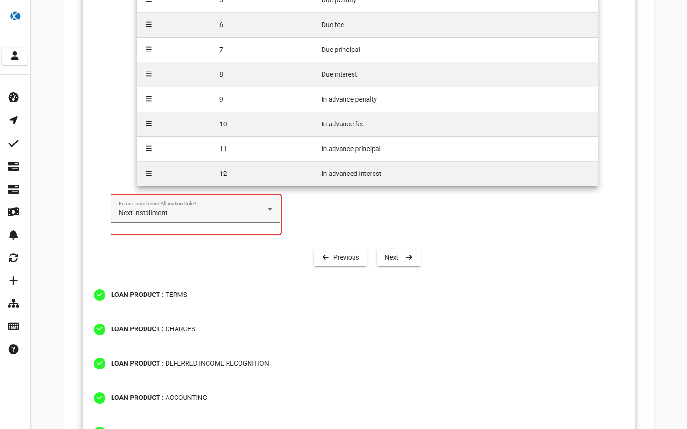
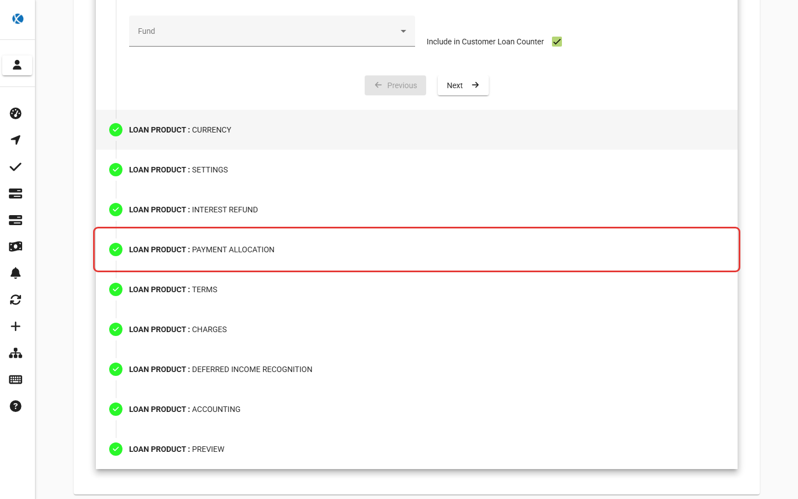

# In-Advance Allocation Rules

The in advance allocation rules decide how an unprocessed repayment amount is distributed across upcoming installments for loans that use the New DueInAdvance payment strategy with in advance portions. On the Repayment schedule tab, the In Advance column shows principal only rather than principal plus fee.

Allocation order:

- The in advance allocation rule allocates the unprocessed amount to the upcoming installment first, then to the last installment if any amount remains.
- If an early repayment amount exceeds both the first upcoming installment outstanding and the last installment outstanding, the remaining unprocessed amount is allocated to the last but one installment.
- The Future installment rule allocates the unprocessed amount to the upcoming installment first, then to the last installment, and from that point allocates backward in order.

Future installment allocation rule options:

| Option | Code |
| --- | --- |
| Next installment - Last installment | NEXT_INSTALLMENT |
| Last installment | LAST_INSTALLMENT |
| Reamortization | REAMORTIZATION |

Select the future installment allocation rule from the dropdown on the loan product configuration screen.

## Set the future installment allocation rule

Use this screen to choose how unprocessed amounts are allocated to upcoming installments for loans using the New DueInAdvance payment strategy.

1. Select **Admin** > **Products** > **Loan Products**.
2. Select **Create** > **Create Loan Product (Classic)**, or open an existing product and select **Edit**.
3. Open the **PAYMENT ALLOCATION** step.

   

| Field | Required | Description |
| --- | --- | --- |
| Credit Allocation Strategy | No |  |
| Future Installment Allocation Rule | No | Select how unprocessed amounts are allocated to upcoming installments. Options include NEXT_INSTALLMENT, LAST_INSTALLMENT, and REAMORTIZATION. |

## Worked examples

A borrower pays 500.00 early on 10 January toward a loan with four equal monthly installments of 200.00 due on 1 February, 1 March, 1 April and 1 May. The figures are illustrative. The in-advance allocation rule sends the unprocessed amount to the upcoming installment first, then to the last installment, and any remainder after both are covered goes to the last-but-one installment.

| Installment | Due | Before | Allocated | After |
| --- | --- | --- | --- | --- |
| 1 | 1 February | 200.00 | 200.00 | 0.00 |
| 2 | 1 March | 200.00 | 0.00 | 200.00 |
| 3 | 1 April | 200.00 | 100.00 | 100.00 |
| 4 | 1 May | 200.00 | 200.00 | 0.00 |
| Total |  | 800.00 | 500.00 | 300.00 |

This shows how an early repayment covers the first and last installments in full and reduces the last-but-one installment by the remainder.
