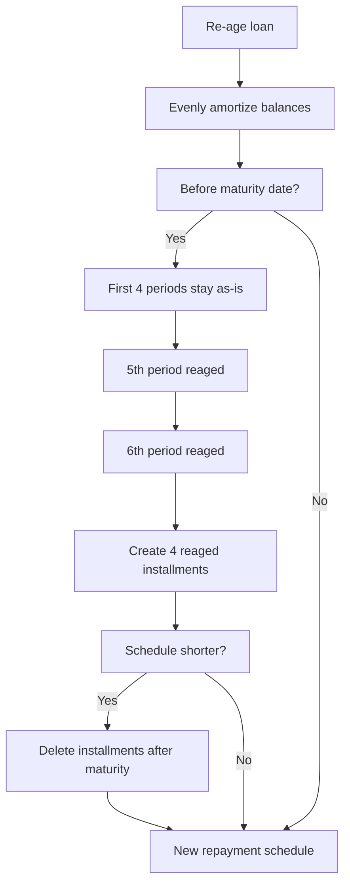
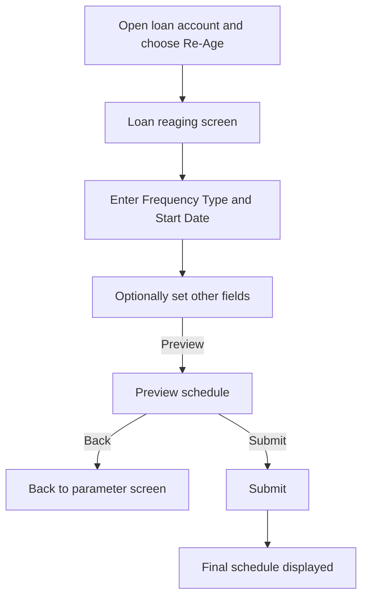

# Re-aging

## Re-aging

### Re-aging overview

Re-aging, also known as Settlement Plan, assists customers in duress around repaying their loans by creating a new set of installments for the same loan account from the principal outstanding pending on the loan account.

### Eligibility and timing

Re-aging applies to progressive loan accounts. You can re-age from any date of the loan cycle after the first disbursement date, including before maturity, but not on a charged-off loan. For interest-bearing loans, the re-aging date must not be before the last repayment date.

Interest handling during re-aging works as follows:

- Interest handling configuration is available on the Re-age screen and is not required on the loan product.
- You can configure interest handling types while re-aging interest-bearing loans from both the UI and the API.
- The options are Default Behavior, Waive Interest, Equal Amortization, Outstanding payable Interest, and Outstanding FULL Interest.
- Interest handling during re-aging for interest-bearing loans uses default behavior.

### Default behavior interest handling

Under Default Behavior interest handling, overdue interest and charge-back interest move to the first new re-age installment, while charge-back principal is re-aged.

Overdue fees and charge-back fees stay on the existing installment, and fees or penalties with a due date after re-age stay as is and are adjusted to the relevant installment.

- Overdue fees remain as is on the existing installment.
- Charge-back fees remain as is on the existing installment.
- Fees or penalties with a due date after re-age remain as is and are adjusted to the relevant installment.

### Waive interest option

When interest handling is set to Waive Interest, overdue interest and outstanding payable interest are waived off.

The following rules apply under Waive Interest:

- Overdue charges remain as is on the existing installments.
- Charge-back principal is re-aged.
- Charge-back interest is waived.
- Charge-back fees remain as is on the existing installment.
- Fees and penalties with a due date after re-age remain as is and are adjusted to the relevant installment.
- Fees and penalties added before re-age remain as is and are adjusted to the relevant installment.

### Equal amortization interest handling

Equal amortization interest handling splits outstanding interest equally among new installments, with the user choosing either outstanding payable interest or outstanding full interest as the basis. No new interest calculation occurs after re-aging, and declining balance interest calculation is turned off.

Equal amortization re-aging applies the following equal splits across new installments:

- Outstanding interest is split equally based on the selected outstanding payable interest or outstanding full interest option.
- Outstanding charges and penalties are split equally.
- Charge-back principal and interest amounts are split equally.
- Charge-back amount portions are split equally.
- Charges are split evenly across each installment.
- Charge to repayment installment mapping must be updated.
- Down-payment amounts are not affected by re-aging.

Charges or penalties with a due date after the re-age date are equally split among new installments.

### Interest recalculation and rate

During re-aging, interest recalculation is turned off and declining balance interest calculation is turned off. Interest rate and interest recalculation remain the same for interest-bearing loans.

The model is updated and used when interest recalculation is true; otherwise only repayment installments are used.

- When interest recalculation is true, the model is updated and used.
- When interest recalculation is false, only repayment installments are used.

### Principal, charges, and fees handling

Re-aging applies to charges and fees based on their due date relative to the re-age date, and it applies the same way for interest-bearing and non-interest bearing products. Down-payment amounts and charge-back amounts are not affected by re-aging. Partial payments made before re-aging stay as they are, and only the unpaid amount is re-aged.

Charges and fees are handled as follows during re-aging:

- Charges and fees with a due date before the re-age date are split equally among the new installments.
- Charges and fees with a due date after the re-age date remain as is on that installment.
- The charge to repayment installment mapping is updated during re-aging.

### N+1 installments

N+1 installments remain unless they overlap with re-aged installments. When re-aged installments are added and an N+1 installment already exists, the N+1 installment is updated to become one of the re-aged installments.

N+1 installments are handled during re-aging as follows:

- N+1 installments are reapplied accordingly to the new installments.
- N+1 installments are reapplied accordingly to the new installments during re-aging for interest-bearing loans.
- The N+1 installment amount is adjusted as part of reverse replay.
- A reversed re-age transaction should not be found during validations when initiating a new re-age.

### Reversing re-aging

You can reverse re-aging until it is the latest transaction on the loan. Reversing a backdated repayment or its reversal also reverses re-aging and replays the schedule accordingly. Iteration is disabled during this process.

When re-aging is reversed, the following occurs:

- The re-aging transaction itself can be reversed until it is the latest transaction on the loan.
- Scheduled is replayed and re-applied accordingly.
- The schedule is replayed and re-applied accordingly.

### Schedule changes and installment overrides

Re-aging replaces part of the existing repayment schedule with a reaged payment plan. The first four installment periods stay as-is, the fifth and sixth periods become reaged installments with recalculated due dates, and four more installments are created from the reage payment plan. If the reaged schedule is shorter, all normal installments after the new maturity date are deleted. Outstanding balances can be evenly amortized into equal installments.

### Charge-off scenarios

Charge-off accelerate maturity date logic works the same as contract termination. The charge-off setting makes future installment interest zero. You cannot perform re-aging on a charged-off loan account; the system shows a validation message when you try. Edge cases are handled for interest bearing loan accounts with Default Behavior and interest recalculation enabled when a charge-off occurs during re-aging, when a chargeback before re-age occurs during re-aging, and when a backdated re-age occurs during re-aging.

Excess payments are handled as follows:

- Any excess payment allocated to installments after the re-age date is allocated to a special installment created as of the re-age start date.
- This excess payment handling applies to both non-interest bearing and interest bearing loan accounts.

### Frequency and due date support

Re-aging supports changes to due dates and repayment frequency when interest recalculation is enabled. The re-aging date must not fall before the last repayment date.

Re-aging applies the following rules:

- Principal Only is re-amortized and unpaid interest is waived off.
- Charge-back interest and principal amounts from the previous schedule are split accordingly.

### Preview and user interface

You open the loan account, choose "Re-Age" from the actions, and enter the Frequency Type and Start Date on the loan reaging screen. You can optionally set Interest Handling, Reason, External Id, Note and Transaction Amount before choosing Submit.

The screen provides three actions:

- Cancel returns without saving changes.
- Submit applies the re-aging parameters.
- Preview generates and shows a re-age schedule based on the selected parameters.

The preview dialog behaves as follows:

- It displays the heading Repayment Schedule Preview.
- A Back button returns you to the re-age parameter screen.
- You need the Re-age permission to preview a schedule; no other specific permission is required.

After re-aging completes, the system displays the final schedule.

Contract termination occurs on 1st March.

A Reage transaction with amount of 0 is not allowed when there are no outstanding balances to be reaged. If a 0 amount reage situation occurs during reverse-replay, the Reage transaction is reverted.

### Example values

The example uses an EMI of 17.01, an interest rate of 7% per annum with a daily rate of 0.000194444, and iteration disabled with an iterate value of 0.00.

### Worked examples

A customer holds a 900.00 progressive loan with interest at 12 percent per year and monthly installments. After the first installment of 309.00 is paid on 2/1/24, the principal balance is 600.00. The customer misses the 3/1/24 installment, leaving 300.00 principal and 6.00 interest overdue. On 3/15/24, fifteen days of interest accrue, adding 3.00. The officer opens the loan on 3/15/24, chooses Re-aging, sets the re-age date to 4/1/24, selects three new installments, and keeps the default interest handling. The system moves the 9.00 overdue interest to the first new installment and spreads the 600.00 principal evenly. The figures in this example are illustrative.

Default handling consolidates overdue interest into the first re-aged installment while principal is amortized evenly.

| Date | Transaction | Principal | Interest | Total | Balance after |
| --- | --- | --- | --- | --- | --- |
| 2/1/24 | Installment 1 paid | 300.00 | 9.00 | 309.00 | 600.00 |
| 3/1/24 | Installment 2 missed | 300.00 | 6.00 | 306.00 | 600.00 |
| 3/15/24 | Interest accrual | 0.00 | 3.00 | 3.00 | 609.00 |
| 4/1/24 | Re-age installment 1 | 200.00 | 9.00 | 209.00 | 400.00 |
| 5/1/24 | Re-age installment 2 | 200.00 | 0.00 | 200.00 | 200.00 |
| 6/1/24 | Re-age installment 3 | 200.00 | 0.00 | 200.00 | 0.00 |

Using the same 900.00 loan and missed 3/1/24 installment, the outstanding amount on 3/15/24 is 600.00 principal and 9.00 interest. The officer selects Re-aging from 4/1/24 with three installments. With Equal Amortization, the system splits both principal and interest equally across the three installments and stops new interest calculation. With Waive Interest instead, the 9.00 interest is removed and only the 600.00 principal is split. Changing the setting from Equal Amortization to Waive Interest lowers each installment from 203.00 to 200.00 and removes the interest charge.

Equal amortization divides principal and interest evenly and turns off new interest calculation.

| Date | Transaction | Principal | Interest | Total | Balance after |
| --- | --- | --- | --- | --- | --- |
| 2/1/24 | Installment 1 paid | 300.00 | 9.00 | 309.00 | 600.00 |
| 3/1/24 | Installment 2 missed | 300.00 | 6.00 | 306.00 | 600.00 |
| 3/15/24 | Interest accrual | 0.00 | 3.00 | 3.00 | 609.00 |
| 4/1/24 | Re-age installment 1 | 200.00 | 3.00 | 203.00 | 406.00 |
| 5/1/24 | Re-age installment 2 | 200.00 | 3.00 | 203.00 | 203.00 |
| 6/1/24 | Re-age installment 3 | 200.00 | 3.00 | 203.00 | 0.00 |

A 900.00 loan has its first installment paid on 2/1/24, leaving 600.00 principal. The loan is charged off on 3/1/24 for 606.00, comprising 600.00 principal and 6.00 interest. Because re-aging is permitted on charge-off accounts, the officer re-ages the 606.00 from 4/1/24 into three equal installments of 202.00. The charge-off does not block re-aging; it simply defines the outstanding amount that is redistributed.

Re-aging can restart repayment on a charge-off loan by splitting the charged-off principal and interest into new installments.

| Date | Transaction | Principal | Interest | Total | Balance after |
| --- | --- | --- | --- | --- | --- |
| 2/1/24 | Installment 1 paid | 300.00 | 9.00 | 309.00 | 600.00 |
| 3/1/24 | Charge-off | 600.00 | 6.00 | 606.00 | 0.00 |
| 4/1/24 | Re-age installment 1 | 200.00 | 2.00 | 202.00 | 404.00 |
| 5/1/24 | Re-age installment 2 | 200.00 | 2.00 | 202.00 | 202.00 |
| 6/1/24 | Re-age installment 3 | 200.00 | 2.00 | 202.00 | 0.00 |

After re-aging the 900.00 loan on 4/1/24 into three installments, the officer decides to undo the change before any re-aged installment is paid. Because the re-aging transaction is still the latest entry on the loan, it can be reversed. Reversal removes the new schedule and restores the original repayment plan, so the missed 3/1/24 installment and the 4/1/24 installment become due again under their original terms.

Reversal is possible only while no later transaction exists, and it returns the loan to its pre-re-age schedule.

| Date | Transaction | Principal | Interest | Total | Balance after |
| --- | --- | --- | --- | --- | --- |
| 4/1/24 | Re-aging posted | 0.00 | 0.00 | 0.00 | 609.00 |
| 4/1/24 | Re-aging reversed | 0.00 | 0.00 | 0.00 | 609.00 |
| 5/1/24 | Original installment 2 due | 300.00 | 6.00 | 306.00 | 303.00 |
| 6/1/24 | Original installment 3 due | 300.00 | 3.00 | 303.00 | 0.00 |
