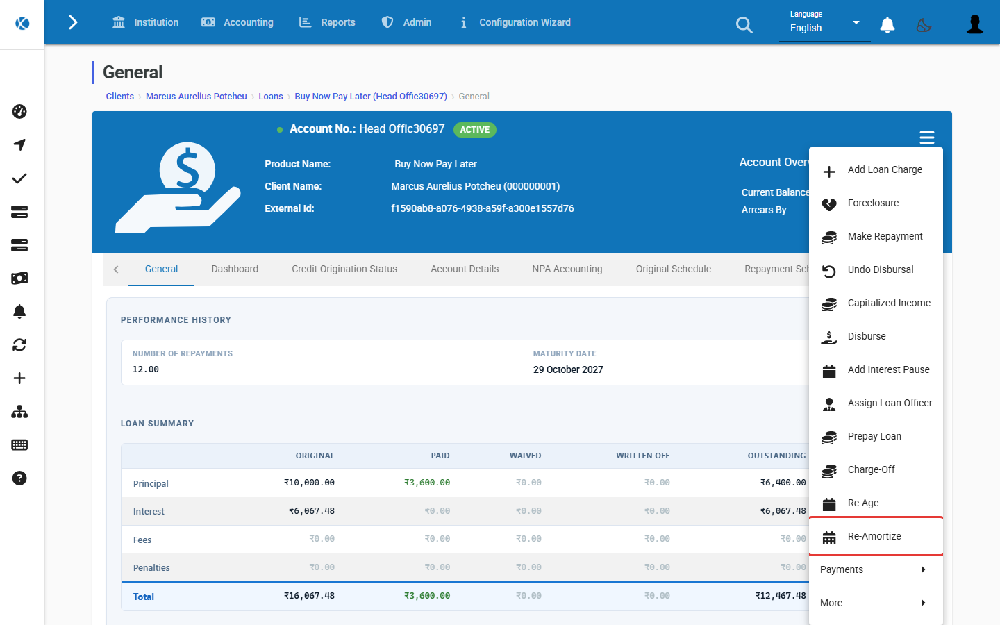
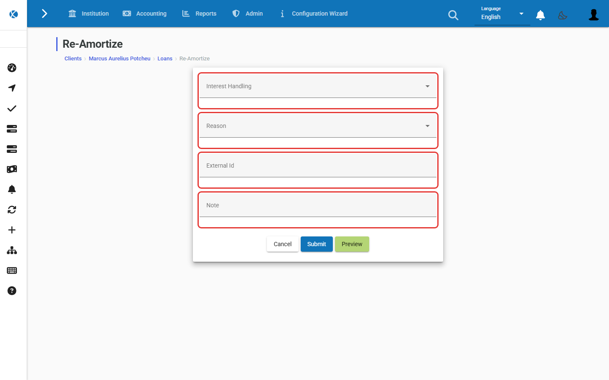
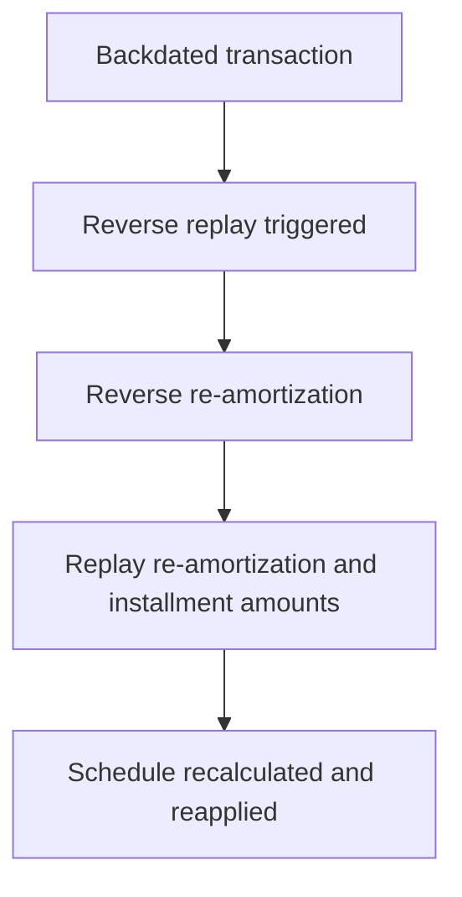

# Re-amortization

## About re-amortization

Re-amortization helps customers who have missed payments by moving the overdue amount into future installments so the loan no longer has a past due balance. It is available for non-interest bearing loans, and the schedule end date typically stays the same.

What re-amortization does:

- It redistributes only the overdue amount to the remaining future installments.

## Re-amortize a loan

Re-amortization spreads the past due balance of the loan over the remaining installments so there is no past due balance.

1. Select **Institution** > **Clients** and open the client.
2. Under **Loan Accounts**, select the loan account.
3. Open the **Loan Account Actions** menu (the ☰ button next to the account name).
4. Select **Re-Amortize**.

   

5. Enter the details described below, then select **Submit**.

| Field | Required | Description |
| --- | --- | --- |
| Interest Handling | No | Choose how interest is handled during re-amortization: Default Behavior, Waive Interest, or Equal Overdue Interest Split. |
| Reason | No | Enter the reason for applying re-amortization. This is optional. |
| External Id | No |  |
| Note | No |  |

The repayment schedule reflects the re-amortized repayment schedule details, and you can view the re-amortized transaction details in the transaction tab.

## Eligibility and supported loans

Re-amortization applies only to active loan accounts that use a progressive repayment schedule handling or advance repayment strategy. It cannot be applied after the maturity date or after the new maturity date.

Charge-off loan accounts:

- Re-amortization cannot be applied on charge-off loan accounts.
- Re-amortization is allowed on charge-off loan accounts.

Interest bearing loan accounts:

- Re-amortization is enabled for interest bearing progressive loan repayment strategy.

## Interest handling options

When you apply re-amortization, choose an interest handling subtype from the drop-down: Default Behavior, Waive Interest, or Equal Overdue Interest Split. Each option decides how overdue interest, charges, and fees are treated after re-amortization.

| Interest handling option | Interest and EMI | Overdue interest including chargeback interest | Overdue charge including chargeback charge | Fees or penalties due after re-amortization |
| --- | --- | --- | --- | --- |
| Default Behavior | Re-calculated based on the new principal balance | Moved to the first installment after the re-amortization date | Remains as is on the existing installment | Remains as is |
| Waive Interest | Re-calculated based on the new principal balance | Waived off | Remains as is on the existing installments | Remains as is |
| Equal Overdue Interest Split | Not stated | Outstanding payable interest including chargeback interest is equally split among future installments | Outstanding charges or penalty is equally split among new installments | Remains as is on the existing installment |

## Applying re-amortization

You apply re-amortization from an active loan account. The system uses the current business date as the transaction date and re-amortization date, and applies the sum of the full past due amount and the current day due amount. No date or amount fields are required.

When you submit re-amortization:

- You can enter an optional reason in a text field.
- You can generate and preview the re-amortized schedule based on the selected parameters.
- You can go back to the re-amortization parameter screen from the preview.
- Once applied, you can view the re-amortized transaction details in the transaction tab.
- The repayment schedule reflects the re-amortized repayment schedule details.

## What gets re-amortized

It does not change the repayment schedule structure, maturity date, due dates, or the number of installments. It applies only to installments after the re-amortization date; installments on or before that date are not re-amortized.

The following amounts stay as they are:

- Down-payment amounts are not affected by re-amortization.
- Partial or excess paid amounts on installments before re-amortization remain on those installments; only the unpaid amount is re-amortized.
- Charges and interest remain as is for their respective installments.
- Payable interest does not change.
- Chargeback amounts remain as they are.
- Past due period EMI is set to the total of paid balances plus charges and is not re-amortized.

The N+1 installment is not affected:

- The N+1 installment remains as is during re-amortization.

Future down-payment installments:

- Future down-payment installments, if they exist, are considered for re-amortization.

What gets re-amortized:

- Only principal can be re-amortized; outstanding fees or penalties remain outstanding for their particular installments and must be paid or waived.
- The re-amortized amount is the complete past due principal amount plus the current date due amount if an installment falls on the same day as re-amortization.

Unpaid principal on the schedule after re-amortization:

| Installment timing | Unpaid principal shown |
| --- | --- |
| Unpaid installments on or before the re-amortized date | Zero |
| Future installments after the re-amortized date | Recalculated principal share |

## Schedule behavior after re-amortization

After re-amortization, the system recalculates the loan schedule using the re-amortization interest handling setting. Interest-bearing loans with interest recalculation enabled follow the default schedule behaviour. Interest waiver and equal overdue interest split behaviour apply to both interest-bearing and non-interest-bearing loans.

Transactions continue to work normally on the re-amortization schedule:

- All transaction types work normally on the re-amortization schedule.
- Credit transactions such as disbursements and capitalised income work normally on the re-amortization schedule.

## Accruals and delinquency

Accruals are recalculated and adjusted as of the re-amortization business date at end of day (COB, the nightly job that posts interest and fees). Periodic accrual is then calculated and posted based on the new installment interest, and accrual activity posts regularly on future installment dates at EOD.

Accrual activity for overdue installments being re-amortized is handled as follows:

- Accrual activity of overdue installments is reversed or reverse-replayed on the re-amortization business date in real time.
- A backdated repayment or reversal before the re-amortization date recalculates and posts the difference accrual or accrual adjustment as of current business date EOD.
- A backdated repayment that results in installment recalculation before re-amortization creates a new accrual activity as of the installment date in real time.
- A backdated repayment reversal that results in installment recalculation and re-amortization reverses the respective accrual activity transaction in real time.

Delinquency is handled as follows:

- Delinquency calculation is triggered when re-amortization is triggered on the loan account.
- Delinquency calculation is triggered when re-aging is triggered on the loan account.
- When the repayment schedule and delinquency buckets are modified by re-amortization, the DelinquencyRangeChange event and AccountStatusChange event are triggered.

Principal and interest are handled as follows:

- Principal Only is re-amortized.
- Unpaid interest is waived off.

## Multiple re-amortizations

You can re-amortize a loan account more than once, but not on the same date. Each re-amortization after the first must use the same interest options as the first re-amortization.

## Undoing re-amortization

You can undo the last re-amortization applied to a loan account. When you do, the system recalculates and reapplies the repayment schedule at that time.

Undo re-amortization only when:

- There are no future payments made after re-amortization (non-reversed payments only).
- You can reverse the re-amortization transaction from the UI.

## Backdated transactions and reversals

You can post backdated transactions on a loan account that has been re-amortized. A backdated repayment or reversal triggers reverse replay, which reverses and replays the re-amortization and recalculates and reapplies the schedule. The repayment schedule replays the re-amortization and installment amounts based on the new past due principal amount plus the current date due amount when an installment falls on the same day as the re-amortization.

The following actions change the past due amount:

- Undoing old repayments
- Backdated repayments
- Backdated disbursements
- Backdated charge additions
- Undoing re-amortization

## Parameters and events

Re-amortization requires one manual parameter and two System parameters. No explicit events or new parameters are required.

## Transaction and schedule details

When re-amortization is applied, the system adds a non-monetary re-amortized transaction to the loan account as of the current business date. This transaction creates no journal entry, and the loan account is not explicitly marked as re-amortized.

## Worked examples

An active loan of 1,000 is repayable in five equal monthly installments of 200, with 30-day months and no interest. The customer pays the first two installments on time but misses the third installment of 200. On the current business date, after the missed due date and before the next due date, the officer applies re-amortization. The overdue principal of 200 is spread equally across the two remaining future installments, adding 100 to each. The maturity date does not change, and the missed installment keeps its original amount. These figures are illustrative.

| Due date | Original installment | Re-amortized installment | Re-amortized amount added | Balance after payment |
| --- | --- | --- | --- | --- |
| Month 1 | 200.00 | 200.00 | 0.00 | 800.00 |
| Month 2 | 200.00 | 200.00 | 0.00 | 600.00 |
| Month 3 | 200.00 | 200.00 | 0.00 | 600.00 |
| Month 4 | 200.00 | 300.00 | 100.00 | 300.00 |
| Month 5 | 200.00 | 300.00 | 100.00 | 0.00 |
| Total | 1,000.00 | 1,000.00 | 200.00 |  |

This shows that only the overdue principal moves to future installments; past installments and the maturity date stay the same.

An active interest-bearing loan of 1,000 is repayable in five monthly installments of 200 principal each, with interest of 1% per month on the opening balance and 30-day months. The original schedule charges 10, 8, 6, 4, and 2 in interest. The customer pays the first two installments but misses the third, leaving 200 of principal and 6 of interest overdue. On the current business date, after the missed due date and before the fourth installment, the officer applies re-amortization with Default interest handling. The overdue interest of 6 is moved to the first future installment. The overdue principal of 200 is added equally to the fourth and fifth installments, giving each 100 extra principal. Interest is recalculated on the new opening balances, so the fourth installment becomes 312 and the fifth becomes 303. The maturity date stays the same. These figures are illustrative.

| Due date | Opening balance | Original installment | Re-amortized installment | Principal | Interest | Balance after payment |
| --- | --- | --- | --- | --- | --- | --- |
| Month 1 | 1,000.00 | 210.00 | 210.00 | 200.00 | 10.00 | 800.00 |
| Month 2 | 800.00 | 208.00 | 208.00 | 200.00 | 8.00 | 600.00 |
| Month 3 | 600.00 | 206.00 | 206.00 | 0.00 | 6.00 | 600.00 |
| Month 4 | 600.00 | 204.00 | 312.00 | 300.00 | 12.00 | 300.00 |
| Month 5 | 300.00 | 202.00 | 303.00 | 300.00 | 3.00 | 0.00 |
| Total |  | 1,030.00 | 1,239.00 | 1,000.00 | 39.00 |  |

With Waive interest handling, the 6 of overdue interest is removed instead of moved, lowering the fourth installment to 306 and total interest to 33; with Equal Overdue Interest Split, the 6 is divided evenly across the fourth and fifth installments, making them 309 and 306 while total interest stays at 39.
