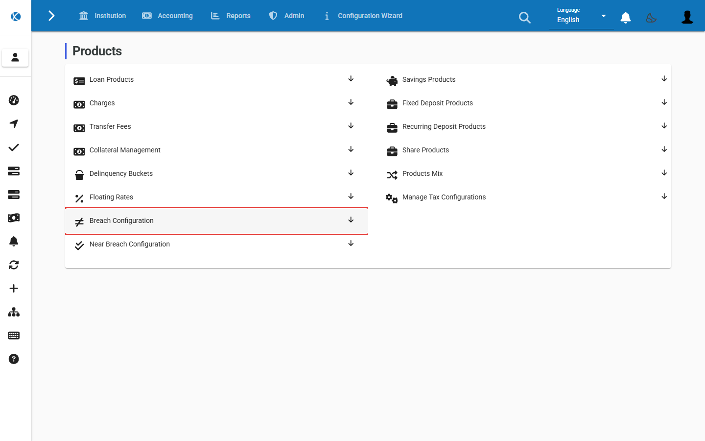
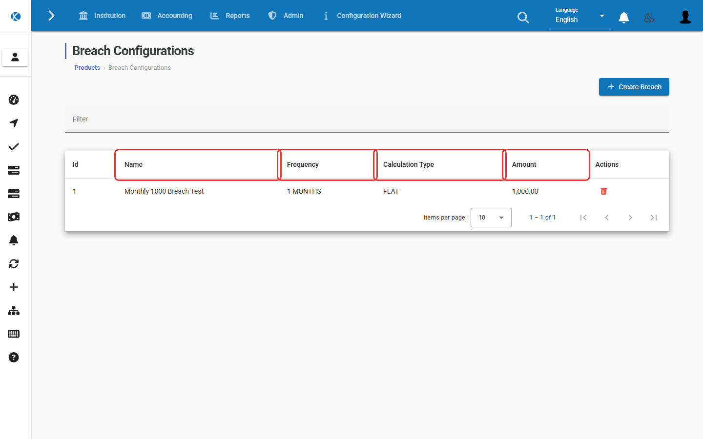
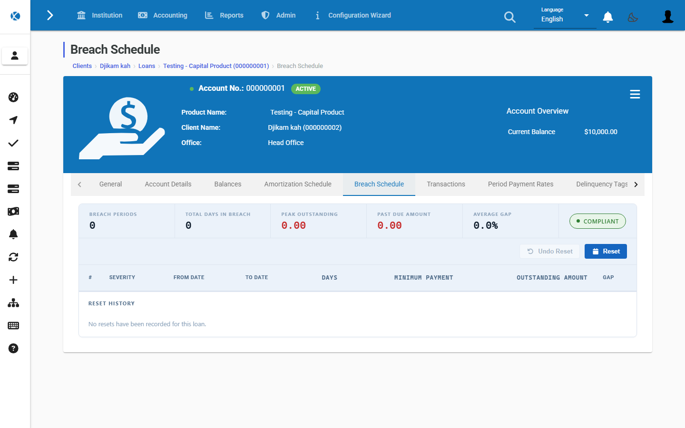
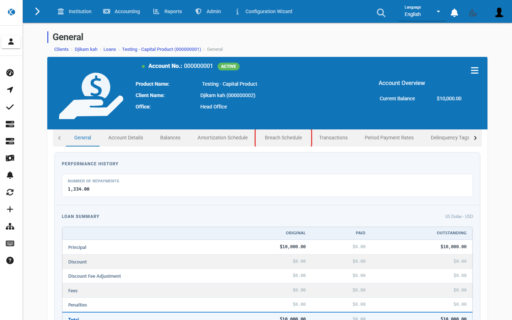
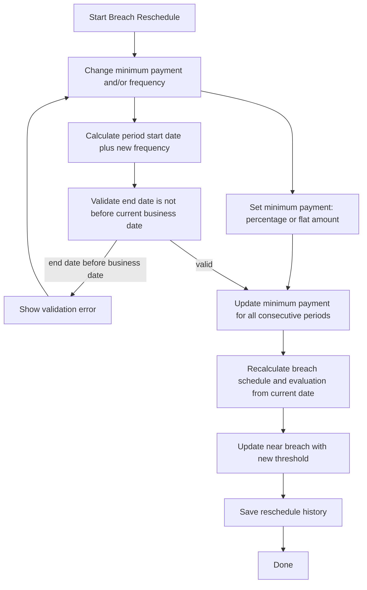
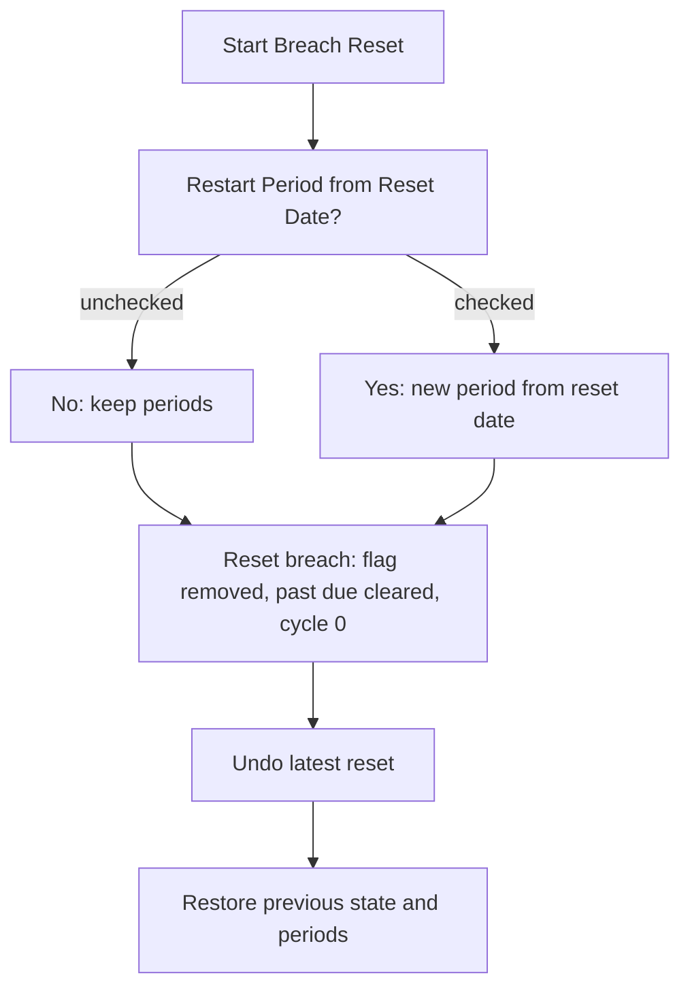

# Breach Management

## Breach Management overview

Breach Management identifies, monitors, and resolves violations of predefined loan conditions and merchant performance thresholds. It detects risk signals such as repayment delays and revenue declines early, so you can take timely corrective action. It also shows expected versus actual payments within defined periods, helping minimize credit losses, maintain portfolio health, and support compliance with internal risk policies.

## Create a breach configuration

Use this screen to set up breach parameters that identify and monitor violations of predefined loan conditions for Working Capital loan products.

1. Select **Admin** > **Products**.
2. Select **Breach Configuration**.

   

3. Enter the details described below, then select **Submit**.

| Field | Required | Description |
| --- | --- | --- |
| Name | Yes | Enter a unique name for the breach configuration. |
| Frequency | Yes | Enter the numeric range interval for the breach period. |
| Frequency Type | Yes | Select the time unit for the range interval, such as days, weeks, or months. |
| Calculation Type | Yes | Choose whether the breach amount is a percentage of the loan amount or a flat amount. |
| Amount | Yes | Enter the breach amount. |

The breach configuration is saved and can be mapped to the relevant loan product.

## View the breach schedule

Use the loan breach schedule tab to see breach periods, totals, timeline severity, and reset history for the loan.

1. Select **Institution** > **Clients** and open the client.
2. Under **Loan Accounts**, select the loan account.
3. Open the **Breach Schedule** tab.

   

The screen shows breach periods, total days in breach, peak outstanding, past due amount, average gap, counts for in breach, near breach, resolved, and compliant periods, the breach timeline by severity, and any recorded resets.

## Manage breach actions for a loan

Use the loan breach actions tab to view and act on breach actions recorded for a loan, including pauses and near breach actions.

1. Select **Institution** > **Clients** and open the client.
2. Under **Loan Accounts**, select the loan account.
3. Open the **Loan Account Actions** menu (the ☰ button next to the account name).
4. Open the **Breach Actions** tab.

The breach action you apply is recorded and reflected in the breach actions list for the loan.

## Breach configuration

Breach configuration lets you set up breach rules at the product level for WC loan products. You can create multiple configurations and map each one to the relevant loan product. Each configuration has a unique name, a breach period and rule, a frequency, a frequency type, a breach amount type, and a breach amount.

| Parameter | Description |
| --- | --- |
| Name | Unique name for the breach configuration |
| Breach period and rule | The period and rule that define when a breach occurs |
| Frequency | Numeric value representing the range interval |
| Frequency Type | Time unit of the range interval, such as days, weeks, or months |
| Breach amount type | Percentage of loan amount or Flat amount |
| Breach amount | The breach amount |

## Breach schedule

The Breach Schedule calculates breach and near breach for working capital loan accounts based on parameters set at Breach configuration. Each row covers one installment period, starting from the disbursement date. A missed payment means no payment received during the expected installment period.

The schedule shows one row per installment period.

| Column | Description |
| --- | --- |
| From Date | Starts from the disbursement date |
| To Date | Period end date of that installment |
| No of Days | Total number of days in the period |
| Min Payment Amount | Calculated based on input parameters |
| Outstanding | Outstanding amount of that period |
| Near breach | True or false |
| Breach | True or false |

The evaluation date is the breach range start date plus frequency plus frequency type. Near breach evaluation runs at the end of every near-breach period frequency as configured.

## Breach evaluation

Breach evaluation runs at the end of every period as of the current date. It checks whether the total payment received in the period meets the minimum payment amount. If the payment is greater than or equal to the minimum payment amount, the period is not a breach. If the payment is less than the minimum payment amount, the period is a breach. Breach status is stored at each period level and does not change if the customer pays an excess amount in another period. The system stores only breach status; it does not store breach days or breach amount.

The system calculates Breach Past Due Amount at the end of each breach period as defined in the breach schedule. The breach schedule start date is calculated based on the selected anchor plus grace days, or a fallback value if no anchor is selected. The period past due amount is the greater of zero and the total amount due in the period minus the total amount paid in the period. Breach Past Due Amount equals the previous period past due amount plus the current period past due amount. The amount never goes negative and carries forward cumulatively across periods until fully resolved or reset.

Breach Past Due Amount is calculated at the end of each period as part of close of business in every scenario. Backdated repayments or adjustments trigger recalculation of Breach Past Due Amount for the affected periods in real time. A breach reschedule recomputes Breach Past Due Amount based on the revised breach schedule. Breach Pause has no impact on the calculation. When Breach Disable is active, the system stops calculating Breach Past Due Amount from the disable date onward.

For breach, incoming payments are allocated only to the current period; payments are not applied to past or future periods. Repayment on past due periods updates the breach past due amount. Otherwise, it is evaluated at period due date close of business.

Breach reset is renamed to Breach Past Due amount reset. When breach past due amount is reset, it is set to zero. Past periods before the reset are not changed.

For breach, past due is cumulative; any unpaid amount from the previous period is carried forward and added to the current period's past due.

Minimum payment amount calculation

| Condition | Minimum payment amount |
| --- | --- |
| Outstanding loan balance is greater than minimum payment amount | Minimum payment amount |
| Outstanding loan balance is not greater than minimum payment amount | Outstanding loan balance |

## Breach Past Due Amount

The Breach Past Due Amount is the amount by which an account remains in breach in the current period.

The amount is made up of two parts:

- Previous Period Past Due Amount is the cumulative past due up to the last completed period.
- Current Period Past Due Amount is the past due calculated for the current period.

The following rules apply:

- Past Due Amount continues to be computed as per defined logic, irrespective of pause periods.
- After a Breach Reschedule, the system recomputes the Breach Past Due Amount based on the revised breach schedule and applicable terms.

## Near Breach

Near Breach is an early warning that a Working Capital loan period is approaching its breach threshold but has not yet breached. It applies only to Working Capital loan products when breach is enabled. The system evaluates each period once against the configured Near Breach Threshold percentage. Near Breach status is stored at each period level and does not change if the customer pays excess in another period.

The period is considered Near Breach when any of the following is true:

- The percentage of outstanding amount in the period is greater than the Near Breach Threshold percentage.
- The percentage of paid amount in the period is lower than the Near Breach Threshold percentage.
- The Near Breach period requirement is 33.33%.
- Near Breach period evaluation is 30.

| Configuration | Description |
| --- | --- |
| Enable Near Breach checkbox | Disabled by default. When enabled, Near Breach Threshold percentage becomes available for configuration. |
| Near Breach Threshold percentage | The threshold used to evaluate whether a period is Near Breach. |
| Near Breach Evaluation Frequency | A Frequency numeric value representing the range interval and a Frequency Type time unit such as days, weeks, or months. |

## Breach grace days and start date

Breach grace days shift the start date of the first breach period when Breach is allowed. If near-breach is allowed, its initial start date shifts by the same number of grace days. The start date type for breach is selectable on the loan product as either the loan creation date or the disbursement date, with the disbursement date used by default when no value is provided.

Breach configuration on the Working Capital Loan product:

| Field | Value |
| --- | --- |
| Breach grace days | 0 |
| Breach period frequency | 90 |
| Breach period frequency term | DAY |

## Breach Reschedule

Breach Reschedule lets you change the minimum payment amount and/or the frequency of the Breach range schedule for a Working Capital loan. You can reschedule an active loan account multiple times, including on the same date, and the system keeps the reschedule history.

You can set the new minimum payment using one of two options:

- Percentage Amount — calculated based on principal plus discount.
- Flat Amount — you enter the new minimum payment amount.

Based on the date you provide, the system targets the appropriate minimum payment or breach ranges and updates the minimum payment amount for all consecutive periods. It recalculates the Breach Schedule and Evaluation from the current date according to the latest reschedule, and updates the near breach using the new breach threshold.

When you change the frequency, the system applies this rule:

- The new period end date is the period start date plus the new frequency.

> **Note:** If the period start date plus the new frequency produces an end date before the current business date, the system shows: “Frequency change results a breach period end date before current business date is not allowed”.

## Breach Pause

Breach Pause temporarily suspends breach tracking for a Working Capital loan. It applies only to the Breach schedule and affects breach evaluation exclusively; it does not affect delinquency, repayment schedules, or other loan calculations. Breach Pause is available only for active loan accounts.

When you apply Breach Pause:

- The pause starts as of the current business date.
- The system extends the Breach range schedule by shifting the active and all future periods forward by the number of pause days.
- The system re-triggers and recomputes breach evaluation for the affected period.

Rules for multiple pauses:

- You can apply multiple Breach Pause records to an account, but overlapping pause periods are not permitted and the system validates this.

Resuming Breach Pause:

- You can resume an active paused Breach at any point within the defined pause period.
- When you resume, the pause ends as of the resume date and the system recalculates breach based on the revised shortened pause duration.
- There is no Undo of Resume, no backdated resume, and multiple resumes are allowed.

Backdated pauses:

- You can apply Breach Pause backdated.
- The system re-triggers and recomputes breach evaluation for the affected period upon application.

UI actions:

- Apply Breach Pause from the UI.
- Resume the active paused Breach from the UI.

## Breach Reset

Breach Reset marks a breached WCP account as regularized once compliance is restored and restarts breach monitoring cycles. The reset occurs on the current system date; backdated resets are not permitted.

A Breach Reset does the following:

- Removes the breach flag.
- Resets the cycle to 0.
- Nullifies all breach records and evaluations prior to the reset date so they are not considered for future breach tracking or calculations.
- Restarts breach evaluation from the current evaluation period.

The following limits apply:

- Only one breach reset per account per day is permitted.

The Restart Period from Reset Date option is optional and presented during the Breach Reset process:

- If not selected, the reset does not change the period dates of the breach schedule and existing breach period calculations continue unchanged.
- If selected, the system considers the Breach Reset Date as the new starting point for breach period calculations, resets all existing breach periods, creates a new breach period starting from the Breach Reset Date, and calculates subsequent breach periods based on this new start date following the existing breach period generation logic.

Undoing or deleting a breach reset:

- Is supported subject to appropriate user permissions and controls.

Reset history:

- All reset history is maintained to help undo or delete the latest reset.
- Backdated actions before the reset are ignored; transaction date matters.

## Breach Disable and re-enable

Breach Disable stops breach evaluation for a loan account, such as during charge-off or write-off. You can apply it only as of the current system date; backdated disable is not permitted. Only a user with the "disable breach" permission or "all functions" permission can perform this action.

While Breach Disable is active:

- Near Breach evaluation stops.
- Breach Reschedule is not permitted.
- Breach Reset is not permitted.
- Breach Pause is not permitted.

Other rules:

- Breach Disable can be applied only once until the current disable is reversed.
- The system maintains history for Breach Disable, like other breach actions.
- Breach Disable can be reversed and applied again as of the current date.

Re-enabling Breach Disable:

- You can re-enable Breach Disable using the BREACH enable action.
- Breach evaluation is re-triggered and recomputed as of the undo date.
- The UI shows the recomputed breach schedule and evaluation.

UI behaviour:

- An authorised user can disable breach evaluation from the UI.
- The UI shows that the breach is disabled and does not show previous evaluation.

## Backdated transactions and reversals

Backdated repayments or reversals trigger reprocessing of the breach schedule and evaluation. They update the affected period's Actual Payment Amount, Past Due Amount, and Breach Status, but do not recalculate subsequent periods or alter the current breach evaluation.

## Delinquency Pause

Delinquency Pause pauses delinquency schedule evaluation and calculation only. It does not affect breach management.

Pause rules:

- You can pause only loans with active status.
- Pause cannot start within an already evaluated range schedule period where minimum payment criteria met is not null.
- Pause periods cannot overlap with other existing pause periods.

## Delinquency Reschedule

Delinquency Reschedule changes the frequency of future delinquency periods. It applies when you reschedule a delinquent loan and does not affect the Breach Schedule of Evaluation.

Rules:

- If multiple reschedule actions exist, the latest one by ID takes precedence for generating new periods during close of business (COB), the nightly job that posts interest and fees.
- Before reschedule, frequency comes from product-level delinquency bucket configuration; after reschedule it uses the new frequency and frequency type from the reschedule action.
- Before reschedule, future periods keep the original schedule; after reschedule they are deleted and regenerated with the new parameters.
- Frequency type must be one of DAYS, WEEKS, MONTHS or YEARS.

## Delinquency Reset

Delinquency Reset restarts delinquency evaluation for an account from the current system date and the current evaluation period. You can reset an account only once per day, and backdated resets are not permitted.

## Delinquency Disable

Delinquency Disable stops changes to a delinquent loan. While it is active, you cannot reschedule, reset or pause delinquency.

Delinquency Disable blocks the following actions:

- Delinquency Reschedule
- Delinquency Reset
- Delinquency Pause

## Delinquency evaluation

Delinquency evaluation applies to Working Capital loans only. The system calculates delinquency on the range schedule created from the loan’s expected period and amount. A minimum payment amount defines the expected paid amount for each interval. If you miss the minimum payment amount, the period goes into delinquency and the system recognizes a past due amount equal to the minimum payment amount minus the amount paid.

Payment allocation and past due calculation work as follows:

- The system allocates incoming payments to the oldest unpaid minimum due period, applying payments to past due periods first, then the current period, and never to future periods.
- The system calculates past due independently for each period and does not carry it forward from previous periods. Period Past Due Amount = Total Amount Due for the Period − Total Amount Paid for the Period.

Reset and backdated transactions behave as follows:

- When a reset is performed, all periods prior to the reset period are nullified for delinquency evaluation, and the system updates the delinquency tag history accordingly.
- Backdated payments or reversals do not affect periods prior to the reset. Delinquency calculations continue from the reset period without re-evaluating earlier periods.

## Breach vs Delinquency comparison

Breach does not keep a history of evaluations.

## Re-age

Re-age regularizes delinquent merchant loan accounts by resetting Days Past Due (DPD) to zero after the borrower meets defined repayment conditions, without restructuring the loan.

After re-age:

- New evaluations commence from the re-age date based on the current outstanding balance.
- Only one re-age per account per day is permitted.
- Near Breach evaluation continues to function as per existing configuration, without interruption or reset.
- Re-age has no impact on the existing breach past due amount, which continues to be tracked independently.

## Hardship Termout

Hardship Termout applies a new breach schedule to a loan. Near Breach Evaluation stops after Hardship Termout is applied, and breach past due amount continues based on the new breach schedule.

## Minimum payment amount

The system recalculates the minimum payment amount when a period is generated after its due date passes, when a reschedule changes the minimum payment amount or frequency, or when a backdated or reversed monetary transaction lowers the outstanding loan balance below the originally calculated minimum payment for that period.

When the minimum payment amount changes, the system also shifts future period start dates to keep periods continuous.

- Future period start dates shift accordingly to maintain continuity.

## Breach UI actions

Working Capital loans include Breach and Near Breach actions on the Loan details view, available from the Breach tags tab or Near Breach tags tab, or from the top right corner menu.

The Breach menu option lets you change:

- Breach
- Frequency
- Breach amount

The Near Breach menu option lets you change:

- Near Breach Threshold percentage
- Frequency

The system keeps a history of Near Breach changes, showing what actions were made with what values.

## Delinquency UI actions

You can reset delinquency from the UI and view the reset delinquency data. You can undo or delete only the latest delinquency reset. Only users with the required permissions or super users can perform these actions.

Breach evaluation shows the following parameter:

- Breach Past Due amount

## Worked examples

A Working Capital loan of 1,000 is disbursed on 1 January. The breach condition is 50 percent of the outstanding amount every 60 days, so the minimum payment is 500 per period. Using 30-day months, the first period runs from 1 January to 1 March, the second from 2 March to 1 May, and the third from 2 May to 1 July. The figures are illustrative. The example shows that unpaid minimums accumulate across periods, while a period that meets its minimum is not itself a breach even though older past due remains.

| Period | From | To | Min payment | Paid | Period past due | Cumulative past due | Breach |
| --- | --- | --- | --- | --- | --- | --- | --- |
| 1 | 1 Jan | 1 Mar | 500.00 | 300.00 | 200.00 | 200.00 | Y |
| 2 | 2 Mar | 1 May | 500.00 | 100.00 | 400.00 | 600.00 | Y |
| 3 | 2 May | 1 Jul | 500.00 | 500.00 | 0.00 | 600.00 | N |

The same 1,000 loan with a 50 percent every 60 days breach condition has its first period running from 1 January to 1 March. A breach pause is applied from 15 February to 19 February, five days. During the pause, the active and all future periods shift forward by five days, so the first period ends on 6 March and the second runs from 7 March to 6 May. Breach past due calculation continues as if the pause had not changed the amounts; only the dates move. Changing the pause length would shift every subsequent date by the same number of days.

| Period | Original from | Original to | Pause days | Shifted from | Shifted to |
| --- | --- | --- | --- | --- | --- |
| 1 | 1 Jan | 1 Mar | 5 | 1 Jan | 6 Mar |
| 2 | 2 Mar | 1 May | 5 | 7 Mar | 6 May |

After two breach periods, the account carries a breach past due of 600. On 1 July, an officer performs a breach reset. The reset date is the current date. All prior breach periods remain on record for audit, but the past due amount is set to 0 and the cycle restarts. The next period begins on 1 July and runs to 30 August with a minimum payment of 500. If the restart option were not selected, the old period dates would continue instead of beginning again on the reset date.

| Event | Date | Past due before | Past due after | Breach cycle |
| --- | --- | --- | --- | --- |
| Period 1 evaluated | 1 Mar | 0.00 | 200.00 | Active |
| Period 2 evaluated | 1 May | 200.00 | 600.00 | Active |
| Breach reset | 1 Jul | 600.00 | 0.00 | Restarted |
| Period 3 evaluated | 30 Aug | 0.00 | 0.00 | Active |

A 1,000 Working Capital loan has a breach condition of 50 percent every 60 days, so the minimum payment is 500 per period. Near breach is configured every 30 days at 70 percent of the breach minimum. The first evaluation falls on day 30, when 33 percent of 500 (165) is expected; the second falls on day 60, when 66 percent of 500 (330) is expected. If the merchant pays less than the expected share at an evaluation point, the period is flagged near breach. A longer near-breach frequency would move each evaluation point later and reduce the number of warnings before the period ends.

| Evaluation day | From breach start | Expected share | Paid | Near breach |
| --- | --- | --- | --- | --- |
| 30 | Day 30 | 165.00 | 100.00 | Y |
| 60 | Day 60 | 330.00 | 400.00 | N |

See also: [Projected Balances](confluence-link:Projected%20Balances).
