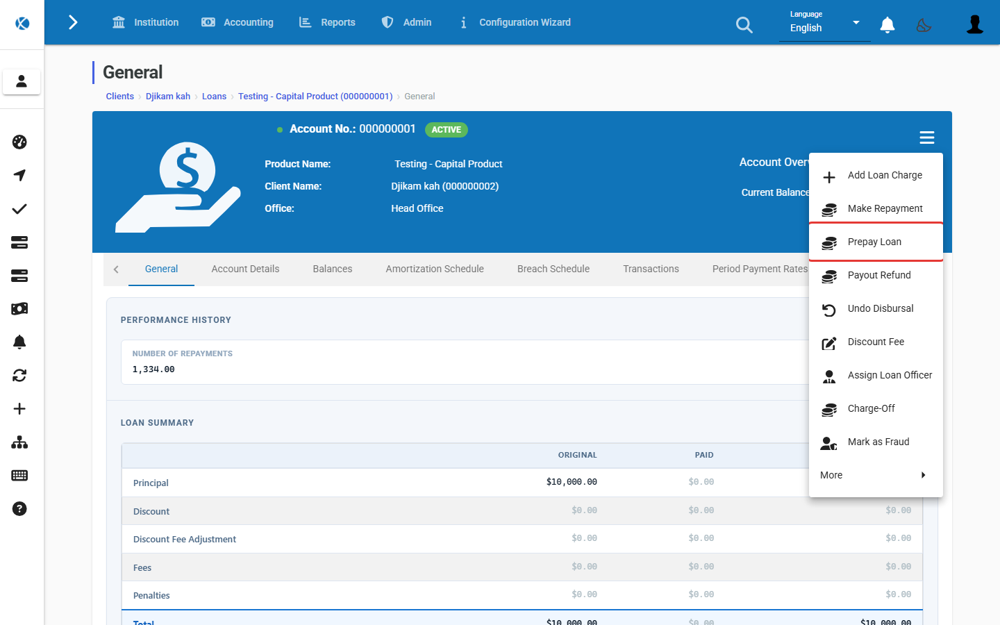
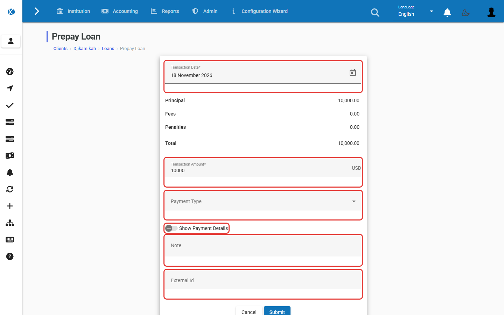
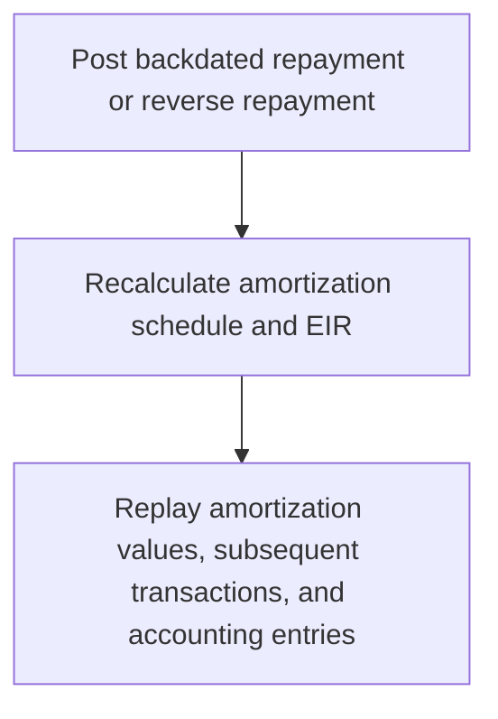
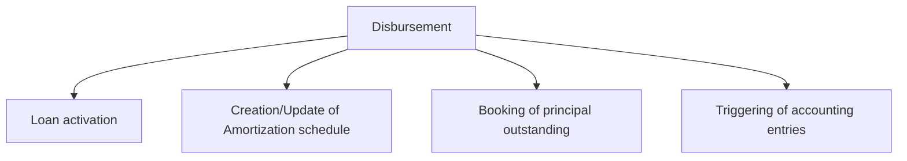
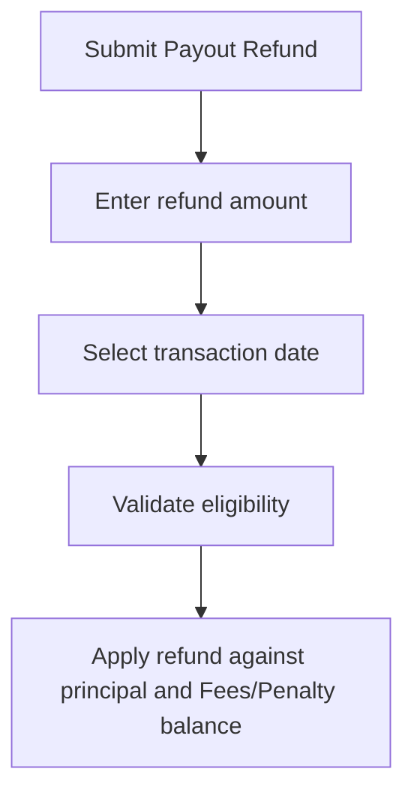

# Transaction Types

## Transaction types overview

Transaction types record money movements and account changes at loan account level. Monetary types include Disbursement, Repayment, Discount fees Amortization, Prepayment, Charge Adjustment, Discount Fees, Credit Balance Refund, Goodwill Credit Transaction, Recovery Payment (post write-off), and Payout Refund. Non-monetary types include Charge Application, Charge Waiver, Write-Off / Charge-Off, and Adjustments / Reversals. All transaction types follow APIs and parameters consistent with term loan product implementations.

Transaction date rules:

- The transaction date must not precede the loan disbursement date.
- The transaction date must comply with backdating rules.
- Transactions are allowed only for valid loan states: Active, Charged-Off (with restrictions), and Written-Off (restricted to recovery transactions).

Allocation and reversal:

- Transaction allocation distributes amounts into Penalties, Fees, and Principal.
- The priority order for allocation is configurable at Transaction level.
- Transactions can be reversed subject to no dependency conflicts and valid loan status.

Backdated transactions are supported for most transaction types. Every transaction triggers Journal Entries (JE) based on configuration.

## Prepay a loan

Use this screen to record a prepayment against a loan account, entering the date and amount and choosing how the payment is classified.

1. Select **Institution** > **Clients** and open the client.
2. Under **Loan Accounts**, select the loan account.
3. Open the **Loan Account Actions** menu (the ☰ button next to the account name).
4. Select **Prepay Loan**.

   

5. Enter the details described below, then select **Submit**.

| Field | Required | Description |
| --- | --- | --- |
| Transaction Date | Yes | Enter the date of the prepayment transaction. This field is required. |
| Transaction Amount | Yes | Enter the prepayment amount. This field is required. |
| Payment Type | No | Select the payment type used for the prepayment. |
| Classification | No | Select the classification for the prepayment transaction. |
| Show Payment Details | No | Choose whether to show payment details. |
| Account | No | Select the loan account to which the prepayment applies. |
| Cheque | No | Enter cheque details if paying by cheque. |
| Routing Code | No | Enter the routing code for the payment. |
| Receipt | No | Enter the receipt number for the prepayment. |
| Bank | No | Select the bank used for the payment. |
| Note | No | Enter a note for the prepayment transaction. |
| External Id | No | Enter an external identifier for the prepayment transaction. |

The prepayment is posted to the loan account and allocated across principal, fees, and penalties according to the configured allocation priority.

## Record a recovery payment

Use this screen to record money collected after a loan has been written off; the loan stays closed with a zero balance and only the recovered total changes.

1. Select **Institution** > **Clients** and open the client.
2. Under **Loan Accounts**, select the loan account.
3. Open the **Loan Account Actions** menu (the ☰ button next to the account name).
4. Select **Recovery Payment**.
5. Enter the details described below, then select **Submit**.

| Field | Required | Description |
| --- | --- | --- |
| Transaction Date | Yes | Enter the date of the recovery payment. |
| Transaction Amount | Yes | Enter the amount recovered. |
| Payment Type | No | Select the payment type. |
| Show Payment Details | No | Choose whether to show payment details. |
| Account | No | Select the loan account receiving the recovery payment. |
| Cheque | No | Enter cheque details if paying by cheque. |
| Routing Code | No | Enter the routing code for the payment. |
| Receipt | No | Enter the receipt number or details. |
| Bank | No | Enter the bank receiving or processing the payment. |
| Note | No | Enter a note about the recovery payment. |
| External Id | No | Enter an external identifier for the recovery payment. |

The recovery payment is recorded and the recovered total on the written-off loan is updated while the loan remains closed with a zero balance.

## Repayment

A Repayment transaction records money paid toward a loan. You can post a repayment on an active loan account or on a closed or charged-off loan account. Repayment reduces the outstanding balance, updates the amortization schedule, allocates the payment across components, posts discount fees amortization, and triggers accounting entries. Real-time allocation covers Principal and Deferred Income Amortization. Accounting is the same as existing, the transaction is the same as existing, and balances are new based on the balances table. You can view repayments on the transaction tab and undo a repayment transaction.

Repayment types include:

- Regular repayment.
- Partial payment.
- Excess payment or advance payment.

A Repayment transaction requires:

- Transaction amount.
- Transaction date.
- Classification.
- Payment type.

Repayment rules:

- Repayment amount must be greater than zero.
- Repayment amount follows the allocation strategy set for the Repayment transaction type; otherwise it follows the default strategy.

Repayment reversal:

- Repayment reversal creates a linked reversal transaction.
- Repayment reversal reverses allocated components such as penalty, fee, and principal.
- Repayment reversal reverses the outstanding balance impact.
- Repayment reversal reverses accounting entries.
- Repayment reversal reprocesses the amortization schedule.
- Repayment reversal replays subsequent transactions if applicable.

Backdated repayments:

- The system reprocesses the schedule.
- The system replays all subsequent transactions and accounting entries.

## Undoing and reversing transactions

Rules for undoing a transaction:

- Only non-reversed transactions can be undone.
- A reversal external ID can be provided or auto-generated where applicable.
- You can add a note, which is created accordingly.

Fields supported when undoing a transaction:

| Field | Description |
| --- | --- |
| Reversal external ID | Provided by you or auto-generated where applicable. |
| Note | Supported and created accordingly. |

## Discount fee

A Discount fee transaction reduces the amount disbursed on a loan.

Rules for Discount fee transactions:

- Only one Discount transaction is allowed per Disbursement, and a relation is made between them.
- Real-time allocation for Discount covers Principal.

> **Note:** When overriding select terms and settings in loan accounts is disabled, creating a loan account with discount set up results in an error.

## Credit Balance Refund

A Credit Balance Refund returns an overpaid amount on a loan. It requires the transaction amount, transaction date, classification, and payment type, and allocates in real time to Overpayment.

Accounting follows the existing approach, and balances and status change are new based on the balances table with WC loan details.

## Disbursement

A disbursement pays out the loan principal to the borrower.

> **Note:** You cannot undo a disbursement if any monetary transaction other than Disbursement or Discount exists on the account.

## Charge Adjustment

Charge Adjustment pays down an existing charge on a loan.

## Discount fee adjustment

A Discount fee adjustment reduces the principal balance.

## Transaction allocation

Transaction allocation decides how a payment applies to principal and charges on a loan. Allocation changes only when charges exist on the loan and a backdated transaction occurs, based on the new chronological order and whether the backdated transaction pays any portion of the charge.

## Payout Refund

Use Payout Refund to recover disbursed funds from fraudulent WCP loan accounts.

You can enter:

- A refund amount.
- A transaction date.

## Charge-off and write-off

Charge-off moves a loan account from Active Delinquent to Charged-Off, removes outstanding balances from the loan asset books, and posts accounting entries according to the configured charge-off journal entry rules.

## Charges

A Charge Transaction applies fees or penalties to a loan account.

Accounting entries are created as follows:

| Charge type | Accounting entry date |
| --- | --- |
| Disbursement Charge | Transaction date |
| Specific due date charge | Submitted date |

## Disbursement reversal

You can reverse a disbursement.

## Charge Adjustment reversal

You can reverse any Charge Adjustment on an active or closed loan account.

## Disbursement accounting

A disbursement posts two journal entries: it debits GL 112601 Loans Receivable Principal and credits GL 145023 Suspence/clearing account.

## Repayment accounting

Repayment posts the payment to the suspense/clearing account and reduces the loan principal, while any excess goes to the other credit liability account and fees and penalties go to fee receivable.

| Transaction | Debit GL | Credit GL |
| --- | --- | --- |
| Repayment | GL 145023 Suspence/clearing account (Asset/Liability, Prin, Fees, Penalty and excess) | GL 112601 Loans Receivable Principal (Asset, Prin); GL 245000 Other Credit liability (Liability, excess); GL 112603 Fee Receivable (Asset, Penalty); GL 112603 Fee Receivable (Asset, fees) |
| Repayment Reversal | GL 112601 Loans Receivable Principal (Asset, Prin); GL 245000 Other Credit liability (Liability, excess); GL 112603 Fee Receivable (Asset, fees); GL 112603 Fee Receivable (Asset, Penalty) | GL 145023 Suspence/clearing account (Asset/Liability, Prin, Fees, Penalty and excess) |

## Write-off accounting

A write-off removes the principal, fees and penalty from the loan balance by posting them to recoveries.

Accounting entries

| Transaction | Debit | Credit |
| --- | --- | --- |
| Write-off | GL 744008 recoveries (Expense, Prin, fees, and Penalty) | GL 112603 Fee Receivable (Asset, fees); GL 112603 Fee Receivable (Asset, Penalty); GL 112601 Loans Receivable Principal (Asset, Prin) |
| Write-off Reversal | GL 112601 Loans Receivable Principal (Asset, Prin); GL 112603 Fee Receivable (Asset, fees); GL 112603 Fee Receivable (Asset, Penalty) | GL 744008 recoveries (Expense, Prin, fees, and Penalty) |

## Credit Balance Refund accounting

A Credit Balance Refund debits GL 245000 Other Credit liability and credits GL 145023 Suspence/clearing account.

## Charge accounting

Charge accounting posts a charge addition to Fee Receivable and Fee Income, and a charge waiver reverses those entries.

| Action | Debit GL | Credit GL |
| --- | --- | --- |
| Charge addition | 112603 Fee Receivable (Asset, fees) | 404007 Fee Income (Income, fees) |
| Charge waive | 404007 Fee Income (Income, fees) | 112603 Fee Receivable (Asset, fees) |

## Charge-off accounting

Charge-off accounting moves overdue principal, fees and penalty from the loan receivable accounts to credit loss and charge-off income accounts.

| Transaction | Debit accounts | Credit accounts |
| --- | --- | --- |
| Charge-off | GL 744007 Credit loss-bad dept (Expense, Prin), GL 744037 Credit loss-bad dept- fraud (Expense, Prin), GL 404008 Fee Charge off (Income, fees), GL 404008 Fee Charge off (Income, Penalty) | GL 112601 Loans Receivable Principal (Asset, Prin), GL 112603 Fee Receivable (Asset, fees), GL 112603 Fee Receivable (Asset, Penalty) |
| Charge-off Reversal | GL 112603 Fee Receivable (Asset, fees), GL 112603 Fee Receivable (Asset, Penalty) | GL 112601 Loans Receivable Principal (Asset, Prin), GL 404008 Fee Charge off (Income, fees), GL 404008 Fee Charge off (Income, Penalty) |

## Repayment after charge-off accounting

Repayment after charge-off records money received on a charged-off loan.

| Transaction | Debit | Credit |
| --- | --- | --- |
| Repayment after charge-off | GL 145023 Suspence/clearing account (Asset/Liability, Prin, Fees, Penalty and excess) | GL 744008 recoveries (Income, Prin); GL 245000 Other Credit liability (Liability, excess); GL 744008 recoveries (Income, Penalty); GL 744008 recoveries (Income, fees) |
| Repayment reversal after charge-off | GL 744008 recoveries (Income, Prin); GL 245000 Other Credit liability (Liability, excess); GL 744008 recoveries (Income, Penalty); GL 744008 recoveries (Income, fees) | GL 145023 Suspence/clearing account (Asset/Liability, Prin, Fees, Penalty and excess) |

## Credit Balance Refund after charge-off accounting

A credit balance refund after charge-off debits GL 245000 Other Credit liability and credits GL 145023 Suspence/clearing account.

## Goodwill Credit after charge-off accounting

Goodwill Credit after charge-off posts accounting entries that adjust principal, fees and penalties against recoveries and other credit liability.

| Transaction | Debit (Dr) | Credit (Cr) |
| --- | --- | --- |
| Goodwill Credit after charge-off | GL 744003 Principal bal adjustment (Expense, Prin,excess); GL 404008 Fee Charge off (Income, fees); GL 404008 Fee Charge off (Income, Penalty) | GL 744008 recoveries (Income, prin); GL 744008 recoveries (Income, fees); GL 744008 recoveries (Income, Penalty); GL 245000 Other Credit liability (Liability, excess) |
| Goodwill Credit Reversal after charge-off | GL 744008 recoveries (Income, prin); GL 744008 recoveries (Income, fees); GL 744008 recoveries (Income, Penalty); GL 245000 Other Credit liability (Liability, excess) | GL 404008 Fee Charge off (Income, fees); GL 404008 Fee Charge off (Income, Penalty) |

## Discount fee accounting

Discount fee accounting records how discount fees move between general ledger accounts when they are charged, adjusted, or amortized into interest income.

| Transaction | Debit account | Credit account |
| --- | --- | --- |
| Discount fees | 112601 Loans Receivable Principal (Asset, Prin, Fees, and Penalty) | 240005 Deferred Interest (Liability, Prin, Fees, and Penalty) |
| Discount fees Adjustment | 240005 Deferred Interest (Liability, Prin, Fees, and Penalty) | 112601 Loans Receivable Principal (Asset, Prin, Fees, and Penalty) |
| Amortization | 240005 Deferred Interest (Liability, Int) | 404000 Interest income (Income, Int) |
| Amortization after charge-off | 240005 Deferred Interest (Liability, Int) | 404000 Interest income (Income, Int) |

## Payout Refund accounting

| Account status | Charge type | Debit GL | Credit GL |
| --- | --- | --- | --- |
| Active | Penalty | 145023 | 112603 |
| Active | Fees | 145023 | 112603 |
| Active | Principal | 145023 | 112601 |
| Active | Unallocated Credit (UNC) | 145023 | 245000 |
| Charge-off | Penalty | 145023 | 404008 |
| Charge-off | Fees | 145023 | 404008 |
| Charge-off | Principal | 145023 | 744007/740037 |
| Charge-off | Unallocated Credit (UNC) | 145023 | 245000 |

| Account status | Charge type | Debit GL | Credit GL |
| --- | --- | --- | --- |
| Active | Penalty | 112603 | 145023 |
| Active | Fees | 112603 | 145023 |
| Active | Principal | 112601 | 145023 |
| Active | Unallocated Credit (UNC) | 245000 | 145023 |
| Charge-off | Penalty | 404008 | 145023 |
| Charge-off | Fees | 404008 | 145023 |
| Charge-off | Principal | 744007/740037 | 145023 |
| Charge-off | Unallocated Credit (UNC) | 245000 | 145023 |

## Goodwill Credit accounting summary

Goodwill Credit debits Principal bal adjustment GL 744003 and Fee Charge off GL 404008, and credits Loans Receivable Principal GL 112601, Fee Receivable GL 112603, and Other Credit liability GL 245000.

Goodwill Credit accounting entries

| Debit GL | GL name | Type | Applies to |
| --- | --- | --- | --- |
| 744003 | Principal bal adjustment | Expense from Goodwill Credit | Prin,excess |
| 404008 | Fee Charge off | Income from Goodwill Credit Fees | fees |
| 404008 | Fee Charge off | Income from Goodwill Credit Penalty | Penalty |

Credit entries

| Credit GL | GL name | Type | Applies to |
| --- | --- | --- | --- |
| 112601 | Loans Receivable Principal | Loan Portfolio | prin |
| 112603 | Fee Receivable | Fees Receivable | fees |
| 112603 | Fee Receivable | Penalty Receivable | Penalty |
| 245000 | Other Credit liability | Overpayment Liability | excess |

## Backdated transactions

## Disbursement effects

## Prepayment

Prepayment pays off a loan in full before its scheduled end date.

## Payout Refund submission

## Transaction display and UI

Transactions appear in chronological order by transaction date. You can filter by type and date range, drill down to detailed transaction data, and follow the linkage between an original transaction and its reversal.

## Transaction lifecycle

A loan account can have transactions only while it is open.

## Repayment accounting summary

| GL code | Account name | Mapped to | Debit or credit | Applies to |
| --- | --- | --- | --- | --- |
| 145023 | Suspence/clearing account | Fund source | Debit | Principal, fees, penalty and excess |
| 744008 | Recoveries | Income from Recovery Repayment | Credit | Principal, penalty and fees |
| 245000 | Other Credit liability | Overpayment Liability | Credit | Excess |

## Repayment reversal accounting summary

| Amount | Debit GL code | Debit mapping | Credit GL code | Credit mapping |
| --- | --- | --- | --- | --- |
| Principal | 744008 | Income from Recovery Repayment for Prin. | 145023 | Fund source |
| Fees | 744008 | Income from Recovery Repayment for fees | 145023 | Fund source |
| Penalty | 744008 | Income from Recovery Repayment for Penalty | 145023 | Fund source |
| Excess | 245000 | Overpayment Liability | 145023 | Fund source |

## Goodwill Credit reversal accounting summary

| Amount type | Debit GL code | Debit mapping | Credit GL code | Credit mapping |
| --- | --- | --- | --- | --- |
| Principal | 744008 | Income from Recovery Repayment |  |  |
| Fees | 744008 | Income from Recovery Repayment | 404008 | Income from Goodwill Credit Fees |
| Penalty | 744008 | Income from Recovery Repayment | 404008 | Income from Goodwill Credit Penalty |
| Excess | 245000 | Overpayment Liability |  |  |

## Goodwill Credit user actions

Goodwill Credit lets you credit a loan account without applying charges. You can do it on active and closed or charge-off loan accounts. You can view the transaction on the transaction tab and undo it. Reversal of a Goodwill Credit transaction is allowed.

## Charge Adjustment user actions

## Payout Refund user actions

## Disbursement definition

## Discount fees transaction definition

## Credit balance

## Goodwill Credit definition

## Goodwill Credit effects

## Charges definition

## Charges tax-inclusive

## Charges waiver

## Abbreviations

| Abbreviation | Meaning |
| --- | --- |
| WCP | Working Capital Product |
| TPV | Total Payment Volume |

## Worked examples

A loan officer posts two repayments on an active loan with a principal balance of 1,000.00. The first repayment of 300.00 is allocated as 50.00 toward a fee and 250.00 toward principal. The second repayment of 200.00 is applied entirely to principal because the fee is already settled. When the first repayment is reversed, the system undoes its fee and principal portions and reprocesses the second repayment against the now-outstanding fee. The figures in this example are illustrative.

| Step | Transaction | Amount | Fee portion | Principal portion | Principal balance |
| --- | --- | --- | --- | --- | --- |
| 1 | Disbursement | 1,000.00 | 0.00 | 0.00 | 1,000.00 |
| 2 | Repayment 1 | 300.00 | 50.00 | 250.00 | 750.00 |
| 3 | Repayment 2 | 200.00 | 0.00 | 200.00 | 550.00 |
| 4 | Reverse Repayment 1 | -300.00 | -50.00 | -250.00 | 800.00 |
| 5 | Reprocess Repayment 2 | 200.00 | 50.00 | 150.00 | 850.00 |

Reversing Repayment 1 causes Repayment 2 to be reprocessed as 50.00 fee and 150.00 principal; if Repayment 2 is backdated before Repayment 1 instead, it pays the same 50.00 fee and 150.00 principal, while Repayment 1 pays 300.00 principal, leaving a final principal balance of 550.00 instead of 850.00.

A loan officer disburses 1,000.00 on a working capital loan. An upfront charge of 100.00 is added at disbursement, and a discount fee of 50.00 is applied in the same step. The disbursement transaction allocates its full amount to principal, the charge adds to the fee balance, and the discount fee transaction allocates to principal while creating a matching deferred income liability. If no charge is added, the charge step is omitted; if no discount fee is set, the discount step is omitted and only the disbursement transaction is posted.

| Step | Transaction | Amount | Principal portion | Fee portion |
| --- | --- | --- | --- | --- |
| 1 | Disbursement | 1,000.00 | 1,000.00 | 0.00 |
| 2 | Upfront charge | 100.00 | 0.00 | 100.00 |
| 3 | Discount fee | 50.00 | 50.00 | 0.00 |
| Total |  | 1,150.00 | 1,050.00 | 100.00 |

See also: [Delinquency Restrictions](confluence-link:Delinquency%20Restrictions), [Breach Management](confluence-link:Breach%20Management), [Accounting](confluence-link:Accounting), [Projected Balances](confluence-link:Projected%20Balances).
