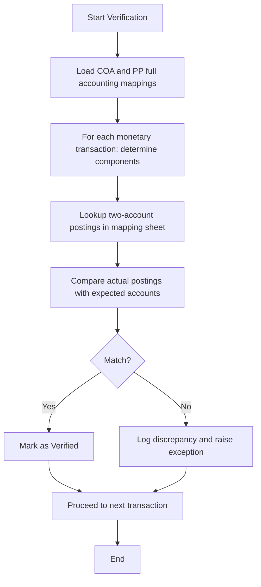

# Interest Bearing Accounting entries verification for all Monetory transactions

This page documents the verified behavior of Pepper-Soup's accounting verification workflow for all monetary transactions that include interest-bearing components. The verification relies on two primary artifacts defined in the reference data: the Chart of Accounts (COA) and the two-account postings specified in the PP full accounting mapping. The aim is to verify that every monetary event—such as disbursements, repayments, refunds, and charge-offs—produces postings to the correct GL accounts with correct debits and credits, including the components related to interest, penalties, and recoveries.

### Foundations: Chart of Accounts and mapping artefacts

The Chart of Accounts (COA) defines the GL accounts used by the system and their types. The accounting verification relies on the following representative accounts and types:

- 112601 Loans Receivable — Asset
- 145023 Suspense/Clearing account — Suspense/clearing account
- 112603 Fee Receivable — Asset
- 245000 Other Credit liability — Liability
- 744003 Principal bal adjustment — Expense
- 404000 Interest income — Income
- 404001 Interest income charge off — Income
- 404007 Fee Income — Income
- 404011 Fee Income — Income
- 404008 Fee Charge off — Income
- 744008 Recoveries — Expense
- 744007 Credit Loss/Bad Debt — Expense
- 744037 Credit Loss/Bad Debt Fraud — Expense
- 145800 Other receivables — Asset

These accounts provide the anchor against which postings are validated. The presence and type of each account constrain how principal, interest, fees, penalties, recoveries, and overpayments are represented in the ledger as part of the verification process.

The PP full accounting sheet provides the concrete pairings of GL accounts used to post each monetary transaction category. Each line defines two GL accounts that correspond to the two postings (the debit-side account and the credit-side account) to be generated for that transaction type, along with contextual fields such as cash direction and fund source.

### Representative transaction mappings (conceptual)

The following representative mappings illustrate how the two-account postings tie to typical monetary events. The mapping lines come from the PP full accounting sheet and show the two GL accounts involved for the most common components. The labels reflect the transaction type and the component being posted.

- Loan Disbursement (Principal)
 - Accounts involved: 112601 Loans Receivable and 145023 Suspense/Clearing account
 - Interpretation: The principal of a new loan is posted as an increase in Loans Receivable with a balancing entry to the Suspense/Clearing account.

- Transaction Refund/Provisional Credit (Interest - Repayment)
 - Accounts involved: 145023 Suspense/Clearing account and 112603 Interest Receivable
 - Interpretation: Interest repayment increases Interest Receivable and clears the clearing account.

- Transaction Refund/Provisional Credit (Principal Payment)
 - Accounts involved: 145023 Suspense/Clearing account and 112601 Loans Receivable
 - Interpretation: Principal repayment reduces Loans Receivable with the counterpart entry to the clearing account.

- Merchant Refund (Interest portion)
 - Accounts involved: 145023 Suspense/Clearing account and 404001 Interest income charge off
 - Interpretation: The interest portion of a merchant refund is posted against the interest-income-related account as an offset through the clearing account.

- Overpayment or Unallocated Credit (UNC)
 - Accounts involved: 145023 Suspense/Clearing account and 245000 Overpayment Liability
 - Interpretation: Unallocated credits or overpayments are tracked against the Overpayment Liability, with clearing-account movement to reconcile cash and ledger state.

These example pairings demonstrate the pattern: each monetary event is represented by two postings to two GL accounts defined in the two-entry mapping. The precise account pairings for all categories are enumerated in the PP full accounting sheet (the reference data), and the COA provides the account types and descriptions that drive verification expectations.

### Verification process and runtime behavior (architecture-leaning overview)

The verification workflow operates by cross-referencing monetary transactions against the two-account postings defined in the PP full accounting sheet and validated against the COA. For every monetary transaction, the verifier determines the relevant components (principally principal, interest, fees, penalties, recoveries, and any UNC adjustments) and applies the associated two-account posting from the mapping. The verification checks include:

- Account mapping consistency: The accounts used in the actual postings must correspond to the two-account pair defined by the transaction category in the PP full accounting mapping.
- Balance integrity: The postings must balance (the debit and credit sides must reconcile to zero net effect within the posting envelope).
- Component segregation: Principal, interest, fees, penalties, and recoveries are identified and posted to their designated GL accounts as per the mapping rules.
- Cash-flow consistency: The involved clearing or suspense accounts reflect movement consistent with cash in and cash out directions described by the transaction type.

The integrity guarantees applicable to all verifications are described in the reference guidance as follows:

- Each period's opening balance must equal the previous period's closing balance.
- Payment allocations must reconcile with the transaction amount.
- Remaining cash and outstanding dues must reconcile.
- Journal entries must balance when debit and credit data are available.
- Intermediate calculations, running balances, totals, precision, and rounding must be verified.
- Rounding must follow established conventions (HALF_UP or HALF_EVEN).

Where entries exist for charge-off and related recoveries, the mapping verifies the standard GL accounts are used for both the expense and income sides (for example credit losses, recoveries, and related charge-off expense lines).

### Example of the verification workflow (diagrammatic overview)

Mermaid diagrams are used to illustrate the verification flow and decision points. The following diagram depicts the verified verification loop:

This diagram captures the core steps a verifier follows: load the definitive mappings, decompose the transaction, apply the mapped postings, compare with actual ledger entries, and handle mismatches or proceed on success.

### Data structures and persistence (verified behavior)

- Chart of Accounts (COA) provides the canonical GL accounts and their types (Asset, Liability, Income, Expense, etc.). The entries listed in the COA sheet are the reference for validating postings in all monetary transactions, including interest-bearing activity and charge-offs.
- PP full accounting defines the transactional mappings used to post two GL accounts per monetary event. Each line represents a transaction type and component paired with two GL accounts, which serve as the expected debit and credit postings for that event.
- The verification process compares the ledger postings against these two-account mappings to confirm consistency and financial integrity. No additional fields beyond the two-account pairings are introduced by the verified behavior described in the reference data.

The integration points implied by the reference data are limited to the accounting domain: loading the COA, loading the two-account mappings from PP full accounting, decomposing the monetary transaction into components, and validating that the two postings follows the mapping and with ledger balance requirements.

### Safety, retries, and observability (as evidenced)

The reference data provided does not document retry policies, compensating transactions, or explicit domain events or audit logs emitted by the verification process. Therefore, the publication of such behaviors is not included here as verified behavior. If those artifacts exist, they would be described in separate, -backed documentation.

### Appendix: Selected COA table (glossary-style reference)

 
GL Account112601

 
DescriptionLoans Receivable

 
GL TypeAsset

 
GL Account145023

 
DescriptionSuspense/Clearing account

 
GL TypeSuspense/clearing

 
GL Account112603

 
DescriptionFee Receivable

 
GL TypeAsset

 
GL Account245000

 
DescriptionOther Credit liability

 
GL TypeLiability

 
GL Account404001

 
DescriptionInterest income charge off

 
GL TypeIncome

 
GL Account404000

 
DescriptionInterest income

 
GL TypeIncome

 
GL Account744007

 
DescriptionCredit Loss/Bad Debt

 
GL TypeExpense

### Appendix: Representative PP full accounting mappings (illustrative)

The PP full accounting sheet defines two GL accounts per monetary event to represent the debit and credit postings. Representative examples include:

- Loan Disbursement, Principal component: 112601 Loans Receivable and 145023 Suspense/Clearing account
- Transaction Refund/Provisional Credit, Interest - Repayment: 145023 Suspense/Clearing account and 112603 Interest Receivable
- Merchant Refund, Interest portion: 145023 Suspense/Clearing account and 404001 Interest income charge off
- Unallocated Credit (UNC): 145023 Suspense/Clearing account and 245000 Overpayment Liability

The full, line-by-line mappings are defined in the PP full accounting sheet within the reference data and are relied upon during verification.

### Summary of verification intent

The verification process verifies that every monetary transaction with an interest-bearing component is represented in the ledger by a precise, two-account posting defined in the mapping, anchored to the Chart of Accounts. This guarantees traceability from each transaction to its GL impact, preserves period-end balance integrity, and maintains clear separation of principal, interest, fees, penalties, and recoveries in the financial records.